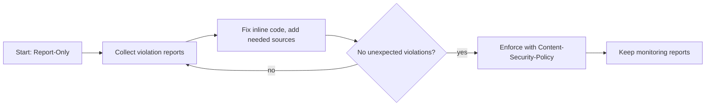

# 03. HTTP Security Headers and CSP

Response headers tell the browser how strictly to treat your site. They are cheap, high-value hardening and are exactly what [[7. Siteward Web Security Scanner|Siteward Web Security Scanner]] checks. Attacks they limit are in [[2. Web Application Security|02. Web Application Security]].

## Headers at a glance

| Header | Protects against | Typical value |
| ------ | ---------------- | ------------- |
| **Content-Security-Policy** | XSS, data injection, clickjacking | See below |
| **Strict-Transport-Security** (HSTS) | Downgrade to HTTP, SSL stripping | `max-age=31536000; includeSubDomains` |
| **X-Content-Type-Options** | MIME sniffing | `nosniff` |
| **X-Frame-Options** | Clickjacking (older; CSP `frame-ancestors` supersedes) | `DENY` or `SAMEORIGIN` |
| **Referrer-Policy** | Leaking URLs to other sites | `strict-origin-when-cross-origin` |
| **Permissions-Policy** | Unwanted use of camera, mic, geolocation | `camera=(), microphone=(), geolocation=()` |
| **Cross-Origin-Opener-Policy** | Cross-window attacks | `same-origin` |
| **Cross-Origin-Resource-Policy** | Other sites embedding your resources | `same-origin` or `same-site` |
| **Cross-Origin-Embedder-Policy** | Needed for cross-origin isolation | `require-corp` |
| **Cache-Control** | Sensitive pages cached or shared | `no-store` on private pages |

Also remove information leaks: `Server` version and `X-Powered-By`.

---

# Content Security Policy (CSP)

CSP is an **allow-list of where content may load from and what may run**. If an attacker injects a `<script>`, the browser refuses to run it because it is not on the list. It is a second line behind output encoding, not a replacement.

```
Content-Security-Policy:
  default-src 'self';
  script-src 'self' 'nonce-r4nd0m';
  style-src 'self';
  img-src 'self' data:;
  connect-src 'self';
  font-src 'self';
  object-src 'none';
  base-uri 'self';
  form-action 'self';
  frame-ancestors 'none';
  upgrade-insecure-requests
```

## Directives

| Directive | Controls |
| --------- | -------- |
| `default-src` | Fallback for any fetch type not listed |
| `script-src` | JavaScript sources |
| `style-src` | CSS sources |
| `img-src` / `font-src` / `media-src` | Images, fonts, audio and video |
| `connect-src` | `fetch`, XHR, WebSocket targets |
| `frame-src` | What you may embed |
| `frame-ancestors` | Who may embed **you** (clickjacking) |
| `object-src` | Plugins; set to `'none'` |
| `base-uri` | Stops injected `<base>` tags |
| `form-action` | Where forms may submit |
| `upgrade-insecure-requests` | Upgrade `http://` sub-resources to HTTPS |
| `report-to` / `report-uri` | Where violation reports are sent |

## Source values

| Value | Meaning |
| ----- | ------- |
| `'self'` | Same origin only |
| `'none'` | Nothing allowed |
| `https://cdn.example.com` | A specific host |
| `'nonce-...'` | Only tags carrying that per-response random value |
| `'sha256-...'` | Only inline code with that exact hash |
| `'strict-dynamic'` | Trust scripts loaded by an already-trusted script |
| `'unsafe-inline'` / `'unsafe-eval'` | **Defeat the protection; avoid** |

## Nonces: allow inline scripts safely

The server generates a fresh random value per response and puts it in both the header and the tag:

```html
<script nonce="r4nd0m">/* allowed */</script>
<script>/* blocked: no nonce */</script>
```

A nonce must be **unpredictable and unique per response**. A static "nonce" is worthless.

## Rolling it out without breaking the site



```
Content-Security-Policy-Report-Only: default-src 'self'; report-to csp-endpoint
```

Report-Only logs violations without blocking, so you can tighten safely. Browser developer tools show the same violations in the console.

Common sources of breakage: inline `<script>` and `onclick=` handlers, inline styles, analytics and tag managers, CDN fonts and images, embedded video. Move inline code to files, or use nonces.

---

# HSTS

Tells the browser to use **HTTPS only** for your domain for the stated time.

```
Strict-Transport-Security: max-age=31536000; includeSubDomains; preload
```

- Start with a short `max-age`, confirm every subdomain works over HTTPS, then raise it to a year
- `preload` submits the domain to browsers' built-in list; hard to undo, so be sure first
- Only effective once the first HTTPS visit happens; redirect HTTP to HTTPS too

---

# Cookie Flags

| Flag | Effect |
| ---- | ------ |
| `Secure` | Sent only over HTTPS |
| `HttpOnly` | Not readable by JavaScript (limits XSS token theft) |
| `SameSite=Lax` / `Strict` | Limits cross-site sending (CSRF defence) |
| `__Host-` prefix | Forces `Secure`, path `/`, no `Domain`: tightest scope |

```
Set-Cookie: __Host-session=abc123; Path=/; Secure; HttpOnly; SameSite=Lax
```

---

# CORS (not a security header you add to protect, but often misused)

CORS **relaxes** the browser's same-origin rule for chosen sites.

- Never combine `Access-Control-Allow-Origin: *` with credentials
- Do not reflect the request `Origin` back without checking an allow-list
- CORS does not stop a server being called directly; it only governs browsers

---

# Setting Them

## Nginx

```nginx
add_header Strict-Transport-Security "max-age=31536000; includeSubDomains" always;
add_header X-Content-Type-Options "nosniff" always;
add_header Referrer-Policy "strict-origin-when-cross-origin" always;
add_header Permissions-Policy "camera=(), microphone=(), geolocation=()" always;
add_header Content-Security-Policy "default-src 'self'; frame-ancestors 'none'; object-src 'none'; base-uri 'self'" always;
server_tokens off;
```

## Static hosts (Cloudflare Pages, Netlify)

A `_headers` file in the output folder:

```
/*
  X-Content-Type-Options: nosniff
  Referrer-Policy: strict-origin-when-cross-origin
  Permissions-Policy: camera=(), microphone=(), geolocation=()
  Content-Security-Policy: default-src 'self'; frame-ancestors 'none'
```

## Django

Built-in settings cover HSTS, cookies, `nosniff`, referrer policy and frame options (see the checklist in [[2. Web Application Security|02. Web Application Security]]). For CSP use the `django-csp` package (recent Django releases also add built-in CSP support; check the docs for your version).

## At the edge

CDNs and gateways can add headers for every response: CloudFront response headers policies ([[5. AWS Networking|05. AWS Networking]]), Azure Front Door rule sets ([[3. Azure Networking|03. Azure Networking]]).

---

# Checking Your Work

```
$ curl -sI https://example.com | grep -iE 'strict-transport|content-security|x-content-type|referrer|permissions|x-frame'
```

- Run a passive scan with [[7. Siteward Web Security Scanner|Siteward Web Security Scanner]]
- Online graders: Mozilla Observatory and securityheaders.com (public sites only)
- Browser DevTools, Network tab: look at the response headers; Console: CSP violations

Aim for: HTTPS with HSTS, a CSP without `'unsafe-inline'` for scripts, `nosniff`, a referrer policy, `frame-ancestors`, and cookies flagged `Secure; HttpOnly; SameSite`.
