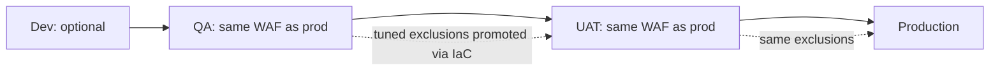

# 04. WAF in Production

A web application firewall (WAF) filters HTTP requests before they reach the app. This note covers AWS WAF in practice: rollout, tuning false positives, and why **every environment needs the same rules**. Principles are in [[2. Web Application Security|02. Web Application Security]]; placement in front of CloudFront or an ALB is in [[2. AWS CloudFront Deep Dive|AWS CloudFront Deep Dive]] and [[3. AWS Elastic Load Balancing Deep Dive|AWS Elastic Load Balancing Deep Dive]].

## Services at a glance

| Cloud | WAF service | Attaches to |
| ----- | ----------- | ----------- |
| AWS | **AWS WAF** (web ACL) | CloudFront, ALB, API Gateway, AppSync, Cognito |
| Azure | **WAF** on Front Door / Application Gateway | Front Door, App Gateway |
| GCP | **Cloud Armor** | External Application Load Balancer |

---

# AWS WAF Building Blocks

| Term | Meaning |
| ---- | ------- |
| **Web ACL** | The rule set attached to a resource. **Scope**: *CloudFront* (global, created in `us-east-1`) or *Regional* |
| **Rule** | Conditions + action (**Allow**, **Block**, **Count**, **CAPTCHA**, **Challenge**) |
| **Rule group** | A reusable bundle of rules, yours or **managed** (AWS or vendors) |
| **Priority** | Rules run in order; first terminating match wins |
| **Label** | A tag a rule adds to a request so later rules can react |
| **Scope-down statement** | Limit a rule to part of the traffic (a path, a header) |
| **Default action** | Allow or block what no rule matched |

Common managed rule groups: **Core rule set** (OWASP-style: XSS, bad inputs, size limits), **Known bad inputs**, **SQL database**, **Linux / PHP / POSIX** OS rules, **IP reputation**, **Anonymous IP list**, **Bot Control**. Plus your own **rate-based rules** and IP / geo sets.

---

# Why Lenient Lower Environments Cost You

The costliest mistake: **QA with loose WAF rules, production with strict ones.** Everything passed in QA; on go-live the managed rules blocked legitimate requests:
- Large form submissions tripped the **body size** rule (`SizeRestrictions_BODY` in the core rule set, which blocks bodies over the inspection limit)
- Certain field content (HTML-like text, special characters) matched **XSS** rules
- The problems appeared **under production pressure**, with real users, and diagnosing them took days

The fix, and the standard from then on: **WAF parity**. QA and UAT carry the **same managed rule groups as production from day one**, so anything production would block is blocked immediately during internal testing, with the team present. Turnaround drops from days to hours.



Keep the web ACL **in infrastructure code** (CloudFormation / Terraform) with one definition and per-environment parameters, so tuning in QA is promoted, not re-typed ([[1. Infrastructure as Code|Infrastructure as Code]]).

---

# Rolling Out Safely

1. Add the managed rule group with its action set to **Count** (log only)
2. Run realistic traffic: the full test suite, large uploads, rich-text forms, API clients
3. Read the logs and list which rules matched legitimate requests
4. Write **narrow exceptions** (below)
5. Switch the group to **Block** (remove the Count override)
6. Keep logging and alarms on blocked requests

---

# Finding What Blocked a Request

Enable **WAF logging** (to S3, CloudWatch Logs or Kinesis Firehose) and use **sampled requests** in the console.

Key log fields:

| Field | Tells you |
| ----- | --------- |
| `action` | `ALLOW`, `BLOCK`, `COUNT` |
| `terminatingRuleId` | Which rule ended evaluation |
| `terminatingRuleType` | Group, regular or rate-based |
| `ruleGroupList[].terminatingRule` | The specific rule inside a managed group |
| `httpRequest.uri`, `.args`, `.headers` | What was requested |
| `labels` | Labels added during evaluation |

```
$ aws logs filter-log-events --log-group-name aws-waf-logs-web \
    --filter-pattern '{ $.action = "BLOCK" }' --limit 20
```

Also read the **CloudFront** and **ALB** logs to line a user's failing request up with the WAF record.

---

# Writing Narrow Exceptions

Do **not** disable a managed rule globally because one endpoint trips it. Scope the exception to the **specific path** that needs it.

## Pattern: override to Count, then re-block everywhere else

1. In the managed group, set the offending rule (for example `SizeRestrictions_BODY`) to **Count** using a *rule action override*. Counting adds a **label** such as `awswaf:managed:aws:core-rule-set:SizeRestrictions_Body`
2. Add a custom rule **after** the group that **blocks** requests carrying that label **unless** the URI matches the allowed path

```json
{
  "Name": "block-large-body-except-uploads",
  "Priority": 10,
  "Action": { "Block": {} },
  "Statement": {
    "AndStatement": { "Statements": [
      { "LabelMatchStatement": { "Scope": "LABEL",
          "Key": "awswaf:managed:aws:core-rule-set:SizeRestrictions_Body" } },
      { "NotStatement": { "Statement": { "ByteMatchStatement": {
          "SearchString": "/api/submissions/",
          "FieldToMatch": { "UriPath": {} },
          "TextTransformations": [{ "Priority": 0, "Type": "NONE" }],
          "PositionalConstraint": "STARTS_WITH" } } } }
    ] }
  },
  "VisibilityConfig": { "SampledRequestsEnabled": true, "CloudWatchMetricsEnabled": true, "MetricName": "BlockLargeBodyExceptUploads" }
}
```

The same shape handles **XSS rule false positives** on one field or path: count, then re-block except where the rich text is expected.

Tips:
- Scope by **URI path** (and method) rather than by IP
- Keep a comment or ticket reference for each exception
- Re-review exceptions regularly; remove ones no longer needed

## Body inspection size

WAF inspects only the **first part of the body** (a limited number of KB; configurable up to a higher maximum for some resource types). Oversized bodies are handled according to the *oversize handling* setting (continue, match or no-match). For very large uploads, avoid sending them through WAF-protected paths at all: use **presigned uploads direct to S3** ([[6. Django on ECS Fargate - Architecture and Lessons|Django on ECS Fargate - Architecture and Lessons]]).

---

# Other Useful Rules

| Rule | Purpose |
| ---- | ------- |
| **Rate-based** | Block an IP exceeding N requests per 5 minutes; protect login and API routes |
| **Login protection** | Tighter rate limit on `/login`, `/password-reset` |
| **Geo match** | Block or allow countries (a blunt tool; combine with others) |
| **IP sets** | Allow office / partner IPs; block known-bad ranges |
| **Header checks** | Require the secret header from CloudFront so direct hits to the ALB fail |
| **Bot Control** | Distinguish bots from people; costs extra |
| **CAPTCHA / Challenge** | For suspicious clients instead of hard blocks |

---

# Operating a WAF

- **CloudWatch metrics and alarms** on blocked-request counts and sudden spikes
- Review **sampled requests** weekly after changes
- **Subdomain coverage**: WAF rules, CSRF trusted origins and cookie domains must list every hostname explicitly where wildcards do not apply ([[2. Multi-Tenant Django by Subdomain|Multi-Tenant Django by Subdomain]])
- Cost: per web ACL, per rule, per million requests, plus extras for Bot Control and logging
- A WAF is a **safety net, not a substitute** for input validation, patching and headers ([[3. HTTP Security Headers and CSP|03. HTTP Security Headers and CSP]])

---

# Checklist

- [ ] Same managed rule groups in QA, UAT and production
- [ ] New groups start in Count; promoted to Block after review
- [ ] Logging on; know how to find the terminating rule
- [ ] Exceptions are path-scoped and documented
- [ ] Rate limits on authentication endpoints
- [ ] Web ACL defined as code
- [ ] Large uploads bypass the app tier
