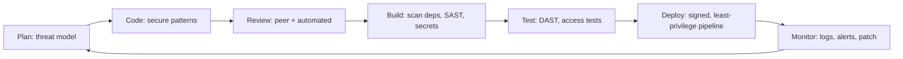

Keeping code, dependencies, secrets and pipelines safe from the first commit to production. Vulnerability classes are in [[2. Web Application Security|2. Web Application Security]]; cloud controls in [[6. Cloud Security|4. Cloud Security]].

## Secure SDLC at a glance



Shift left: find issues where they are cheapest to fix, in the editor and pull request, not in production.

| Stage | Control | Example tools |
| ----- | ------- | ------------- |
| Code | Linters, secure patterns, pre-commit hooks | pre-commit, ruff, ESLint security rules |
| Secrets | Detect committed secrets | gitleaks, truffleHog, GitHub secret scanning |
| Dependencies (SCA) | Known-vulnerable packages | Dependabot, pip-audit, npm audit, OWASP Dependency-Check |
| SAST | Static analysis of source | Bandit, Semgrep, CodeQL |
| Containers | Image and OS package scan | Trivy, Grype, Docker Scout |
| IaC | Misconfiguration in Terraform / CloudFormation | Checkov, tfsec / Trivy |
| DAST | Attack a running test app | OWASP ZAP |
| Passive web checks | Headers, cookies, TLS | [[7. Siteward Web Security Scanner|Siteward Web Security Scanner]] |

---

# Secrets Management

Secrets are passwords, API keys, tokens, private keys, connection strings.

- **Never commit them**, even to private repos; history keeps them forever
- Keep them in **environment variables** loaded from a manager, or fetch at runtime from a vault (Secrets Manager, Key Vault, Secret Manager, HashiCorp Vault)
- `.env` files are for local development only and belong in `.gitignore`; commit a `.env.example` with fake values
- **Rotate** on a schedule and **immediately on suspected exposure**. Deleting the commit is not enough; assume the secret is burned
- One secret per purpose and per environment; scope each to least privilege
- Use **short-lived credentials** (OIDC, managed identities) so there is nothing long-lived to leak

```
# .gitignore
.env
*.pem
*.tfstate
*.tfstate.backup
```

```
$ gitleaks detect --source . --verbose      # scan history for secrets
$ pre-commit install                        # block them before commit
```

---

# Dependencies and Supply Chain

Most of your running code is **other people's code**. Attacks target that trust: typosquatted package names, hijacked maintainer accounts, malicious updates.

| Practice | Why |
| -------- | --- |
| **Pin versions** and use a lock file (`requirements.txt` with hashes, `package-lock.json`, `poetry.lock`) | Reproducible, no surprise upgrades |
| **Review new dependencies** before adding | Fewer packages, smaller attack surface |
| **Automated update PRs** (Dependabot, Renovate) | Patches arrive quickly and reviewably |
| **Audit for known CVEs** in CI | `pip-audit`, `npm audit` fail the build on critical issues |
| **Generate an SBOM** (CycloneDX, SPDX) | Know exactly what is in each release |
| **Verify provenance and signatures** | Sigstore / cosign, SLSA levels, npm provenance |
| **Use a private registry or proxy** for internal packages | Avoids dependency confusion |

Dependency confusion: an attacker publishes a public package with the same name as your internal one. Scope internal names or configure the registry so internal names never resolve publicly.

---

# Secure Pull Requests and Code Review

- **Branch protection**: require pull requests, reviews and passing checks; no force-push to `main`
- **CODEOWNERS** for sensitive paths (auth, payments, infrastructure)
- Review checklist: untrusted input handled? authorisation checked? secrets absent? logging free of personal data? error messages generic?
- **Signed commits** where tracing authorship matters
- Separate duties: the author is not the only approver of a production change

---

# Pipeline Security

The CI/CD system holds the keys to production, so protect it like production. Pipeline basics: [[1. CI-CD Pipelines|CI-CD Pipelines]], [[2. GitHub Actions|GitHub Actions]], [[5. Jenkins|Jenkins]].

- **Least-privilege tokens**: set `permissions:` in GitHub Actions to the minimum
- **OIDC to the cloud** instead of stored access keys
- **Pin third-party actions to a full commit SHA**, not a tag
- Treat pull requests from forks as untrusted; avoid `pull_request_target` with their code
- Protect **environments** with required reviewers for production
- Use **ephemeral** runners; never self-hosted runners on public repos
- Do not print secrets; masked values can still be leaked by clever scripts
- Keep build logs and artifacts access-controlled

```yaml
permissions:
  contents: read
steps:
  - uses: actions/checkout@<full-commit-sha>
  - run: pip-audit -r requirements.txt
  - run: bandit -r src -ll
```

---

# Secure Containers

Details in [[3. Container Images and Build Tools]] and [[1. Docker]].

- **Minimal base images** (slim, distroless) with fewer packages to exploit
- **Run as non-root** (`USER app`), read-only filesystem where possible, drop capabilities
- **Multi-stage builds** so compilers and secrets do not reach the final image
- **Never bake secrets into layers**; pass them at runtime or use BuildKit secret mounts
- Scan images in CI and again on a schedule (new CVEs appear after you ship)
- Pin base images by **digest** and rebuild regularly for patches
- Sign images and verify signatures at deploy time

```dockerfile
FROM python:3.12-slim
RUN useradd --create-home app
WORKDIR /app
COPY --chown=app requirements.txt .
RUN pip install --no-cache-dir -r requirements.txt
COPY --chown=app . .
USER app
CMD ["gunicorn", "app.wsgi:application"]
```

---

# Secure Coding Habits

| Habit | Detail |
| ----- | ------ |
| **Validate input, encode output** | Allow-list validation at the boundary, escape for the output context |
| **Handle errors safely** | Log details internally, return generic messages to users |
| **Do not log secrets or personal data** | Mask tokens, passwords, card numbers |
| **Use safe defaults and safe APIs** | Parameterised queries, `secrets` module, `subprocess` without shell |
| **Keep it simple** | Less code and fewer features mean fewer bugs |
| **Fix the class, not the instance** | One XSS bug usually means a missing pattern; fix it centrally |
| **Write security tests** | Test that user A cannot access user B's data, that bad input is rejected |

---

# Privacy and Compliance Basics

- Collect and keep **only the data you need**; delete it when no longer needed
- Know where personal data lives; encrypt it; restrict who can see it
- South Africa: **POPIA**. Europe: **GDPR**. Cards: **PCI DSS**. Provider compliance reports (AWS Artifact, Azure Service Trust Portal, Google Compliance) help with evidence
- Keep **audit trails** for access to sensitive data

---

# Pre-Release Checklist

- [ ] No secrets in the repo or history; secret scanning on
- [ ] Dependencies pinned, audited, update PRs enabled
- [ ] SAST and dependency scans pass in CI
- [ ] Container image scanned, non-root, minimal
- [ ] Security headers and CSP set: [[3. HTTP Security Headers and CSP|3. HTTP Security Headers and CSP]]
- [ ] Debug off, errors generic, admin protected
- [ ] Least-privilege pipeline and runtime roles: [[6. Cloud Security|4. Cloud Security]]
- [ ] Logging and alerting in place; backups tested
