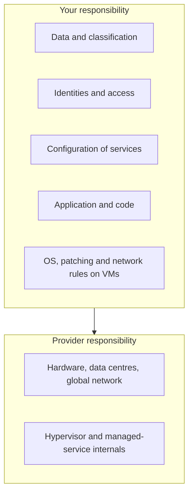
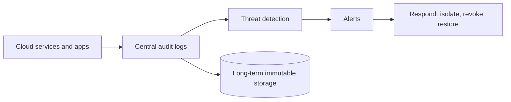

Securing workloads in AWS, Azure and GCP. The provider secures the cloud; you secure what you put in it. Service detail is in [[2. AWS IAM and Security|2. AWS IAM and Security]], [[5. Azure Identity and Security]] and [[1. GCP Fundamentals]]. Principles are in [[1. Security Fundamentals|1. Security Fundamentals]].

## Shared responsibility



The more managed the service, the more the provider handles (VM > container > serverless > SaaS). **Identity, data and configuration are always yours.** Most cloud breaches are misconfiguration, not provider failure.

## Services at a glance

| Concern | AWS | Azure | GCP |
| ------- | --- | ----- | --- |
| **Identity and access** | IAM, IAM Identity Center | Microsoft Entra ID, Azure RBAC | Cloud IAM, Cloud Identity |
| **Org-level guardrails** | Organizations + SCPs | Management groups + Azure Policy | Resource hierarchy + Organization Policy |
| **Key management** | KMS, CloudHSM | Key Vault, Managed HSM | Cloud KMS, Cloud HSM |
| **Secrets** | Secrets Manager, SSM Parameter Store | Key Vault secrets | Secret Manager |
| **Network filtering** | Security groups, NACLs, Network Firewall | NSGs, Azure Firewall | VPC firewall rules, Cloud NGFW |
| **Web protection** | WAF, Shield, CloudFront | Front Door / App Gateway WAF, DDoS Protection | Cloud Armor |
| **Private access to services** | VPC endpoints / PrivateLink | Private Endpoints | Private Service Connect, VPC Service Controls |
| **Audit logging** | CloudTrail, CloudWatch Logs | Activity Log, Azure Monitor | Cloud Audit Logs, Cloud Logging |
| **Threat detection** | GuardDuty, Inspector, Macie | Microsoft Defender for Cloud | Security Command Center |
| **Posture / compliance** | Security Hub, Config | Defender for Cloud, Azure Policy | Security Command Center, Policy Intelligence |
| **SIEM** | Security Lake, OpenSearch | Microsoft Sentinel | Chronicle |

---

# 1. Identity First

Identity is the new perimeter.

- **Never use the root / global admin account** for daily work. Lock it away with MFA and alerts on use
- **Least privilege**: start with nothing, add narrow permissions, review regularly (IAM Access Analyzer, Entra access reviews, IAM Recommender)
- **Roles over long-lived keys**: instances, functions and pods assume roles (instance profiles, managed identities, workload identity). No access keys in code
- **MFA** for every human; short-lived credentials through SSO
- **Federation for CI/CD**: GitHub Actions to the cloud with **OIDC**, no stored keys ([[2. GitHub Actions|GitHub Actions]])
- Separate **accounts / subscriptions / projects** per environment and workload to limit blast radius

```json
{
  "Version": "2012-10-17",
  "Statement": [{
    "Effect": "Allow",
    "Action": ["s3:GetObject"],
    "Resource": "arn:aws:s3:::my-unique-bucket-12345/reports/*"
  }]
}
```

A narrow policy: one action, one prefix. Compare with the `"Action": "*"` anti-pattern.

---

# 2. Protect Data

| Control | How |
| ------- | --- |
| **Encrypt at rest** | Managed encryption on storage and databases; customer-managed keys (CMK) where required |
| **Encrypt in transit** | TLS only; reject plain HTTP |
| **No public storage by default** | S3 **Block Public Access**, Azure storage "disable public blob access", GCS uniform access + public access prevention |
| **Classify and find sensitive data** | Macie, Purview, Sensitive Data Protection |
| **Backups and immutability** | Versioning, object lock, soft delete, cross-region copies |
| **Secrets in a vault** | Secrets Manager, Key Vault, Secret Manager; rotate automatically |

Keys: separate who can **use** a key from who can **administer** it; log all key usage.

---

# 3. Secure the Network

- **Private by default**: workloads in private subnets, one controlled entry (load balancer, WAF, CDN)
- **Security groups / NSGs**: allow only needed ports from needed sources. Never `0.0.0.0/0` on SSH or RDP; use SSM Session Manager, Azure Bastion or IAP tunnels instead
- **Private endpoints** keep traffic to storage and databases off the internet
- **Egress control**: restrict outbound traffic to stop data exfiltration and callbacks
- **WAF** in front of public web apps; **DDoS** protection for exposed services
- Segment with **hub-and-spoke** networks and firewalls ([[12. VPC Playground|VPC Playground]], [[11. Cloud Portfolio Blueprints|Cloud Portfolio Blueprints]])

Network concepts: [[13. Network Security|Network Security]].

---

# 4. Log, Detect, Respond



- Turn on **organisation-wide audit logging** (CloudTrail, Activity Log, Cloud Audit Logs) and send it to a separate, locked account / project
- Enable managed threat detection (GuardDuty, Defender for Cloud, Security Command Center)
- Alert on: root / admin sign-in, MFA disabled, policy changes, new public resources, unusual regions, large data transfers
- Keep logs long enough to investigate (months), protected from deletion

---

# 5. Govern with Policy and Posture

- **Policy as code** blocks bad configuration before it ships: SCPs, Azure Policy, Organization Policy, plus Terraform checks
- **CSPM** (cloud security posture management) continuously finds drift: Security Hub, Defender for Cloud, Security Command Center
- **Tag and inventory** everything so there are no orphaned, unowned resources
- **Cost anomalies** are also a security signal (crypto-mining shows up as a bill spike): [[6. Azure Governance and Cost Management]]

Benchmarks to measure against: **CIS Benchmarks** for each cloud and **cloud provider well-architected security pillars**.

---

# 6. Secure the Build and Deploy Path

- Scan **infrastructure code** (Checkov, tfsec / Trivy, cfn-lint) before apply: [[3. Terraform Best Practices|Terraform Best Practices]], [[1. Infrastructure as Code|Infrastructure as Code]]
- Scan **container images** and use minimal base images: [[3. Container Images and Build Tools]]
- Keep **Terraform state** private and encrypted: it can contain secrets
- Protect the pipeline itself: [[5. Secure Coding and Supply Chain|5. Secure Coding and Supply Chain]]
- Kubernetes: RBAC, network policies, pod security, no privileged containers ([[1. Orchestration Platforms|Orchestration Platforms]])

---

# Common Cloud Mistakes

| Mistake | Result | Fix |
| ------- | ------ | --- |
| Public storage bucket | Data leak | Block public access, review with posture tools |
| Access keys committed to git | Account takeover | Roles / OIDC, secret scanning, rotate on exposure |
| `*:*` admin policies | Huge blast radius | Scoped roles, access analyzer |
| SSH/RDP open to the world | Brute force, ransomware | Bastion / session manager, VPN |
| No audit logs | Cannot investigate | Org-wide logging to a protected account |
| Unpatched VMs | Known exploits | Patch management, immutable images |
| Metadata service exposed to SSRF | Credential theft | IMDSv2, least-privilege instance roles |

---

# Quick Review Checklist

- [ ] MFA on all humans; root / global admin locked down
- [ ] No long-lived keys; roles and OIDC used
- [ ] Storage private by default and encrypted
- [ ] Private subnets, narrow security groups, no open admin ports
- [ ] Audit logs on, centralised and protected
- [ ] Threat detection and posture tools enabled
- [ ] Policy guardrails and IaC scanning in the pipeline
- [ ] Backups tested; budget alerts set
