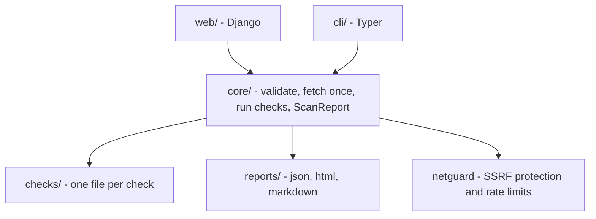

> **Repository:** [sharifndlovu123/siteward](https://github.com/sharifndlovu123/siteward) · MIT licence · Python 3.11+
> **Get it:** `git clone https://github.com/sharifndlovu123/siteward.git && cd siteward && pip install .` then `siteward scan https://your-site.example` (or run the Docker image / local web UI, see the repo README). Only scan sites you own or may test.

**Siteward** is a small, self-hostable **passive** web security scanner: give it a URL, it runs standard checks and reports findings as Markdown, JSON or a self-contained HTML file. Nothing about scanned sites is stored. Source: the `siteward` repo. Use it **only on sites you run or have explicit permission to test**; it is a routine-coverage tool, not a replacement for a manual penetration test.

## Tools at a glance

| Part | Choice |
| ---- | ------ |
| **Language** | Python 3.11+ |
| **Web UI** | Django, no login, results in memory only |
| **CLI** | Typer (`siteward scan <url>`) |
| **HTTP / DNS** | `httpx`, `dnspython` |
| **Reports** | Jinja2 templates (Markdown, JSON, HTML) |
| **Hosting** | Docker, optional Cloudflare Turnstile and rate limits for a public instance |
| **CI** | GitHub Actions: tests plus a scheduled monitor workflow |

```
$ pip install .
$ siteward scan https://example.com
$ siteward scan https://example.com --format html --out report.html
$ siteward scan https://example.com --ports --fail-on medium     # exits 1 in CI if medium or worse
```

---

# What It Checks (and Why Each Matters)

| Check | What it looks for | Why it matters |
| ----- | ----------------- | -------------- |
| **CSP** (`Content-Security-Policy`) | Whether scripts, styles and frames are restricted | Limits the damage of XSS |
| **HSTS** (`Strict-Transport-Security`) | Browsers forced to use HTTPS | Stops downgrade and SSL-stripping attacks |
| **Framing** (`X-Frame-Options` / `frame-ancestors`) | Whether the site can be embedded | Prevents clickjacking |
| **`X-Content-Type-Options: nosniff`** | Browser must trust declared content types | Blocks MIME sniffing attacks |
| **Referrer-Policy** | How much URL is leaked to other sites | Privacy and leakage |
| **Permissions-Policy** | Which browser features (camera, geolocation) are allowed | Reduces abuse by embedded content |
| **TLS** | Certificate validity and expiry, legacy protocols (SSLv3, TLS 1.0 / 1.1) | Encryption strength |
| **HTTP → HTTPS redirect** | Plain HTTP sent to HTTPS | No unencrypted sessions |
| **Cookie flags** | `Secure`, `HttpOnly`, `SameSite` | Session theft and CSRF |
| **CORS** | Over-permissive `Access-Control-Allow-Origin` (e.g. `*` with credentials) | Cross-origin data theft |
| **Exposed files** | `.git`, `.env`, backups, dumps, directory listing | Secret and source leakage |
| **Information leakage** | Verbose `Server` / `X-Powered-By` headers, stack traces | Helps attackers fingerprint |
| **`security.txt` / `robots.txt`** | A vulnerability reporting contact; sensitive paths in robots | Responsible disclosure |
| **SPF / DKIM / DMARC** | DNS records that protect email from spoofing | Prevents phishing in your name |
| **Dangling CNAME** | DNS pointing at a deleted cloud resource | **Subdomain takeover** risk |
| **Port check** (opt-in) | About 20 common TCP ports | Accidentally exposed services |

Active tests such as XSS or injection probes are planned for a later version, behind an ownership check.

---

# Architecture: A Complexity Budget

The design rule: **small enough to read in an afternoon, cheap enough to host on the smallest box.** Every piece must earn its place.

| Decision | Choice | Why |
| -------- | ------ | --- |
| Processes | One (Django, scans in a thread) | No Redis, Celery or broker to run |
| Database | None; results in process memory for 15 minutes | Nothing stored means nothing to leak, back up or migrate |
| Runtime deps | Django, httpx, dnspython, Jinja2, Typer | Few libraries; TLS and ports use the standard library |
| JavaScript | A ~30-line polling snippet | No build step |
| Front-end | Bootstrap CSS vendored | No Node, no npm |
| Auth | None in v1: run on localhost, or behind your own auth / VPN | Accounts are a big attack surface |



**Dependency rule:** arrows only point downward. `core/` and `checks/` never import Django or Typer, and `web/` and `cli/` never hold scan logic.

## The plugin contract
A check is just a module, no base class or registry:

```python
# checks/security_headers.py
ID = "headers.security"
CATEGORY = "Headers"
NEEDS_OPT_IN = False          # True only for the port check

def run(ctx: ScanContext) -> list[Finding]:
    ...
```

- The runner discovers every module in `checks/` automatically
- A check returns findings, or an empty list for "fine"; if it raises, the runner records an `error` result
- The page is fetched **once** into a shared `ScanContext` so checks do not each re-request it
- Findings are plain dataclasses: `Finding(id, title, category, severity, evidence, remediation)`; grade and severity counts are computed

---

# Defending the Scanner Itself

A scanner that fetches arbitrary URLs is a risk to the host, so the tool guards itself:

- **SSRF protection** (`netguard`): refuse private, loopback and cloud-metadata addresses (e.g. `169.254.169.254`) unless explicitly allowed, and re-check after redirects and DNS resolution
- **Rate limits** per IP and per target, a concurrency cap and a bounded queue
- **Public mode**: Cloudflare Turnstile, restrictions and a minimal abuse log
- **Privacy**: logs never contain targets or findings; results vanish after the TTL
- **Ownership first**: strong disclaimers, and active tests planned behind an ownership check
- Keep `SECURITY.md` for reporting vulnerabilities in the tool itself

---

# Testing and Delivery
- **Unit tests** for checks; **end-to-end tests** for Docker, public mode, load, quality and a "dogfood" scan of the project's own site
- A **smoke script** against the deployed instance
- **CI** runs the tests; a **monitor workflow** runs on a schedule to watch the live site ([[2. GitHub Actions|GitHub Actions]])
- Container build ([[1. Docker]]) and `--fail-on` for use as a pipeline gate ([[1. CI-CD Pipelines|CI-CD Pipelines]])
- Designed with a **spec, an architecture doc and a numbered implementation plan** committed to the repo before the code, a workflow that suits agents ([[1. AI Agents and Workflows|AI Agents and Workflows]])

---

# Using It Well
1. Run it against **your own** staging and production sites after each release
2. Treat "no findings" as "nothing found by these checks", not "secure"
3. Fix high-severity items first (exposed `.env`, missing HTTPS, dangling DNS)
4. Add it to CI with `--fail-on medium`
5. Pair it with manual review, dependency scanning and a proper penetration test

Related: [[13. Network Security|Network Security]], [[Server Hardening with SSH, UFW and Fail2ban]], [[24. Network Device Monitoring with NetPulse|Network Device Monitoring with NetPulse]]
