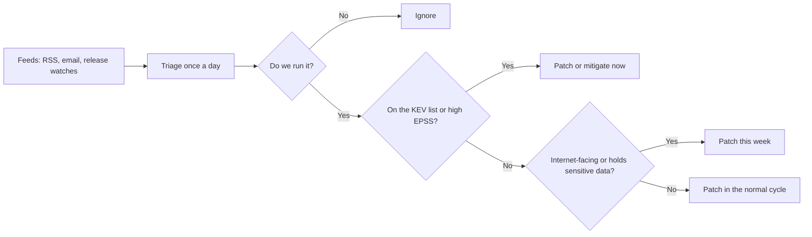

New flaws and exploits appear every week, so security knowledge goes stale quickly. This note lists the places to watch, the vocabulary they use, a way to decide what actually needs action, and some famous incidents worth reading in full. The general process is in [[1. Security Fundamentals|1. Security Fundamentals]]; the dependency side is in [[5. Secure Coding and Supply Chain|5. Secure Coding and Supply Chain]].

> Site addresses and feeds change; if a link fails, search for the project's name. Everything below is for **defence and learning**: only test exploits against systems you own or have written permission to test.

---

## The names you were looking for

The sites that list known flaws are **vulnerability databases** and **advisory feeds**. They all revolve around a few standard identifiers:

| Term | Meaning | Example |
|------|---------|---------|
| **CVE** | *Common Vulnerabilities and Exposures*: the unique ID for one publicly known flaw | `CVE-2021-44228` (Log4Shell) |
| **CWE** | *Common Weakness Enumeration*: the **type** of mistake behind flaws | CWE-79 cross-site scripting, CWE-89 SQL injection |
| **CVSS** | Severity score from 0 to 10 | 9.0 to 10 is Critical |
| **EPSS** | *Exploit Prediction Scoring System*: probability (0 to 1) a CVE is exploited in the next 30 days | 0.94 means very likely |
| **KEV** | CISA's *Known Exploited Vulnerabilities* catalogue: flaws **confirmed** to be exploited in the wild | Fix these first |
| **CPE** | Standard name for a product and version, used to match CVEs to what you run | `cpe:2.3:a:apache:log4j:2.14.1` |
| **GHSA / OSV** | Advisory IDs from GitHub and the Open Source Vulnerabilities database | `GHSA-jfh8-c2jp-5v3q` |
| **PoC** | Proof of concept: code showing the flaw works | Often on GitHub |
| **0-day / N-day** | Exploited before a fix exists / after a fix is available | Most real attacks are N-days |
| **SBOM / VEX** | Software bill of materials / statement of whether a CVE affects a product | Needed to answer "are we affected?" |

CVSS bands: 0.1 to 3.9 Low, 4.0 to 6.9 Medium, 7.0 to 8.9 High, 9.0 to 10.0 Critical. A score says how bad a flaw *can* be, not whether anyone is using it, which is why EPSS and KEV exist.

---

## Where to look

### Vulnerability databases and catalogues

| Source | What it gives you |
|--------|-------------------|
| **CVE Program** (cve.org) | The official list of CVE IDs and descriptions |
| **NVD** (nvd.nist.gov) | NIST's enriched CVE data: CVSS scores, affected products (CPE), references; has a free API |
| **CISA KEV catalogue** (cisa.gov, search "Known Exploited Vulnerabilities") | The "being exploited right now" list; downloadable as JSON or CSV |
| **EPSS** (first.org/epss) | Daily exploitation-probability scores for every CVE |
| **OSV** (osv.dev) | Open-source package vulnerabilities across ecosystems (PyPI, npm, Go, Maven, Debian and more) |
| **GitHub Advisory Database** (github.com/advisories) | Reviewed advisories feeding Dependabot |
| **Exploit-DB** (exploit-db.com) | Public exploit code and papers, maintained by OffSec; searchable offline with `searchsploit` |
| **MITRE CWE / CAPEC** (cwe.mitre.org, capec.mitre.org) | Catalogues of weakness types and attack patterns |
| **MITRE ATT&CK** (attack.mitre.org) | Map of attacker tactics and techniques, used to design detections |
| **Snyk Vulnerability DB** (security.snyk.io) | Commercial database with a free browse view |

### Vendor and distribution advisories

Patch notices from the people who ship what you run:
- **Linux distros:** Debian Security Tracker (security-tracker.debian.org), Ubuntu Security Notices (ubuntu.com/security), Red Hat (access.redhat.com/security), Arch Security Tracker.
- **Microsoft:** the Security Update Guide (msrc.microsoft.com) and the monthly "Patch Tuesday" release (second Tuesday of each month).
- **Cloud and platforms:** AWS, Azure and Google Cloud security bulletins; Cisco, Fortinet, Palo Alto and other network vendors publish their own advisories, and edge devices are frequent targets.
- **Language and framework projects:** release notes and security pages for Django, Rails, Spring, Node.js, PHP and the like.

### Mailing lists and research

- **oss-security** (openwall.com/lists/oss-security): where open-source maintainers disclose flaws, often with a patch and timeline. Low volume, high signal.
- **Google Project Zero** (projectzero.google): detailed write-ups of real 0-days.
- **PortSwigger Research** (portswigger.net/research) and the **Web Security Academy** (free labs): web-attack techniques explained and practised.
- **SANS Internet Storm Center** (isc.sans.edu): daily "diary" posts on what is being seen in the wild.
- **Vendor research blogs:** Cisco Talos, Palo Alto Unit 42, Mandiant, Microsoft Threat Intelligence, and similar teams publish campaign analyses.

### News and commentary

| Source | Style |
|--------|-------|
| **Krebs on Security** (krebsonsecurity.com) | Investigative reporting on breaches and cybercrime |
| **BleepingComputer** | Fast, practical news and patch alerts |
| **The Hacker News** (thehackernews.com) | Daily roundup of new flaws and campaigns |
| **The Record** (therecord.media) | Policy and incident reporting |
| **SecurityWeek, Dark Reading** | Industry and enterprise coverage |
| **Schneier on Security** (schneier.com) | Long-form analysis and cryptography |
| **Troy Hunt** (troyhunt.com), **Have I Been Pwned** (haveibeenpwned.com) | Breaches, with a service to check whether your accounts leaked |
| **Risky Business** (risky.biz) | Weekly podcast of the week's news |
| **r/netsec** | Community-curated technical links |

### National and other trackers

- **CISA** alerts, **US-CERT** and the UK's **NCSC** publish advisories; most countries have a national CERT/CSIRT. Check which covers your own country and region.
- **Shodan** and **Censys** show what is exposed on the internet, useful for checking your own footprint.
- **abuse.ch** (URLhaus, MalwareBazaar) and **AlienVault OTX** publish malware and indicator feeds; **VirusTotal** checks files and URLs.

---

## Keeping up without drowning



Practical set-up:
- **RSS reader** (Feedly, Miniflux, NetNewsWire, Thunderbird) with 5 to 10 trusted feeds beats checking sites ad hoc. Many of the sources above publish RSS or an email digest.
- **Watch releases and security advisories** on the GitHub repositories you depend on (Watch, then Custom, then Security alerts), and turn on **Dependabot alerts**.
- **Subscribe to your distro's security list** (for example `debian-security-announce`) and enable unattended security updates for servers.
- **Keep an inventory** (an SBOM from Syft or `trivy sbom`) so "are we affected?" takes minutes, not days.
- **Set a rhythm:** a short daily skim, a weekly review of everything pending, a monthly patch window, and an emergency path for KEV entries on internet-facing systems.
- **Write down your decisions**, including "not affected because the vulnerable function is never called".

---

## Hands-on examples

```bash
# Look up one CVE through the NVD API
$ curl -s "https://services.nvd.nist.gov/rest/json/cves/2.0?cveId=CVE-2021-44228" | jq '.vulnerabilities[0].cve.descriptions[0].value'

# EPSS score for a CVE
$ curl -s "https://api.first.org/data/v1/epss?cve=CVE-2021-44228" | jq '.data[0]'

# Is it on the CISA KEV list? (download the JSON feed from the CISA site, then search it)
$ jq -r '.vulnerabilities[] | select(.cveID=="CVE-2021-44228") | .vulnerabilityName' known_exploited_vulnerabilities.json

# Search offline copies of Exploit-DB
$ sudo apt install exploitdb
$ searchsploit apache 2.4
$ searchsploit -x 12345            # read an exploit's source

# Scan a project for known-vulnerable dependencies (OSV data)
$ osv-scanner scan source -r .     # older versions use: osv-scanner -r .
$ pip-audit
$ npm audit

# Scan a container image
$ trivy image nginx:latest

# Which pending updates are security updates (Debian or Ubuntu)?
$ sudo apt update && apt list --upgradable
$ sudo unattended-upgrade --dry-run -d
```

Example triage: a new critical CVE appears in `libfoo`. You check the inventory, find version 2.3 on one internal server and the image of a public API. KEV lists it and EPSS is high, so the **public API is patched today**; the internal server goes in this week's window.

---

## Incidents worth reading in full

Each one teaches a lesson that is still current. Search the CVE or name for the original advisory and post-mortems.

| Incident | CVE | What happened | Lesson |
|----------|-----|---------------|--------|
| **Heartbleed** (2014) | CVE-2014-0160 | An OpenSSL bug let anyone read server memory, including keys | Critical libraries are everywhere and rarely inventoried |
| **Shellshock** (2014) | CVE-2014-6271 | Bash executed code hidden in environment variables, reachable through CGI | Old, trusted tools can hide severe flaws |
| **Dirty COW** (2016) | CVE-2016-5195 | A Linux kernel race condition gave local users root | Local access plus a kernel bug equals full control |
| **Equifax** (2017) | CVE-2017-5638 | An unpatched Apache Struts flaw led to a breach of huge amounts of personal data | A known, fixed bug that was not patched in time |
| **EternalBlue / WannaCry** (2017) | CVE-2017-0144 | A Windows SMB flaw spread ransomware worldwide | Patch available months before the outbreak; disable unneeded services |
| **Log4Shell** (2021) | CVE-2021-44228 | Logging a crafted string could run remote code in Java apps | Transitive dependencies: you may not know you use the library |
| **Spring4Shell** (2022) | CVE-2022-22965 | Remote code execution in some Spring Framework setups | Early rumours mix up flaws; wait for the verified advisory |
| **MOVEit Transfer** (2023) | CVE-2023-34362 | SQL injection in a file-transfer product exploited as a 0-day by a ransomware group | Internet-facing file transfer is a prime target |
| **xz backdoor** (2024) | CVE-2024-3094 | A maintainer-level compromise planted a backdoor in the xz compression library | Supply-chain attacks target people and trust as well as code |
| **regreSSHion** (2024) | CVE-2024-6387 | A signal-handler race in OpenSSH on glibc Linux allowed remote code execution | Even hardened software regresses; patch SSH quickly |

Cross-reference the technique classes with [[2. Web Application Security|2. Web Application Security]] (injection, XSS, SSRF) and the supply-chain lessons with [[5. Security and Supply Chain Hygiene|Open Source: Security and Supply Chain Hygiene]].

---

## Practising safely

Reading about exploits is better with practice, on targets built to be attacked:

- **PortSwigger Web Security Academy**: free browser-based labs for each web vulnerability class.
- **OWASP Juice Shop** and **DVWA**: intentionally vulnerable apps you run locally in Docker (`docker run -p 3000:3000 bkimminich/juice-shop`).
- **TryHackMe**, **Hack The Box**, **OverTheWire**, **picoCTF**: guided rooms, machines and capture-the-flag games.
- **Your own lab:** virtual machines on an isolated network, never your home or work LAN.

Responsible habits: stay inside written scope, never test other people's systems, report what you find through the vendor's disclosure process (see disclosure in [[5. Security and Supply Chain Hygiene|Open Source: Security and Supply Chain Hygiene]]), and do not run public PoC code you have not read.

---

## Reading list order

1. Learn the vocabulary above (CVE, CWE, CVSS, EPSS, KEV).
2. Read the OWASP Top 10 and one real write-up per category.
3. Follow two news sites and one research source for a month before adding more.
4. Pick one incident from the table each week and read the original advisory and the post-mortem.
5. Repeat the triage routine until it is a habit; add automation (Dependabot, OSV, Trivy) as the inventory grows.
