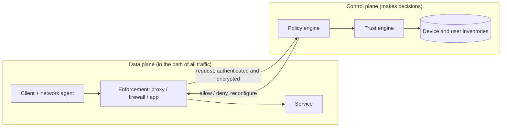

# 09. Zero Trust Networks

Zero trust drops the idea that being inside the network earns trust. Every request is authenticated, authorised and judged on current evidence. Principles are in [[1. Security Fundamentals|01. Security Fundamentals]]; certificates are in [[Certificates]]; a small working example is in [[3. Tailscale, VPNs and Always-On Pi Services|Tailscale, VPNs and Always-On Pi Services]].

## The five assertions

- The network is always assumed hostile
- External and internal threats exist on it at all times
- Network locality is not enough to decide trust
- Every device, user and network flow is authenticated and authorised
- Policy is dynamic and calculated from as many data sources as possible

A perimeter model splits the network into zones behind firewalls, with a DMZ for risky services. Once an attacker is inside a trusted zone, lateral movement is easy. Zero trust moves the checks onto every connection.

---

# Control Plane and Data Plane

- The **data plane** handles all traffic, so its logic stays simple and fast
- The **control plane** is the changeable part (configuration, policy) and is queried rarely compared with the traffic rate
- The data plane has broad exposure, so it must not be a way into the control plane. The book compares the interface to user space versus kernel space
- Requests between the planes are encrypted and authenticated with a **non-public PKI**

| Component | Job |
| --------- | --- |
| **Network agent** | The thing being authenticated: user + device + application together |
| **Enforcement** | Allows or blocks each request on the data plane |
| **Policy engine** | Compares a request with policy and decides |
| **Trust engine** | Produces a numeric risk score for a request or entity |
| **Inventories** | Authoritative device and user data that feeds the scores |

---

# Variable Trust and Policy

Policy is written against a **trust score**, not only allow/deny rules. Binary rules end up either too rigid (constant manual adjustment) or too loose to assert much.

- Static rules lower a score: a device missing patches, repeated failed authentication
- Mature trust engines mix static rules with learned (machine learning) scoring; the explicit rules stay for custom behaviour
- Policy should not rely on the score alone; role and request attributes still count

**What gets scored.** Locking a user out after a brute-force attempt hands the attacker a denial-of-service lever. Scoring the attacker's *network agent* leaves the legitimate agent unaffected. A suspect device should lower the score of every request from it, and a user hopping between kiosks should show up across devices. So both the agent and the device are scored.

**Policy in practice**
- Keep policy in **version control with review**, so a security reviewer can ask whether it is scoped tightly
- Define policy by **logical intent** (roles, services), not IP addresses, so it changes less often
- Layer **broad infrastructure rules over fine-grained team policy**, so a team's policy cannot override a rule such as "only these roles accept internet traffic"
- Keeping the policy engine next to enforcement (over IPC) allows per-request authorisation instead of per-session; keep them as separate processes

---

# Establishing Trust

## Devices

- **Golden image**: load a known-good, certified image on every new device. Record when it was last imaged; that date is a trust signal
- **Secure Boot** loads a public key into firmware to validate driver and OS loader signatures, defending against implants that survive reimaging (support is limited to certain hardware and operating systems)
- **Device identity**: a unique certificate signed by your own private CA. Details in the certificate are matched to the device inventory for further decisions
- **X.509** defines certificate format, revocation lists and chain validation, and its key pair can also bootstrap encrypted communication. Every device in a zero trust network should have one
- **Protect the private key**: if it is stolen, device authentication is a sham. A **TPM** (a type of HSM) generates and holds the key so it can be used but never read
- **Inventory**: catalogue devices and their properties. A VM or container can be a "device"; grouping all VM traffic into one policy brings back the perimeter model. A configuration management system can act as an inventory
- **Renewing trust**: the longer a device runs, the more likely it is compromised, so **device age is a heavily weighted signal**. Rotate: rebuild cloud instances, reimage physical machines (this does not cover hardware-level attacks)

## Users

- Authentication produces a *level of trust*, not a yes/no. A music service needs a password; an investment account needs a password and a code
- Use the **trust score to drive authentication**: when a score falls below what a request needs, ask for more proof (step-up), such as re-entering a password before a sensitive action
- Trust gained from authentication should be **bounded**, so poor device security and other bad signals cannot be washed out
- Factors: passwords, TOTP, hardware tokens, biometrics; combine them for stronger assurance

## Applications

- **Isolation** limits what a compromised application can reach: CPU, memory, network, filesystem and system calls. Tools: SELinux and AppArmor (see [[SELinux and AppArmor]]), BSD jails, containers, virtual machines
- Virtualisation is generally considered stronger than a shared-kernel environment
- Secure the code repository and the build artifacts and their hashes, since the application is only as trustworthy as how it was built (see [[5. Secure Coding and Supply Chain|05. Secure Coding and Supply Chain]])

## Traffic

- **Encryption** gives confidentiality; **authentication** proves the sender and that the message is unaltered. Encryption without authentication lets an attacker forge or replay messages
- **Mutually authenticated TLS**: ordinary TLS only has the client check the server. Mutual TLS also requires the server to validate a **client certificate**, which zero trust requires for anything that is not public
- **The first packet problem**: even with mutual TLS, the service is discoverable and answers unauthenticated packets. **Pre-authentication** (Single Packet Authorisation) has the client send a small signed or encrypted **UDP** packet first. UDP gets no reply by default, so the service stays hidden until it receives a valid one, then opens a narrow firewall rule for that sender only
- SPA only mitigates the first packet; it does not replace mutual TLS or IKE

---

# Where Tailscale Fits

This mapping is an interpretation, not from the book.

- A tailnet is **identity-based**: devices authenticate, and ACLs set in a central policy decide who reaches what
- The coordination service plays the **control plane**; the WireGuard tunnels between devices carry the **data plane**
- A Pi acting as subnet router and exit node with ACLs limiting access is a small working example (see [[Remote Workstation Anywhere]])
- Missing compared with the book: a computed **trust score**. Access is by identity and policy, not by a risk number

---

# Quick Checklist

- Is any access granted purely because of where the request came from?
- Does every device have its own certificate, with the key in hardware where possible?
- Is there an inventory that policy can read (age, last imaged, patch level)?
- Can a sensitive request trigger step-up authentication?
- Is service-to-service traffic mutually authenticated?
- Is policy in version control, reviewed, with broad rules above team rules?
