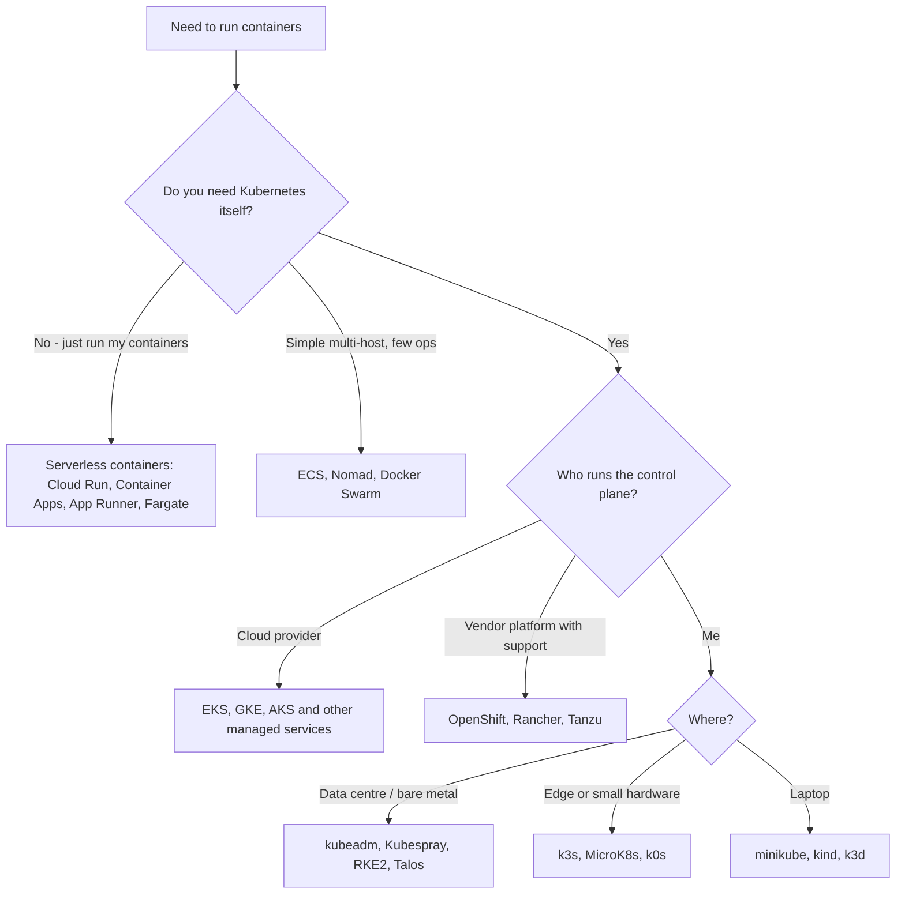
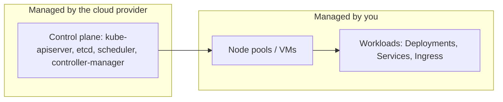

Container orchestration decides **where containers run, keeps them alive, scales them and connects them**. Kubernetes dominates, but there is a wide range of ways to get it, plus several non-Kubernetes alternatives. Start with [[3. Container Images and Build Tools]] and [[1. Docker]], then see how Kubernetes itself works in [[2. Kubernetes Architecture – from Container Images to Running Pods]].

## Options at a glance

| Category | Examples |
| -------- | -------- |
| **Upstream / self-managed Kubernetes** | kubeadm, Kubespray, kOps, Cluster API, Talos Linux |
| **Managed Kubernetes (hyperscalers)** | **Amazon EKS**, **Google GKE**, **Azure AKS** |
| **Managed Kubernetes (others)** | DigitalOcean DOKS, Linode LKE (Akamai), Oracle OKE, IBM Cloud Kubernetes Service, Vultr VKE, Scaleway Kapsule, Civo |
| **Enterprise Kubernetes platforms** | **Red Hat OpenShift**, SUSE **Rancher**, VMware **Tanzu**, Canonical Charmed Kubernetes, Google Distributed Cloud (formerly Anthos) |
| **Lightweight / edge Kubernetes** | k3s, MicroK8s, k0s, KubeEdge |
| **Local / dev** | minikube, kind, k3d, Docker Desktop ([[2. Local Kubernetes Tools|Local Kubernetes Tools]]) |
| **Cloud-native container services (not exposing Kubernetes)** | AWS **ECS**, **Fargate**, **App Runner**; Google **Cloud Run**; Azure **Container Apps**, **Container Instances** |
| **Other orchestrators** | HashiCorp **Nomad**, Docker **Swarm**, Apache Mesos (legacy) |



---

# Kubernetes (the baseline)

Open source, vendor-neutral orchestrator from the CNCF. You get the control plane, nodes, networking (CNI), storage (CSI) and everything else covered in the chapters.

- **Upstream / "vanilla"**: you install and upgrade it yourself
- Core objects: Pod, Deployment, Service, Ingress, ConfigMap, Secret, PersistentVolume, Namespace, and custom resources
- **Extensible** through CRDs and **operators**
- Every option below that says "Kubernetes" is **conformant**, so the same manifests and `kubectl` commands work, which is what makes migration and multi-cloud possible

## Self-managed installers

| Tool | Use |
| ---- | --- |
| **kubeadm** | Official bootstrap tool ([[3. Installing Your First Kubernetes Cluster]]) |
| **Kubespray** | Ansible-based, production on bare metal or VMs |
| **kOps** | Builds and manages clusters on AWS (and others) |
| **Cluster API** | Declarative cluster lifecycle using Kubernetes itself |
| **RKE2 / k3s** | Rancher's hardened and lightweight distributions |
| **Talos Linux** | Immutable OS purpose-built for Kubernetes, API-driven |

Self-managing means you own control plane upgrades, etcd backups, certificates, HA and security patching.

---

# Managed Kubernetes on the Big Three

The provider runs the control plane (API server, etcd, scheduler, controllers); you manage workloads and, depending on mode, nodes. Cluster-level background in [[3. Installing Your First Kubernetes Cluster]].



| | **EKS** (AWS) | **GKE** (Google) | **AKS** (Azure) |
| - | ------------- | ---------------- | --------------- |
| **Control plane cost** | Hourly fee per cluster | Per-cluster management fee, with a free-tier credit covering one zonal or Autopilot cluster | Free tier, paid **Standard** tier with SLA |
| **Node options** | Managed node groups, self-managed, **Fargate** (serverless Pods), **EKS Auto Mode** | **Standard** (you manage node pools) or **Autopilot** (fully managed nodes, pay per Pod) | Node pools (VM Scale Sets), **virtual nodes** (ACI), **AKS Automatic** |
| **Identity** | IAM, **IRSA** / **EKS Pod Identity** | IAM, **Workload Identity** | Entra ID, **Workload Identity** |
| **Default networking** | **VPC CNI** (Pods get VPC IPs) | VPC-native (alias IPs), Dataplane V2 (Cilium) | Azure CNI, Azure CNI Overlay, kubenet |
| **Load balancing** | AWS Load Balancer Controller → ALB / NLB | Cloud Load Balancing, GKE Gateway | Azure Load Balancer, Application Gateway for Containers |
| **Registry** | ECR | Artifact Registry | ACR |
| **Standout** | Deep AWS integration | Most automated, created by Kubernetes' originators, multi-cluster / fleet | Tight Entra ID, DevOps and Azure integration |

```
# EKS
$ eksctl create cluster --name demo --region af-south-1 --nodes 2
$ aws eks update-kubeconfig --name demo --region af-south-1

# GKE
$ gcloud container clusters create-auto demo --region=europe-west1
$ gcloud container clusters get-credentials demo --region=europe-west1

# AKS
$ az aks create -g rg-demo -n demo --node-count 2 --generate-ssh-keys
$ az aks get-credentials -g rg-demo -n demo
```

Related notes: [[3. AWS Compute|3. AWS Compute]] (EKS, ECS, Fargate), [[2. Azure Compute]] (AKS, Container Apps), [[5. AWS Networking|5. AWS Networking]], [[3. Azure Networking]].

## Other managed offerings
- **DigitalOcean DOKS**, **Linode LKE**, **Vultr VKE**, **Civo**: simple, low cost, free or cheap control planes
- **Oracle OKE**, **IBM Cloud Kubernetes Service**, **Alibaba ACK**: provider-integrated
- **Hybrid / multi-cloud control**: **Google Distributed Cloud (Anthos)**, **Azure Arc-enabled Kubernetes**, **EKS Anywhere**, **Rancher**

---

# Red Hat OpenShift and Enterprise Platforms

## OpenShift
**Red Hat OpenShift** is Kubernetes plus a full, opinionated, supported platform: security defaults, built-in registry, CI/CD (Pipelines on Tekton, GitOps with Argo CD), service mesh, monitoring, an operator catalogue (**OperatorHub**), a developer / admin web console and the `oc` CLI (a superset of `kubectl`).

| Edition | What it is |
| ------- | ---------- |
| **OpenShift Container Platform (OCP)** | Self-managed, on bare metal, VMware, or any cloud |
| **OKD** | Community upstream version of OpenShift |
| **ROSA** | Red Hat OpenShift Service on AWS, jointly managed |
| **ARO** | Azure Red Hat OpenShift, jointly managed |
| **OpenShift Dedicated** | Red Hat-managed on AWS / GCP |
| **OpenShift Local (CRC)** | Single-node local cluster for development |

Things that differ from plain Kubernetes:
- **Security Context Constraints (SCC)**: containers run as a **random non-root UID** by default, so images that assume root often fail. Build with OpenShift in mind (non-root, group-writable dirs, Red Hat **UBI** bases)
- **Routes** (HAProxy-based) in addition to Ingress
- **Projects** = namespaces with extras; **ImageStreams**; **BuildConfigs** with **Source-to-Image** ([[3. Container Images and Build Tools]])
- **Operators** manage the platform itself, including upgrades
- Subscription licensing

```
$ oc login https://api.cluster.example.com:6443
$ oc new-project demo
$ oc new-app python~https://github.com/sharif/shop-api.git
$ oc expose service shop-api
$ oc get routes
```

## Rancher and RKE2 (SUSE)
- **Rancher** is a management plane to create, import and govern **many clusters** (EKS, GKE, AKS, on-prem) from one UI with RBAC, monitoring and catalogues
- **RKE2** is a security-hardened distribution; **k3s** is the lightweight sibling
- **Rancher Desktop** for local development

## VMware Tanzu (now under Broadcom)
Kubernetes integrated with vSphere (**vSphere with Tanzu**), plus the Tanzu Application Platform. Common in VMware-centric data centres.

## Others
- **Canonical Charmed Kubernetes / MicroK8s**: Ubuntu-centred
- **Nutanix NKE**, **HPE Ezmeral**, **Mirantis (MKE)**: enterprise offerings

---

# Lightweight and Edge Kubernetes

| Distribution | Notes |
| ------------ | ----- |
| **k3s** | Single <100 MB binary, SQLite / embedded etcd, runs on Raspberry Pi |
| **MicroK8s** | Snap package, add-ons by command |
| **k0s** | Single binary, zero host dependencies |
| **KubeEdge / OpenYurt** | Extend Kubernetes to edge devices with intermittent connectivity |

---

# Not-Kubernetes Alternatives

Choose these when Kubernetes' power is more than you need.

## AWS ECS (Elastic Container Service) and Fargate
AWS's own orchestrator: **task definitions**, **services**, **clusters**. Run on **EC2** or **Fargate** (serverless, no hosts to manage). Simpler than Kubernetes, but AWS-specific. Also **App Runner** for "give me a URL for this image or repo". See [[3. AWS Compute|3. AWS Compute]].

## Google Cloud Run
Serverless containers: deploy an image, get an HTTPS URL, scale to zero, pay per request. Built on **Knative**.

## Azure Container Apps and Container Instances
Container Apps: serverless containers on Kubernetes with KEDA, Dapr and revisions, no cluster to run. ACI: single container groups for short jobs. See [[2. Azure Compute]].

## HashiCorp Nomad
Single binary scheduler for containers **and** VMs, binaries and batch jobs. Integrates with Consul and Vault. Simple to operate, smaller ecosystem.

## Docker Swarm
Built into Docker: `docker swarm init`, `docker stack deploy -c compose.yaml app`. Easy for small clusters, but largely in maintenance mode; the community moved to Kubernetes. Compose files carry over ([[2. Docker Compose]]).

## Apache Mesos / Marathon
Historically important (Twitter, Apple), now legacy and effectively retired; mentioned for context only.

---

# Choosing

| Need | Good fit |
| ---- | -------- |
| Learn Kubernetes on a laptop | minikube, kind ([[2. Local Kubernetes Tools|Local Kubernetes Tools]]) |
| Production on AWS / GCP / Azure with least ops | **EKS**, **GKE** (Autopilot), **AKS** |
| Deploy one container, scale to zero | **Cloud Run**, **Container Apps**, **App Runner** |
| AWS-only, simple services | **ECS on Fargate** |
| Regulated enterprise needing vendor support | **OpenShift** |
| Many clusters across clouds and on-prem | **Rancher**, Anthos / Google Distributed Cloud, Azure Arc |
| Edge, IoT, Raspberry Pi | **k3s**, MicroK8s, k0s |
| Mixed containers, VMs and batch with little ops | **Nomad** |
| Dev environment for a Compose app | Docker Compose |

## Factors to weigh
- **Operational capacity**: who patches, upgrades, backs up etcd and carries the pager?
- **Portability**: Kubernetes-conformant services are portable; ECS and Cloud Run are not
- **Cost**: control plane fee + nodes + load balancers + egress; serverless saves at low or spiky load
- **Ecosystem fit**: IAM / identity, registry, networking and monitoring in your cloud
- **Compliance and support contracts**
- **Skills**: Kubernetes is broad; a smaller tool may suit a small team better

---

# Concept Map

| Concept | Kubernetes | ECS | Nomad | Swarm |
| ------- | ---------- | --- | ----- | ----- |
| Smallest unit | Pod | Task | Allocation | Task |
| Desired-count controller | Deployment / ReplicaSet | Service | Job (group count) | Service |
| Service discovery | Service + DNS | Cloud Map / ALB | Consul | Built-in DNS |
| Config | ConfigMap / Secret | SSM / Secrets Manager | Templates / Vault | Configs / Secrets |
| Ingress | Ingress / Gateway API | ALB | Traefik / Consul | Routing mesh |
| Package format | Helm / Kustomize | Task definition JSON | HCL job files | Compose stack |

Pipeline integration for all of these is in [[1. CI-CD Pipelines|CI-CD Pipelines]].
