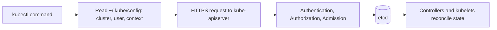
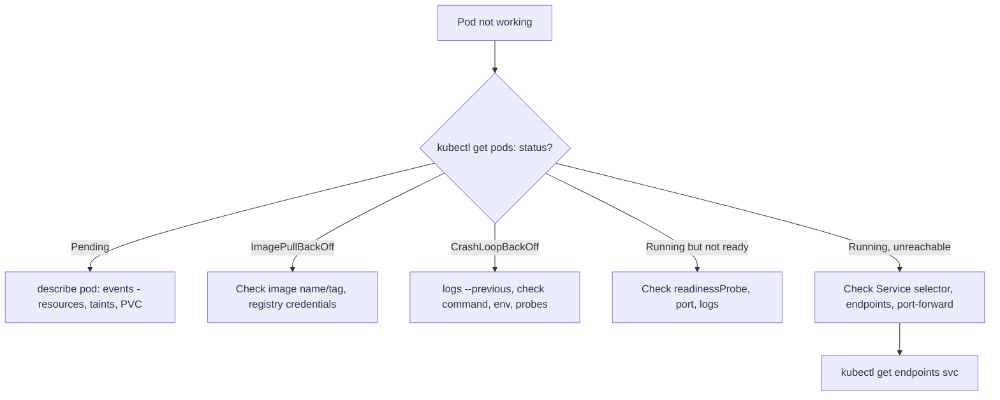

# 02. kubectl Cheat Sheet

Daily `kubectl` commands. How `kubectl` works (REST calls to `kube-apiserver`) is in [[2. Kubernetes Architecture – from Container Images to Running Pods|01. Kubernetes Architecture – from Container Images to Running Pods]]; Pod basics in [[4. Running Your Containers in Kubernetes|03. Running Your Containers in Kubernetes]]; local clusters in [[2. Local Kubernetes Tools|Local Kubernetes Tools]].



---

# Syntax

```
kubectl <verb> <resource> [name] [flags]
```

- **Verbs**: `get`, `describe`, `create`, `apply`, `delete`, `edit`, `logs`, `exec`, `explain`
- **Resources** accept singular, plural and short names: `pod` / `pods` / `po`, `deployment` / `deploy`, `service` / `svc`, `namespace` / `ns`, `configmap` / `cm`, `persistentvolumeclaim` / `pvc`, `node` / `no`, `ingress` / `ing`
- Discover resources and fields:

```
$ kubectl api-resources                 # all kinds, short names, namespaced or not
$ kubectl explain pod.spec.containers   # field documentation
$ kubectl explain deployment --recursive
$ kubectl api-versions
```

---

# Viewing Resources

```
$ kubectl get pods
$ kubectl get pods -o wide              # + node and IP
$ kubectl get pods -A                   # all namespaces
$ kubectl get pods -n dev
$ kubectl get pods --show-labels
$ kubectl get pods -l app=web           # label selector
$ kubectl get pods -w                   # watch changes
$ kubectl get all                       # common workload objects
$ kubectl get pod web -o yaml
$ kubectl get pod web -o json | jq '.status.phase'
$ kubectl get pods -o custom-columns=NAME:.metadata.name,NODE:.spec.nodeName
$ kubectl get pods -o jsonpath='{.items[*].metadata.name}'
$ kubectl get pods --sort-by=.metadata.creationTimestamp
$ kubectl get events --sort-by=.lastTimestamp
$ kubectl describe pod web              # config + events (first stop for debugging)
$ kubectl top nodes                     # needs metrics-server
$ kubectl top pods --containers
```

Output formats: `-o wide | yaml | json | name | jsonpath=... | custom-columns=...`.

---

# Creating and Changing

```
# Imperative (quick)
$ kubectl run nginx --image=nginx:1.27
$ kubectl create deployment web --image=nginx:1.27 --replicas=3
$ kubectl expose deployment web --port=80 --type=NodePort
$ kubectl create namespace dev
$ kubectl create configmap app-config --from-literal=MODE=dev --from-file=app.properties
$ kubectl create secret generic db --from-literal=password='S3cret!'

# Declarative (preferred)
$ kubectl apply -f manifest.yaml
$ kubectl apply -f ./k8s/                # a whole directory
$ kubectl apply -k overlays/dev          # kustomize
$ kubectl diff -f manifest.yaml          # preview changes
$ kubectl delete -f manifest.yaml

# Generate YAML instead of writing it
$ kubectl create deployment web --image=nginx --dry-run=client -o yaml > web.yaml

# Edit live objects
$ kubectl edit deployment web
$ kubectl set image deployment/web nginx=nginx:1.28
$ kubectl label pod web tier=frontend
$ kubectl annotate pod web note="demo"
$ kubectl patch deployment web -p '{"spec":{"replicas":5}}'
$ kubectl replace --force -f manifest.yaml     # delete and recreate
```

Note: `create` fails if the object exists; `apply` creates or updates.

---

# Deleting

```
$ kubectl delete pod web
$ kubectl delete pod web --grace-period=0 --force     # last resort
$ kubectl delete pods -l app=web
$ kubectl delete deployment,svc web
$ kubectl delete namespace dev                        # removes everything inside
$ kubectl delete all --all -n dev
```

---

# Debugging

```
$ kubectl logs web
$ kubectl logs -f web -c sidecar              # follow a specific container
$ kubectl logs web --previous                 # the crashed instance
$ kubectl logs -l app=web --tail=50 --all-containers
$ kubectl logs deploy/web                     # pick a Pod from the Deployment

$ kubectl exec web -- env
$ kubectl exec -it web -- /bin/sh
$ kubectl port-forward pod/web 8080:80
$ kubectl port-forward svc/web 8080:80
$ kubectl cp web:/var/log/app.log ./app.log   # copy files out (and in)
$ kubectl debug -it web --image=busybox --target=web   # ephemeral debug container
$ kubectl run tmp --rm -it --image=busybox -- sh       # throwaway Pod inside the cluster
$ kubectl auth can-i create pods --as=system:serviceaccount:dev:default
```



Common checks:

```
$ kubectl get endpoints web                  # empty means the selector matches no ready Pods
$ kubectl describe svc web
$ kubectl get pods --show-labels             # do labels match the Service selector?
$ kubectl rollout status deployment/web
```

---

# Deployments and Rollouts

```
$ kubectl scale deployment web --replicas=5
$ kubectl autoscale deployment web --min=2 --max=10 --cpu-percent=70
$ kubectl rollout status deployment/web
$ kubectl rollout history deployment/web
$ kubectl rollout undo deployment/web
$ kubectl rollout undo deployment/web --to-revision=2
$ kubectl rollout restart deployment/web
$ kubectl rollout pause deployment/web
```

---

# Nodes and Cluster

```
$ kubectl cluster-info
$ kubectl get nodes -o wide
$ kubectl describe node minikube
$ kubectl cordon node1                   # mark unschedulable
$ kubectl drain node1 --ignore-daemonsets --delete-emptydir-data   # evict Pods safely
$ kubectl uncordon node1
$ kubectl taint nodes node1 key=value:NoSchedule
$ kubectl label node node1 disk=ssd
$ kubectl version
```

---

# Contexts and Namespaces

```
$ kubectl config view
$ kubectl config get-contexts
$ kubectl config current-context
$ kubectl config use-context minikube
$ kubectl config set-context --current --namespace=dev
```

Per command: `-n <namespace>` or `--context <name>`.

---

# Productivity

```
# Alias and completion
alias k=kubectl
source <(kubectl completion bash)
complete -o default -F __start_kubectl k

# Handy variables
export do="--dry-run=client -o yaml"
$ k run web --image=nginx $do > web.yaml

# Quickly see what a command would send
$ kubectl get pods -v=8                  # verbose: shows the HTTP calls
```

- `kubectl options` lists global flags; `kubectl <verb> --help` has examples
- `kubectl api-resources --namespaced=false` shows cluster-scoped kinds
- `kubectl get pods -o name | xargs -I{} kubectl delete {}` for bulk actions (review first)

---

# Quick Reference

| Goal | Command |
| ---- | ------- |
| List Pods with node and IP | `kubectl get pods -o wide` |
| Why is my Pod failing? | `kubectl describe pod <p>` then `kubectl logs <p> --previous` |
| Apply a file | `kubectl apply -f file.yaml` |
| Reach a Pod from my laptop | `kubectl port-forward pod/<p> 8080:80` |
| Open a shell in a Pod | `kubectl exec -it <p> -- sh` |
| Scale | `kubectl scale deploy <d> --replicas=N` |
| Roll back | `kubectl rollout undo deploy/<d>` |
| Generate YAML | `kubectl create ... --dry-run=client -o yaml` |
| What does this field mean? | `kubectl explain <resource>.<field>` |
| Which cluster am I on? | `kubectl config current-context` |
