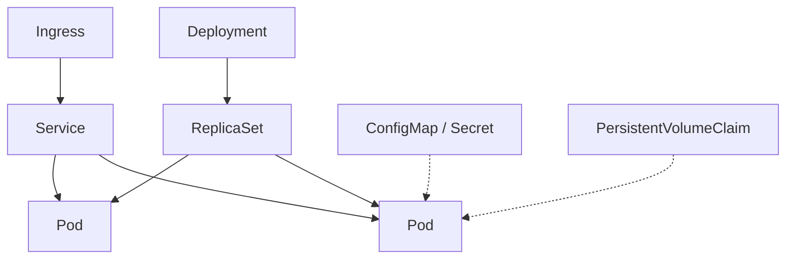

> **Hands-on:** each resource below has runnable examples in [sharifndlovu123/devops-directive-kubernetes-course](https://github.com/sharifndlovu123/devops-directive-kubernetes-course) (section "Built-in resource types", one namespace and one task list per type). Cluster set-up is in [[2. Local Kubernetes Tools]]; commands are in [[3. kubectl Cheat Sheet]].

Kubernetes describes everything as **resources** you declare in YAML. The control plane then works to make reality match, continuously (**declarative state plus reconciliation**). The best order to learn them is bottom up.

## Resources at a glance

| Resource | One-line job |
| -------- | ------------ |
| **Namespace** | Divide a cluster into isolated groups of resources |
| **Pod** | One or more containers sharing network and storage; the smallest unit |
| **ReplicaSet** | Keep N identical pods running |
| **Deployment** | Manage stateless apps: rolling updates and rollbacks (creates ReplicaSets) |
| **Service** | A stable name and IP in front of changing pods |
| **Job / CronJob** | Run to completion once / on a schedule |
| **DaemonSet** | One pod on every (or selected) node |
| **StatefulSet** | Stateful apps: stable names, ordered start, own storage |
| **ConfigMap / Secret** | Configuration and sensitive data injected into pods |
| **Ingress / Gateway API** | HTTP routing from outside to Services |
| **PersistentVolume / Claim** | Storage that outlives pods |
| **RBAC** | Who may do what in the cluster |



---

# Namespace

A scope for names, quotas and access. Put each example or team in its own namespace; **deleting a namespace deletes everything in it**, which makes clean-up easy.

```
$ kubectl create namespace demo
$ kubectl config set-context --current --namespace=demo
```

# Pod

```yaml
apiVersion: v1
kind: Pod
metadata:
  name: web
  labels: { app: web }
spec:
  containers:
    - name: nginx
      image: nginx:1.27
      ports: [{ containerPort: 80 }]
      resources:
        requests: { cpu: 100m, memory: 128Mi }
        limits: { memory: 256Mi }
      readinessProbe:
        httpGet: { path: /, port: 80 }
```

You rarely create bare Pods: if one dies nothing replaces it. Use a Deployment. **Requests** guide scheduling; **limits** cap usage. **Probes** tell Kubernetes when a container is ready (receive traffic) or alive (otherwise restart it).

# ReplicaSet and Deployment

A ReplicaSet keeps the count right. A **Deployment** adds **rolling updates** and **rollback** on top:

```yaml
apiVersion: apps/v1
kind: Deployment
metadata: { name: web }
spec:
  replicas: 3
  selector:
    matchLabels: { app: web }
  strategy:
    type: RollingUpdate
    rollingUpdate: { maxUnavailable: 1, maxSurge: 1 }
  template:
    metadata:
      labels: { app: web }
    spec:
      containers:
        - name: nginx
          image: nginx:1.27
```

```
$ kubectl rollout status deployment/web
$ kubectl set image deployment/web nginx=nginx:1.28
$ kubectl rollout undo deployment/web
$ kubectl scale deployment/web --replicas=5
```

# Service

Pods come and go, so clients talk to a **Service** that selects them by label.

| Type | Reachable from |
| ---- | -------------- |
| **ClusterIP** (default) | Inside the cluster only |
| **NodePort** | Each node's IP and a high port |
| **LoadBalancer** | An external cloud load balancer |
| **ExternalName** | A DNS alias to an outside name |
| **Headless** (`clusterIP: None`) | DNS returns pod IPs directly (used with StatefulSets) |

```yaml
apiVersion: v1
kind: Service
metadata: { name: web }
spec:
  selector: { app: web }
  ports: [{ port: 80, targetPort: 80 }]
```

Inside the cluster, `web.demo.svc.cluster.local` (or just `web`) resolves to it. This is the same "use the service name, not localhost" idea as in [[2. Docker Compose]].

# Job and CronJob

```yaml
apiVersion: batch/v1
kind: CronJob
metadata: { name: nightly-report }
spec:
  schedule: "30 1 * * *"
  concurrencyPolicy: Forbid
  jobTemplate:
    spec:
      backoffLimit: 2
      template:
        spec:
          restartPolicy: OnFailure
          containers:
            - name: report
              image: myorg/report:1.0
```

# DaemonSet

One pod per node: log shippers, monitoring agents, network plugins.

# StatefulSet

For databases and other apps needing **stable identity** (`db-0`, `db-1`), **ordered** start and stop, and a **volume per pod** (`volumeClaimTemplates`). Pair it with a headless Service. For serious databases, prefer an operator ([[5. Extending Kubernetes - CRDs and Operators|Extending Kubernetes - CRDs and Operators]]).

# ConfigMap and Secret

```yaml
apiVersion: v1
kind: ConfigMap
metadata: { name: app-config }
data:
  LOG_LEVEL: info
---
apiVersion: v1
kind: Secret
metadata: { name: db-creds }
type: Opaque
stringData:
  password: change-me
```

Inject as environment variables (`envFrom`) or mounted files. **Secrets are only base64-encoded by default, not encrypted**; enable encryption at rest and never commit them. Better approaches: [[7. Developer Experience, Secrets and Debugging|Developer Experience, Secrets and Debugging]].

# Ingress and Gateway API

An **Ingress** routes HTTP(S) by host and path to Services, and needs an **ingress controller** (Traefik, NGINX, cloud load balancers) to act on it. **Gateway API** is the newer, more expressive successor (separate roles for infrastructure and app teams, richer routing).

```yaml
apiVersion: networking.k8s.io/v1
kind: Ingress
metadata: { name: web }
spec:
  rules:
    - host: demo.example.com
      http:
        paths:
          - path: /
            pathType: Prefix
            backend:
              service: { name: web, port: { number: 80 } }
```

TLS certificates can be automated with cert-manager.

# PersistentVolume and PersistentVolumeClaim

A **PersistentVolume (PV)** is storage; a **PersistentVolumeClaim (PVC)** is a pod's request for it. A **StorageClass** provisions volumes dynamically from the cloud disk service.

```yaml
apiVersion: v1
kind: PersistentVolumeClaim
metadata: { name: data }
spec:
  accessModes: [ReadWriteOnce]
  resources: { requests: { storage: 10Gi } }
```

`ReadWriteOnce` means one node at a time; shared access needs `ReadWriteMany` storage (file systems). Related cloud storage: [[4. AWS Storage and Databases]].

# RBAC

```yaml
apiVersion: rbac.authorization.k8s.io/v1
kind: Role
metadata: { name: pod-reader, namespace: demo }
rules:
  - apiGroups: [""]
    resources: ["pods", "pods/log"]
    verbs: ["get", "list", "watch"]
---
apiVersion: rbac.authorization.k8s.io/v1
kind: RoleBinding
metadata: { name: read-pods, namespace: demo }
subjects:
  - kind: ServiceAccount
    name: ci
    namespace: demo
roleRef:
  kind: Role
  name: pod-reader
  apiGroup: rbac.authorization.k8s.io
```

**Role** and **RoleBinding** are namespaced; **ClusterRole** and **ClusterRoleBinding** are cluster-wide. Give each workload its own **ServiceAccount** with the least privilege. Check with `kubectl auth can-i list pods --as system:serviceaccount:demo:ci`.

---

# Beyond the Core

These matter in real clusters and are covered separately in the course:

| Resource | Purpose |
| -------- | ------- |
| **LimitRange / ResourceQuota** | Default and maximum resources per namespace |
| **NetworkPolicy** | Firewall rules between pods (needs a CNI that enforces them) |
| **HorizontalPodAutoscaler** | Scale replicas on CPU or custom metrics |
| **Admission webhooks** (mutating / validating) | Change or reject requests before they are stored |
| **CustomResourceDefinition** | Add new resource types: [[5. Extending Kubernetes - CRDs and Operators|Extending Kubernetes - CRDs and Operators]] |

# Working Method

1. One **namespace** per exercise
2. Apply, then inspect: `kubectl get`, `describe`, `logs`, `events`
3. Break it on purpose and fix it ([[7. Developer Experience, Secrets and Debugging|Developer Experience, Secrets and Debugging]])
4. Delete the namespace to clean up
