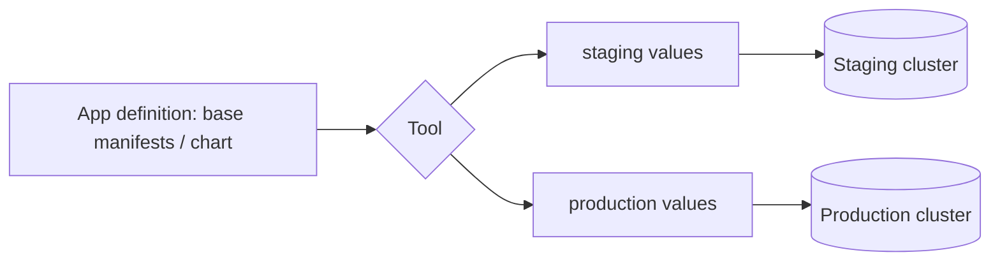

# 05. Packaging and Multi-Environment Deploys

> **Hands-on:** Helm, Kustomize and Kluctl versions of the same app in [sharifndlovu123/devops-directive-kubernetes-course](https://github.com/sharifndlovu123/devops-directive-kubernetes-course) (sections "Helm" and "Deploying to multiple environments"). Helm basics are in [[2. Local Kubernetes Tools|01. Local Kubernetes Tools]].

Raw YAML works for one cluster. Real systems deploy the **same application to several environments** (staging, production) with small differences: image tag, hostnames, replica counts, secrets. The tools below manage that.

## Tools at a glance

| Tool | Model | Good at | Watch out for |
| ---- | ----- | ------- | ------------- |
| **Kustomize** | **Overlays**: a base plus per-environment patches | Built into `kubectl`; no templating language; easy start | Patching gets verbose and awkward for some changes |
| **Helm** | **Charts**: templated packages with `values.yaml` | Huge ecosystem of third-party charts; versioned releases and rollback | Go templating boilerplate; heavy for simple apps |
| **Kluctl** | Hybrid of templating and overlays, with **diff** and a GitOps controller | Previews exactly what will change; handles third-party deps | Smaller community |
| **Timoni** | Typed config in **CUE** | Type safety and validation; ships config with the app | Steep learning curve (CUE plus the tool) |
| **cdk8s** | Define resources in TypeScript, Python, Java or Go | Loops, functions, tests | Another build step; generated YAML to review |
| **Pulumi** | General-purpose languages for Kubernetes and cloud | One tool for infrastructure and cluster | Needs state management |



---

# Helm

A **chart** bundles templates, default `values.yaml` and metadata. A **release** is one installed instance of a chart.

```
$ helm repo add bitnami https://charts.bitnami.com/bitnami
$ helm install db bitnami/postgresql -n data --create-namespace -f values.yaml
$ helm upgrade db bitnami/postgresql -n data -f values.yaml
$ helm list -n data
$ helm rollback db 1 -n data
$ helm template ./mychart -f values-prod.yaml      # render YAML without installing
```

Two uses:
- **Third-party software**: install databases, ingress controllers and monitoring from existing charts, overriding a few values
- **Your own app**: `helm create` scaffolds a chart; a minimal one needs only a Deployment, Service and a few values (image tag, hostname)

```yaml
# templates/deployment.yaml (fragment)
image: "{{ .Values.image.repository }}:{{ .Values.image.tag }}"
replicas: {{ .Values.replicas }}
```

Tips: pin chart **versions**, keep per-environment `values-<env>.yaml`, run `helm lint` and `helm template` in CI, and review what a chart really creates before installing it in production.

---

# Kustomize

Plain YAML in a **base**, plus **overlays** that patch it:

```
app/
  base/
    deployment.yaml
    service.yaml
    kustomization.yaml
  overlays/
    staging/kustomization.yaml
    production/kustomization.yaml
```

```yaml
# overlays/production/kustomization.yaml
resources:
  - ../../base
images:
  - name: api
    newName: registry.example.com/api
    newTag: "1.8.2"
replicas:
  - name: api
    count: 4
patches:
  - path: ingress-host.yaml
```

```
$ kubectl kustomize overlays/production        # render
$ kubectl apply -k overlays/production         # apply
```

Strong when the differences are small and structured (image tag, replica count, host name).

---

# Kluctl

Combines the best of both: Jinja-style **templating**, an overlay-like **target** per environment, a **diff** before every deploy, and a GitOps controller.

```
$ kluctl diff -t staging       # what would change
$ kluctl deploy -t production
```

A `.kluctl.yaml` defines targets (staging, production); `deployment.yaml` lists the components. The course uses it for a complete multi-service deployment, including third-party dependencies, and reuses it for the GitOps example ([[8. Upgrades, CI-CD and GitOps|Upgrades, CI-CD and GitOps]]).

---

# Choosing

| Situation | Pick |
| --------- | ---- |
| Installing someone else's software | **Helm** (use their chart) |
| Few environments, few differences, want no extra tooling | **Kustomize** |
| Want a clear diff and one tool for templates, overlays and GitOps | **Kluctl** |
| Strongly typed config, shipping config with the app | **Timoni** (CUE) |
| Need real loops, abstractions and unit tests | **cdk8s** or **Pulumi** |
| Everything already in Pulumi or Terraform | Stay in that tool ([[2. Terraform|02. Terraform]]) |

Practices that apply to all of them:
- **One source of truth** in Git; environments differ by **parameters**, not copies of manifests
- Keep **secrets out** of values files ([[7. Developer Experience, Secrets and Debugging|Developer Experience, Secrets and Debugging]])
- **Promote** the same image through environments by changing its tag, never rebuilding per environment
- Validate in CI: `kubectl apply --dry-run=server`, `kubeconform`, policy checks
- Pair with CI/CD and GitOps ([[1. CI-CD Pipelines|01. CI-CD Pipelines]])
