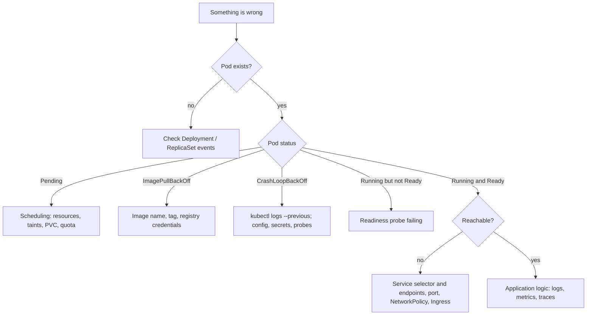

> **Hands-on:** Tilt files, External Secrets Operator examples and a deliberately broken microservices app in [sharifndlovu123/devops-directive-kubernetes-course](https://github.com/sharifndlovu123/devops-directive-kubernetes-course). Resources are covered in [[4. Kubernetes Resource Types|Kubernetes Resource Types]].

Kubernetes is only pleasant if the daily loop is fast, secrets are handled safely and you know how to find faults. This note covers all three.

# 1. The Inner Development Loop

Default flow: edit code, rebuild the image, push, redeploy, wait. Too slow. Tools that shorten it:

| Tool | Idea |
| ---- | ---- |
| **Tilt** | A `Tiltfile` watches your code; each change rebuilds and live-updates the service in the cluster, with a web dashboard |
| **Skaffold** | Build, push and deploy on every change; supports profiles for dev and CI |
| **Telepresence** | Run one service on your laptop while it behaves as if it were inside the cluster network |
| **mirrord** | Run local code with the environment, traffic and files of a real pod |
| **kind / minikube / k3d** | A local cluster that resembles production ([[2. Local Kubernetes Tools]]) |

```python
# Tiltfile (fragment)
docker_build('api', './api', live_update=[sync('./api/src', '/app/src')])
k8s_yaml('k8s/api.yaml')
k8s_resource('api', port_forwards=8080)
```

Tips: keep images small and layers cache-friendly ([[3. Container Images and Build Tools]]), use hot-reload tools (`air` for Go, `nodemon` for Node) inside the dev image, and keep the dev environment as close to production as you can.

---

# 2. Secrets Management

Configuration belongs in Git. **Secrets cannot**, so the question is how they reach the cluster.

| Approach | How it works | Verdict |
| -------- | ------------ | ------- |
| **Create by hand** (`kubectl create secret`) | Out-of-band, undocumented | Fine for a first try; unmanageable and unrepeatable |
| **External Secrets Operator** | Mirrors secrets from a cloud store (AWS Secrets Manager, Google Secret Manager, Azure Key Vault, 1Password, Vault) into Kubernetes Secrets, kept in sync | Good: the source of truth stays in the secret manager |
| **Sealed Secrets** | Encrypt with a cluster key; commit the **encrypted** object; the controller decrypts in-cluster | Good for GitOps |
| **SOPS** | Encrypt values inside YAML files using cloud KMS or age keys; decrypt at apply time | Good; pairs with Flux and Helm |
| **Skip Kubernetes Secrets** | App reads from Vault, a cloud secret manager or Doppler directly using workload identity | Strong isolation, more app code |

```yaml
apiVersion: external-secrets.io/v1beta1
kind: ExternalSecret
metadata: { name: db-creds }
spec:
  refreshInterval: 1h
  secretStoreRef: { kind: ClusterSecretStore, name: cloud-secrets }
  target: { name: db-creds }
  data:
    - secretKey: password
      remoteRef: { key: prod/app/db-password }
```

Rules that always hold:
- **Encrypt Secrets at rest** in etcd and restrict who can `get secrets` (RBAC)
- Use **workload identity** (IAM roles for service accounts, Azure workload identity, GKE Workload Identity) so pods authenticate without stored keys
- **Rotate** secrets; one secret per purpose and environment
- More general advice: [[5. Secure Coding and Supply Chain]]

---

# 3. Debugging Kubernetes

Real clusters misbehave in repeatable ways. Practise on a broken app (the course uses a microservices demo with intentional faults) before an outage forces you to.

## The investigation flow



## Commands in order

```
$ kubectl get pods -A                          # what is not Running?
$ kubectl describe pod <name>                  # events at the bottom explain most problems
$ kubectl logs <pod> [-c container] --previous # logs, including the crashed container
$ kubectl get events --sort-by=.lastTimestamp
$ kubectl get endpoints <service>              # empty means the selector matches no ready pods
$ kubectl exec -it <pod> -- sh                 # look from the inside
$ kubectl port-forward svc/<service> 8080:80   # test a Service from your laptop
$ kubectl debug -it <pod> --image=busybox --target=<container>   # ephemeral debug container
$ kubectl top pods                             # CPU and memory (needs metrics-server)
```

## Common faults and where they hide

| Symptom | Usual cause |
| ------- | ----------- |
| `Pending` | Not enough CPU or memory, unbound PVC, node selector or taint mismatch |
| `ImagePullBackOff` | Wrong tag, private registry without an `imagePullSecret` |
| `CrashLoopBackOff` | App exits on start: missing env var or secret, bad config, failing dependency |
| `OOMKilled` | Memory limit too low or a leak |
| Service has no endpoints | Label selector does not match the pod labels, or pods not Ready |
| `503` from Ingress | Backend not Ready, wrong port, wrong `targetPort` |
| DNS failures | CoreDNS problem, wrong namespace in the name |
| Works in one namespace only | Missing ConfigMap or Secret in that namespace, RBAC |
| Slow or flapping | Probes too aggressive, CPU throttling from low limits |

Reading order that works: **events, then logs, then configuration, then network**. The Learnk8s "troubleshooting deployments" flow chart is a good reference to keep nearby.

---

# Tools That Help

| Tool | Use |
| ---- | --- |
| **k9s** | Terminal UI for navigating and debugging a cluster |
| **stern** | Tail logs from many pods at once |
| **kubectx / kubens** | Switch cluster and namespace quickly |
| **Lens / Headlamp** | Graphical cluster browsers |
| **Prometheus + Grafana, OpenTelemetry** | Metrics and traces for production |

Cheat sheet of commands: [[3. kubectl Cheat Sheet]].
