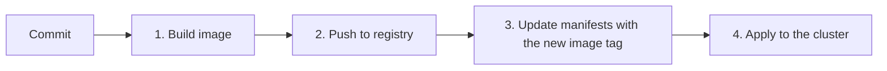
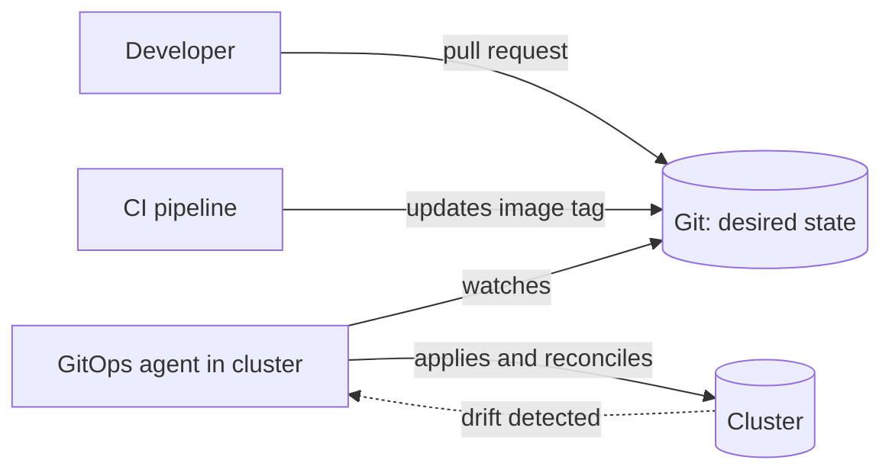
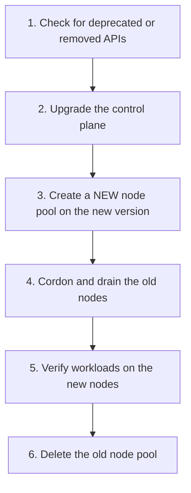

> **Hands-on:** upgrade tasks, a reference image-build workflow and a Kluctl GitOps example in [sharifndlovu123/devops-directive-kubernetes-course](https://github.com/sharifndlovu123/devops-directive-kubernetes-course). Pipeline concepts: [[1. CI-CD Pipelines]]; workflow syntax: [[3. GitHub Actions Deep Dive|GitHub Actions Deep Dive]].

Two operational jobs keep a cluster healthy: **delivering changes** to it and **upgrading it**.

# 1. CI/CD for Kubernetes

The Kubernetes-specific part of a pipeline has four steps:



CI still also lints, tests and scans, but those are not Kubernetes-specific ([[5. Secure Coding and Supply Chain]]).

Practices:
- **Tag images immutably** (commit SHA or semantic version), never `latest`
- Build once, **promote the same image** from staging to production
- Scan the image and sign it; verify signatures at deploy time
- Updating tags by string replacement in a script is **brittle**; use a proper mechanism (Flux image automation, Renovate, Kustomize `images`, Helm values)

```yaml
# build job (fragment)
- uses: docker/build-push-action@<sha>
  with:
    push: true
    tags: ghcr.io/${{ github.repository }}/api:${{ github.sha }}
```

---

# 2. Keeping the Cluster in Sync

| Method | How | Problem |
| ------ | --- | ------- |
| **Manual `kubectl apply`** | A person runs it | Someone forgets, or targets the wrong cluster |
| **Pipeline push** | CI runs `kubectl apply` or `helm upgrade` | Cluster credentials live in the CI system; **no drift detection** |
| **GitOps (pull)** | An agent **inside** the cluster pulls from Git and applies | Strongest security boundary; continuous drift correction |



Why GitOps is attractive:
- **Git is the audit log** and the rollback (`git revert`)
- No inbound cluster credentials in CI; the cluster reaches out
- Drift (manual edits) is **detected and reverted**
- Disaster recovery: point a new cluster at the same repo

## Tools

| Tool | Notes |
| ---- | ----- |
| **Argo CD** | Popular, rich web UI, application and app-of-apps model |
| **Flux CD** | Toolkit of controllers, strong Helm, Kustomize and image automation |
| **Kluctl** | Diff-first CLI with a GitOps controller ([[6. Packaging and Multi-Environment Deploys|Packaging and Multi-Environment Deploys]]) |

Repository layout that works: separate the **application repo** (code, Dockerfile, CI) from the **environment repo** (manifests per environment) so deploys do not trigger code builds and vice versa.

---

# 3. Cluster and Node Upgrades

Upgrade regularly to **patch vulnerabilities** and get new features. Versions are supported for a limited window, so skipping falls you out of support.

Managed services (GKE, EKS, AKS) can automate much of it: for example GKE offers **release channels** (rapid, regular, stable) and upgrades the control plane and nodes for you. You still decide when to upgrade early or manually, and you must make sure your workloads survive it. See [[1. Orchestration Platforms]].

## A safe manual process



1. **Deprecated APIs**: find manifests using APIs the next version removes (tools such as `kubent` or `pluto`, or the API server's deprecation metrics) and migrate them first
2. **Control plane first**: it may be ahead of the nodes by a limited skew, never behind
3. **New node pool**: rather than upgrading nodes in place, add a fresh pool; the new nodes are proven before any workload moves, and rollback is just keeping the old pool
4. **Cordon and drain**:

```
$ kubectl cordon <old-node>            # stop new pods landing here
$ kubectl drain <old-node> --ignore-daemonsets --delete-emptydir-data
```

5. Check workloads, probes and storage on the new nodes
6. Delete the old pool

## Making workloads upgrade-safe

| Need | Setting |
| ---- | ------- |
| Keep enough replicas up during drains | **PodDisruptionBudget** (`minAvailable` or `maxUnavailable`) |
| Spread across nodes and zones | `topologySpreadConstraints` or anti-affinity |
| Graceful shutdown | `terminationGracePeriodSeconds`, handle `SIGTERM`, `preStop` hook |
| No traffic to unready pods | Readiness probes |
| At least 2 replicas | Otherwise a drain means downtime |

```yaml
apiVersion: policy/v1
kind: PodDisruptionBudget
metadata: { name: api }
spec:
  minAvailable: 2
  selector:
    matchLabels: { app: api }
```

## Before and after

- Back up cluster state and persistent data; test the upgrade in a non-production cluster first
- Read the release notes for removed features and changed defaults
- Upgrade add-ons (ingress controller, CNI, operators) to versions that support the new Kubernetes version
- Watch metrics and error rates after each step
