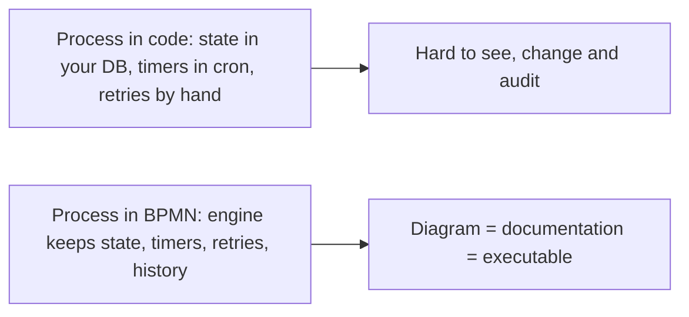

Camunda is a **process orchestration** platform: you draw a business process in BPMN, deploy it, and the engine runs it, waiting for people, calling services and keeping the state. Background: [[4. BPMN and Workflow Engines|BPMN and Workflow Engines]]. The rest of this section: [[2. BPMN Modelling Guide|BPMN Modelling Guide]], [[3. DMN and FEEL|DMN and FEEL]] and the [[1. Camunda 8 Architecture|Camunda 8]] notes.

## What it is used for

**Technical use cases**

| Use case | What the engine does |
| -------- | -------------------- |
| **Human workflow automation** | Routes tasks to people, tracks deadlines, escalates when late |
| **Microservices orchestration** | Calls services in order, retries failures, handles errors and compensation |
| **RPA bot orchestration** | Starts and supervises robots, passes data in and out |
| **Decision automation** | Evaluates business rules (DMN tables) inside a process |
| **Document management** | Moves documents through review, approval and archiving |

**Business processes**

| Process | Typical steps |
| ------- | ------------- |
| **Customer onboarding and data management** | Collect details, verify identity, create accounts, welcome |
| **Order management** | Receive, check stock, charge payment, ship (see the order example in [[2. BPMN Modelling Guide|the BPMN guide]]) |
| **Claims management** | Register claim, assess, investigate, decide, pay |
| **Loan origination** | Application, credit check, underwriting, offer, signing |
| **Risk management and underwriting** | Score risk with rules, refer exceptions to a person |

## Why use an engine instead of code

- **One diagram everyone reads**: business and developers discuss the same model.
- **Long-running by design**: waits of days or weeks survive restarts.
- **Built-in reliability**: retries, timeouts, incidents, audit trail.
- **Visibility**: see every instance, where it is stuck and how long steps take.
- **Not a good fit** for very short, purely technical request/response logic, or one-off scripts.

## Code and deploy in your preferred language

Workers are ordinary programs that do the work for a service task. Use **Java, C# (.NET), Python, Node.js (TypeScript), Go, Ruby** or anything that can call the API. How: [[4. Writing Job Workers|Writing Job Workers]].

## Where it runs

| Platform | Notes |
| -------- | ----- |
| **Docker Compose** | Local or small self-managed setups |
| **Kubernetes** | Production self-managed (Helm charts), see [[1. Orchestration Platforms|Orchestration Platforms]] |
| **SaaS** | Camunda's hosted service, nothing to operate |
| **Camunda 8 Run** | A single download that runs everything locally: [[2. Running Camunda 8 Locally|Running Camunda 8 Locally]] |

## Camunda 7 and Camunda 8: universal process orchestrator

**Camunda 7** (engine embedded in a Java application, relational database):

![[Pasted image 20251021151754.png]]

**Camunda 8** (Zeebe engine as a separate, horizontally scalable service):

![[Pasted image 20251021151846.png]]

Comparison and notes on migrating: [[1. Camunda 8 Architecture|Camunda 8 Architecture]].
