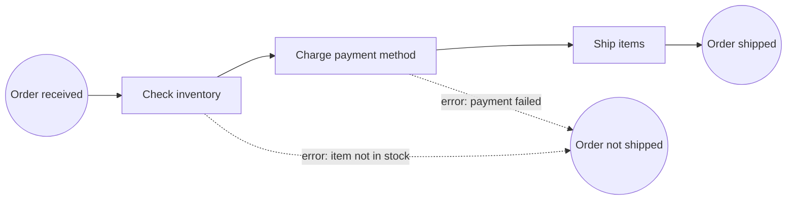
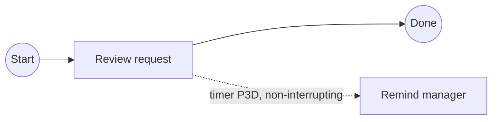
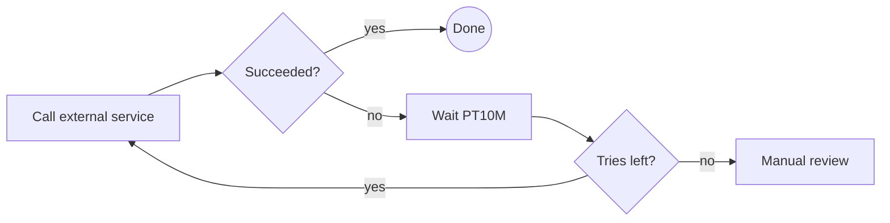
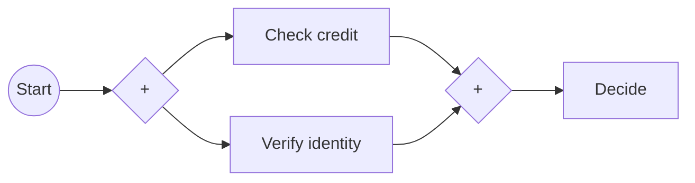

BPMN 2.0 is a diagram standard that the engine can execute. This guide takes the basics in [[4. BPMN and Workflow Engines|BPMN and Workflow Engines]] further: the full element set, the patterns used most, and how to model so others can read it. Running example: a small **order process** with service tasks and error events (the same shape as the simple models used when trying Camunda).

## The order process



| BPMN element | Zeebe job type | Worker does |
| ------------ | -------------- | ----------- |
| Service task "Check inventory" | `check-inventory` | Looks up stock |
| Service task "Charge payment method" | `charge-payment` | Calls the payment provider |
| Service task "Ship items" | `ship-items` | Creates the shipment |
| Error boundary event | error code (e.g. `out_of_stock`) | Worker **throws a BPMN error**; the engine follows the boundary path |

Each service task has a **task definition type**; any worker subscribed to that type picks up the job ([[4. Writing Job Workers|Writing Job Workers]]).

## Elements you will use

### Events (circles)

| Event | Start | Intermediate (catch / throw) | Boundary (on a task) | End |
| ----- | :---: | :---: | :---: | :---: |
| **None** | yes | yes (a milestone) | n/a | yes |
| **Message** | process starts on a message | wait for / send a message | task interrupted by a message | send a message |
| **Timer** | start on a schedule | wait for a duration or date | **escalate after 3 days** | n/a |
| **Error** | n/a | n/a | catch an error thrown inside | end with an error |
| **Signal** | broadcast start | wait / broadcast | react to a broadcast | n/a |
| **Escalation** | n/a | throw | notify without stopping | n/a |
| **Terminate** | n/a | n/a | n/a | stop everything now |

- **Interrupting** boundary events cancel the task; **non-interrupting** ones (dashed) run alongside it (for example, send a reminder but keep waiting).
- **Event-based gateway** waits for the first of several events (a reply message or a timeout).

### Tasks (rounded rectangles)

| Task | Meaning | Who does it |
| ---- | ------- | ----------- |
| **User task** | A person completes it, usually with a form | Tasklist or your own UI |
| **Service task** | Automated work | A job worker or connector |
| **Send / receive task** | Send or wait for a message | Worker / engine |
| **Business rule task** | Evaluate a DMN decision ([[3. DMN and FEEL|DMN and FEEL]]) | Engine |
| **Script task** | A short FEEL expression | Engine |
| **Call activity** | Run another process | Engine |
| **Manual task** | Done offline, no system involved | (documentation only) |

### Gateways (diamonds)

| Gateway | Behaviour |
| ------- | --------- |
| **Exclusive (X)** | Exactly **one** outgoing path, the first whose condition is true; always add a default |
| **Parallel (+)** | **All** paths at once; a second parallel gateway joins them |
| **Inclusive (O)** | **Every** path whose condition is true |
| **Event-based** | Wait for the first event to happen |

### Containers

- **Embedded subprocess**: group steps, scope variables, and attach one boundary event to the whole group. In the HZV example the whole "In Quarantine" loop can be cancelled by one timer.
- **Event subprocess**: a mini-process that starts when an event occurs anywhere inside its parent (for example "cancel order").
- **Call activity**: reuse a process (a "credit check") from many parents.
- **Multi-instance**: run a task for every item in a list, in parallel or in turn.
- **Pools and lanes**: who does what; the engine executes one pool.

## Patterns that come up constantly

**1. Wait for a person, escalate if late**


**2. Retry loop with a limit**

Prefer **job retries with back-off** in the worker for technical failures. Model the loop only when the *business* wants a visible retry.

**3. Parallel work, then continue**


**4. Run for each item (multi-instance)**
A service task with a multi-instance marker, **input collection** `=order.items`, **input element** `item`, and an **output collection** that gathers each result.

**5. Compensation (undo)**
If shipping fails after payment, a **compensation or refund** path reverses the payment. Model the undo explicitly. Check your Camunda version's list of supported elements for the exact compensation features.

**6. Start by message, correlate later messages**
A message start event creates the instance; later messages find *their* instance through a **correlation key** (for example `=order_id`). See [[4. Writing Job Workers|Writing Job Workers]].

**7. Timers**
ISO 8601 values: `PT30M` (30 minutes), `P2D` (2 days), `R3/PT10M` (repeat 3 times every 10 minutes), a fixed date-time, or a FEEL expression such as `=quarantine_duration` (see the HZV example in [[3. Camunda 8 Code Studio Tutorial|the tutorial]]).

## Modelling style: make it readable

| Do | Don't |
| -- | ----- |
| Name tasks **verb + object**: "Check inventory", "Approve claim" | Vague names ("Process", "Step 2") |
| Name events as **something that happened**: "Order received", "Payment failed" | Reuse the same name for different things |
| Label exclusive gateways as **questions**: "In stock?" and label every outgoing flow ("yes"/"no") | Leave conditions on unlabeled lines |
| Flow **left to right**, one main "happy path" in a straight line | Crossing lines everywhere |
| Show **end states** that mean different outcomes separately ("Shipped", "Cancelled") | One end event for everything |
| Keep a model to roughly **a screen**; extract subprocesses or call activities | One huge diagram |
| Keep **logic in workers and rules in DMN**; keep the diagram to *what happens when* | Complex code or conditions in sequence flows |
| Version and review models like code | Edit production models without a trail |

**Anti-patterns**
- **Spaghetti** with lines jumping back (loops without a named reason).
- **Everything in one pool** with no lanes, so nobody knows who owns a step.
- **Gateways that do work**: a gateway only chooses a path.
- **Business data hidden in variables** nobody documents: write down the variables each task reads and writes.
- **Using the engine as a database**: store big data elsewhere and pass references ([[5. Troubleshooting and Best Practices|Best Practices]]).

## Variables and data

- Variables live on the **process instance** (and on scopes such as subprocesses).
- Tasks can **map inputs and outputs** so each task sees only what it needs.
- Conditions and mappings use **FEEL** expressions starting with `=`: `=order.total > 1000`, `=customer.country = "ZA"`. Details: [[3. DMN and FEEL|DMN and FEEL]].
- Keep payloads small: IDs and key facts, not documents.

## Reading the XML (when you need to)

```xml
<bpmn:serviceTask id="check" name="Check inventory">
  <bpmn:extensionElements>
    <zeebe:taskDefinition type="check-inventory" />
  </bpmn:extensionElements>
</bpmn:serviceTask>

<bpmn:boundaryEvent id="out_of_stock" name="Item not in stock" attachedToRef="check">
  <bpmn:errorEventDefinition errorRef="Error_out_of_stock" />
</bpmn:boundaryEvent>
```
The `zeebe:` parts are Camunda 8 additions: job type, called decision, form, message correlation, input/output mappings. They live in the same `.bpmn` file as the picture, so one file is both documentation and program.

## Tools

| Tool | Notes |
| ---- | ----- |
| **Camunda Desktop Modeler** | Free app, edit BPMN, DMN and forms, deploy and start instances ([[2. Running Camunda 8 Locally|Running Camunda 8 Locally]]) |
| **Camunda Web Modeler** | In the browser, collaboration, versions, connectors |
| **bpmn.io** | The open-source modeler library behind both; also works for viewing |
| **Mermaid flowcharts** | Good for quick sketches in these notes, but not executable BPMN |
