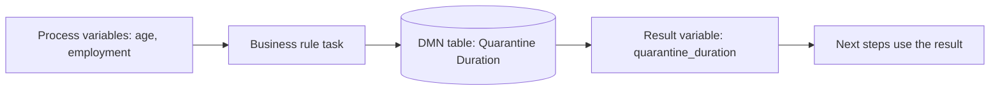
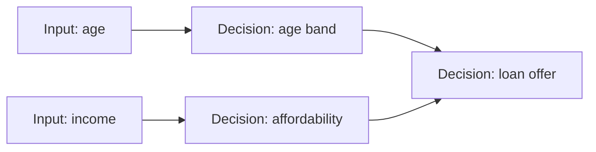

How to keep business rules out of the process diagram and out of code. **DMN** (Decision Model and Notation) is a standard for decision tables; **FEEL** is the expression language used inside them and inside Camunda 8 processes. Used from a **business rule task** in [[2. BPMN Modelling Guide|BPMN]].

## Why a decision table



- Rules change more often than process flow. A table can be edited and **redeployed** without touching the diagram or code.
- Business people can read a table. They cannot read nested `if` statements.

## Example from the tutorial: quarantine duration

Inputs: **Employment Category** and **Age**. Output: **Quarantine Duration** (an ISO 8601 duration).

| # | Employment Category | Age | Quarantine Duration | Why |
| - | ------------------- | --- | ------------------- | --- |
| 1 | `"critical infrastructure"` | `<=30` | `"P5D"` | Young, recovers fast, and the role keeps society running |
| 2 | `"non-critical infrastructure"` | `<=30` | `"P7D"` | Young, recovers fast |
| 3 | *(any)* | `>30` | `"P10D"` | Older people take longer to be sure |

- The hit policy is **Unique**: at most one rule may match.
- The output (`P5D`, `P7D`, `P10D`) goes straight into a **timer** as `=quarantine_duration`, so a rule result drives the process.
- The task's *Called decision ID* is `Decision_Quarantine` and the *Result variable* is `quarantine_duration`. The ID in the process must match the decision's ID.

```xml
<bpmn:businessRuleTask id="rule" name="Determine length of quarantine">
  <bpmn:extensionElements>
    <zeebe:calledDecision decisionId="Decision_Quarantine" resultVariable="quarantine_duration" />
  </bpmn:extensionElements>
</bpmn:businessRuleTask>
```

## Hit policies

| Policy | Letter | Meaning | Example use |
| ------ | ------ | ------- | ----------- |
| **Unique** | U | Only one rule can match (error if several) | Mutually exclusive bands |
| **First** | F | First matching rule wins (order matters) | Priority lists, defaults at the bottom |
| **Priority** | P | Highest-priority matching output wins | Ranked outcomes |
| **Any** | A | Several can match but must agree | Redundant rules |
| **Collect** | C | All matches returned as a list (or `+` sum, `<` min, `>` max, `#` count) | Totalling fees or surcharges |
| **Rule order** | R | All matches, in table order | Ordered checklists |
| **Output order** | O | All matches, in output priority order | Sorted results |

**Collect with sum, e.g. insurance loading**

| Age | Smoker | Loading |
| --- | ------ | ------- |
| `>50` | - | `20` |
| - | `true` | `30` |
| `<25` | - | `10` |

A 55-year-old smoker matches rows 1 and 2, so with **Collect (+)** the result is `50`.

## Input and output cells (FEEL unary tests)

| Write | Matches |
| ----- | ------- |
| `5` | exactly 5 |
| `<=30`, `>30` | comparisons |
| `[18..65]` | 18 to 65 inclusive |
| `(18..65)` | 18 to 65 exclusive |
| `"gold", "silver"` | either value |
| `not("closed")` | anything but "closed" |
| *(empty)* or `-` | any value |

## FEEL: the expression language

In a BPMN field, an expression starts with `=`. Without `=`, it is plain text.

```
= 1 + 2 * 3                              # 7
= "Hello, " + name                       # string join
= order.total > 1000 and customer.vip    # boolean
= if age >= 18 then "adult" else "minor"
= items[price > 100]                     # filter a list
= sum(items.price)                       # 3 + 5 + ... of a field
= count(items)
= for i in items return i.price * i.qty  # transform each element
= some i in items satisfies i.price > 100
= every i in items satisfies i.qty > 0
= contains(email, "@")
= upper case(name)
= string length(code)
= date("2026-10-29") + duration("P7D")
= now() + duration("PT2H")
= date and time(dueDate) < now()
```

**Data types:** number, string, boolean, date, time, date-time, duration (ISO 8601: `P1DT2H`), list `[1,2,3]`, context (object) `{ name: "A", age: 3 }`, and **null**.

### Where FEEL appears in Camunda 8

| Place | Example |
| ----- | ------- |
| Sequence flow conditions | `=isZombie = true` |
| Timers | `=quarantine_duration` |
| Message correlation key | `=person_uuid` |
| Input / output mappings | `=customer.email` mapped to `to` |
| Multi-instance input collection | `=order.items` |
| Task headers and assignee | `=manager` |
| Script tasks | `=total * 1.15` |

### Null handling and pitfalls

- A missing variable is **null**, and most operations on null give null. Use `= if x = null then 0 else x`, or defaults, to be safe.
- Strings in FEEL need **double quotes**. `"critical infrastructure"` is a string; `critical` is a variable name.
- Comparing a string to a number is **false**, not an error. Check variable types in Operate.
- A path through a missing key (`order.address.city`) gives null, not a crash. If a *required* value is missing, the engine raises an **incident** instead ([[5. Troubleshooting and Best Practices|Troubleshooting]]).
- Names with spaces need backticks: `` `order total` ``.

## Chaining decisions: DRD

A **Decision Requirements Diagram** links decisions: the output of one is the input of the next.


- Keep each table small and focused; combine them in a DRD.
- Use **literal expressions** in a decision for a single formula and **decision tables** for rule lists.

## Testing decisions

- Write a few **example rows** next to the table (inputs and the expected output) and check each in the Modeler's decision test or a unit test.
- Test the **boundaries** (age 30 and 31 here) and the **empty** values.
- Keep tables **versioned in Git** with the process.
- Overlapping rules under *Unique* cause runtime errors: review tables for gaps and overlaps whenever they change.
