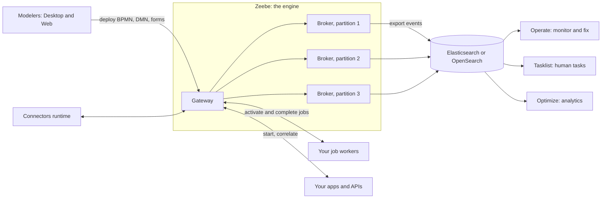
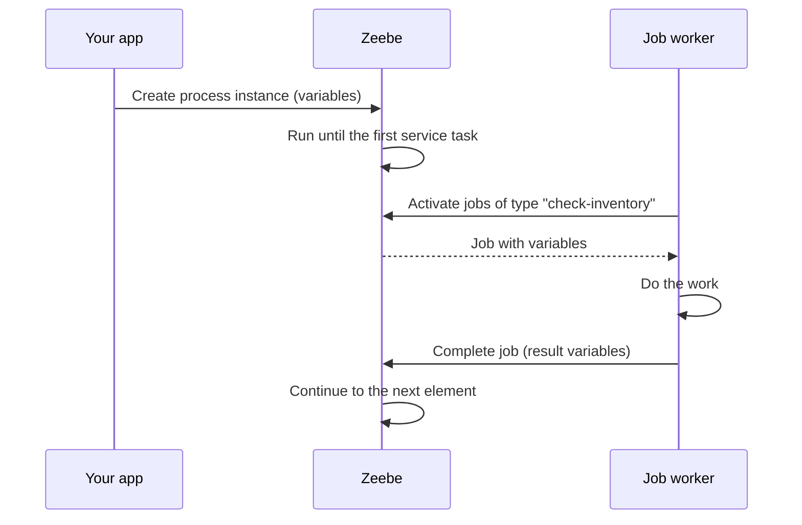

# 01. Camunda 8 Architecture

How Camunda 8 is built, how it differs from Camunda 7, and which piece does what. Models: [[2. BPMN Modelling Guide|BPMN Modelling Guide]]. Run it yourself: [[2. Running Camunda 8 Locally|Running Camunda 8 Locally]].

> Camunda changes its packaging between releases (8.8 groups several components into one application). Treat names below as concepts and check the documentation for your exact version.

## The big picture

## Components

| Component | Role |
| --------- | ---- |
| **Zeebe** | The workflow engine. Stores process state as an **append-only log** replicated across brokers |
| **Gateway** | Entry point (gRPC and REST) that routes requests to the right partition |
| **Operate** | See running and finished instances, find **incidents**, retry, change variables, cancel |
| **Tasklist** | The inbox for user tasks, with forms |
| **Optimize** | Dashboards and reports on process performance and bottlenecks |
| **Connectors** | Ready-made integrations (REST, Slack, email, Kafka...) so simple tasks need no worker |
| **Web Modeler / Desktop Modeler** | Draw BPMN, DMN and forms |
| **Identity / Management Identity** | Users, roles, permissions, tokens |
| **Console** (SaaS) | Create clusters, API clients, manage the organisation |

## How Zeebe works (the part worth understanding)

- Work is divided into **partitions**; each partition is a **Raft** group with a leader and followers (replication factor, usually 3). More partitions means more parallel throughput.
- A process instance lives on **one partition**. State changes are written to the log first (**event sourcing**), then applied.
- There is **no central database** that every step must hit, which is why it scales horizontally.
- **Exporters** stream events out to Elasticsearch/OpenSearch. Operate, Tasklist and Optimize read from there. If the search store is down, the engine still runs, but the tools show stale data.
- Service tasks become **jobs**. Workers **activate** jobs (long polling), do the work and **complete** or **fail** them. This is pull-based, so workers can scale and be down for a while without losing work.

## Camunda 7 and Camunda 8

| | Camunda 7 | Camunda 8 |
| - | --------- | --------- |
| **Engine** | Java library, often embedded in your app (or a shared engine) | Separate engine service (Zeebe) |
| **State** | Relational database (PostgreSQL, MySQL...) | Replicated log plus search store for the UIs |
| **Scaling** | Vertical, plus clustering on one database | Horizontal by partitions |
| **Service tasks** | Java delegates or external tasks | **Job workers** (external, any language) or connectors |
| **Expressions** | JUEL, Groovy and others | **FEEL** |
| **Forms** | Embedded or generated forms | Camunda Forms (JSON) |
| **API** | Java API and REST | gRPC and REST |
| **Hosting** | Self-managed only | SaaS or self-managed |
| **Status** | The Community Edition was announced to reach end of life in late 2025; check the current support dates | The active product |

**Migrating from 7 to 8** is a re-platforming, not an upgrade: models need adjusting (expressions to FEEL, delegates to workers), and running instances are handled by finishing them on 7 or migrating with tooling. Plan it as a project.

## Deployment options

| Option | Good for | Notes |
| ------ | -------- | ----- |
| **SaaS** | Fast start, nothing to operate | Free trial clusters for learning |
| **Camunda 8 Run** | Local development on a laptop | One download: [[2. Running Camunda 8 Locally|Running Camunda 8 Locally]] |
| **Docker Compose** | Single-host test environments | Compose files published by Camunda ([[2. Docker Compose|02. Docker Compose]]) |
| **Kubernetes with Helm** | Production self-managed | Stateful: needs storage, backups, upgrades |

Licence note: self-managed Camunda 8 is free for development and non-production use; **production use needs a licence**. Check the current terms before building a business on it.

## Sizing and limits (rules of thumb)

- Start with **3 brokers**, 3 partitions, replication factor 3, and measure.
- Throughput depends mostly on partitions, disk speed (the log is written to disk) and the number of exported events.
- Keep **variables small**; the engine limits message size (around 4 MB). Store documents elsewhere and pass references.
- Give the search store enough disk, and set **retention** on old process data.
- Back up the broker volumes and the search store together.
- See [[7. Capacity Estimation and Sizing|Capacity Estimation]] for turning instances per day into numbers.
