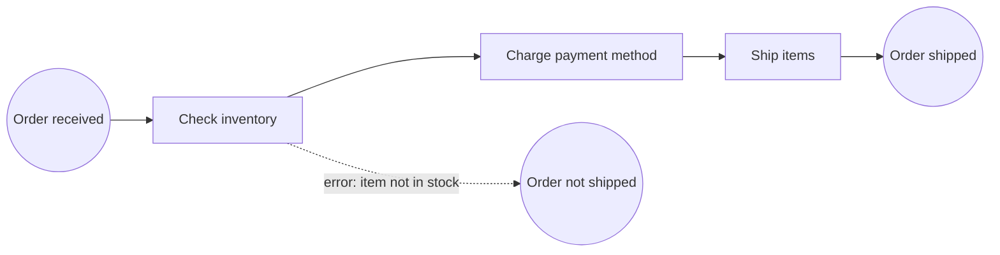

# 02. Running Camunda 8 Locally

Run a full Camunda 8 on your own machine, deploy a model from the Desktop Modeler, and watch it in Operate. This follows the **Camunda 8 Run** getting-started bundle: a self-contained Java application that bundles the engine, the web tools, a search store and the connectors runtime. Architecture: [[1. Camunda 8 Architecture|Camunda 8 Architecture]].

## What you need

| Item | Notes |
| ---- | ----- |
| **JDK 21 to 23** | Camunda 8 Run (8.8) needs one of these |
| **Camunda 8 Run** | Download the 8.8 release from Camunda's download page |
| **Camunda Desktop Modeler** | Download from the Camunda website; no install needed on Linux, just unpack |
| **The demo project** | `git clone https://github.com/camunda/camunda-8-get-started.git` (BPMN models plus Java and Node.js workers) |

```
$ java -version                                  # confirm 21, 22 or 23
$ git clone https://github.com/camunda/camunda-8-get-started.git
```

## Start it

```
$ cd c8run
$ ./c8run start        # starts the engine, tools and Elasticsearch
$ ./c8run stop         # stops everything again
```
A small wrapper script is handy:
```bash
#!/bin/bash
cd c8run
./c8run start --startup-url="https://developers.camunda.com/developers/quick-start?c8run_start=success"
cd ..
```

What is running and where (defaults):

| What | URL |
| ---- | --- |
| **Operate** | `http://localhost:8080/operate` |
| **Tasklist** | `http://localhost:8080/tasklist` |
| **Login** | `demo` / `demo` (local development only) |

It also starts an Elasticsearch that holds the data the tools show, and the **connectors runtime** (extra connectors can go in the `custom_connectors` folder).

## Your first process: the order example

The demo has two small models:

| File | What it contains |
| ---- | ---------------- |
| `diagram_1.bpmn` | **Order received** -> **Check inventory** -> **Charge payment method** -> **Ship items** -> **Order shipped** |
| `diagram_2.bpmn` | The same flow plus an **error boundary event** ("Item not in stock") leading to **Order not shipped** |



1. Open **Camunda Desktop Modeler**, then **File > Open** `bpmn/diagram_1.bpmn`.
2. Click the **play** icon in the bottom toolbar. Choose the local cluster and deploy and start.
3. Open **Operate**. You will see one **active** instance sitting at "Check inventory". Nothing happens because **no worker is running** for the job type `check-inventory`.
4. Start the workers (below). The instance finishes at once.

Each service task's job type is set in the **Properties panel** (`check-inventory`, `charge-payment`, `ship-items`). The worker must use exactly the same strings.

## Run the workers

**Node.js**
```
$ cd nodejs && npm install
$ npx ts-node workers.ts
```
**Java (Spring Boot)**
```
$ cd java && ./mvnw spring-boot:run
```
Then start another instance. Watch it complete immediately in Operate. Stop the workers and start another, and it waits again; start the workers, and it **catches up**. That is the pull-based job model at work ([[4. Writing Job Workers|Writing Job Workers]]).

## Try these experiments

1. **Make a task fail**: change a worker to throw an error. See the **incident** in Operate, fix the code, press **Retry**.
2. **Use the error path**: open `diagram_2.bpmn`, make the inventory worker throw the BPMN error. The instance should end at "Order not shipped".
3. **Add a user task** to approve large orders, give it a form, and complete it in Tasklist.
4. **Change a variable** in Operate on a stuck instance and retry.
5. **Redeploy** a changed model and notice the new **version**; old instances keep the old one.
6. **Start an instance from the API** instead of the Modeler:
```
$ curl -u demo:demo -X POST http://localhost:8080/v2/process-instances \
    -H "Content-Type: application/json" \
    -d '{"processDefinitionId":"order-process","variables":{"orderId":"A-1001"}}'
```
(The API path and fields depend on the Camunda version; check the API reference for yours.)

## Docker Compose alternative

The Run bundle also ships a `docker-compose-8.8` folder. Use it when you want the same stack in containers ([[2. Docker Compose|02. Docker Compose]]):
```
$ cd docker-compose-8.8
$ docker compose up -d
$ docker compose ps
```

## Troubleshooting

| Problem | Fix |
| ------- | --- |
| `Unsupported Java version` | Use JDK 21 to 23; check `JAVA_HOME` |
| Port 8080 already in use | Stop the other service (or change the port in the configuration) |
| Operate shows no data for a few seconds | The exporter feeds Elasticsearch asynchronously; wait and refresh |
| Instance waits at a service task | No worker for that job type, or the job type string differs |
| Elasticsearch out of memory or disk | Free space, stop other heavy apps, check the `log` folder |
| Modeler cannot connect | Make sure Run is started and the endpoint is `localhost:26500` (gRPC) or the REST port, as shown in `endpoints.txt` |
More in [[5. Troubleshooting and Best Practices|Troubleshooting and Best Practices]].
