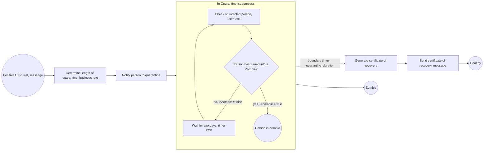

# 03. Camunda 8 Code Studio Tutorial

> **Repository:** [camunda-community-hub/camunda-8-code-studio](https://github.com/camunda-community-hub/camunda-8-code-studio), Camunda's public workshop project. The model, decision table and form are in its `ressources` folder, workers in `src`.

A hands-on exercise that builds one complete process: model it, add a business rule and a form, automate the steps with workers, then analyse it. The scenario is deliberately silly (a **zombie virus** quarantine) so the *process* stays the focus. Architecture: [[1. Camunda 8 Architecture|Camunda 8 Architecture]]. Setup options: [[2. Running Camunda 8 Locally|Running Camunda 8 Locally]] or a free SaaS trial cluster.

## The scenario

When a person tests positive for **HZV** (Hypothetical Zombie Virus), the Health Department must run a quarantine process:

- Tell the person to quarantine, and for how long.
- Check on them **every two days**.
- If they turn into a zombie, the quarantine ends and a different process starts.
- If the period ends without that, issue a **digital recovery certificate** and send it (good for a discount on ice cream).
- **Duration** depends on age and job: people **30 or under** recover faster (**5 days** if they work in critical infrastructure, **7 days** otherwise); people **over 30** need **10 days**.

## The process



| Element | BPMN type | What it does in Camunda 8 |
| ------- | --------- | ------------------------- |
| Positive HZV Test | **Message start event** | A message named `Positive_HZV_Test` starts an instance |
| Determine length of quarantine | **Business rule task** | Evaluates the DMN decision `Decision_Quarantine`, result in `quarantine_duration` |
| Notify person to quarantine | **Send task** (a service task) | Job type `notify_person_to_quarantine` |
| In Quarantine | **Embedded subprocess** | Lets one timer interrupt the whole loop |
| Check on infected person | **User task** | Appears in Tasklist with a form |
| Person has turned into a Zombie? | **Exclusive gateway** | `=isZombie="true"` or `=isZombie="false"` |
| Wait for two days | **Timer catch event** | `P2D` (48 hours), then back to the check |
| Quarantine finishes officially | **Interrupting boundary timer** | Duration is `=quarantine_duration` (from the rule) |
| Generate certificate of recovery | **Service task** | Job type `generate_certificate_of_recovery` |
| Send certificate of recovery | **Message throw event** | Job type `send_certificate_of_recovery` |

The boundary timer is the key idea: **a decision made at the start (rule result) controls a timer later** through a variable. This is my reading of the model in the repo's `ressources/hzvprocess.bpmn`.

## The decision table (DMN)

| Employment Category | Age | Quarantine Duration |
| ------------------- | --- | ------------------- |
| `"critical infrastructure"` | `<=30` | `"P5D"` |
| `"non-critical infrastructure"` | `<=30` | `"P7D"` |
| *(any)* | `>30` | `"P10D"` |

Hit policy **Unique**. Full explanation: [[3. DMN and FEEL|DMN and FEEL]].

## The form

The user task "Check on infected person" shows a **Camunda Form** with:

| Field | Type | Purpose |
| ----- | ---- | ------- |
| `person_uuid` | Text (read-only) | Who is being checked |
| `quarantine_duration` | Text (read-only) | The rule result, for information |
| `isZombie` | Radio (true/false) | The answer that drives the gateway |

## Exercises, step by step

**1. Design the process.** Draw it yourself first in the Modeler, comparing with the reference only afterwards. Think about every outcome (recovered, zombie, early release).

**2. Meet the platform.** Create a cluster (SaaS) or start Camunda 8 Run, and open **Operate**, **Tasklist** and **Optimize** to see what each one is for ([[1. Camunda 8 Architecture|Architecture]]).

**3. User tasks and forms.** Change a task to a **user task**, set its assignee, build the form with the form builder, deploy, start an instance, and complete the task in **Tasklist**.

**4. Automate with workers.** Three steps need code: *notify*, *generate certificate*, *send certificate*. Use the language you like (Node.js, Java/Spring Boot, .NET, Python are in the repo).

**5. Analyse in Optimize.** Create a **collection**, add the process, and build a dashboard from a template (heatmaps, average duration per step, where instances wait).

## Start an instance

The process starts from a **message**. Publish `Positive_HZV_Test`, or start an instance from the Modeler with this payload:

```json
{
  "person_uuid": "Carl",
  "employment_category": "critical infrastructure",
  "age": 25
}
```

**Tip: shrink the time.** Quarantine is days long. For testing, change the DMN outputs to short ISO durations such as `"PT20S"`, and the timer `P2D` to `PT5S`, so a full run takes under a minute.

## The workers

All three do the same job in any language: receive variables, do something, return variables.

**Python (pyzeebe)**
```python
@worker.task(task_type="notify_person_to_quarantine")
def notify(quarantine_duration: str) -> dict:
    print(f"You're sick! Stay in for {quarantine_duration}!")
    return {"output": f"Stay in for {quarantine_duration}"}

@worker.task(task_type="generate_certificate_of_recovery")
async def generate_certificate(person_uuid: str) -> dict:
    return {"certificate": f"Dear {person_uuid}, you are fully recovered!"}

@worker.task(task_type="send_certificate_of_recovery")
async def send_certificate(certificate: str) -> dict:
    print(f"New certificate: {certificate}")
    return {}
```

**Node.js (zeebe-node)**
```ts
zbc.createWorker({
  taskType: 'generate_certificate_of_recovery',
  taskHandler: job => {
    const recovery_certificate_uuid = uuid()
    return job.complete({ recovery_certificate_uuid })
  }
})
```

**Credentials** (SaaS) come from an **API client** created in the Console: `ZEEBE_ADDRESS`, `ZEEBE_CLIENT_ID`, `ZEEBE_CLIENT_SECRET`, `ZEEBE_AUTHORIZATION_SERVER_URL`. Never commit them ([[5. Secure Coding and Supply Chain|Secure Coding]]). Local Camunda 8 Run needs no credentials.

More on job workers: [[4. Writing Job Workers|Writing Job Workers]].

## Things worth noticing

- **A leftover worker.** The Node.js example also defines a `determine_quarantine_period` worker, but the model uses a **business rule task** for that step, so the engine never creates that kind of job and the worker does nothing. Always check the job types in the model against the workers you run.
- **Variable flow:** the rule writes `quarantine_duration`; the notify task reads it; the form shows it; the timer uses it. Following one variable through the process is the best way to understand it.
- **The "send certificate" step is a message throw event** but technically runs as a **job** too, so you must have a worker for it or the instance will wait.
- **Zombie vs healthy** are different end states, so Optimize can compare outcomes.

## Extend it

1. Add a **non-interrupting timer** that reminds the department when a check is overdue.
2. Replace the "send" worker with a **connector** (email or Slack) and no code.
3. Add a **second DMN** that decides how often to check, based on risk.
4. Handle **"Person died"** and a **positive PCR test** as extra messages that end or reroute the process.
5. Write a **process test** that runs the model with fast timers ([[5. Troubleshooting and Best Practices|Testing]]).
6. Start many instances (a script) and watch **Optimize** find the slowest step.
