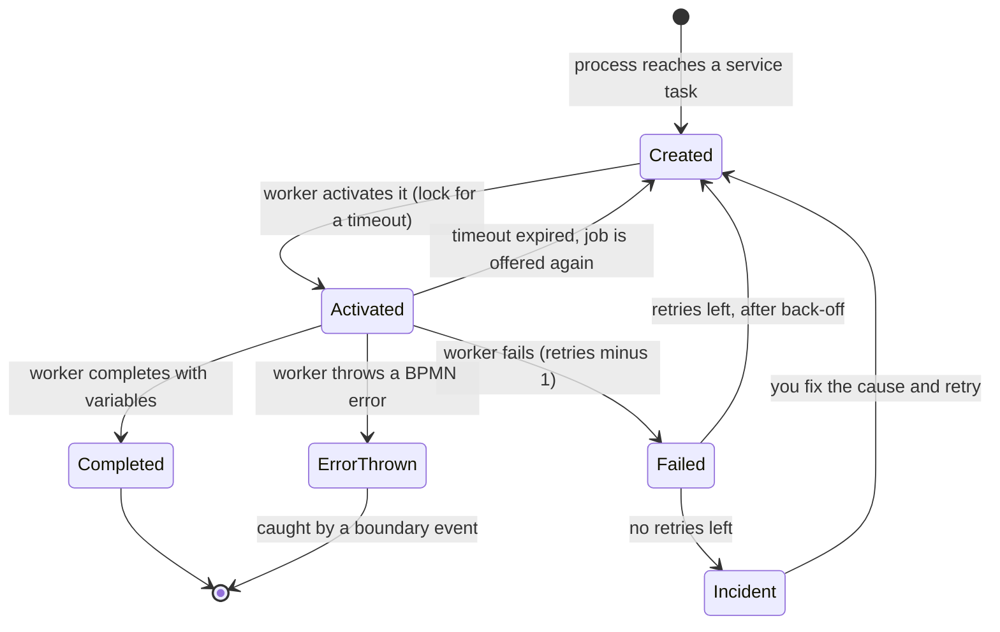
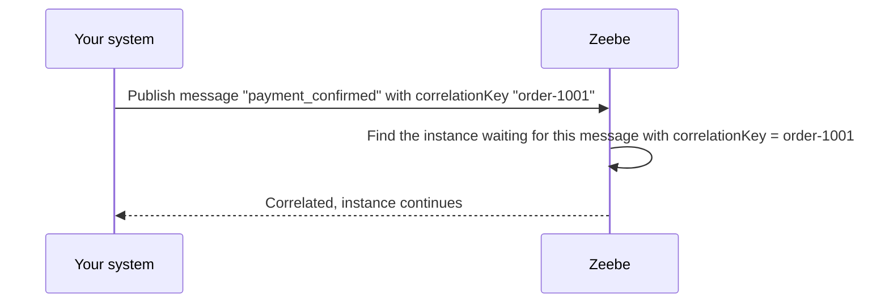

# 04. Writing Job Workers

Service tasks are done by **job workers**: your code, in any language, that asks the engine for work. This note covers how that works, how to handle success, failure and business errors, and how to write workers that are safe to run at scale. Architecture: [[1. Camunda 8 Architecture|Camunda 8 Architecture]]. Practice: [[2. Running Camunda 8 Locally|Running Camunda 8 Locally]].

## The job lifecycle



- The **job type** string in the model (`check-inventory`) is how a worker is matched to a task.
- A worker **activates** jobs with a **timeout**: if it does not finish in time, the job is offered to another worker.
- Workers use **long polling**: they hold a request open until a job is available, so there is little delay and little wasted traffic.

## Three ways to finish a job

| Outcome | When | Effect |
| ------- | ---- | ------ |
| **Complete** | Work succeeded | Variables returned are merged into the process |
| **Fail** | Technical problem (service down, timeout) | Retries decrease; at **0** an **incident** is raised so a person can look |
| **Throw BPMN error** | A **business** outcome the model handles ("out of stock", "card declined") | Engine follows a matching **error boundary event** in the diagram |

**Rule of thumb:** *fail* for things that might work if tried again; *throw an error* for outcomes the business has a path for.

## A worker, in three languages

**Node.js (TypeScript)**
```ts
import { Camunda8 } from '@camunda8/sdk'
const zeebe = new Camunda8().getZeebeGrpcApiClient()

zeebe.createWorker({
  taskType: 'check-inventory',
  taskHandler: async (job) => {
    const { sku, quantity } = job.variables
    const stock = await inventory.lookup(sku)          // your own code
    if (stock < quantity) {
      return job.error('out_of_stock', `Only ${stock} left`)   // business error
    }
    return job.complete({ reserved: true })
  },
})
```

**Python (pyzeebe)**
```python
@worker.task(task_type="charge-payment", timeout_ms=30_000)
async def charge(order_id: str, amount: float) -> dict:
    result = await payments.charge(order_id, amount)   # raises on technical errors
    if result.declined:
        raise BusinessError("payment_failed")          # mapped to a BPMN error
    return {"paymentId": result.id}
```

**Java (Spring Boot with the Camunda starter)**
```java
@JobWorker(type = "ship-items")
public Map<String, Object> ship(@Variable String orderId) {
    String trackingNumber = shipping.createShipment(orderId);
    return Map.of("trackingNumber", trackingNumber);
}
```
SDK names and APIs change between releases, so treat these as the shape of a worker and check the SDK documentation for the exact calls in your version.

## Writing good workers

| Principle | Why |
| --------- | --- |
| **Idempotent** | A job can be delivered **more than once** (a timeout, a crash after the work but before completing). Make "charge payment" safe by passing the order ID as an **idempotency key**, or check if it was already done |
| **Fast** | Long work blocks job slots. For long tasks, do the work asynchronously and complete the job when it finishes (or use a message/receive task) |
| **Small variables** | Return only what the process needs; store big data elsewhere and return a reference |
| **Set a sensible timeout** | Longer than the work normally takes, but short enough to retry soon after a crash |
| **Log the job key and process instance key** | So you can find the same instance in Operate |
| **Stateless** | Scale by running more copies; no state kept between jobs |
| **Fail with back-off** | Do not hammer a service that is down: set `retryBackOff` and decrease retries |
| **Do not swallow exceptions** | Let them become *fail* so an incident is visible |
| **Validate inputs** | Check variables exist; a clear error beats a null pointer |

**Tuning knobs**

| Setting | Meaning |
| ------- | ------- |
| `maxJobsToActivate` / `maxJobsActive` | How many jobs a worker holds at once (backpressure) |
| `timeout` | How long a worker has before the job is offered again |
| `pollInterval` / long-poll | How often to ask, if not long-polling |
| `fetchVariables` | Load only the variables you need (smaller messages) |
| `retries`, `retryBackOff` | Technical retry policy |

## Messages and correlation

How the outside world talks to a *running* instance:



- A **message start event** creates a new instance; **intermediate catch events** and **message boundary events** correlate to existing ones.
- Each waiting event has a **correlation key expression** (for example `=order_id`); the message's key must equal that value.
- **Message time-to-live (TTL)** lets a message wait a little for an instance that has not reached the event yet. A **message ID** prevents duplicates being published twice.
- **Signals** broadcast to many instances at once.

## Connectors: no code for common integrations

For REST calls, Slack, email, Kafka, SQL and so on, add a **connector** to a task in the Modeler and fill in its fields, with secrets referenced as `{{secrets.MY_KEY}}`. Write a worker only when you need your own logic. Where possible, prefer a connector for plumbing and a worker for business logic.

## Starting instances and publishing messages

```
$ curl -u demo:demo -X POST http://localhost:8080/v2/process-instances \
    -H "Content-Type: application/json" \
    -d '{"processDefinitionId":"order-process","variables":{"orderId":"A-1001"}}'

$ curl -u demo:demo -X POST http://localhost:8080/v2/messages/publication \
    -H "Content-Type: application/json" \
    -d '{"name":"payment_confirmed","correlationKey":"A-1001","variables":{"paid":true}}'
```
Endpoints and field names depend on your Camunda version: check its API reference. Official client libraries exist for Java, Node.js, Python, C# and Go.

## Security

- Use a dedicated **API client** per worker, with only the permissions it needs.
- Keep **client secrets** in environment variables or a secret store, never in the repo.
- Workers call **out** to the engine, so they need no inbound ports. Run them in a private network.
- Do not log variables that hold personal data. See [[5. Secure Coding and Supply Chain|Secure Coding and Supply Chain]].
