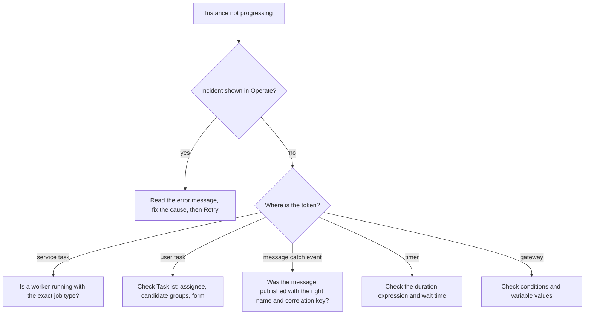

What to check when a process does not behave, and habits that keep Camunda 8 projects healthy. Related: [[4. Writing Job Workers|Writing Job Workers]], [[2. BPMN Modelling Guide|BPMN Modelling Guide]], [[3. DMN and FEEL|DMN and FEEL]], [[1. Camunda 8 Architecture|Architecture]].

## First question: where is the instance?

Open **Operate**, find the instance, and look at the **token**: where is it, and is there a red incident marker?



## Common problems

| Symptom | Likely cause | Fix |
| ------- | ------------ | --- |
| Waiting at a **service task** forever | No worker, wrong **job type** (typo or extra space), worker pointed at another cluster | Compare the type in the model with the worker's `taskType`; check worker logs and credentials |
| Incident: **"Failed to evaluate expression"** | FEEL error: a variable is missing or the wrong type | Open the variables in Operate, correct them, retry. Check the `=` and quotes |
| Incident: **"No matching rule"** (decision) | The DMN table has a gap for these inputs | Add a rule or a catch-all, redeploy; check input types (`"30"` is not `30`) |
| Incident: **"Multiple rules matched"** (hit policy Unique) | Overlapping rules | Make rules exclusive or change the hit policy |
| Incident: **"no retries left"** | Worker failed repeatedly | Read the error, fix the cause (service down?), **Retry** |
| Message does not start or continue anything | Message **name** differs, **correlation key** differs, or the message TTL expired before the instance got there | Check names exactly; log the key; set a TTL |
| User task not visible in Tasklist | Wrong assignee or candidate group, no permission | Check the task's assignment and the user's group |
| Exclusive gateway takes the wrong path | A condition is `null`, or conditions overlap; no **default flow** | Add a default, test with real variable values |
| Timer fires at the wrong time | Wrong ISO 8601 (`P2D` days vs `PT2D` is invalid), variable not set | Use `PT` for time units, `P` for date units: `PT30M`, `P2D`, `P1DT12H` |
| Variables overwritten unexpectedly | Same variable name used in different scopes | Use **input/output mappings** and scope variables in subprocesses |
| Tool shows old data | The exporter or search store is lagging or down | Check Elasticsearch/OpenSearch health, then exporter logs |
| New model version not used | Instances stay on the **version they started with** | Start a new instance; migrate old ones if needed |
| `RESOURCE_EXHAUSTED` / backpressure | Brokers overloaded | Slow starters, add partitions or brokers, check disk speed |

## Reading incidents

In Operate: open the failed instance, click the incident marker to see the **error type** and message, then:
1. Fix the **cause** (the worker, data or model).
2. If the data is wrong, **edit the variable** on the instance.
3. Press **Retry** on the incident.
4. If the instance is hopeless, **cancel** it, or use **modify instance** to move the token.

**Never** just cancel instances to make the red go away without understanding why they failed.

## Testing

| Level | What | How |
| ----- | ---- | --- |
| **Model** | Does the diagram follow the paths you expect? | Run it with a **process test** in code (Camunda's process test library for Java), mocking the workers |
| **Decisions** | Do the DMN rules give the right result at the edges? | Table-driven tests: inputs and expected output, including boundaries ([[3. DMN and FEEL|DMN and FEEL]]) |
| **Workers** | Does each handler behave on success, failure and business errors? | Ordinary unit tests; the handler is just a function |
| **Integration** | The whole thing against a real local engine | Camunda 8 Run or Docker Compose in CI ([[2. Docker Compose]]) |
| **Time** | Timers of days | Use test clocks or **shorten durations through configuration** |

Run these in your pipeline ([[2. GitHub Actions|GitHub Actions]]) before deploying a model.

## Deploying changes

- **Keep models, decisions and forms in Git** with the worker code; review them like code.
- **Deploy from CI**, not by hand, to test and production clusters ([[1. CI-CD Pipelines|CI/CD Pipelines]]).
- Each deployment of a changed model creates a **new version**. Running instances **keep their version**, so you can change a process safely, but design variables to stay **backward compatible**.
- To move running instances onto a new version, use **process instance migration**.
- Do not rename **job types** or **message names** casually: a worker or sender somewhere may depend on them.

## Best practices

**Process design**
- Model **what happens and when**; keep calculation and integration in workers and rules in DMN.
- One **business process per diagram**; extract reusable parts as **call activities**.
- Name things clearly and keep the **happy path** straight ([[2. BPMN Modelling Guide|style guide]]).
- Every service task should have a thought-out **failure story**: retry, error path or manual review.
- Add **timers/escalations** for waiting on people so nothing sits forever.

**Data**
- Keep variables **small** and structured; store documents elsewhere and pass **references**.
- Document the **variables** each task reads and writes.
- Never put **secrets** or unnecessary personal data in variables (they appear in tools and exports).

**Operations**
- **Monitor** the engine, the search store, worker health and job backlog; alert on **incidents**.
- Set **retention** on historic data so storage does not grow forever.
- Back up broker volumes and the search store; **test restores**.
- Run **several workers** per job type and several brokers; plan upgrades.
- Use **separate clusters** for development, test and production, with different credentials.

**Teams**
- Agree on **naming conventions** (job types in `kebab-case` or `snake_case`, one style).
- Review models with the business: if they cannot read it, simplify it.
- Keep a **README per process**: purpose, owner, variables, workers, decisions and message names.

## Anti-patterns

| Anti-pattern | Better |
| ------------ | ------ |
| Business rules buried in worker code | A **DMN** table the business can read |
| One worker for every task, switching on a field | One worker per **job type** |
| Huge payloads in variables | Store elsewhere, pass an ID |
| Using the engine for millisecond request/response calls | Call the service directly; use the engine for **long-running** coordination |
| Polling in a loop inside the diagram | A **message** or event wait |
| Ignoring incidents | Alerts and an owner for each process |
| Cancelling instances to clear errors | Fix and retry |
| Editing production models by hand | Deploy from Git through CI |

## Useful checks in a hurry

```
$ ./c8run start                            # is the local stack up?
$ curl -s localhost:9600/actuator/health   # Camunda health endpoint (management port; check your version)
$ docker compose logs -f                   # Compose setups: watch broker and worker logs
$ grep -r "taskDefinition type" models/    # list every job type used in your models
```
