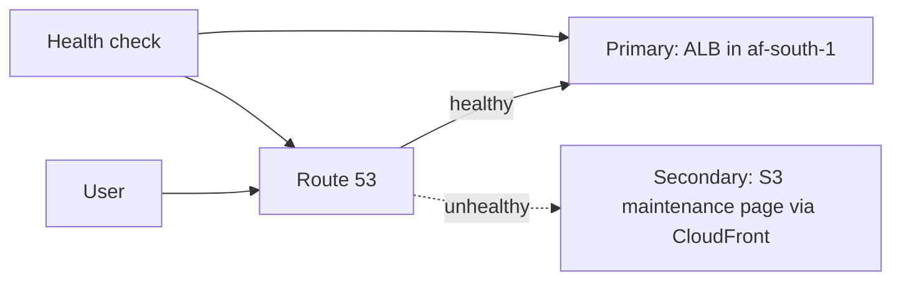

Route 53 is AWS's **DNS** service (authoritative DNS, domain registration, health checks and traffic routing). Overview is in [[5. AWS Networking|5. AWS Networking]]; DNS fundamentals are in [[09. Network Services|Network Services]].

## Parts at a glance

| Part | Role |
| ---- | ---- |
| **Hosted zone** | Container for a domain's DNS records. **Public** (internet) or **Private** (inside chosen VPCs) |
| **Record** | A DNS entry: name, type, value, TTL, routing policy |
| **Alias record** | Route 53-specific pointer to an AWS resource |
| **Routing policy** | How Route 53 chooses among answers |
| **Health check** | Probes an endpoint, alarm or other checks; drives failover |
| **Domain registration** | Buy and renew domains |
| **Resolver** | DNS between VPCs and on-premises networks |
| **DNSSEC** | Signs zone data against spoofing |

---

# Records

| Type | Purpose | Example |
| ---- | ------- | ------- |
| **A** / **AAAA** | Name to IPv4 / IPv6 | `www` to `203.0.113.10` |
| **CNAME** | Name to another name | `blog` to `example.ghost.io` |
| **MX** | Mail servers (with priority) | `10 mail.example.com` |
| **TXT** | Text: SPF, DKIM, domain verification | `"v=spf1 include:... ~all"` |
| **NS** | Name servers for the zone or a delegated sub-zone | |
| **SOA** | Zone authority data (automatic) | |
| **CAA** | Which CAs may issue certificates | `0 issue "amazon.com"` |
| **SRV** / **PTR** | Service location / reverse lookup | |

TTL is how long resolvers cache an answer. Lower it **before** planned changes (for example to 60 s), then raise it again.

## Alias vs CNAME

| | **Alias** | **CNAME** |
| - | --------- | --------- |
| At the zone apex (`example.com`) | **Yes** | No |
| Targets | AWS resources (CloudFront, ALB / NLB, API Gateway, S3 website, Global Accelerator, another record in the zone) | Any DNS name |
| Query cost | **Free** for AWS targets | Charged |
| Record type shown | A / AAAA | CNAME |
| TTL | Taken from the target | You set it |
| Health | Can **evaluate target health** | No |

Use alias for anything pointing at AWS, especially the apex:
`example.com` alias A and AAAA to CloudFront ([[2. AWS CloudFront Deep Dive|AWS CloudFront Deep Dive]]).

---

# Routing Policies

| Policy | Behaviour | Use |
| ------ | --------- | --- |
| **Simple** | One answer (or several values, returned all) | Single resource |
| **Weighted** | Split by weight (e.g. 90 / 10) | Canary releases, migrations |
| **Latency** | Lowest-latency Region | Multi-Region apps |
| **Failover** | Primary, then secondary when unhealthy | Active-passive disaster recovery |
| **Geolocation** | By user's country or continent | Language, licensing, data residency |
| **Geoproximity** | By distance, with adjustable **bias** (Traffic Flow) | Shift load between Regions |
| **IP-based** | By client CIDR | Route known networks to chosen endpoints |
| **Multivalue answer** | Up to 8 healthy records returned | Poor-man's load balancing with health checks |



## Failover setup

1. Create a **health check** on the primary (HTTPS, path `/health`, expect 2xx or 3xx)
2. Create the primary record: Failover **Primary**, attach the health check
3. Create the secondary record: Failover **Secondary**
4. Keep TTLs low (30 to 60 s)

---

# Health Checks

| Type | Checks |
| ---- | ------ |
| **Endpoint** | HTTP, HTTPS or TCP to an IP or name; optional string match in the first 5,120 bytes |
| **Calculated** | Combines other health checks (AND / OR / at least N) |
| **CloudWatch alarm** | Follows an alarm, so you can fail over on any metric or for **private** resources |

- Checkers run from several Regions; the endpoint must allow their IP ranges
- Settings: interval (30 s standard, 10 s fast), failure threshold, latency graphs, SNS notification
- Private endpoints cannot be probed directly; use a **CloudWatch alarm** health check

---

# Public and Private Hosted Zones

| | **Public zone** | **Private zone** |
| - | --------------- | ---------------- |
| Visible to | The internet | Only associated VPCs |
| Use | Customer-facing names | Internal names (`db.internal.example.com`) |
| Needs | Delegation at your registrar | VPC with **DNS support** and **DNS hostnames** enabled |

**Split-horizon DNS**: the same name in a public and a private zone returns different answers inside the VPC and outside.

---

# Registering and Delegating Domains

- Register in Route 53 or elsewhere; a public hosted zone gets **four NS records**. If the domain is registered elsewhere, copy those four NS values to the registrar
- **Delegate a subdomain** (`dev.example.com`) by creating a zone for it and adding its NS records in the parent zone
- **Transfers**: unlock the domain, get the authorisation code, approve at both ends
- Enable **auto-renew** and keep contact details current

---

# Resolver (Hybrid DNS)

Every VPC has an Amazon-provided resolver at the **VPC base + 2** address (for example `10.0.0.2`). **Route 53 Resolver** extends it:

| Piece | Direction | Use |
| ----- | --------- | --- |
| **Inbound endpoint** | On-premises to VPC | On-premises servers resolve private zone names |
| **Outbound endpoint + rules** | VPC to on-premises | VPC resolves `corp.example.com` via on-premises DNS |
| **DNS Firewall** | Filtering | Block known-bad domains from VPC workloads |
| **Query logging** | Visibility | Log queries from VPCs to S3 / CloudWatch |

---

# DNSSEC

- Signs a public zone so resolvers can verify answers
- Uses a **KMS key** in `us-east-1` (asymmetric, ECC_NIST_P256) and a **DS record** published at the registrar
- Do it carefully: a wrong DS record can make the domain unresolvable

---

# Common Tasks

```
$ aws route53 list-hosted-zones
$ aws route53 list-resource-record-sets --hosted-zone-id Z123EXAMPLE

# change-batch.json
{
  "Changes": [{
    "Action": "UPSERT",
    "ResourceRecordSet": {
      "Name": "www.example.com",
      "Type": "A",
      "AliasTarget": {
        "HostedZoneId": "Z2FDTNDATAQYW2",
        "DNSName": "d111111abcdef8.cloudfront.net",
        "EvaluateTargetHealth": false
      }
    }
  }]
}
$ aws route53 change-resource-record-sets --hosted-zone-id Z123EXAMPLE --change-batch file://change-batch.json
```

`Z2FDTNDATAQYW2` is the fixed hosted zone ID used for **all CloudFront alias targets**.

## Testing DNS

```
$ dig www.example.com +short
$ dig NS example.com +short
$ dig @ns-123.awsdns-45.com www.example.com      # ask Route 53 directly
$ dig www.example.com +trace                      # follow delegation
$ aws route53 test-dns-answer --hosted-zone-id Z123EXAMPLE --record-name www.example.com --record-type A
```

## Certificate validation

ACM **DNS validation** adds a CNAME in the zone; keep it, because ACM uses it to **renew** automatically.

---

# Troubleshooting

| Symptom | Likely cause |
| ------- | ------------ |
| Domain not resolving | NS records at the registrar do not match the hosted zone |
| Old answer still returned | TTL still counting down; flush local DNS cache |
| Cannot create CNAME at apex | Use an **alias** record |
| Private zone names not resolving | VPC not associated, or DNS support / hostnames disabled |
| Failover never triggers | Health check not attached to the record, or checker IPs blocked by a firewall |
| Duplicate-zone confusion | Two hosted zones for one domain; only the one whose NS are at the registrar is live |

Costs: a monthly fee per hosted zone, per-million-query charges (alias queries to AWS resources are free), health checks and domain fees.
