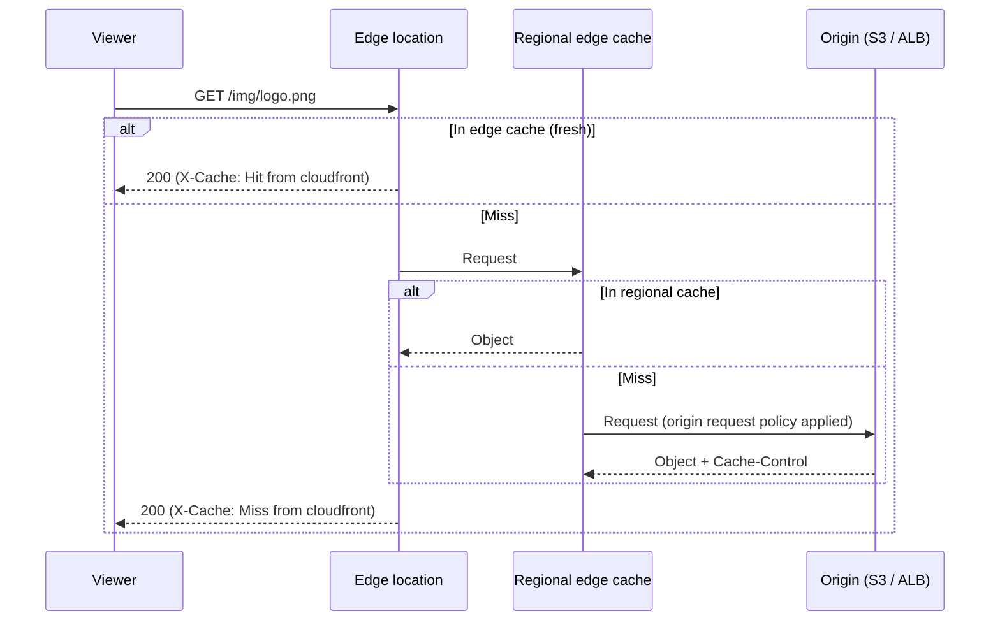
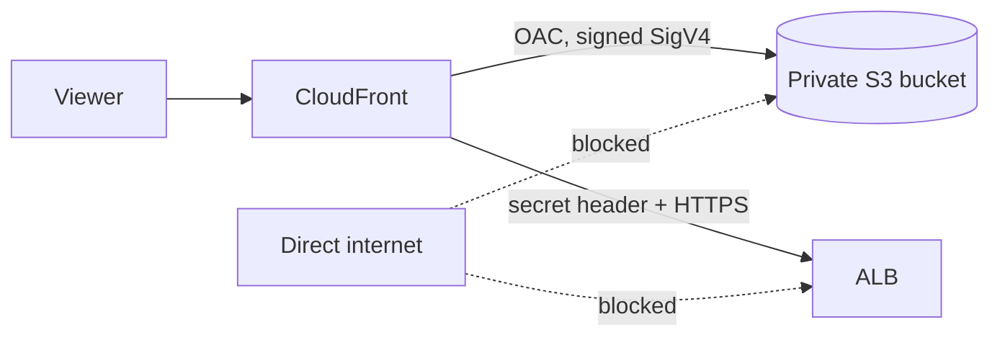
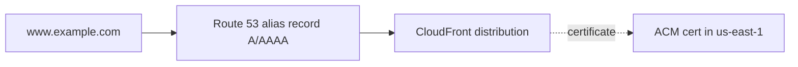

CloudFront is AWS's **CDN**: copies of your content are cached at edge locations close to viewers, so most requests never reach your origin. Overview is in [[5. AWS Networking|5. AWS Networking]]; header hardening is in [[3. HTTP Security Headers and CSP|3. HTTP Security Headers and CSP]].

## Parts at a glance

| Part | Role |
| ---- | ---- |
| **Distribution** | The CloudFront config: domain `dxxxx.cloudfront.net`, origins, behaviors, certificate |
| **Origin** | Where content really lives: S3, ALB, EC2, API Gateway, any HTTP server, Lambda function URL |
| **Origin group** | Primary + secondary origin for failover |
| **Behavior** | A path pattern (`/api/*`, default `*`) and the rules for it |
| **Cache policy** | What goes in the **cache key** and the TTLs |
| **Origin request policy** | What extra data is **forwarded** to the origin (not in the cache key) |
| **Response headers policy** | Headers CloudFront adds or overrides on the way back |
| **Edge function** | CloudFront Functions or Lambda@Edge for code at the edge |
| **Invalidation** | Remove cached objects before their TTL ends |
| **Edge location / Regional edge cache** | Where objects are cached, and a larger middle tier behind them |

---

# How a Request Flows



Identical requests are **collapsed**: if 100 viewers ask for the same uncached object at once, one request goes to the origin.

---

# Origins

| Origin type | Notes |
| ----------- | ----- |
| **S3 bucket** | Use the **bucket REST endpoint** with **Origin Access Control (OAC)** so the bucket stays private |
| **S3 website endpoint** | Treated as a custom (HTTP-only) origin; needed for S3 redirects and index handling; bucket must be public, so prefer OAC |
| **ALB / EC2 / any server** | A **custom origin**: you choose HTTP or HTTPS to the origin and ports |
| **API Gateway** | Regional API as a custom origin |
| **Lambda function URL** | Supported, with OAC for IAM-protected URLs |
| **VPC origin** | Reach an ALB / NLB / EC2 in a **private subnet** without making it public |

Origin settings worth knowing:
- **Protocol policy**: HTTP only, HTTPS only, or match viewer. Use HTTPS to the origin
- **Origin path**: prefix added to every request (e.g. `/v2`)
- **Custom headers**: static headers CloudFront adds to every origin request (for example a secret header the ALB checks)
- **Timeouts**: connection timeout / attempts, **response (read) timeout**, keep-alive timeout
- **Origin Shield**: an extra caching layer in one chosen Region in front of the origin. Raises hit ratio and cuts origin load when you have viewers worldwide; adds a small per-request cost

## Origin groups (failover)

Two origins form a group; CloudFront retries the **secondary** when the primary returns chosen status codes (for example 500, 502, 503, 504, or 403/404) or times out. Failover applies to `GET`, `HEAD`, `OPTIONS`. Useful for S3 cross-Region replicas.

## Keep the origin private



- **S3**: bucket policy lets only the CloudFront service principal read, restricted to your distribution:

```json
{
  "Version": "2012-10-17",
  "Statement": [{
    "Effect": "Allow",
    "Principal": { "Service": "cloudfront.amazonaws.com" },
    "Action": "s3:GetObject",
    "Resource": "arn:aws:s3:::my-unique-bucket-12345/*",
    "Condition": { "StringEquals": {
      "AWS:SourceArn": "arn:aws:cloudfront::123456789012:distribution/EDFDVBD6EXAMPLE" } }
  }]
}
```

- **ALB / custom origin**: use a **VPC origin**, or allow only the CloudFront origin-facing managed prefix list (`com.amazonaws.global.cloudfront.origin_facing`) in the security group, and optionally check a secret custom header
- OAC replaces the older **OAI**; use OAC for new work (supports SSE-KMS and all Regions)

---

# Behaviors

A distribution has a **default behavior** (`*`) plus extra behaviors for specific paths. The **most specific pattern wins by precedence order**, so order matters.

| Setting | Options |
| ------- | ------- |
| **Path pattern** | `/static/*`, `/api/*`, `*.jpg` |
| **Origin** | Which origin serves this path |
| **Viewer protocol policy** | HTTP and HTTPS, **redirect HTTP to HTTPS**, HTTPS only |
| **Allowed methods** | `GET, HEAD`; add `OPTIONS`; or all (`POST`, `PUT`, `DELETE`...) for APIs |
| **Cache policy** / **Origin request policy** / **Response headers policy** | See below |
| **Compress** | Gzip and Brotli for compressible types |
| **Function associations** | Viewer request / response, origin request / response |
| **Restrict viewer access** | Signed URLs or cookies via trusted key groups |

Typical layout: `/static/*` to S3 with long caching; `/api/*` to an ALB with caching disabled; default to the app.

---

# Caching in Depth

## The cache key

The **cache key** decides whether two requests share one cached object. It always includes the URL path and the distribution domain, plus whatever the **cache policy** adds: chosen headers, cookies, query strings.

- **Fewer cache-key values = higher hit ratio.** Do not include `User-Agent`, all cookies or all query strings unless the content truly varies by them
- A header, cookie or query string can be **forwarded to the origin without being in the cache key** using an **origin request policy**. This is the clean way to pass `Host`, `Authorization`, or tracking cookies the origin needs without fragmenting the cache

## Cache policy: TTLs

| TTL | Meaning |
| --- | ------- |
| **Minimum TTL** | Lowest time to cache, even if the origin says less |
| **Default TTL** | Used when the origin sends **no** `Cache-Control` / `Expires` (24 h if unset) |
| **Maximum TTL** | Cap, even if the origin asks for longer |

How the origin's headers interact:
- `Cache-Control: max-age=N` or `s-maxage=N` (`s-maxage` wins for shared caches) sets the TTL, **clamped between Minimum and Maximum**
- `Cache-Control: no-cache`, `no-store` or `private` is respected when Minimum TTL is 0; setting a **Minimum TTL above 0 overrides** them
- No headers: Default TTL applies

## Managed policies

| Policy | Use |
| ------ | --- |
| `Managed-CachingOptimized` | Static content: long TTL, minimal cache key, gzip + Brotli |
| `Managed-CachingDisabled` | APIs and dynamic pages: no caching |
| `Managed-AllViewer` (origin request) | Forward all viewer headers, cookies and query strings to the origin |
| `Managed-CORS-S3Origin` (origin request) | Forward the headers S3 needs for CORS |

Look up IDs with `aws cloudfront list-cache-policies --type managed`.

## Setting good cache headers at the origin

```
# Fingerprinted assets (app.3f9c2a.js): cache for a year
Cache-Control: public, max-age=31536000, immutable

# HTML pages: always revalidate
Cache-Control: no-cache

# Shared cache longer than the browser
Cache-Control: public, max-age=60, s-maxage=3600

# Serve stale while refreshing
Cache-Control: max-age=60, stale-while-revalidate=300, stale-if-error=86400
```

For S3, set headers when uploading:

```
$ aws s3 cp ./dist s3://my-unique-bucket-12345 --recursive \
    --cache-control "public, max-age=31536000, immutable" \
    --exclude "*.html"
$ aws s3 cp ./dist s3://my-unique-bucket-12345 --recursive \
    --cache-control "no-cache" --exclude "*" --include "*.html"
```

Best practice: **fingerprint filenames** (`app.<hash>.js`) so you can cache for a year and never need to invalidate; keep HTML short-lived.

## Custom error responses

| Setting | Use |
| ------- | --- |
| Map `403` / `404` to `/index.html` with `200` | Single-page apps (client-side routing) |
| **Error caching minimum TTL** (default 10 s) | How long errors are cached; lower it while debugging |
| Custom error page per status | Branded 404 / 503 pages from S3 |

## Inspecting cache behaviour

```
$ curl -sI https://www.example.com/app.js | grep -iE 'x-cache|age|via|x-amz-cf'
x-cache: Hit from cloudfront
age: 4721
x-amz-cf-pop: JNB50-C1
x-amz-cf-id: ...
```

`X-Cache` values: **Hit**, **Miss**, **RefreshHit** (revalidated with origin), **Error**. `Age` is seconds in cache. You can also add **additional metrics** (cache hit rate, origin latency) in CloudWatch.

---

# Response Headers Policy: Add and Override Headers

Lets CloudFront **set headers on every response** without touching the origin, useful for S3 and static sites that cannot add headers.

| Type | Examples |
| ---- | -------- |
| **Security headers** | `Strict-Transport-Security`, `Content-Security-Policy`, `X-Content-Type-Options`, `X-Frame-Options`, `Referrer-Policy` |
| **CORS** | `Access-Control-Allow-Origin`, methods, headers, max age, credentials |
| **Custom headers** | Any name and value, e.g. `Permissions-Policy`, `Cache-Control` |
| **Remove headers** | Strip `Server`, `X-Powered-By` |
| **Server-Timing** | Add timing data for debugging, with a sampling rate |

Each header has an **Origin override** switch:
- **On**: CloudFront's value **replaces** the origin's value
- **Off**: CloudFront adds its value **only if the origin did not send that header**

Managed policy `Managed-SecurityHeadersPolicy` gives a sensible baseline; build a **custom policy** for your own CSP. Validate the result with the commands in [[3. HTTP Security Headers and CSP|3. HTTP Security Headers and CSP]].

Two related tools:
- **Origin custom headers**: sent **to** the origin (request side)
- **CloudFront Functions / Lambda@Edge**: for logic (conditional headers, rewrites)

---

# Domains and HTTPS



1. **Request a certificate in ACM in `us-east-1`** (required for CloudFront) for `example.com` and `www.example.com`; validate by DNS
2. Add the names as **Alternate domain names (CNAMEs)** on the distribution and attach the certificate
3. In DNS, point the name to the distribution: in Route 53 use an **alias** A and AAAA record (works at the zone apex); elsewhere use a CNAME to `dxxxx.cloudfront.net` ([[1. AWS Route 53 Deep Dive|AWS Route 53 Deep Dive]])
4. Pick the **security policy** (minimum TLS), e.g. `TLSv1.2_2021`
5. Use **SNI** (free) unless you must support very old clients (dedicated IP costs extra)

Also: **default root object** (`index.html`) applies only to the root URL, not sub-folders; HTTP/2 and **HTTP/3** can be enabled; IPv6 is on by default.

---

# Invalidations: Flushing the Cache

```
$ aws cloudfront create-invalidation \
    --distribution-id EDFDVBD6EXAMPLE \
    --paths "/index.html" "/images/*"

$ aws cloudfront list-invalidations --distribution-id EDFDVBD6EXAMPLE
$ aws cloudfront get-invalidation --distribution-id EDFDVBD6EXAMPLE --id I2J0I21PCUYOIK
```

- Path patterns: `/file.html`, `/folder/*`, or `/*` for everything. A wildcard counts as **one path**
- Typically completes in **minutes**, not instantly
- A free monthly allowance of paths, then a per-path charge. Invalidating `/*` once per deploy is cheap; invalidating thousands of individual paths is not
- Query strings are part of the object identity unless your cache key ignores them
- **Better than invalidating**: use **versioned filenames**, short HTML TTLs, or a **new path prefix** per release
- Invalidation clears CloudFront only. **Browsers** keep their own copy until `max-age` ends, so set sensible `Cache-Control`

CI step after a deploy ([[2. GitHub Actions|GitHub Actions]]):

```yaml
- run: aws s3 sync ./dist s3://my-unique-bucket-12345 --delete
- run: aws cloudfront create-invalidation --distribution-id ${{ vars.CF_DIST_ID }} --paths "/*"
```

---

# Large Uploads and Timeouts End to End

Uploads of tens of MB can fail silently because **each hop has its own timeout**: CloudFront origin response timeout, ALB idle timeout (default 60 s), the app server (Gunicorn `--timeout`, default 30 s), and WAF body-size limits. Tune every layer consistently, and prefer **presigned S3 uploads** so big files bypass the app tier. Worked example: [[6. Django on ECS Fargate - Architecture and Lessons|Django on ECS Fargate - Architecture and Lessons]].

---

# Edge Compute

| Feature | **CloudFront Functions** | **Lambda@Edge** |
| - | ------------------------ | --------------- |
| Runtime | JavaScript (small, fast) | Node.js, Python |
| Runs at | Edge location | Regional edge cache |
| Events | Viewer request / response | Viewer **and origin** request / response |
| Time / size | Sub-millisecond, tiny limits | Seconds, larger packages |
| Network / body access | No | Yes (can call APIs, read body) |
| Cost | Much cheaper | Higher |
| Typical use | URL rewrites, redirects, header tweaks, simple auth checks, cache-key normalisation | A/B tests, auth with external calls, image resizing, dynamic origin selection |

```js
// CloudFront Function: serve /about as /about/index.html
function handler(event) {
  var request = event.request;
  if (request.uri.endsWith('/')) request.uri += 'index.html';
  else if (!request.uri.includes('.')) request.uri += '/index.html';
  return request;
}
```

Lambda@Edge is authored in `us-east-1` and replicated.

---

# Security

| Control | How |
| ------- | --- |
| **HTTPS** | Redirect to HTTPS, modern TLS policy, HSTS via response headers policy |
| **Private origins** | OAC for S3; VPC origins or prefix list for ALB |
| **WAF** | Attach a **global** web ACL (created in `us-east-1`): rate limits, managed rule groups, bot control |
| **DDoS** | **AWS Shield Standard** included; Shield Advanced optional |
| **Signed URLs / cookies** | Restrict private content to authorised users, with expiry; signed by a **trusted key group** |
| **Geo restriction** | Allow-list or block-list countries |
| **Field-level encryption** | Encrypt chosen form fields at the edge |
| **Referer / token checks** | Edge function or WAF rule to stop hotlinking |

Signed URL for a private object:

```
$ aws cloudfront sign --url https://www.example.com/private/report.pdf \
    --key-pair-id K2JCJMDEHXQW5F --private-key file://private_key.pem \
    --date-less-than 2026-12-31
```

---

# Logging and Monitoring

- **Standard logs** to S3 (or CloudWatch Logs / Firehose): per-request records, delayed by minutes
- **Real-time logs** to Kinesis Data Streams: seconds-level, sampled
- **CloudWatch metrics** (free, in `us-east-1`): requests, bytes, 4xx / 5xx error rate; enable **additional metrics** for cache hit rate and origin latency
- Alarm on rising 5xx and falling cache hit ratio

---

# Cost and Choices

- Charged for **data transfer out** and **requests** (by Region), plus function invocations, invalidations beyond the free allowance, and WAF. Origin fetch from S3 to CloudFront is free
- **Price classes**: All edge locations, 200, or 100 (cheapest Regions only)
- A permanent free tier covers a modest amount of monthly transfer and requests
- **Continuous deployment** lets you test a config change on a small slice of traffic with a staging distribution

---

# Example: Static Site on S3 (Terraform)

```hcl
data "aws_cloudfront_cache_policy" "optimized" {
  name = "Managed-CachingOptimized"
}
data "aws_cloudfront_response_headers_policy" "security" {
  name = "Managed-SecurityHeadersPolicy"
}

resource "aws_cloudfront_origin_access_control" "site" {
  name                              = "site-oac"
  origin_access_control_origin_type = "s3"
  signing_behavior                  = "always"
  signing_protocol                  = "sigv4"
}

resource "aws_cloudfront_distribution" "site" {
  enabled             = true
  default_root_object = "index.html"
  aliases             = ["www.example.com"]
  price_class         = "PriceClass_100"

  origin {
    domain_name              = aws_s3_bucket.site.bucket_regional_domain_name
    origin_id                = "s3-site"
    origin_access_control_id = aws_cloudfront_origin_access_control.site.id
  }

  default_cache_behavior {
    target_origin_id           = "s3-site"
    viewer_protocol_policy     = "redirect-to-https"
    allowed_methods            = ["GET", "HEAD"]
    cached_methods             = ["GET", "HEAD"]
    compress                   = true
    cache_policy_id            = data.aws_cloudfront_cache_policy.optimized.id
    response_headers_policy_id = data.aws_cloudfront_response_headers_policy.security.id
  }

  restrictions {
    geo_restriction { restriction_type = "none" }
  }

  viewer_certificate {
    acm_certificate_arn      = aws_acm_certificate.site.arn   # us-east-1
    ssl_support_method       = "sni-only"
    minimum_protocol_version = "TLSv1.2_2021"
  }
}
```

More on state and modules: [[2. Terraform|Terraform]], [[3. Terraform Best Practices|Terraform Best Practices]].

---

# Troubleshooting

| Symptom | Likely cause |
| ------- | ------------ |
| Old content still showing | TTL not expired or browser cache; invalidate, or version the filenames |
| Always `Miss` | Cache key includes too much (cookies, query strings, `Authorization`), or origin sends `no-store` / `private` |
| `403` from S3 origin | OAC / bucket policy missing, wrong bucket endpoint, or object absent (S3 returns 403 for missing keys without list permission) |
| `502` | TLS handshake to origin failed (certificate name mismatch, unsupported protocol) |
| `504` | Origin too slow; raise the origin response timeout or fix the origin |
| `403` on custom domain | Alternate domain name missing on the distribution, or wrong certificate |
| Cert not selectable | ACM certificate not in `us-east-1` |
| CORS errors | Forward `Origin` (origin request policy) or add a CORS response headers policy |
| Sub-folder returns error | Default root object only covers `/`; add a function to append `index.html` |
| Changes not live yet | Distribution status still "Deploying" |
