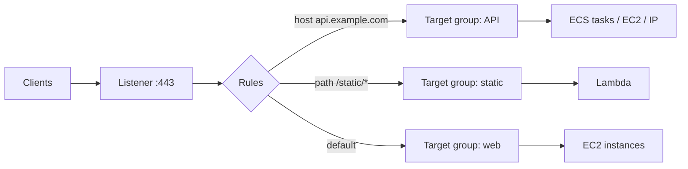
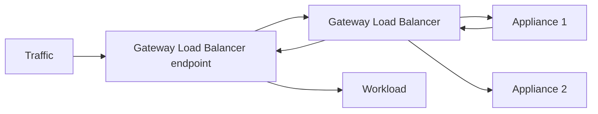

# 03. AWS Elastic Load Balancing Deep Dive

Elastic Load Balancing (ELB) spreads traffic across healthy targets in multiple Availability Zones. Overview is in [[3. AWS Compute|03. AWS Compute]]; network context is in [[5. AWS Networking|05. AWS Networking]].

## Load balancer types at a glance

| Type | Layer | Protocols | Best for |
| ---- | ----- | --------- | -------- |
| **Application Load Balancer (ALB)** | 7 | HTTP, HTTPS, gRPC, WebSocket | Web apps, microservices, path / host routing |
| **Network Load Balancer (NLB)** | 4 | TCP, UDP, TLS | Extreme performance, static IPs, non-HTTP, PrivateLink |
| **Gateway Load Balancer (GWLB)** | 3 | IP (GENEVE) | Inline firewalls and inspection appliances |
| **Classic Load Balancer** | 4 / 7 | Legacy | Old workloads only; migrate |



---

# Core Concepts

| Term | Meaning |
| ---- | ------- |
| **Listener** | Port and protocol the balancer accepts (e.g. HTTPS 443) |
| **Rule** (ALB) | Conditions + action, evaluated by priority; the default rule is last |
| **Target group** | A set of targets plus health check settings |
| **Target** | Instance, **IP address**, or **Lambda function** (ALB); ECS tasks register by IP |
| **Health check** | Path, port, interval, thresholds; unhealthy targets receive no traffic |
| **Scheme** | **Internet-facing** (public subnets) or **internal** (private) |
| **Subnets / AZs** | Pick at least two AZs; one node per AZ |

---

# Application Load Balancer

## Routing conditions

| Condition | Example |
| --------- | ------- |
| **Host header** | `api.example.com`, `*.example.com` |
| **Path** | `/api/*`, `/images/*` |
| **HTTP header** | `X-Version: beta` |
| **Query string** | `?env=test` |
| **HTTP method** | `POST` |
| **Source IP** | A CIDR block |

## Rule actions

| Action | Use |
| ------ | --- |
| **Forward** | To one target group, or **weighted** across several (blue / green, canary) |
| **Redirect** | HTTP to HTTPS (`301`), or to another host / path |
| **Fixed response** | Static `200` / `404` / `503` page |
| **Authenticate** | Sign-in with **Cognito** or any **OIDC** provider before forwarding |

```
$ aws elbv2 create-listener --load-balancer-arn $ALB_ARN \
    --protocol HTTP --port 80 \
    --default-actions 'Type=redirect,RedirectConfig={Protocol=HTTPS,Port=443,StatusCode=HTTP_301}'
```

## Features

- **TLS termination** with ACM certificates; many certificates on one listener using **SNI**; pick a **security policy** (TLS 1.2+ / 1.3)
- **Sticky sessions** by cookie (duration-based or application-based)
- **Slow start** ramps a new target up gradually
- **Deregistration delay** (connection draining, default 300 s) lets in-flight requests finish
- **WAF** integration, **HTTP/2**, **gRPC**, **WebSocket**
- Adds headers: `X-Forwarded-For` (client IP), `X-Forwarded-Proto`, `X-Forwarded-Port`
- **Idle timeout** default 60 s; raise it for long requests and keep the backend keep-alive higher than the ALB value to avoid `502`s
- **Access logs** to S3, **connection logs**, CloudWatch metrics

## Health checks

```
Protocol: HTTP    Path: /health    Port: traffic-port
Healthy threshold: 2    Unhealthy threshold: 3    Interval: 15 s    Success codes: 200-299
```

Make `/health` cheap and honest (checks critical dependencies but is not a heavy query). A target failing checks is taken out; if **all** targets fail, the ALB sends traffic to all of them (fail-open).

---

# Network Load Balancer

- **Layer 4**: very high throughput, millions of requests per second, ultra-low latency
- **Static IP** per AZ (and optional **Elastic IP**), good when partners allow-list addresses
- Preserves the **client source IP** (for instance targets)
- **TLS listeners** can terminate TLS; **UDP** supported
- Enables **AWS PrivateLink** (expose a service to other VPCs / accounts via a VPC endpoint service)
- Health checks: TCP, HTTP or HTTPS
- Security groups on NLBs are supported (configure them at creation)

Choose **NLB** for TCP / UDP, fixed IPs or PrivateLink; **ALB** for anything HTTP that needs smart routing.

---

# Gateway Load Balancer

Transparent insertion of **third-party virtual appliances** (firewalls, IDS / IPS, deep packet inspection):



Uses the **GENEVE** protocol on port 6081 and scales appliances horizontally.

---

# Cross-Zone Load Balancing

| Type | Default |
| ---- | ------- |
| ALB | **On** (no extra data charge) |
| NLB / GWLB | **Off** (enabling it incurs inter-AZ data charges) |

Without cross-zone, each AZ node only sends to targets in its own AZ, so uneven target counts per AZ cause uneven load.

---

# Security

- **Security groups**: ALB group allows `443` from the internet; the **target group's** security group allows traffic **only from the ALB's** security group
- Place targets in **private subnets**; the load balancer is the only public entry
- Redirect HTTP to HTTPS, use modern TLS policies, add **WAF** for web protection
- Mutual TLS (mTLS) with a trust store is available on ALB
- See [[6. Cloud Security|06. Cloud Security]] and [[3. HTTP Security Headers and CSP|03. HTTP Security Headers and CSP]]

---

# ELB with Other Services

| Service | How |
| ------- | --- |
| **Auto Scaling group** | Registers and deregisters instances; use ELB health checks to replace unhealthy ones |
| **ECS / EKS** | Target type **IP**; the service or ingress controller registers tasks / pods |
| **Lambda** | ALB invokes a function as a target (alternative to API Gateway: [[4. AWS API Gateway Deep Dive|AWS API Gateway Deep Dive]]) |
| **CloudFront** | ALB as an origin; restrict it to CloudFront ([[2. AWS CloudFront Deep Dive|AWS CloudFront Deep Dive]]) |
| **Route 53** | Alias record to the ALB ([[1. AWS Route 53 Deep Dive|AWS Route 53 Deep Dive]]) |
| **Global Accelerator** | Static anycast IPs in front of ALB / NLB |

---

# Troubleshooting

| Symptom | Likely cause |
| ------- | ------------ |
| **502 Bad Gateway** | Target closed the connection early, protocol mismatch, or backend keep-alive shorter than the ALB idle timeout |
| **503 Service Unavailable** | No healthy targets registered |
| **504 Gateway Timeout** | Target did not respond within the idle timeout |
| Targets show **unhealthy** | Wrong health check path / port, security group blocks the ALB, app slow to start |
| Client IP missing in logs | Read `X-Forwarded-For`, not the connection address (ALB) |
| Uneven traffic | Cross-zone off, sticky sessions, or long-lived connections |
| Certificate warnings | Wrong certificate on the listener or missing SNI cert |

```
$ aws elbv2 describe-target-health --target-group-arn $TG_ARN
$ aws elbv2 describe-load-balancers
```
