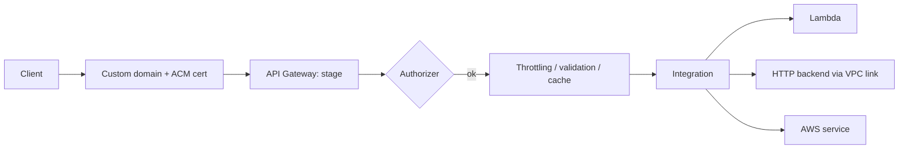

API Gateway is the managed front door for APIs: routing, auth, throttling, caching and monitoring in front of Lambda or any backend. Overview is in [[5. AWS Networking|5. AWS Networking]] and serverless context in [[6. AWS Developer Services and Serverless|6. AWS Developer Services and Serverless]].

## API types at a glance

| Type | Protocol | Notes |
| ---- | -------- | ----- |
| **REST API** | HTTP | Most features: usage plans, API keys, caching, request validation, WAF, private APIs, canary releases |
| **HTTP API** | HTTP | Cheaper and faster, simpler; JWT authorizers, automatic CORS; fewer features |
| **WebSocket API** | WebSocket | Two-way real time: chat, notifications; routes by message content |

Pick **HTTP API** for simple proxy-to-Lambda or backend routes; pick **REST API** when you need caching, usage plans, validation, WAF or private endpoints.



---

# Building Blocks

| Term | Meaning |
| ---- | ------- |
| **Resource / route** | The path (`/orders/{id}`) and method (`GET`) |
| **Integration** | What handles the request |
| **Stage** | A named, deployed snapshot (`dev`, `prod`) with its own URL, settings and variables |
| **Deployment** | Publishing the API config to a stage (REST needs an explicit deploy) |
| **Authorizer** | Checks who is calling |
| **Model / mapping template** | Request and response shape and transformation (REST) |
| **Usage plan + API key** | Quotas and throttles per client (REST) |
| **Custom domain** | `api.example.com` mapped to a stage |

## Integration types

| Type | What it does |
| ---- | ------------ |
| **Lambda proxy** | Passes the full request to Lambda; Lambda returns status, headers and body. Simplest and most common |
| **Lambda (non-proxy)** | You map request and response with templates |
| **HTTP proxy / HTTP** | Forward to any public HTTP backend |
| **VPC link** | Reach private resources (ALB / NLB / Cloud Map) in a VPC |
| **AWS service** | Call SQS, SNS, DynamoDB, Step Functions directly, no Lambda |
| **Mock** | Return a fixed response without a backend |

Lambda proxy handler:

```python
import json

def handler(event, context):
    order_id = event["pathParameters"]["id"]
    return {
        "statusCode": 200,
        "headers": {"Content-Type": "application/json"},
        "body": json.dumps({"id": order_id, "status": "shipped"}),
    }
```

HTTP API uses payload format 2.0 (similar shape, with `requestContext.http`).

---

# Endpoint Types (REST)

| Type | Behaviour |
| ---- | --------- |
| **Edge-optimized** | Requests enter through CloudFront edge locations; good for a global audience |
| **Regional** | Served in one Region; use this when your clients are nearby or you front it with your own CloudFront ([[2. AWS CloudFront Deep Dive|AWS CloudFront Deep Dive]]) |
| **Private** | Reachable only inside a VPC through an **interface VPC endpoint**; use a resource policy |

---

# Authentication and Authorisation

| Method | Works on | Use |
| ------ | -------- | --- |
| **IAM (SigV4)** | REST, HTTP, WebSocket | Service-to-service and AWS-signed callers |
| **Cognito user pool** | REST (native); HTTP via JWT | End-user sign-in with tokens |
| **JWT authorizer** | HTTP API | Validate OIDC / OAuth2 tokens from Cognito, Auth0, Entra ID... |
| **Lambda authorizer** | REST, HTTP, WebSocket | Custom logic: token or request based; returns an IAM policy; results can be cached |
| **Resource policy** | REST | Allow / deny by IP, VPC, account |
| **mTLS** | Custom domain | Client certificates |

- **API keys are for identifying and metering clients, not for security.** Combine with a real authorizer
- Authorise per route and scope; do not rely on hidden URLs. See [[2. Web Application Security|2. Web Application Security]]

---

# Throttling, Quotas and Caching

| Feature | Details |
| ------- | ------- |
| **Account throttle** | Default of thousands of requests per second per Region (steady rate plus burst); request an increase if needed |
| **Stage / method throttling** | Set rate and burst per stage or route to protect backends |
| **Usage plans** (REST) | Per-API-key rate, burst and daily / monthly quota |
| **429 Too Many Requests** | Returned when throttled; clients should back off with jitter |
| **Caching** (REST) | Optional per-stage cache (0.5 GB to 237 GB), TTL (default 300 s), cache keys on selected parameters, invalidate via header `Cache-Control: max-age=0` with permission |

Integration timeout defaults to about 29 seconds (check current quotas); long jobs should be asynchronous (return `202` and process via SQS / Step Functions).

---

# Request and Response Handling

- **Request validation** (REST): reject bad bodies, query strings or headers before they reach Lambda, using JSON Schema models
- **Mapping templates** (REST, VTL): reshape payloads, for example turn a request into a DynamoDB call
- **CORS**: HTTP API enables it in one setting; REST needs an `OPTIONS` method and CORS headers on responses
- **Gateway responses**: customise error bodies (`4XX`, `5XX`, throttling)
- **Binary media types** for images and files
- Payload limit about 10 MB

```yaml
# OpenAPI / SAM style (HTTP API)
Events:
  GetOrder:
    Type: HttpApi
    Properties:
      Path: /orders/{id}
      Method: GET
```

---

# Stages, Deployments and Releases

- **Stages** hold their own **stage variables**, logging and throttling (e.g. `dev` points at a `dev` Lambda alias)
- REST: edit, then **create a deployment** to a stage. HTTP API supports **auto-deploy**
- **Canary releases** (REST): send a percentage of traffic to the new deployment, then promote
- Pair **Lambda aliases** (`live`, `beta`) with stage variables for safe rollouts
- Export and import with **OpenAPI** to keep the API in source control ([[1. Infrastructure as Code|Infrastructure as Code]])

---

# Custom Domains

1. ACM certificate (Regional APIs: same Region; edge-optimized: `us-east-1`)
2. Create the **custom domain name**, choose TLS version
3. **API mapping**: `api.example.com/v1` to API + stage
4. Route 53 **alias** record to the domain's target ([[1. AWS Route 53 Deep Dive|AWS Route 53 Deep Dive]])

---

# Security

- **WAF** (REST): rate limits, managed rules, geo blocks
- **Resource policies** and private endpoints for internal APIs
- **TLS** only; choose a minimum TLS version on the custom domain
- **Least-privilege roles** for integrations: [[2. AWS IAM and Security|2. AWS IAM and Security]]
- Validate input; return generic errors; no stack traces

---

# Logging and Monitoring

| Source | Content |
| ------ | ------- |
| **Access logs** | One line per request (format you define) to CloudWatch Logs or Firehose |
| **Execution logs** (REST) | Detailed integration traces; use only while debugging (cost and sensitive data) |
| **CloudWatch metrics** | `Count`, `4XXError`, `5XXError`, `Latency`, `IntegrationLatency`, `CacheHitCount` |
| **X-Ray** | Distributed traces (REST) |

Compare `Latency` (total) with `IntegrationLatency` (backend only) to see whether time is spent in API Gateway or in your code.

---

# API Gateway vs Alternatives

| Need | Choose |
| ---- | ------ |
| Public API with auth, throttling, usage plans | **API Gateway** |
| Simple HTTP in front of one Lambda | **Lambda function URL** (no gateway features) |
| HTTP routing to containers / instances with high volume | **ALB** ([[3. AWS Elastic Load Balancing Deep Dive|AWS Elastic Load Balancing Deep Dive]]) |
| Cache and protect globally | Put **CloudFront** in front |
| Async events | EventBridge / SQS / SNS ([[6. AWS Developer Services and Serverless|6. AWS Developer Services and Serverless]]) |

---

# Troubleshooting

| Symptom | Likely cause |
| ------- | ------------ |
| `403 Forbidden` / `Missing Authentication Token` | Wrong path or method, route not deployed, or IAM auth failed |
| `401` | Authorizer rejected the token |
| `429` | Throttled by stage, plan or account limit |
| `502 Bad Gateway` | Lambda returned an invalid proxy response (bad `statusCode` / body type) |
| `504 Gateway Timeout` | Integration exceeded the timeout |
| CORS error in the browser | Missing `OPTIONS` handling or CORS headers |
| Change not visible | REST API edited but **not deployed** to the stage |
| Works in test but not from the browser | Stage name missing from the URL (`/prod/...`) or custom domain mapping absent |
