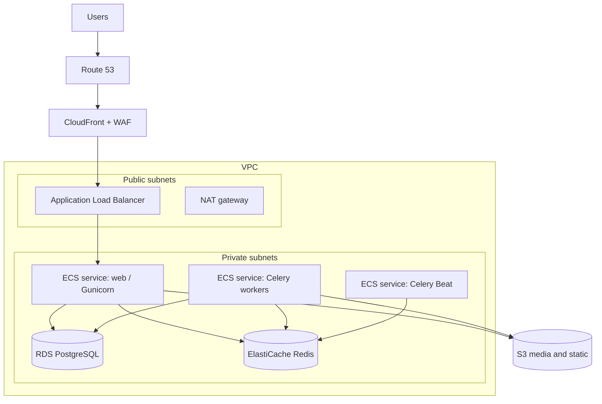
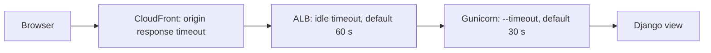

# 06. Django on ECS Fargate - Architecture and Lessons

A production Django platform on AWS, built across three environments (QA, UAT, production) with ECS Fargate, RDS PostgreSQL, ElastiCache Redis and S3. This note records the architecture and the problems that actually came up. Services are explained in [[3. AWS Compute|03. AWS Compute]], [[5. AWS Networking|05. AWS Networking]] and [[4. AWS Storage and Databases|04. AWS Storage and Databases]].

## Services at a glance

| Layer | Service | Role |
| ----- | ------- | ---- |
| DNS + TLS | **Route 53**, **ACM** | Names and certificates ([[1. AWS Route 53 Deep Dive|AWS Route 53 Deep Dive]]) |
| Edge | **CloudFront**, **AWS WAF** | Caching, TLS, firewall ([[2. AWS CloudFront Deep Dive|AWS CloudFront Deep Dive]], [[4. WAF in Production|04. WAF in Production]]) |
| Load balancing | **Application Load Balancer** | Health-checked routing ([[3. AWS Elastic Load Balancing Deep Dive|AWS Elastic Load Balancing Deep Dive]]) |
| Compute | **ECS on Fargate** | Web service, Celery worker service, Celery Beat |
| Images | **ECR** | Container registry |
| Database | **RDS PostgreSQL** (+ PostGIS) | Private subnet, backups, Multi-AZ in production |
| Cache / broker | **ElastiCache Redis** | Cache, Celery broker, Channels layer |
| Files | **S3** (+ **EFS** where a shared filesystem is needed) | Static, media, uploads ([[5. AWS S3 Deep Dive|AWS S3 Deep Dive]]) |
| Config | **SSM Parameter Store / Secrets Manager** | Settings and secrets |
| Infra as code | **CloudFormation** | Repeatable stacks per environment |
| Observability | **CloudWatch** Logs and alarms | Logs, health, alerts |

---

# Architecture



- **Public subnets** hold only the load balancer and NAT; everything else is **private**
- **Separate ECS services** for web, workers and the scheduler, so each scales and deploys independently
- One **task definition per role**, same image, different command (`gunicorn ...`, `celery worker`, `celery beat`)

---

# Security Group Chain

Each hop accepts traffic only from the previous one:

| Resource | Inbound allowed from |
| -------- | -------------------- |
| ALB | `443` from CloudFront (managed prefix list) or the internet |
| Web tasks | App port **from the ALB security group only** |
| RDS | `5432` **from the web and worker security groups only** |
| Redis | `6379` from the web and worker security groups only |

Every component has to be wired exactly right: **a wrong security group means no database; a wrong subnet means ECS tasks cannot pull images.**

## Why tasks fail to start (checklist)

| Symptom | Cause |
| ------- | ----- |
| `CannotPullContainerError` | Private subnet with no route to ECR: add a **NAT gateway** or VPC endpoints for `ecr.api`, `ecr.dkr`, the **S3 gateway endpoint** and `logs` |
| Task stops immediately | Container command or env var wrong; read the CloudWatch log stream |
| Task cycles (start, fail, replace) | Health check failing; see below |
| Cannot reach DB or Redis | Security group missing a rule, wrong subnet group |
| `AccessDenied` on S3 or secrets | **Task role** missing permission (execution role is for pulling images and writing logs; task role is for the app) |

Two roles: **task execution role** (ECR pull, logs, secret injection) and **task role** (what the application itself may do): [[2. AWS IAM and Security|02. AWS IAM and Security]].

---

# Health Checks as Diagnostics

A `/health/` endpoint that checks the critical dependencies, so a cycling task tells you *which* one is unreachable:

| Check | Verifies |
| ----- | -------- |
| Database | Can run `SELECT 1` |
| Cache | Redis read and write |
| Storage | S3 reachable with the task role |
| Migrations | No unapplied migrations |
| Workers | At least one Celery worker responds (`inspect ping`) |

```python
def health(request):
    checks = {
        "database": check_db(),
        "cache": check_cache(),
        "storage": check_s3(),
        "migrations": check_migrations(),
        "celery": check_celery(),
    }
    status = 200 if all(checks.values()) else 503
    return JsonResponse(checks, status=status)
```

Lessons:
- A missing security-group rule or IAM permission fails a check and puts the task in a **replacement loop**; the JSON body says which dependency broke
- Use a **fast liveness** path for the ALB target group and the **deep check** for diagnostics, so a slow dependency does not cause a mass restart
- Allow a **start period / grace time** so slow starts (migrations, warm-up) are not killed
- Order start-up: database and cache must exist before the app; workers after the web service

---

# Timeouts Across the Whole Path

Large uploads (tens of MB) broke silently because **every layer has its own timeout**, and the smallest one wins:



| Layer | Setting |
| ----- | ------- |
| CloudFront | Origin **response timeout** (and keep-alive) on the origin |
| ALB | **Idle timeout** attribute |
| Gunicorn | `--timeout` and worker class (sync workers block on slow clients) |
| Django | `DATA_UPLOAD_MAX_MEMORY_SIZE`, `FILE_UPLOAD_MAX_MEMORY_SIZE` |
| WAF | Body size inspection limit ([[4. WAF in Production|04. WAF in Production]]) |

Rule: **tune every layer consistently**, keeping each downstream timeout at least as long as the one in front of it. Better still, **do not send big files through the app**: use a presigned S3 upload.

## Direct-to-S3 uploads (presigned POST)

```python
import boto3
s3 = boto3.client("s3")
post = s3.generate_presigned_post(
    Bucket="my-unique-bucket-12345",
    Key="uploads/${filename}",
    Conditions=[["content-length-range", 1, 50 * 1024 * 1024]],
    ExpiresIn=600,
)
# return post["url"] and post["fields"]; the browser POSTs the file straight to S3
```

The app only issues a short-lived signed form; the bytes never touch Gunicorn, ALB or CloudFront limits. Add a bucket CORS rule for the site's origin.

---

# Repeatable Environments with CloudFormation

Three environments from **one set of templates** and a parameter file per environment:

```
infra/
  network.yaml           VPC, subnets, route tables, NAT, endpoints
  data.yaml              RDS, ElastiCache, S3
  service.yaml           ECS cluster, task definitions, services, ALB
  params/qa.json  params/uat.json  params/prod.json
scripts/
  push-env.sh            store env vars / secrets for an environment
  push-image.sh          build, tag, push the image to ECR
  deploy-env-addons.sh   buckets, queues, alarms
  deploy-all.sh          everything in order
  release.sh             roll the service to a new image
```

- **One script per concern**, called by a thin `deploy-all`, keeps each step re-runnable ([[4. CloudFormation, Bicep and ARM Templates|CloudFormation, Bicep and ARM Templates]])
- Environments differ by **parameters** (sizes, counts, domain), not by template copies
- Keep **QA / UAT / production the same shape** so a bug found in QA is the one that would hit production

## Migrating off a generator tool

AWS announced end-of-life for the Copilot CLI (mid-2026). Moving live services off it meant:
1. **Reverse-engineer** the CloudFormation stacks it generated
2. Extract the reusable patterns (task definition, service, ALB rules)
3. Rebuild them as **standalone templates** with per-environment parameter files
4. Drive them with small **DRY bash scripts** split by concern

Lesson: a wrapper CLI is convenient until it is deprecated. Keep the **underlying templates in your repository** from the start. See [[1. Infrastructure as Code|Infrastructure as Code]].

---

# Data and Region Choices

- Keep personal data in-country by choosing the right Region (for example `af-south-1`, Cape Town, for POPIA-sensitive workloads) and checking that every service you use is available there
- RDS: private subnet, automated backups, Multi-AZ in production, parameter groups, PostGIS extension for geospatial data
- Redis does three jobs here (cache, Celery broker, Channels layer): use **separate databases or key prefixes** so they stay isolated ([[4. Celery and Message Brokers|Celery and Message Brokers]], [[5. Async Django - ASGI, Channels and SSE|Async Django - ASGI, Channels and SSE]])

---

# Lessons Worth Keeping

| Lesson | Detail |
| ------ | ------ |
| **Own the estate end to end once** | Wiring VPC, subnets, security groups, RDS, Redis, ECS, ALB, S3, Route 53 and ACM by hand teaches what each dependency needs |
| **Production controls in every environment** | WAF, TLS, headers and limits identical from QA onwards ([[4. WAF in Production|04. WAF in Production]]) |
| **Health checks that explain themselves** | Return per-dependency results |
| **Tune the whole request path** | Browser to CloudFront to ALB to app |
| **Presigned uploads for big files** | Keep large bodies off the app tier |
| **Templates in git, not in a tool's cache** | Survive tool deprecation |
| **Separate task and execution roles** | Least privilege |
