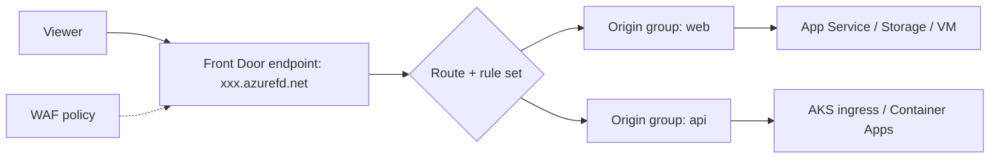
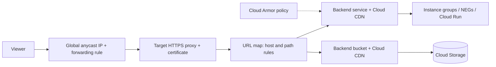

# 05. Azure and GCP Edge Delivery and Load Balancing

How Azure and GCP do what CloudFront, Route 53 and ELB do on AWS ([[2. AWS CloudFront Deep Dive|AWS CloudFront Deep Dive]], [[1. AWS Route 53 Deep Dive|AWS Route 53 Deep Dive]], [[3. AWS Elastic Load Balancing Deep Dive|AWS Elastic Load Balancing Deep Dive]]). Networking context: [[3. Azure Networking|03. Azure Networking]], [[1. GCP Fundamentals|01. GCP Fundamentals]].

## Services at a glance

| Job | AWS | Azure | GCP |
| --- | --- | ----- | --- |
| **CDN and global edge** | CloudFront | **Azure Front Door** (Standard / Premium) | **Cloud CDN** (on the global external Application Load Balancer) |
| **Layer 7 load balancing (regional)** | ALB | **Application Gateway** (with WAF) | Regional external / internal **Application Load Balancer** |
| **Layer 7 load balancing (global)** | CloudFront + ALB | **Front Door** | Global external **Application Load Balancer** |
| **Layer 4 load balancing** | NLB | **Azure Load Balancer** (Standard) | **Network Load Balancer** (passthrough / proxy) |
| **DNS** | Route 53 | **Azure DNS**, **Traffic Manager** (DNS routing) | **Cloud DNS** |
| **WAF / DDoS** | AWS WAF, Shield | Front Door / App Gateway WAF, DDoS Protection | **Cloud Armor** |
| **API front door** | API Gateway | **API Management** | **API Gateway**, **Apigee** |
| **Private service exposure** | PrivateLink | Private Link | Private Service Connect |

---

# Azure Front Door

Global entry point: CDN, TLS termination, routing, WAF and failover in one service, using Microsoft's edge network.



| Concept | Meaning |
| ------- | ------- |
| **Profile** | Top-level Front Door resource (tier: Standard or Premium) |
| **Endpoint** | A hostname served by the profile |
| **Origin group / origin** | Backend pool and the backends in it, with **health probes** and load-balancing settings |
| **Route** | Domains + path patterns to an origin group; HTTPS redirect; caching on or off |
| **Rule set** | Conditions and actions: rewrite URL, redirect, **modify request / response headers**, override cache duration |
| **Custom domain** | Your hostname, with **Front Door-managed certificate** or your own from Key Vault |
| **Premium extras** | **Private Link** to origins, managed WAF rule sets, bot protection |

## Caching

- Enable caching per route; Front Door honours origin `Cache-Control` unless a rule set overrides the duration
- **Query string behaviour**: ignore, use each unique query, or include / exclude listed parameters (controls the cache key)
- Compression for text types
- **Purge** removes cached content:

```
$ az afd endpoint purge --resource-group rg-web --profile-name fd-prod \
    --endpoint-name www --content-paths '/*' '/images/*'
```

## Headers, security and domains

- Rule set actions add or override response headers such as HSTS, CSP, `X-Content-Type-Options`: [[3. HTTP Security Headers and CSP|03. HTTP Security Headers and CSP]]
- Restrict the origin to Front Door by checking the **`X-Azure-FDID`** header (your Front Door ID) and the **AzureFrontDoor.Backend** service tag
- DNS: CNAME the custom domain to the endpoint (apex via alias in Azure DNS); add the **TXT validation** record
- **WAF policy** modes: Detection or Prevention; custom rules, rate limiting, geo filtering

Azure's older CDN offerings (CDN profiles) are being phased out in favour of Front Door; check the current status in the Azure docs before starting new work.

---

# Azure Application Gateway, Load Balancer and Traffic Manager

| Service | Layer / scope | Key points |
| ------- | ------------- | ---------- |
| **Application Gateway** | L7, regional | Listeners, routing rules (host / path), backend pools, **WAF v2**, TLS offload, cookie affinity, autoscaling, **AKS ingress controller** |
| **Load Balancer** | L4, regional | Public or internal, health probes, rules, **zone-redundant** frontends, HA ports, outbound rules |
| **Traffic Manager** | DNS-based, global | Routing methods: priority, weighted, performance, geographic, multivalue, subnet; **no traffic passes through it** |
| **Azure DNS** | DNS hosting | Public and private zones, alias records to Azure resources |

Rule of thumb: **Front Door** for global web apps, **Application Gateway** for regional L7 behind it, **Load Balancer** for non-HTTP, **Traffic Manager** for DNS-level failover across anything.

---

# GCP Cloud CDN and Load Balancing

Cloud CDN is **switched on for a backend** (a backend service or backend bucket) behind the **global external Application Load Balancer**; there is no separate "distribution".



| Piece | Role |
| ----- | ---- |
| **Forwarding rule** | The IP and port (a single global anycast IP) |
| **Target proxy** | Terminates HTTP(S); holds certificates |
| **URL map** | Host and path routing to backends |
| **Backend service / bucket** | Group of instances, **NEGs** (serverless, zonal or internet) or a Cloud Storage bucket |
| **Health check** | Decides which backends receive traffic |
| **Cloud CDN** | Caches responses at Google's edge for that backend |

## Cache modes

| Mode | Behaviour |
| ---- | --------- |
| `CACHE_ALL_STATIC` | Caches common static types automatically; respects origin headers for others |
| `USE_ORIGIN_HEADERS` | Cache only what `Cache-Control` / `Expires` allow |
| `FORCE_CACHE_ALL` | Cache successful responses regardless of origin headers (avoid for private content) |

- Set **default, minimum and maximum TTLs** and **client TTL**
- **Cache keys**: include or exclude protocol, host, query string and selected headers or cookies; fewer values mean a better hit ratio
- **Custom response headers** can be added on the backend service (for HSTS and other security headers)
- **Signed URLs and cookies** protect private content
- **Negative caching** and **serve stale** options reduce load during errors

```
$ gcloud compute backend-services update web-backend --global \
    --enable-cdn --cache-mode=CACHE_ALL_STATIC --default-ttl=3600

$ gcloud compute url-maps invalidate-cdn-cache web-map --path "/*"
$ gcloud compute url-maps invalidate-cdn-cache web-map --host www.example.com --path "/images/*"
```

Invalidation takes a short time to propagate and has rate limits; prefer **versioned filenames**.

## Load balancer families

| Type | Layer | Scope | Notes |
| ---- | ----- | ----- | ----- |
| **Global external Application LB** | 7 | Global | Anycast IP, Cloud CDN, Cloud Armor, multi-region failover |
| **Regional external / internal Application LB** | 7 | Region | Envoy-based; internal for private services |
| **External proxy Network LB** | 4 (TCP proxy) | Global or regional | TCP with TLS offload |
| **External passthrough Network LB** | 4 | Regional | Preserves client IP; UDP supported |
| **Internal passthrough Network LB** | 4 | Regional | Private TCP / UDP inside a VPC |

## Cloud DNS and Cloud Armor

- **Cloud DNS**: public and private zones, routing policies (weighted round robin, geolocation, failover), DNSSEC, 100% availability SLA
- **Cloud Armor**: WAF and DDoS protection attached to a backend service: preconfigured rules (OWASP-style), rate limiting, IP and geo rules, adaptive protection

---

# Choosing Across Clouds

| Question | Pick |
| -------- | ---- |
| Static site behind a CDN | CloudFront + S3, Front Door + Storage, Cloud CDN + Cloud Storage bucket |
| Global web app, one entry point | CloudFront + ALB, Front Door, global external Application LB |
| DNS-level failover | Route 53 failover, Traffic Manager, Cloud DNS routing policies |
| Non-HTTP / fixed IP | NLB, Azure Load Balancer, Network LB |
| Edge code | CloudFront Functions / Lambda@Edge, Front Door rules, Cloud CDN with Service Extensions |
| Web protection | AWS WAF, Front Door / App Gateway WAF, Cloud Armor |

Common ideas apply everywhere: keep the **cache key small**, set **explicit Cache-Control** at the origin, **version asset filenames**, keep origins **private** so traffic must go through the edge, add **security headers** at the edge, and **purge deliberately** instead of relying on it.
