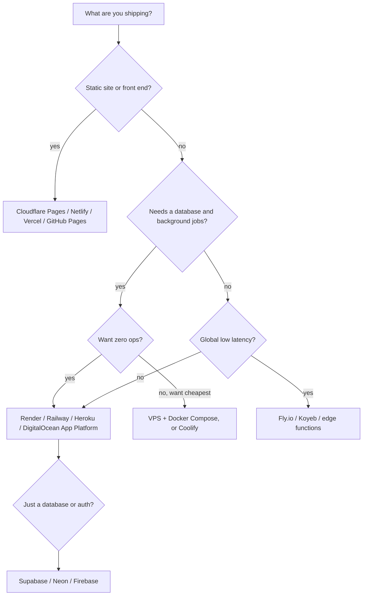
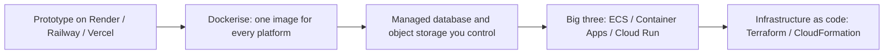

# 06. Smaller Cloud Platforms for Startups and Demos

The big three (AWS, Azure, GCP) are powerful but heavy to set up. For **demos, prototypes, side projects and early startups**, smaller platforms get an app online in minutes from a Git repository. This note compares them and shows how to choose, then how to grow out of them. Big-three equivalents: [[3. AWS Compute|03. AWS Compute]], [[2. Azure Compute|02. Azure Compute]], [[1. GCP Fundamentals|01. GCP Fundamentals]].

> Plans, free tiers and prices on these platforms **change often**. Treat the notes below as a snapshot and check each vendor's pricing page before relying on them.

## Platforms at a glance

| Platform | Type | Good for | Watch out for |
| -------- | ---- | -------- | ------------- |
| **Render** | Full-stack PaaS | Web services, workers, cron, managed Postgres and Redis, static sites; `render.yaml` blueprints | Free web services **spin down after idle** (about 15 min) and take about a minute to wake; free Postgres **expires** after about 30 days; no persistent disk on free |
| **Railway** | Usage-billed PaaS | Fast deploys, databases and services on one canvas, great developer experience | Usage-based billing; a small trial credit then a paid plan, so no permanent free tier |
| **Fly.io** | Containers close to users (Machines / microVMs) | Global low-latency apps, Docker-first, multi-region | Usage billing; new accounts get only a short trial; more to learn (CLI, volumes, networking) |
| **Heroku** | The original PaaS | Mature add-ons ecosystem, buildpacks, simple `git push` | **No free tier**; low-cost Eco dynos sleep when idle; costs rise quickly |
| **DigitalOcean App Platform** | PaaS on a VPS provider | Apps plus managed databases in one place, predictable pricing | Fewer advanced features than the big three |
| **Koyeb** | Serverless containers | Docker and Git deploys, global regions, scale to zero | Smaller ecosystem |
| **Vercel** | Frontend / serverless | Next.js and other front ends, preview deployments per branch, edge functions | Serverless limits; backends and long jobs fit poorly; bandwidth and function charges |
| **Netlify** | Jamstack | Static sites, forms, functions, preview deploys | Same: not for heavy backends |
| **Cloudflare Pages / Workers** | Edge platform | Static sites and edge code, very generous free tier, CDN included ([[10. Static Sites on Cloudflare|Static Sites on Cloudflare]]) | Workers runtime differs from Node; databases are specific (D1, KV, R2) |
| **GitHub Pages** | Static hosting | Docs, portfolios, project pages | Static only, public repos on free |
| **Supabase** | Backend as a service | PostgreSQL with auth, storage, realtime, auto APIs | Free projects can **pause** when inactive |
| **Neon** | Serverless Postgres | Branching databases, scale to zero, good for previews | Database only; cold starts when idle |
| **Firebase** | Google's BaaS | Auth, Firestore, hosting, quick mobile and web apps | Vendor lock-in; NoSQL data model |
| **VPS: DigitalOcean Droplets, Hetzner, Vultr, Linode (Akamai)** | Raw virtual servers | Cheapest always-on compute; full control | **You** run, patch and secure it ([[Server Hardening with SSH, UFW and Fail2ban]]) |
| **Coolify / Dokploy (self-hosted PaaS)** | Open-source "Heroku on your VPS" | Many apps on one cheap server with Git deploys | You operate the server |

---

# Choosing One



Questions to ask:
- **Is it always-on or can it sleep?** Free tiers that sleep suit demos, not customer-facing apps
- **Do I need a database that persists?** Several free databases expire or pause
- **Where are the users?** Regions matter; the big three have an Africa Region (AWS `af-south-1`) that small platforms may not
- **Will it need compliance or private networking?** That pushes toward the big three
- **Cost shape**: flat per service (Render, DigitalOcean) vs usage (Railway, Fly.io, serverless)

---

# Example: Django on Render

Render builds from a Git repo and reads a `render.yaml` **Blueprint** (infrastructure as code for the platform).

```yaml
# render.yaml
databases:
  - name: app-db
    plan: free            # free databases expire; use a paid plan to keep data
    databaseName: app
    user: app

services:
  - type: web
    name: app-web
    runtime: python
    plan: free
    buildCommand: "./build.sh"
    startCommand: "gunicorn config.wsgi:application"
    healthCheckPath: /health/
    envVars:
      - key: DATABASE_URL
        fromDatabase:
          name: app-db
          property: connectionString
      - key: SECRET_KEY
        generateValue: true
      - key: DJANGO_ALLOWED_HOSTS
        value: ".onrender.com"
```

```bash
# build.sh
set -o errexit
pip install -r requirements.txt
python manage.py collectstatic --no-input
python manage.py migrate
```

Typical settings: **WhiteNoise** to serve static files, `dj-database-url` to read `DATABASE_URL`, `DEBUG` off, secrets from environment variables ([[5. Secure Coding and Supply Chain|05. Secure Coding and Supply Chain]]). The production-grade AWS version of the same app is in [[6. Django on ECS Fargate - Architecture and Lessons|Django on ECS Fargate - Architecture and Lessons]].

## The same idea elsewhere

| Platform | How you deploy |
| -------- | -------------- |
| **Railway** | Connect the repo; add a Postgres service; variables are shared between services |
| **Heroku** | `Procfile` (`web: gunicorn config.wsgi`), `git push heroku main`, add-ons |
| **Fly.io** | `fly launch` creates `fly.toml`, builds your Dockerfile, `fly deploy` |
| **DigitalOcean App Platform** | App spec YAML or UI from a repo or container image |
| **Vercel / Netlify** | Import the repo; build command and output folder; preview URL per pull request |
| **VPS** | SSH in, install Docker, `docker compose up -d` behind Caddy or Nginx ([[2. Docker Compose|02. Docker Compose]]) |

---

# Demo and Test Tips

- **Cold starts**: a sleeping free service answers the first request slowly. Warm it before a demo; do not rely on keep-alive pings as a long-term hack, because that is against the spirit of the free tier
- **Preview environments**: platforms that create a deployment per pull request (Render, Vercel, Netlify, Railway) are excellent for review and client demos
- **Seed data**: ephemeral databases need a seed script (fixtures or a management command) so a demo can be rebuilt quickly
- **Free databases expire or pause**: export data you care about, or pay for the smallest plan
- **No persistent local disk** on many free tiers: store uploads in object storage ([[5. AWS S3 Deep Dive|AWS S3 Deep Dive]] or Cloudflare R2)
- **Keep secrets out of the repo**; use the platform's environment variable store
- **Add a `/health/` endpoint** for the platform's health check
- **Do not put real customer or personal data** on throwaway free infrastructure

---

# Twelve-Factor Habits That Make Moving Easy

Apps written this way run on any of these platforms and move to the big three later:

| Habit | Meaning |
| ----- | ------- |
| **Config in environment variables** | No settings files with secrets |
| **One codebase in Git** | Deploy any commit |
| **Stateless processes** | State in the database, cache and object storage, never local disk |
| **Backing services as URLs** | `DATABASE_URL`, `REDIS_URL` can point anywhere |
| **Logs to stdout** | The platform collects them |
| **Disposable processes** | Fast start, graceful stop |
| **Dockerfile** | The most portable packaging ([[3. Container Images and Build Tools|03. Container Images and Build Tools]]) |

---

# Growing Out of a Small Platform

Move when you need: private networking, compliance and data residency, finer IAM, predictable scaling, higher availability, or lower unit cost at volume.



| Small platform feature | Big-three equivalent |
| ---------------------- | -------------------- |
| Render / Railway web service | ECS Fargate, Azure Container Apps, Cloud Run |
| Managed Postgres | RDS, Azure Database for PostgreSQL, Cloud SQL |
| Static site + CDN | S3 + CloudFront, Static Web Apps, Cloud Storage + Cloud CDN ([[2. AWS CloudFront Deep Dive|AWS CloudFront Deep Dive]]) |
| Cron jobs | EventBridge Scheduler, Logic Apps / Functions timers, Cloud Scheduler |
| Environment variables | Parameter Store / Secrets Manager, Key Vault, Secret Manager |
| Preview deployments | CI/CD pipelines ([[2. GitHub Actions|GitHub Actions]], [[1. CI-CD Pipelines|CI-CD Pipelines]]) |

---

# Cost Thinking

| Model | Examples | Good when |
| ----- | -------- | --------- |
| **Flat per service** | Render, DigitalOcean, Heroku dynos | Steady, predictable apps |
| **Usage-based** | Railway, Fly.io, serverless functions | Spiky or tiny workloads |
| **Free tier with limits** | Cloudflare Pages, GitHub Pages, Vercel / Netlify hobby plans | Demos and personal sites |
| **Cheap VPS you manage** | Hetzner, DigitalOcean Droplets | Many small apps, you have the skills |

Watch bandwidth, build minutes, function invocations, database size and **per-seat fees**. Set spending alerts wherever the platform offers them.

---

# Sources Checked

- Render: [free tier docs](https://render.com/docs/free) (free web services spin down after idle; free Postgres expires after a set period)
- Railway, Fly.io and Heroku details came from third-party pricing summaries; confirm on [railway.com/pricing](https://railway.com/pricing), [fly.io/pricing](https://fly.io/pricing) and [heroku.com/pricing](https://www.heroku.com/pricing)
