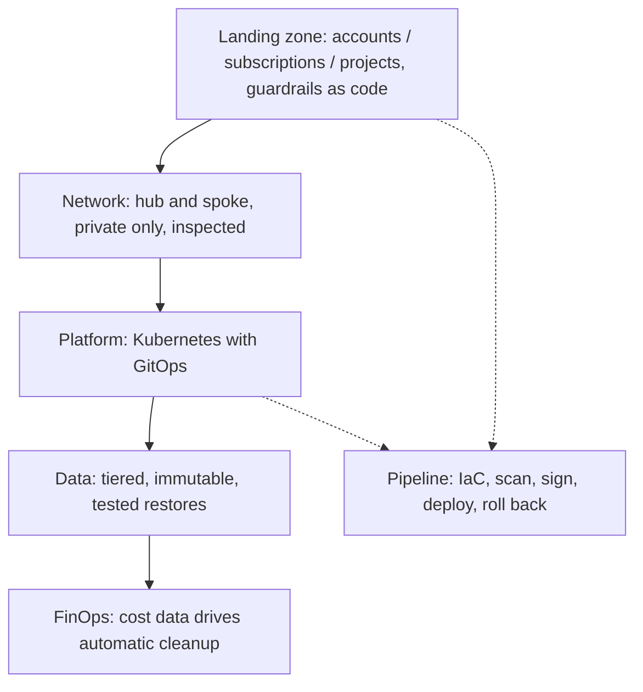

# 08. Cloud Portfolio Blueprints

Nine hands-on cloud builds, three per cloud, each aimed at a problem a company would pay for and each shipped through a real pipeline. They apply the service notes: [[1. Azure Core Concepts|01. Azure Core Concepts]], [[1. AWS Cloud Concepts|01. AWS Cloud Concepts]], [[1. GCP Fundamentals|01. GCP Fundamentals]], and the IaC notes in [[1. Infrastructure as Code|Infrastructure as Code]].

## The nine at a glance

| Cloud | Project | The idea |
| ----- | ------- | -------- |
| **Azure** | Regulated Landing Zone | Hub-and-spoke with private-only networking, firewall-inspected traffic, and **Azure Policy** that blocks non-compliant deployments before they exist |
| **Azure** | Resilient AKS Payments Platform | Zone-redundant **AKS** in South Africa North, a warm standby region, health-based failover through **Front Door**, GitOps releases that roll back on their own |
| **Azure** | Cost-Guarded Data Vault | Tiered, **immutable** storage plus a FinOps engine that reads the daily cost export and fixes waste automatically |
| **AWS** | Multi-Account Network Backbone | **Control Tower** landing zone, central **Transit Gateway**, inspection VPC with **Network Firewall**, **SCPs** that make unsafe configurations impossible |
| **AWS** | EKS Golden-Path Platform | Multi-tenant **EKS** where teams ship via GitOps with signed images, Spot-first Graviton nodes managed by **Karpenter**, and self-aborting canary releases |
| **AWS** | Resilient Data Estate | Tiered **S3**, vault-locked backups, a restore path **tested weekly**, and cost data in **Athena** driving automatic cleanup |
| **GCP** | Zero-Trust Landing Zone | Organisation from Terraform: folders, **Shared VPC**, **Private Service Connect**, org policies and **VPC Service Controls** perimeters |
| **GCP** | GKE Supply-Chain Platform | **GKE Autopilot** and **Cloud Run** where only images built and **attested** by your pipeline may run, released through staged **Cloud Deploy** pipelines |
| **GCP** | BigQuery FinOps Lake | Billing export to **BigQuery**, a governed **Cloud Storage** lake with Autoclass and retention locks, **Pub/Sub** budget alerts triggering cleanup |

---

# Patterns That Repeat Across All Three Clouds

| Theme | AWS | Azure | GCP |
| ----- | --- | ----- | --- |
| **Landing zone** | Control Tower, Organizations, SCPs | Management groups, Azure Policy | Folders, org policies |
| **Central network** | Transit Gateway, inspection VPC, Network Firewall | Hub VNet, Azure Firewall | Shared VPC, Private Service Connect |
| **Stop data leaving** | Endpoint policies, SCPs | Private endpoints, Policy | VPC Service Controls |
| **Kubernetes** | EKS + Karpenter | AKS (zone redundant) | GKE Autopilot, Cloud Run |
| **Release safety** | Canary that aborts itself | Rollback on its own | Staged Cloud Deploy |
| **Supply chain** | Signed images | Signed images | Attested images, Binary Authorization |
| **Immutable storage** | S3 Object Lock, Backup vault lock | Immutable blob policies | Bucket retention locks |
| **FinOps** | Cost and Usage Report + Athena | Cost Management export | Billing export to BigQuery |

# Ideas Worth Remembering

- **Guardrails as code**: make unsafe configurations **impossible** (SCPs, Azure Policy deny, org policy constraints) rather than discouraged
- **Hub and spoke**: shared services and inspection in one place, workloads in isolated spokes ([[3. Azure Networking|03. Azure Networking]], [[5. AWS Networking|05. AWS Networking]])
- **GitOps**: Git is the source of truth for the cluster; the cluster pulls changes and can roll back ([[1. Orchestration Platforms|Orchestration Platforms]])
- **Progressive delivery**: canary releases that abort on bad metrics
- **Supply-chain security**: build, sign or attest, verify at admission ([[3. Container Images and Build Tools|03. Container Images and Build Tools]])
- **Tested restores**: a backup is not real until you have restored from it, so automate the test
- **Closed-loop FinOps**: cost data triggers cleanup automatically ([[6. Azure Governance and Cost Management|06. Azure Governance and Cost Management]])
- **Regions in South Africa**: AWS `af-south-1` is the only AWS region in the country with three availability zones; Azure `southafricanorth` has a paired standby region; some services and instance types arrive later and cost more than in other regions

# Delivering Them
Terraform as the common IaC, Bicep for Azure-native pieces, pipelines in GitHub Actions with OIDC ([[2. Terraform|Terraform]], [[4. CloudFormation, Bicep and ARM Templates|CloudFormation, Bicep and ARM Templates]], [[2. GitHub Actions|GitHub Actions]]).

# Repositories

Each build is its own public repo:

| Cloud | Repo | Focus |
| ----- | ---- | ----- |
| Azure | [regulated-landing-zone](https://github.com/sharifndlovu123/regulated-landing-zone) | Hub-and-spoke landing zone in Terraform |
| Azure | [resilient-aks-payments-platform](https://github.com/sharifndlovu123/resilient-aks-payments-platform) | Zone-redundant AKS with warm standby |
| Azure | [cost-guarded-data-vault](https://github.com/sharifndlovu123/cost-guarded-data-vault) | Immutable tiered storage + FinOps engine |
| AWS | [multi-account-network-backbone](https://github.com/sharifndlovu123/multi-account-network-backbone) | Control Tower, Transit Gateway, Network Firewall |
| AWS | [eks-golden-path-platform](https://github.com/sharifndlovu123/eks-golden-path-platform) | Multi-tenant EKS, Argo CD, Karpenter |
| AWS | [resilient-data-estate](https://github.com/sharifndlovu123/resilient-data-estate) | Tiered S3, vault-locked backups, weekly restore test |
| GCP | [zero-trust-landing-zone](https://github.com/sharifndlovu123/zero-trust-landing-zone) | Org, Shared VPC, VPC Service Controls |
| GCP | [gke-supply-chain-platform](https://github.com/sharifndlovu123/gke-supply-chain-platform) | GKE Autopilot + Cloud Run, attested images |
| GCP | [bigquery-finops-lake](https://github.com/sharifndlovu123/bigquery-finops-lake) | Billing to BigQuery, governed storage lake |

More hands-on practice: [aws-playground](https://github.com/sharifndlovu123/aws-playground) (about 60 AWS services via CLI, IaC and SDKs, with CloudFormation, CDK, Terraform and Pulumi compared) and [vpc-playground](https://github.com/sharifndlovu123/vpc-playground) ([[12. VPC Playground|VPC Playground]]).
