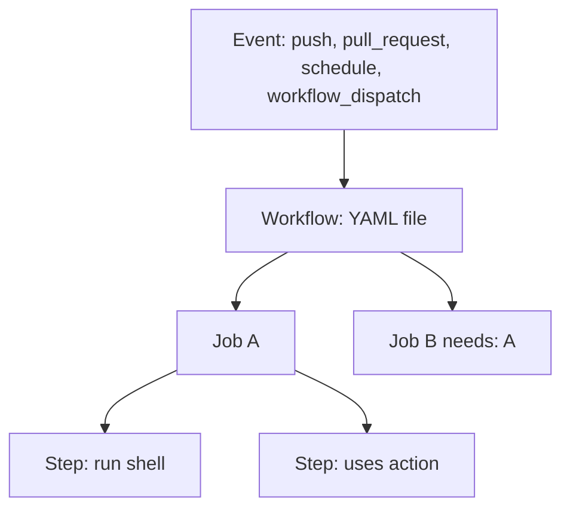

> **Hands-on:** worked through with [sharifndlovu123/github-actions-course](https://github.com/sharifndlovu123/github-actions-course), the companion repo for the DevOps Directive "GitHub Actions: Beginner to Pro" course. The basics are in [[2. GitHub Actions]]; this note goes deeper.

## What each topic is for

| Topic | Question it answers |
| ----- | ------------------- |
| **Core features** | How do workflows, jobs, steps, events and variables fit together? |
| **Runners** | Where does the job run, and on what hardware? |
| **Artifacts and caching** | How do I pass files between jobs and avoid redoing work? |
| **Permissions and OIDC** | How does a workflow get access safely? |
| **Matrix and conditionals** | How do I run many variants and skip what is not needed? |
| **Marketplace actions** | Which reusable actions can I trust? |
| **Common workflows** | What do most pipelines actually contain? |
| **Best practices** | How do I keep pipelines fast, maintainable and secure? |

Authoring your own actions and testing workflows locally: [[4. Authoring and Testing GitHub Actions|Authoring and Testing GitHub Actions]].

---

# Core Features



- A **workflow** reacts to **events**; it contains **jobs** that run **in parallel** unless `needs:` orders them
- A **step** is either a shell command (`run:`, bash by default on Linux, also Python and others via `shell:`) or an **action** (`uses:`)
- Each **job gets a fresh runner**, so nothing carries over between jobs unless you pass it explicitly

## Triggers and filters

```yaml
on:
  push:
    branches: [main]
    paths: ["src/**", "!src/**/*.md"]     # only run when matching files change
    tags: ["v*"]
  pull_request:
    paths-ignore: ["docs/**"]
  workflow_dispatch:                       # manual run button
    inputs:
      env: { type: choice, options: [staging, production] }
```

Path and branch filters are the cheapest way to **do less**: a docs-only change should not run the full test suite.

## Variables and scope

Variables can be set at three levels, and the closest one wins:

```yaml
env:                       # workflow level
  LEVEL: workflow
jobs:
  demo:
    runs-on: ubuntu-latest
    env:
      LEVEL: job           # job level
    steps:
      - run: echo "$LEVEL"           # job
      - env:
          LEVEL: step      # step level
        run: echo "$LEVEL"           # step
```

Use `vars.NAME` for non-sensitive configuration and `secrets.NAME` for sensitive values. Both can be defined on the **repository** or on an **environment** (which can also require reviewers).

## Passing data

| Between | How |
| ------- | --- |
| **Steps** in a job | Write to `$GITHUB_ENV` (env var) or `$GITHUB_OUTPUT` (step output) |
| **Jobs** | Declare job `outputs:` and read them with `needs.<job>.outputs.<name>` |
| **Jobs (files)** | Upload and download an **artifact** |

```yaml
jobs:
  build:
    runs-on: ubuntu-latest
    outputs:
      version: ${{ steps.v.outputs.version }}
    steps:
      - id: v
        run: echo "version=1.4.2" >> "$GITHUB_OUTPUT"
  deploy:
    needs: build
    runs-on: ubuntu-latest
    steps:
      - run: echo "Deploying ${{ needs.build.outputs.version }}"
```

---

# Runners

| Runner | Notes |
| ------ | ----- |
| **GitHub-hosted** | `ubuntu-latest`, `windows-latest`, `macos-latest`; clean VM each job; free minutes depend on plan and repo visibility |
| **Larger / ARM runners** | More CPU and RAM, native ARM, billed per minute |
| **Container jobs** | `container: image:` runs the steps inside an image you choose; `services:` starts databases or Redis next to the job |
| **Self-hosted** | Your own machine, full control, but **you** secure and maintain it |
| **Third-party runners** | Faster or cheaper hosted runners (for example Namespace, Blacksmith, Actuated) that drop in with a different `runs-on:` |

Avoid emulation (QEMU) where you can; use native ARM and x86 runners for each architecture. Never attach self-hosted runners to public repositories that accept fork pull requests.

---

# Artifacts and Caching

| | **Artifacts** | **Cache** |
| - | ------------- | --------- |
| Purpose | Hand **outputs** to later jobs or keep them for download (build files, test reports) | Reuse **dependencies** between runs |
| Actions | `actions/upload-artifact` / `download-artifact` | `actions/cache`, or `cache:` inside `setup-node`, `setup-python`, `setup-go` |
| Scope | One workflow run (with a retention period) | Shared across runs, keyed |

```yaml
- uses: actions/cache@<sha>        # pin to a commit SHA
  with:
    path: ~/.npm
    key: npm-${{ runner.os }}-${{ hashFiles('**/package-lock.json') }}
    restore-keys: |
      npm-${{ runner.os }}-
```

- The **key** should change when the dependencies change (hash the lock file)
- `restore-keys` allow a partial hit from an older cache
- Measure **cache hit rate** and job time before and after; a cache that never hits only adds work
- Prune unused caches and artifacts; set `retention-days`

---

# Permissions and Cloud Authentication

The automatic `GITHUB_TOKEN` is scoped per job. Pull requests from forks get **read-only** tokens by default. Always declare what you need:

```yaml
permissions:
  contents: read          # default to the least
jobs:
  release:
    permissions:
      contents: write     # raise only where needed
```

## Static keys vs OIDC

| | **Static credentials** | **OIDC (recommended)** |
| - | ---------------------- | ---------------------- |
| Stored as | Long-lived secrets in the repo | Nothing stored |
| Lifetime | Until you rotate them | Minutes, per job |
| Risk | Leak means long-lived access | Trust policy limits repo, branch, environment |

```yaml
permissions:
  id-token: write
  contents: read
steps:
  - uses: aws-actions/configure-aws-credentials@<sha>
    with:
      role-to-assume: arn:aws:iam::123456789012:role/github-deploy
      aws-region: af-south-1
```

Equivalent login actions exist for Azure (`azure/login`) and Google Cloud (`google-github-actions/auth`). Cloud-side setup: [[2. AWS IAM and Security]], [[5. Azure Identity and Security]].

---

# Matrix and Conditionals

```yaml
strategy:
  fail-fast: false
  matrix:
    os: [ubuntu-latest, windows-latest]
    node: [20, 22]
    include:
      - os: ubuntu-latest
        node: 24
        experimental: true
    exclude:
      - os: windows-latest
        node: 20
```

- A matrix creates **one job per combination**; `include` and `exclude` fine-tune it
- `fail-fast: false` lets the other jobs finish when one fails; `max-parallel` caps concurrency

## Dynamic matrix

Compute the matrix in a first job, then fan out:

```yaml
jobs:
  plan:
    runs-on: ubuntu-latest
    outputs:
      services: ${{ steps.find.outputs.services }}
    steps:
      - uses: actions/checkout@<sha>
      - id: find
        run: echo "services=$(ls services | jq -R -s -c 'split("\n")[:-1]')" >> "$GITHUB_OUTPUT"
  test:
    needs: plan
    runs-on: ubuntu-latest
    strategy:
      matrix:
        service: ${{ fromJSON(needs.plan.outputs.services) }}
    steps:
      - run: echo "Testing ${{ matrix.service }}"
```

Useful in a monorepo: test only the services that changed.

## Conditionals

```yaml
- if: github.ref == 'refs/heads/main' && github.event_name == 'push'
  run: ./deploy.sh
- if: failure()            # runs only when an earlier step failed
  run: ./notify.sh
- if: always()             # runs regardless
  run: ./cleanup.sh
```

Status functions: `success()` (default), `failure()`, `always()`, `cancelled()`.

---

# Workflow Commands

Specially formatted output lets a step talk to the runner:

| Command | Effect |
| ------- | ------ |
| `::notice::`, `::warning::`, `::error file=app.js,line=5::msg` | Annotations on the run and the diff |
| `::group::Title` ... `::endgroup::` | Collapsible log sections |
| `::add-mask::value` | Hide a value in logs |
| `echo "K=V" >> $GITHUB_ENV` | Set an env var for later steps |
| `echo "k=v" >> $GITHUB_OUTPUT` | Set a step output |
| `echo "text" >> $GITHUB_STEP_SUMMARY` | Markdown shown on the run summary page |
| `echo "/my/bin" >> $GITHUB_PATH` | Add to `PATH` for later steps |

The older `::set-output` and `::set-env` commands are deprecated; use the files above.

---

# Marketplace Actions

Thousands of actions exist, so treat each as a **third-party dependency**:

1. Does it do exactly what you need, and nothing more?
2. Signals: verified publisher, stars, recent commits, open issues, a readable source
3. **Read the code** if it touches secrets or deploys
4. **Pin to a full commit SHA**, not a tag or branch:

```yaml
# bad: moves under you
- uses: actions/checkout@v4
# good: immutable, with the version as a comment
- uses: actions/checkout@<full-40-character-commit-sha>   # v4.x.y
```

Tags can be re-pointed. In March 2025 a widely used action (`tj-actions/changed-files`, CVE-2025-30066) was compromised and leaked secrets from repositories that referenced it by tag, which is why SHA pinning matters. Automate the updates with **Dependabot** or Renovate.

| Group | Examples |
| ----- | -------- |
| **Official** | `checkout`, `cache`, `upload-artifact`, `download-artifact`, `github-script` |
| **Runtimes** | `setup-node`, `setup-python`, `setup-go`, `setup-java` |
| **Cloud auth** | `aws-actions/configure-aws-credentials`, `azure/login`, `google-github-actions/auth` |
| **Containers** | `docker/setup-buildx-action`, `docker/login-action`, `docker/build-push-action` |
| **Quality** | Super-Linter, CodeQL |

---

# Common Workflows

| Stage | Typical jobs |
| ----- | ------------ |
| **Validate** | Lint, unit / integration / end-to-end tests, static analysis, dependency and secret scanning, coverage gates |
| **Build** | Compile, package, build and push a container image or machine image |
| **Deploy (push)** | The pipeline runs `kubectl apply` or `terraform apply` |
| **Deploy (pull / GitOps)** | Commit the desired state; an agent in the cluster applies it ([[8. Upgrades, CI-CD and GitOps|Upgrades, CI-CD and GitOps]]) |
| **Automation** | Release notes and tagging, stale issue cleanup, dependency update PRs |

Pipeline concepts: [[1. CI-CD Pipelines]]. Image build steps: [[3. Container Images and Build Tools]].

---

# Best Practices

## Performance
1. **Measure first**: baseline duration, queue time and cache hit rate
2. **Wait less**: enough runner capacity, **fail fast** with quick lint and type checks first
3. **Do less**: `paths` filters, `if:` conditions, caching, Docker layer caching (`cache-from: type=gha`)
4. **Use resources well**: parallel jobs and matrix, use every CPU core in tests, avoid emulation
5. **Prevent regressions**: alert on job-time creep, clean old caches and artifacts

## Maintainability
- Give each repo a **"CI API"**: a single task runner (Task, Make, Bazel) with standard commands (`install`, `test`, `build`, `dev`) so the workflow just calls `task test` and a developer can run the same thing locally
- Avoid copy-paste: **composite actions** and **reusable workflows**, versioned like libraries
- Iterate locally before pushing ([[4. Authoring and Testing GitHub Actions|Authoring and Testing GitHub Actions]])
- Decide up front how logic is shared across a mono-repo or many repos

## Security
- Least-privilege `permissions:`; prefer `GITHUB_TOKEN` to personal access tokens
- **OIDC** instead of stored cloud keys
- **Pin actions by SHA**
- No self-hosted runners for fork pull requests
- **Environments with required reviewers** for production deploys
- More: [[5. Secure Coding and Supply Chain]]

---

# Capstone Pattern

The course ends with a project that ties it together: pull request checks (lint, test), a build job that creates and pushes an image, and a deploy job gated by an environment, all calling shared tasks so the logic can be run locally with `act`. The repo layout and diagrams are in the capstone folder of the companion repo.
