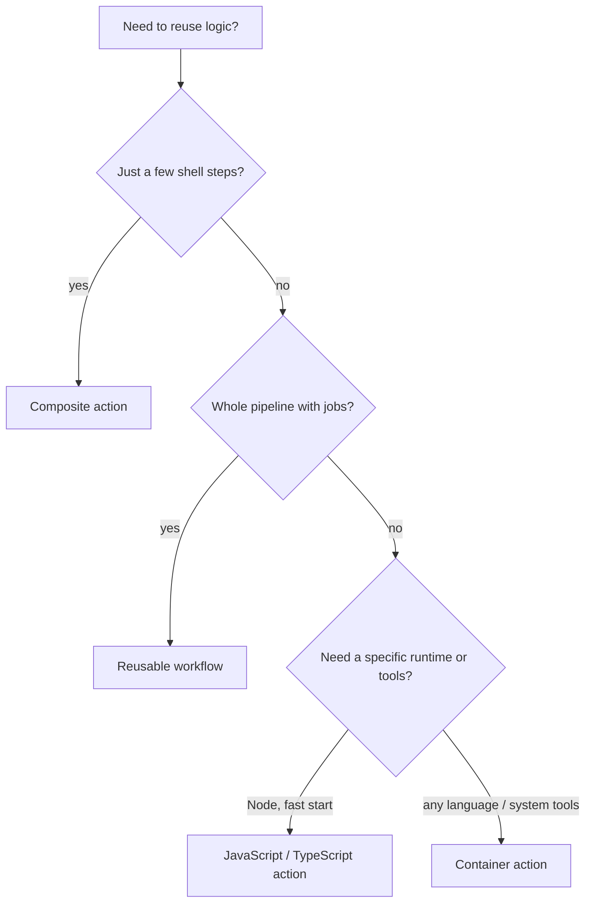

# 04. Authoring and Testing GitHub Actions

> **Hands-on:** exercises in [sharifndlovu123/github-actions-course](https://github.com/sharifndlovu123/github-actions-course) (authoring-actions and developer-experience modules). Concepts first: [[3. GitHub Actions Deep Dive|GitHub Actions Deep Dive]].

Pushing a commit just to see whether a workflow works is slow. This note covers **building your own actions** and **iterating locally**.

## Ways to reuse automation

| Option | What it is | Best for |
| ------ | ---------- | -------- |
| **Composite action** | A bundle of steps in an `action.yml` | Repeated step sequences in one repo or org |
| **Reusable workflow** | A whole workflow called with `workflow_call` | Shared pipelines (build + test + deploy) |
| **JavaScript / TypeScript action** | Node code run by the runner | Fast, cross-platform logic; GitHub API calls |
| **Container action** | A Docker image (or Dockerfile) run as a step | Any language or tool; Linux runners only |



---

# Composite Action

```yaml
# .github/actions/greet/action.yml
name: Greet
description: Print a greeting and return a random number
inputs:
  who:
    description: Name to greet
    default: world
outputs:
  number:
    description: A random number
    value: ${{ steps.rand.outputs.number }}
runs:
  using: composite
  steps:
    - run: echo "Hello, ${{ inputs.who }}"
      shell: bash                       # shell is required in composite steps
    - id: rand
      run: echo "number=$RANDOM" >> "$GITHUB_OUTPUT"
      shell: bash
```

```yaml
# calling it
- uses: ./.github/actions/greet
  with:
    who: Sharif
```

---

# Reusable Workflows

```yaml
# .github/workflows/build.yml  (the source)
on:
  workflow_call:
    inputs:
      environment: { type: string, required: true }
    secrets:
      deploy_token: { required: true }
jobs:
  build:
    runs-on: ubuntu-latest
    steps:
      - run: echo "Building for ${{ inputs.environment }}"
```

```yaml
# caller
jobs:
  call-build:
    uses: ./.github/workflows/build.yml          # same repo
    with:
      environment: staging
    secrets:
      deploy_token: ${{ secrets.DEPLOY_TOKEN }}
  call-shared:
    uses: my-org/shared/.github/workflows/build.yml@<commit-sha>   # another repo, pinned
    secrets: inherit
```

Version shared workflows with tags or SHAs, and call them by a pinned reference.

---

# JavaScript and TypeScript Actions

Three approaches appeared in the course:

| Approach | Trade-off |
| -------- | --------- |
| **Vanilla Node, dependencies committed** | No build step, but a large `node_modules` in the repo |
| **Node action with a build step** | Bundle with `ncc` or `esbuild` into `dist/` and commit it |
| **TypeScript, compiled before use** | Type safety; compile and commit the output (or build in CI) |

```yaml
# action.yml
name: My JS action
runs:
  using: node20
  main: dist/index.js
```

```ts
import * as core from '@actions/core'
async function run() {
  const who = core.getInput('who')
  core.info(`Hello ${who}`)
  core.setOutput('time', new Date().toISOString())
}
run().catch(e => core.setFailed(e.message))
```

GitHub's `actions/typescript-action` template gives a ready structure with tests and packaging.

---

# Container Actions

| Variant | Behaviour |
| ------- | --------- |
| **Dockerfile in the repo** | Built **every run**, so slower |
| **Prebuilt public image** (`image: docker://...`) | Pulled, not built; much faster |
| **Language-specific** (shell, Python) | Entry point script inside the image |

```yaml
runs:
  using: docker
  image: Dockerfile        # or docker://ghcr.io/me/greeter:1.0
  args: ["${{ inputs.who }}"]
```

Container actions run only on Linux runners. Publish a versioned image when startup time matters.

---

# Developer Experience: Test Before You Push

## 1. Move logic out of the YAML

The best fix is to keep workflows thin and put the real work in scripts or a task runner (Task, Make, shell scripts, a small CLI). Then:

```yaml
- run: task test
```

You can run `task test` on your laptop, so most logic is tested without GitHub at all. Keep only Git and GitHub-specific glue (checkout, auth, uploading results) in the workflow.

## 2. Test actions

- Write a normal test suite (`npm test`, Jest)
- Run the action locally with GitHub's `local-action` tool against a `.env` file of inputs:

```
$ npx @github/local-action . src/main.ts .env
```

## 3. Run workflows locally with act

`act` runs workflows in Docker containers and can simulate events:

```
$ act workflow_dispatch -W .github/workflows/hello.yaml
$ act pull_request -s MY_SECRET=value --container-architecture linux/amd64
$ act -l                       # list jobs
```

Limits: the runner image is not identical to GitHub's, some contexts and services differ, and OIDC and some marketplace actions will not work. Treat `act` as a fast first check, not the final test.

## 4. Breakpoints on the real runner

GitHub-hosted runners offer no shell access by default. Add an SSH or tmate step **temporarily** to debug, or use a third-party runner service that provides built-in breakpoints:

```yaml
- uses: mxschmitt/action-tmate@<sha>
  if: failure()
  with:
    limit-access-to-actor: true       # only you can connect
```

Remove it afterwards: an open debug session is a way into the runner and its secrets.

## 5. Debug logging

Set repository secret or variable `ACTIONS_STEP_DEBUG=true` (and `ACTIONS_RUNNER_DEBUG=true`) for verbose logs, and re-run failed jobs from the Actions tab.

---

# Checklist for a New Action

- [ ] Clear inputs, outputs and defaults documented in the README
- [ ] Least privilege: ask for no more token permissions than needed
- [ ] Tests, and a local way to run it
- [ ] Versioned releases (tags and a moving major tag such as `v1`) with a changelog
- [ ] Pinned dependencies and `dist/` committed for JavaScript actions
- [ ] Never prints secrets; uses `::add-mask::` for generated sensitive values
