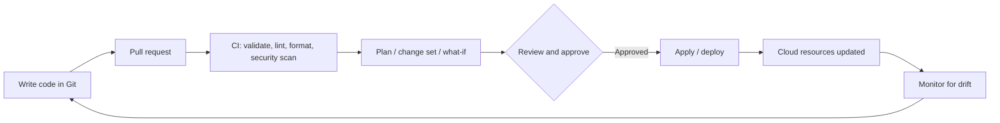

**Infrastructure as Code (IaC)** means defining servers, networks, databases and permissions in **text files** that live in Git, and having a tool create and change the real infrastructure from them. It replaces clicking through consoles with something reviewable, repeatable and versioned.

## Tools at a glance

| Tool | Cloud | Language | Notes |
| ---- | ----- | -------- | ----- |
| **Terraform** | Any (AWS, Azure, GCP, Kubernetes, SaaS) | HCL | Most widely used, state file, [[2. Terraform|Terraform]] |
| **OpenTofu** | Any | HCL | Open-source fork of Terraform under the Linux Foundation |
| **AWS CloudFormation** | AWS | YAML / JSON | AWS-native, [[4. CloudFormation, Bicep and ARM Templates|CloudFormation, Bicep and ARM Templates]] |
| **AWS CDK** / **SAM** | AWS | TypeScript, Python, Java... | Code that synthesises to CloudFormation |
| **Azure Bicep** | Azure | Bicep DSL | Clean syntax that compiles to ARM |
| **ARM templates** | Azure | JSON | Azure's native deployment format |
| **GCP Deployment Manager** / **Config Connector** | GCP | YAML / Kubernetes CRDs | Google-native; most GCP teams use Terraform |
| **Pulumi** | Any | TypeScript, Python, Go, C# | Real programming languages, own state backend |
| **Ansible** | Any | YAML | Configuration management and orchestration, agentless |
| **Crossplane** | Any, via Kubernetes | Kubernetes YAML | Manage cloud resources as Kubernetes objects |
| **Terragrunt**, **Atlantis**, **Atmos** | Wrappers | | Orchestration and PR automation around Terraform |

---

# Core Ideas

## Declarative vs imperative
- **Declarative**: describe the **end state** ("there should be a VNet with these subnets"); the tool works out the steps. Terraform, CloudFormation, Bicep, ARM
- **Imperative**: script the **steps** ("create this, then that"). Shell with `az` / `aws` / `gcloud`, some Ansible usage

## Key properties
- **Idempotent**: running it again changes nothing if reality already matches
- **Immutable infrastructure**: replace rather than patch servers (new image, new instances)
- **Version controlled**: peer-reviewed through pull requests with a history of every change
- **Repeatable environments**: the same code creates dev, staging and production
- **Documentation**: the code *is* the description of what exists

## State and drift
- **State**: the tool's record of what it created and the ids of those resources. Terraform stores a **state file**; CloudFormation tracks a **stack**; ARM / Bicep rely on **Azure Resource Manager** itself as the source of truth, with **what-if** comparing against the live resources
- **Drift**: reality differs from the code (someone changed it in the console). Detect with `terraform plan`, CloudFormation **drift detection**, ARM **what-if**
- Protect state: **remote backend**, locking, encryption, access control ([[3. Terraform Best Practices|Terraform Best Practices]])

## Plan before apply



Every tool has a preview step: `terraform plan`, CloudFormation **change sets**, `az deployment ... what-if`, `pulumi preview`. Make reading the plan part of code review ([[1. CI-CD Pipelines|CI-CD Pipelines]]).

---

# The Same Resource in Four Tools

A storage bucket / account, shown side by side.

## Terraform (AWS S3)

```hcl
resource "aws_s3_bucket" "assets" {
  bucket = "my-unique-bucket-12345"

  tags = {
    Environment = "dev"
  }
}

resource "aws_s3_bucket_versioning" "assets" {
  bucket = aws_s3_bucket.assets.id

  versioning_configuration {
    status = "Enabled"
  }
}
```

## CloudFormation (AWS S3)

```yaml
Resources:
  AssetsBucket:
    Type: AWS::S3::Bucket
    Properties:
      BucketName: my-unique-bucket-12345
      VersioningConfiguration:
        Status: Enabled
      Tags:
        - Key: Environment
          Value: dev
```

## Bicep (Azure storage account)

```bicep
resource sa 'Microsoft.Storage/storageAccounts@2023-01-01' = {
  name: 'stdemo12345'
  location: resourceGroup().location
  sku: { name: 'Standard_LRS' }
  kind: 'StorageV2'
  tags: { Environment: 'dev' }
}
```

## ARM template (the same account, JSON)

```json
{
  "$schema": "https://schema.management.azure.com/schemas/2019-04-01/deploymentTemplate.json#",
  "contentVersion": "1.0.0.0",
  "resources": [
    {
      "type": "Microsoft.Storage/storageAccounts",
      "apiVersion": "2023-01-01",
      "name": "stdemo12345",
      "location": "[resourceGroup().location]",
      "sku": { "name": "Standard_LRS" },
      "kind": "StorageV2",
      "tags": { "Environment": "dev" }
    }
  ]
}
```

## Terraform (GCP Cloud Storage)

```hcl
resource "google_storage_bucket" "assets" {
  name     = "my-unique-bucket-12345"
  location = "EUROPE-WEST1"

  uniform_bucket_level_access = true
  labels = {
    environment = "dev"
  }
}
```

---

# Choosing a Tool

| If you... | Consider |
| --------- | -------- |
| Use several clouds or SaaS (DNS, GitHub, Datadog) | **Terraform / OpenTofu** |
| Are AWS-only and want no extra state to manage | **CloudFormation**, or **CDK** for code-first teams |
| Are Azure-only | **Bicep** (not raw ARM JSON) |
| Want to use a full programming language | **Pulumi** or **CDK** |
| Need to configure software on servers | **Ansible** (with Terraform creating the servers) |
| Already live in Kubernetes | **Crossplane** |

## Typical split of responsibilities
1. **Provision** infrastructure: Terraform, CloudFormation, Bicep
2. **Configure** what runs on it: Ansible, cloud-init, container images ([[3. Container Images and Build Tools]])
3. **Deploy** applications: pipelines ([[2. GitHub Actions|GitHub Actions]], [[6. Azure Pipelines|Azure Pipelines]], [[7. AWS CodePipeline|AWS CodePipeline]]), Kubernetes manifests / Helm ([[2. Local Kubernetes Tools|Local Kubernetes Tools]])

---

# Good Practice for Any IaC Tool

- Everything in Git; no manual console changes to managed resources
- **Small, focused stacks** rather than one giant one (smaller blast radius, faster runs)
- **Parameterise** by environment instead of copying code
- **Never commit secrets**; read them from Key Vault, Secrets Manager or Secret Manager ([[5. Azure Identity and Security]], [[2. AWS IAM and Security|2. AWS IAM and Security]], [[1. GCP Fundamentals]])
- **Pin versions** of providers, modules and API versions
- **Lint, validate and policy-check** in CI (tflint, cfn-lint, Bicep linter, Checkov, tfsec / Trivy, OPA)
- **Tag / label** everything for cost and ownership
- Run deployments from a **pipeline with a least-privilege identity**, using OIDC instead of stored keys
- **Test**: validate, plan against a sandbox account, Terratest or similar for modules
