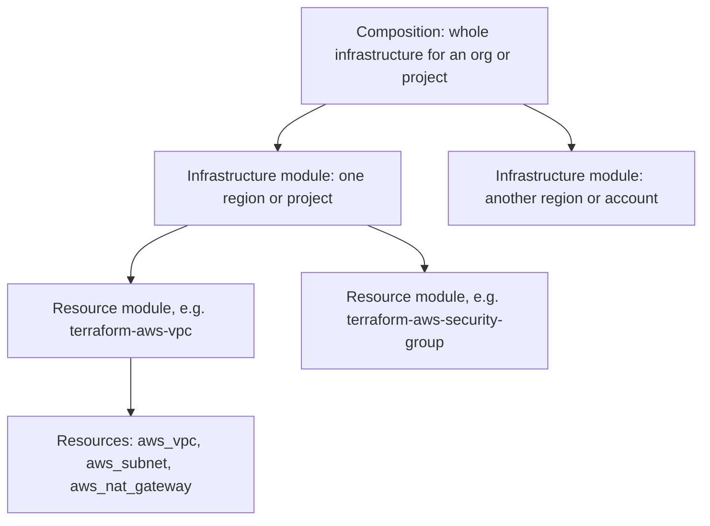

Notes from **[terraform-best-practices.com](https://www.terraform-best-practices.com/)**, an open book (Apache 2.0) maintained by Anton Babenko with contributors and translated into many languages. It separates established practices from opinionated ones. Basics are in [[2. Terraform|Terraform]] and the wider picture in [[1. Infrastructure as Code|Infrastructure as Code]].

The book's pages: Key concepts, Code structure, Code structure examples (Terragrunt and Terraform: small, medium and large), Naming conventions, Code styling, Writing Terraform configurations, FAQ, References and a Workshop.

---

# Key Concepts



| Concept | Meaning |
| ------- | ------- |
| **Resource** | One infrastructure object such as `aws_vpc` or `aws_db_instance`; has arguments, attributes and a lifecycle |
| **Resource module** | A group of connected resources doing one common job, e.g. a VPC module creating VPC, subnets and NAT gateway. The smallest versioned, shareable unit |
| **Infrastructure module** | A group of resource modules serving one purpose in a setup; defines provider configuration and usually covers one logical boundary (an AWS Region or a Google Cloud project) |
| **Composition** | A collection of infrastructure modules, possibly spanning regions or accounts: the full infrastructure |
| **Data source** | Read-only lookup. Useful ones: `terraform_remote_state` (link layers), `external` (run a program), `http` (HTTP GET when no provider exists) |
| **Remote state** | State for each infrastructure module and composition kept in a remote backend |

Mental model: resources are the **atoms**, resource modules the **molecules**.

**Data flow**: between resource modules and infrastructure modules via **module outputs** and **data sources**; between compositions mainly via **remote state data sources**.

---

# Code Structure

There is no universal answer, so ask first:

- **Complexity**: number of resources and providers (logical providers like `random`, `local`, `null`, `time` do not count much)
- **Change frequency**: monthly, daily, or every commit
- **Who changes it**: only developers, or anyone and CI via pull requests
- **Deployment platform**: CodeDeploy, Kubernetes, OpenShift and so on
- **Grouping**: by environment, region or project

## Starting file layout

| File | Contents |
| ---- | -------- |
| `main.tf` | Module calls, locals and data sources that create resources |
| `variables.tf` | Variable declarations used in `main.tf` |
| `outputs.tf` | Outputs from resources created in `main.tf` |
| `versions.tf` | Version requirements for Terraform and providers |

- Everything in `main.tf` is fine for examples and getting started
- `terraform.tfvars` should **only** be used in a composition

## Common recommendations
1. **Smaller is faster**: `plan` and `apply` call cloud APIs to check every resource, so one huge composition is slow
2. **Limit the blast radius**: unrelated resources in separate compositions are insulated from each other, which also reduces the damage of a security breach
3. **Use remote state from the start**: a laptop is not a source of truth and a `tfstate` in git is a "nightmare"; configure the backend with ACLs, versioning and logging
4. **Be consistent** in structure and naming: code is written for people to read first, and moving resources in state is harder when layout is inconsistent
5. **Keep resource modules plain**
6. **Do not hardcode** values that can be variables or looked up with data sources
7. Use **data sources and `terraform_remote_state`** as the glue between infrastructure modules in a composition

## Orchestrating modules and compositions
As infrastructure grows you must chain runs and pass values between modules. Options the book lists:

| # | Approach | Notes |
| - | -------- | ----- |
| 1 | **Terraform only** | Simple, only Terraform knowledge needed |
| 2 | **Terragrunt** | Pure orchestration for the whole infrastructure; reduces duplication, works natively with modules and compositions |
| 3 | **In-house scripts** | Often a starting point before finding Terragrunt |
| 4 | **Ansible or similar** | Common when Ansible came first |
| 5 | **Crossplane** and Kubernetes-inspired tools | Reconciliation loop to reach desired Terraform state |

The book reviews options 1 and 2 only.

## Examples by size

| Size | Description | Terraform | Terragrunt |
| ---- | ----------- | --------- | ---------- |
| **Small** | Few resources, no external dependencies, one account, one region, one environment | Ready | n/a |
| **Medium** | Several accounts and environments, off-the-shelf infrastructure modules | Ready | Adds a composition pattern |
| **Large** | Many accounts and regions, less copy-paste, custom modules, heavy use of compositions | In progress | Planned |
| **Very large** | Multi-cloud with several providers | Planned | Planned |

---

# Naming Conventions

These apply to **Terraform identifiers**; cloud provider restrictions can override them for real resource names.

## General
- Use `_` (underscore) not `-` in resource, data source, variable and output names
- Prefer lowercase letters and numbers
- Use `-` inside **argument values** and anywhere a human sees the value (e.g. an RDS DNS name)

## Resources and data sources
- **Do not repeat the resource type** in the name:

```hcl
resource "aws_route_table" "public" {}                 # preferred
resource "aws_route_table" "public_route_table" {}     # avoid
resource "aws_route_table" "public_aws_route_table" {} # avoid
```

- Name it **`this`** when nothing more descriptive fits or the module creates one resource of that type (the AWS VPC module's `aws_nat_gateway` is `this`, while route tables are `public`, `private`, `database`)
- Use **singular** nouns

## Argument order inside a resource
1. `count` or `for_each` first, then a blank line
2. Regular arguments
3. `tags` (if supported)
4. `depends_on`, then `lifecycle` if needed
5. One blank line between groups

```hcl
resource "aws_nat_gateway" "this" {
  count = 2

  allocation_id = "..."
  subnet_id     = "..."

  tags = {
    Name = "..."
  }

  depends_on = [aws_internet_gateway.this]

  lifecycle {
    create_before_destroy = true
  }
}
```

- In `count`, prefer a **boolean condition** over a `length()` check:

```hcl
resource "aws_nat_gateway" "that" {      # best
  count = var.create_public_subnets ? 1 : 0
}

resource "aws_nat_gateway" "this" {      # good
  count = length(var.public_subnets) > 0 ? 1 : 0
}
```

## Variables
- Reuse the **`name`, `description` and `default`** from the provider's Argument Reference; do not invent new ones
- **Plural** names for `list(...)` and `map(...)` variables
- Key order: `description`, `type`, `default`, `validation`
- **Always include `description`**
- Prefer simple types (`string`, `number`, `list(...)`, `map(...)`, `any`) over `object()` unless you need strict per-key constraints; use specific types like `map(map(string))` when elements share a type
- Use **positive names** (`encryption_enabled`, not `encryption_disabled`)
- Use `tomap(...)` for maps, because `{}` can be a map or an object
- `nullable = false` for variables that must never be `null` (passing `null` then falls back to the default)
- Validation is limited before Terraform 1.9 (cannot reference other variables)

## Outputs
- Name them for the property returned with the pattern **`{name}_{type}_{attribute}`**, e.g. `{name}` = the resource name, `{type}` = the type without the provider prefix, `{attribute}` = what is returned
- Plural name for list outputs
- Always include `description`
- Avoid `sensitive` unless you control every place the output is used
- Prefer `try()` (Terraform 0.13+) over the legacy `element(concat(...))` pattern

```hcl
output "security_group_id" {
  description = "The ID of the security group"
  value       = try(aws_security_group.this[0].id, aws_security_group.name_prefix[0].id, "")
}
```

The book does not set naming rules for modules or files.

---

# Code Styling

- **Format with `terraform fmt`** (opinionated, not configurable); enforce it with the pre-commit hook `terraform_fmt` and `terraform fmt -check` in CI (non-zero exit lists unformatted files)
- Add an **`.editorconfig`**: spaces, size 2, trim trailing whitespace, for `*.tf` and `*.tfvars`; tabs for `Makefile`
- **Pre-commit hooks** for validity, formatting and documentation before code is pushed

```yaml
# .pre-commit-config.yaml
repos:
  - repo: https://github.com/antonbabenko/pre-commit-terraform
    rev: v1.99.4
    hooks:
      - id: terraform_fmt
```

- **Generate docs** with **terraform-docs**, manually or through pre-commit
- Examples and modules should include documentation; use **absolute links** in `README.md` so the Terraform Registry renders them
- Diagrams with Mermaid, blueprints with cloudcraft.co
- **Comments**: use `#`, avoid `//` and block comments; mark section headers with `# -----` or `######` lines

---

# Writing Terraform Configurations

## Dependencies with `locals`
Use `locals` to hint at destroy order when Terraform sees no direct dependency between resources.

## Optional nested blocks with `dynamic` and `lookup`

```hcl
dynamic "website" {
  for_each = length(keys(var.website)) == 0 ? [] : [var.website]

  content {
    index_document = website.value.index_document
    error_document = lookup(website.value, "error_document", null)
  }
}
```

## Optional object attributes (Terraform 1.3+)

```hcl
variable "database_settings" {
  type = object({
    name             = string
    backup_retention = optional(number, 7)
  })
}
```

## Secrets
- Keep secrets **out of configuration and state**: anyone with repository access could read them
- **Fetch at runtime** with data sources such as `aws_secretsmanager_secret_version`
- On Terraform **1.11+**, use **write-only arguments** (e.g. `password_wo`): sent to the provider and never stored in state

```hcl
data "aws_secretsmanager_secret_version" "db_password" {
  secret_id = data.aws_secretsmanager_secret.db_password.id
}

resource "aws_db_instance" "example" {
  password_wo = data.aws_secretsmanager_secret_version.db_password.secret_string
}
```

## Variable validation

```hcl
variable "environment" {
  type = string

  validation {
    condition     = contains(["dev", "staging", "prod"], var.environment)
    error_message = "Environment must be one of: dev, staging, prod."
  }
}
```

For complex types, check object attributes or every item in a list, e.g. `alltrue()` with `can(cidrhost(...))` to confirm each entry is a valid CIDR.

---

# FAQ Highlights

## Tools to consider

| Tool | Purpose |
| ---- | ------- |
| **Terragrunt** | Orchestrates Terraform runs |
| **tflint** | Lints Terraform code |
| **tfenv** / **asdf-hashicorp** | Manage Terraform versions |
| **Atmos** | Composable framework with YAML configuration |
| **Atlantis** | Automates Terraform workflows in pull requests |
| **pre-commit-terraform** | Git hooks via the pre-commit framework |
| **Infracost** | Cost estimates for changes in pull requests |

## Dependency hell with modules
- **Version** resource and infrastructure modules
- Configure **providers outside modules, only in the composition**
- **Lock** provider and Terraform versions
- Use **Dependabot** to open pull requests for updates

---

# Putting It Together: A Practical Layout

```
infrastructure/
├── modules/                    # resource modules (versioned, plain)
│   ├── network/
│   └── app/
├── compositions/
│   ├── dev/
│   │   ├── main.tf
│   │   ├── variables.tf
│   │   ├── outputs.tf
│   │   ├── versions.tf
│   │   └── terraform.tfvars    # tfvars only in a composition
│   └── prod/
│       └── ...
└── .pre-commit-config.yaml
```

Checklist from the book's recommendations:
1. Remote state with locking, versioning and logging from day one
2. Small compositions to limit blast radius and speed up plans
3. Consistent naming (`this`, singular, underscores)
4. `description` on every variable and output
5. `terraform fmt`, tflint and terraform-docs in pre-commit and CI ([[1. CI-CD Pipelines|CI-CD Pipelines]])
6. Pinned module and provider versions, no secrets in state
7. Plan on pull requests (Atlantis, [[2. GitHub Actions|GitHub Actions]]) and estimate cost with Infracost

> Additional points I would add beyond the book: use `for_each` over `count` for collections, commit `.terraform.lock.hcl`, and scan code with Checkov / Trivy.
