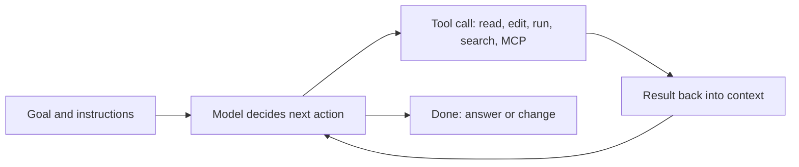
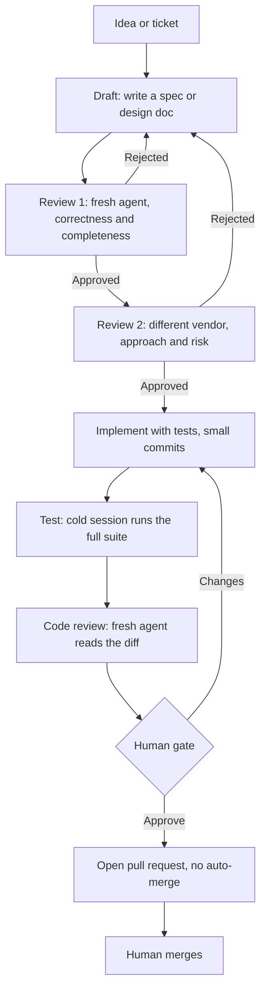

# 01. AI Agents and Workflows

How coding agents are put to work: single agents, multi-agent pipelines, and the human checkpoints between them. A hands-on example is in [[3. Kandev|Kandev]]; the supporting tools are in [[2. Claude Code Tooling and MCP|Claude Code Tooling and MCP]].

## Tools at a glance

| Layer | Examples |
| ----- | -------- |
| **Coding agents** | Claude Code, OpenAI Codex CLI, Gemini CLI |
| **Orchestrators** | Kandev (multi-agent task workflows), n8n (general automation), custom scripts |
| **Protocols** | **MCP** (Model Context Protocol) for tools, **ACP** (Agent Client Protocol) for talking to agents |
| **Agent instructions** | `CLAUDE.md`, `AGENTS.md`, skills, plans |
| **Isolation** | Git worktrees per task, containers |
| **Review gates** | Independent reviewer agents, human approval steps |

---

# What an Agent Is

An **agent** is a language model in a loop: it reads the goal, chooses a **tool** (read a file, run a command, edit code, call an API), sees the result, and repeats until done.



- **Context** is the agent's working memory; it is limited, so long sessions lose detail
- **Tools** give it hands: shell, file edit, web, and anything exposed through MCP
- **Instructions** shape behaviour: repo rules in `CLAUDE.md` / `AGENTS.md`, reusable skills, a written plan

---

# Single Agent vs Pipeline

| | Single agent | Multi-agent pipeline |
| - | ------------ | -------------------- |
| Good for | Small tasks, exploration, quick fixes | Features that need design, review and testing |
| Risk | The same mind writes and checks its own work | More moving parts to manage |
| Control | You watch the session | Defined steps and gates |

The idea behind a pipeline: **separate the roles** so the agent that wrote something is never the only one to judge it.

---

# The Draft → Review → Implement → Human Gate Pattern



Why each part exists:

| Part | Purpose |
| ---- | ------- |
| **Draft in plan mode** | Think before coding; the output is a document, not code |
| **Fresh-context reviewers** | A new session has none of the author's assumptions, so it finds real gaps |
| **Different model vendor** | A second vendor catches blind spots the first shares with itself |
| **Cold test run** | A new session runs the suite from scratch, no "it worked for me" |
| **Human gate** | A person approves before anything leaves the machine |
| **No auto-merge** | Agents open pull requests; humans merge |
| **Round cap** | After N rejected rounds, stop and escalate to a human |

---

# Lessons Learned (the hard way)

1. **The written plan is the source of truth, not the chat.** Verdicts and round counters belong in a plan or file that survives restarts and new sessions
2. **Agents over-help.** They finish a step, then keep going past the gate. Counter with explicit rules in every prompt: "move to exactly one named step, never skip ahead, if unsure stop"
3. **Prompt discipline is not enforcement.** A rule in a prompt can be ignored; where possible make the **system** enforce the stop (a tool-level block or a structural next-step) and treat prompts as a second line
4. **Fresh context gives independence.** Reset the agent's context when entering a review step
5. **Rate and session limits kill agents mid-task.** Expect it. Keep resumable state, and make a resume prompt **minimal**: "continue, do not restart, re-read the plan and git". Never put cross-step actions in a resume note
6. **Cap review loops.** An agent will happily bounce a task back to draft again and again; count rounds and force a human decision
7. **Isolate work.** One git worktree per task so parallel agents do not collide
8. **Make agent output reviewable.** Small commits, a test checklist in the pull request, design docs committed to the repo
9. **Spread load across vendors.** Using more than one agent vendor spreads quota and gives cross-checks
10. **Watch the board.** A human gate with no notification just waits silently, so configure notifications

---

# Writing Good Agent Instructions

## `CLAUDE.md` / `AGENTS.md`
A file at the repo root that the agent reads at the start of each session.

```markdown
# Repository Guidelines
## Project structure
- src/apps/: domain apps; shared code in common
## Commands
- make test    # run the test suite
- make migrate # apply migrations
## Conventions
- Never edit migrations by hand
- Run the tests before claiming a task is done
```

Good contents: what the project is, the layout, how to build and test, naming and style rules, **things not to do**, and where the design docs live. Keep it short and factual; point to longer docs instead of pasting them.

## Skills
Reusable, named instruction bundles an agent loads when relevant (e.g. "review architecture", "build a static site from a brief"). Good for repeatable procedures; see [[2. Claude Code Tooling and MCP|Claude Code Tooling and MCP]].

## Plans
For multi-step work, write numbered implementation plans in the repo so any session can resume from them.

---

# Orchestrating Without a Dedicated Tool

You can get much of this with plain tools:
- **Git worktrees** per task: `git worktree add ../task-123 -b task-123`
- A **Makefile or script** that runs agent CLI in a loop
- **CI** that runs tests and a reviewer agent on every pull request ([[1. CI-CD Pipelines|CI-CD Pipelines]])
- **n8n** or a workflow engine for the non-coding steps ([[4. BPMN and Workflow Engines|BPMN and Workflow Engines]])

A dedicated orchestrator adds task boards, step definitions, human gates, per-step agent choice and run history.

---

# Safety Checklist
- Least privilege: agents get only the tools and repos they need
- Review every permission mode that auto-approves edits or commands
- Keep secrets out of prompts and repos; use environment or a vault
- Run unfamiliar agent code in a container or worktree
- Never let an agent merge or deploy to production without a human gate
- Log what ran, so you can audit afterwards
