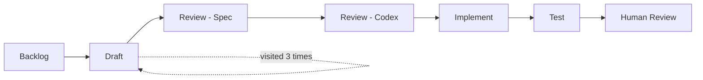

# 04. Kandev Canvas - Step History

> **Repository:** [sharifndlovu123/kandev-canvas-step-history](https://github.com/sharifndlovu123/kandev-canvas-step-history) · MIT · [latest release](https://github.com/sharifndlovu123/kandev-canvas-step-history/releases/latest) v1.0.0
> **Install:** in Kandev, `Settings → Plugins → Canvases → Install canvas` with the release `.tar.gz`. Needs canvases enabled. Platform: [kdlbs/kandev](https://github.com/kdlbs/kandev).

A **canvas** is a small web page that runs inside [[3. Kandev|Kandev]] and visualises data from the orchestrator. This one, **Step History**, shows how a task moved through its workflow: the full step path, how many times each step was visited, and a chronological log of every move. Source: the `kandev-canvas-step-history` repo. It makes the "bounced back to Draft 14 times" problem from [[1. AI Agents and Workflows|AI Agents and Workflows]] visible at a glance.

## Parts at a glance

| Part | Role |
| ---- | ---- |
| **`manifest.yaml`** | Name, version, scope and **declared permissions** |
| **`index.html`** | Page structure |
| **`script.js`** | Fetches data and renders the three views |
| **`styles.css` / `appearance.js`** | Look, plus matching Kandev's theme |
| **Canvas protocol** (`./_kandev/v1`) | The read-only data API Kandev exposes to canvases |
| **Release tarball** | `step-history-<version>.tar.gz` for direct install |

No build step: plain static files, no dependencies.

---

# What It Shows



- **Workflow path**: every step the workflow defines, in order, as context. Visited steps are highlighted; the **current** step is filled solid
- **Visits per step**: how many times the task has moved onto each step, ordered by the workflow's own sequence (not by frequency)
- **History log**: every recorded transition, newest first, each with the destination step, a **forward / backward / entry** marker, a timestamp and the trigger type

Reading it: lots of backward moves into one step means a review loop that is not converging, which is the signal to escalate to a human.

---

# How It Works

- It fetches live through the canvas protocol: `data/tasks/{task_id}/step-transitions` and the task's workflow steps
- **No invented data, no caching** beyond the page load
- **Task-scoped** by the canvas model: it can only read the task it is attached to, so it cannot show other tasks or a workflow-wide view unless promoted to workspace scope

## Permissions: least privilege
```yaml
# manifest.yaml (shape)
name: step-history
scope: task
permissions:
  - tasks:read
  - workflows:read
```

Read-only access to tasks and workflows, no writes, no shared state, no external network access. This is the right habit for any plugin that runs inside a platform.

---

# Installing

1. Enable canvases in Kandev (`Settings → System → Feature Toggles → Canvases`, or set `KANDEV_FEATURES_CANVASES=true`)
2. From the marketplace, search "Step History", or use **Install canvas** with a link to the release tarball, or upload it
3. Installing this way creates a **workspace-scoped** canvas. For one bound to a single task, have that task's agent build its own, using this source as an example

---

# Lessons From Building It

- **A plugin is a small contract**: manifest, declared permissions and a data API; the platform enforces the rest
- **Let an agent build it from a good example**: pointing an agent at working source is faster than describing the idea
- **Keep design history near the code**: the design notes live in the workflow repo's canvas-conversion document
- **Visualise the process, not just the output**: seeing the path and loops explains why a run was slow or expensive
- **Contribute upstream carefully**: discuss larger changes in an issue first ([[3. Kandev|Kandev]])
- Web basics: static HTML, CSS and JavaScript with `fetch` is enough for many internal tools
