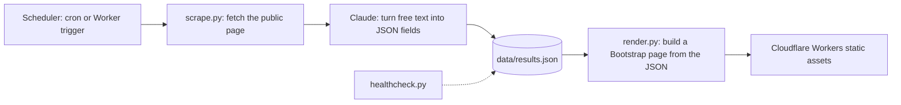
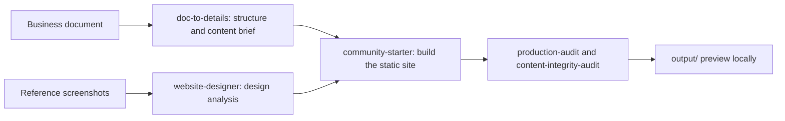

Small projects where an AI model or an agent did real work, with the pattern each one teaches. Concepts are in [[1. AI Agents and Workflows|AI Agents and Workflows]]; tooling is in [[2. Claude Code Tooling and MCP|Claude Code Tooling and MCP]].

## Projects at a glance

| Project | Idea | Key tools |
| ------- | ---- | --------- |
| **Scraper with LLM extraction** ([repo](https://github.com/sharifndlovu123/casino-bonus-scrapper)) | Scrape a page, have Claude turn messy text into structured fields, publish a static page | Python, Anthropic API, Cloudflare Workers |
| **Website-builder pipeline** | Reference screenshots + a business document → finished static site | Claude skills, HTML / CSS / JS |
| **Programmatic video** | Code a video with React, render to MP4 | Remotion |
| **Case-management automation** | Django app that creates and triggers n8n workflows | n8n, Django, Docker Compose |
| **Multi-agent delivery** | Design, review, implement, test with several agents | [[3. Kandev|Kandev]] |

---

# Scraper with LLM Extraction



What it taught:
- **Use the model only where rules fail.** Fetching and layout are normal code; the model handles the irregular part (free-text terms → numbers)
- **Ask for structured output** with a fixed schema; store `null` for anything missing instead of guessing, and show "n/a"
- **Keep the pipeline in stages** (scrape, extract, save, render) so each can be re-run and tested alone
- **Store times in UTC**, display local time (SAST)
- **Validate model output** before saving (types, ranges) and run a **health check** for stale data
- **Static hosting** on Cloudflare Workers is cheap and simple; a custom domain points at the Worker
- Respect the source site's terms, rate limits and robots rules, and keep the source URL with each record

```
$ python scrape.py && python render.py
$ npx wrangler deploy
```

Hosting background in [[3. Azure Networking]] and [[5. AWS Networking|5. AWS Networking]] (CDN, DNS ideas apply equally).

---

Source: [sharifndlovu123/casino-bonus-scrapper](https://github.com/sharifndlovu123/casino-bonus-scrapper) (the Casino Welcome Bonuses scraper).

---

# Website-Builder Pipeline (skills in sequence)

A test harness for iterating on design skills: put screenshots of sites you like into `samples/<style>/`, add a business document (PDF, DOCX or Markdown), then run the pipeline.



Lessons:
- **Chain small skills** with clear files between them (`details.md`, `design-render.md`) so each stage is inspectable
- **Audit against the source**: a content-integrity check catches invented stats, wrong contact details and dead links
- **Audit for production**: semantic HTML, image and font handling, caching and security headers, host config (`_headers`, `_redirects`)
- Keep a `context/`, `errors/` and `docs/` folder so failures become learnings

---

# Programmatic Video with Remotion

Remotion renders **React components as video frames**, so a video is code: scenes, timing, data and styling in TypeScript.

```
$ npm i
$ npm run dev          # preview in the Remotion Studio
$ npx remotion render   # render to MP4
```

- A **Composition** defines size, fps and duration; **scenes** are components
- Animation is driven by the current frame (`useCurrentFrame`, `interpolate`, `spring`)
- Great for data-driven videos, repeatable templates, and generating many variants
- An agent can edit scenes and constants quickly because everything is plain code

---

# n8n Automation with Django

n8n is a workflow automation tool with a visual editor and an API. A Django app can create workflows programmatically and trigger them, so business processes (case management, approvals, notifications) run as n8n flows while Django owns the data.

```
$ npm install -g n8n
$ n8n start              # UI on http://localhost:5678, then create an API key
```

Pattern: Django model → WorkflowManager calls the n8n API → n8n runs steps and calls back with webhooks. Compose runs Django, PostgreSQL and n8n together ([[2. Docker Compose]]). Comparison with BPMN engines is in [[4. BPMN and Workflow Engines|BPMN and Workflow Engines]].

---

# Putting an Agent in the Loop

Where AI helped most in these projects:
1. **Turning messy input into structure** (scraping, documents)
2. **Producing first drafts** of specs, sites and code from a clear brief
3. **Reviewing** work with a fresh, independent reader
4. **Repetitive, well-specified edits** across many files

Where a human stays in charge: approving designs, merging code, deploying, anything with money or customer data.

---

# Writing a Book with Claude Code

[sharifndlovu123/book-of-tartaros](https://github.com/sharifndlovu123/book-of-tartaros) uses Claude Code as a **long-running collaborator for prose and continuity** across many sessions. The repo itself is the collaboration, and the same habits that keep code projects on track work for long writing:

- **A canonical "bible"** (worldbuilding, characters, structure) is the source of truth; everything else is drafting and reference
- A **questions tracker** records open character and plot questions until they are closed
- **Dialogue style cards** give each voice a consistent sound
- A **`CLAUDE.md` project brief** tells the agent the rules at the start of every session
- Chapters live as separate Markdown files, with a consolidated full-book file built from them
- Drafts and scratch work are git-ignored, so only the settled text is tracked

The pattern generalises: write the **rules and facts down once** in a file the agent reads every time, instead of relying on chat history ([[1. AI Agents and Workflows|AI Agents and Workflows]]).
