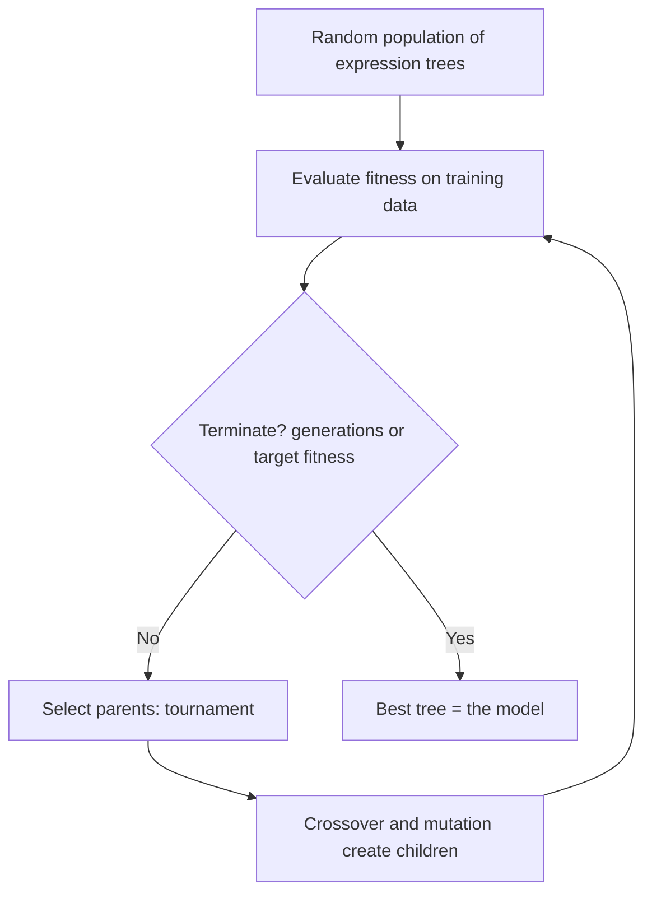

> **Repository:** [sharifndlovu123/COS314_Assignment3](https://github.com/sharifndlovu123/COS314_Assignment3) · group assignment: decision tree, genetic programming, MLP and the report

Three machine-learning models compared on the same task: predicting a **buy / don't-buy** signal from daily price data (open, high, low, close). Genetic Programming, a Decision Tree and a Multi-Layer Perceptron were each built by a different group member, then compared in a report. Source: the `COS314_Assignment3` repo. Optimisation methods that pair with this are in [[Metaheuristics - Ant Colony, Tabu Search and Simulated Annealing]].

## Models at a glance

| Model | Idea | Tooling |
| ----- | ---- | ------- |
| **Genetic Programming (GP)** | Evolve formulas (expression trees) that output a signal | Java, OpenCSV, Commons Lang |
| **Decision Tree** | Learn if-then splits from data | Java with **Weka** (ARFF data files) |
| **Multi-Layer Perceptron (MLP)** | Small neural network | Built by another group member |

---

# The Task

Binary classification: for each day, output **1 = buy** or **0 = don't buy**, using that day's `Open`, `High`, `Low`, `Close` and the previous day's adjusted close. Data is split into **training** and **test** sets so the model is judged on days it never saw.

---

# Genetic Programming

Evolves **programs as trees**. Internal nodes are **functions**, leaves are **terminals** (inputs or constants).



```
        max
       /   \
     (+)    Close
    /   \
  Open  (÷)
        /  \
     High  Low
```

## Terminals and functions

| Terminals (leaves) | Functions (nodes) |
| ------------------ | ----------------- |
| `Open`, `High`, `Low`, `Close` (today) | `+`, `-`, `*` |
| Adjusted close (yesterday) | **protected division**: returns 1 if dividing by zero |
| A constant used as a threshold | `abs`, `max`, `min` |

The tree produces a number, and a **threshold** turns it into 0 or 1.

## Operators
- **Initial population**: grow random trees between a minimum and maximum depth (e.g. 4 to 10)
- **Selection**: **tournament**, pick a few at random and the fittest wins (tournament size 5)
- **Crossover**: swap random subtrees between two parents
- **Mutation**: replace a subtree or change a node
- **Bloat control**: limit maximum depth so trees do not grow without bound

Parameters used: population 20, 10 generations, depth 4 to 10, tournament size 5. A small run, so results are modest; bigger populations and more generations usually help.

## Fitness: why F1, not accuracy
When one class is much more common than the other, a model that always predicts the common class scores high **accuracy** while being useless. So the fitness is `1 - F1` (lower is better).

```
Precision = TP / (TP + FP)
Recall    = TP / (TP + FN)
F1        = 2 · Precision · Recall / (Precision + Recall)
```

| Term | Meaning here |
| ---- | ------------ |
| **TP** | Predicted buy, was buy |
| **TN** | Predicted don't buy, was don't buy |
| **FP** | Predicted buy, should not have (wasted trade) |
| **FN** | Predicted don't buy, missed a buy |

---

# Decision Tree

Learns a tree of questions from data, e.g. "is `Close > Open`? then is `High` above X?", ending in leaves that say buy or don't buy.

- Built with **Weka's** decision tree classifier (J48, an implementation of the C4.5 algorithm, is the usual choice) on **ARFF** files (Weka's data format, with attribute declarations and nominal values)
- **Splitting criterion**: pick the attribute that gives the biggest **information gain** (reduction in entropy)
- **Pruning** stops the tree memorising noise (overfitting)
- Easy to read and explain, which is a big advantage over a neural network
- Run with the seed and the training and test file paths given on the command line

```
$ javac -cp "lib/weka.jar:lib/mtj.jar" -d bin src/DecisionTreeBTC.java
$ java --add-opens java.base/java.lang=ALL-UNNAMED -cp "bin:lib/weka.jar:lib/mtj.jar" DecisionTreeBTC
```

On Linux use `:` as the classpath separator; Windows uses `;`.

---

# Multi-Layer Perceptron (MLP)

A feed-forward neural network: input layer → one or more hidden layers → output. Each neuron computes a weighted sum of inputs plus a bias and applies an **activation** (sigmoid, tanh, ReLU).

- **Training**: forward pass, compute the error, **backpropagation** adjusts weights by **gradient descent**
- Hyperparameters: hidden layers and neurons, **learning rate**, epochs, activation, momentum
- **Normalise inputs** (scale to 0-1 or standardise); neural networks are sensitive to scale
- Needs more data and tuning than a tree, and is harder to interpret

---

# Comparing Models Fairly

| Practice | Why |
| -------- | --- |
| Same train and test split for all models | A fair comparison |
| Report **accuracy, precision, recall and F1** | Accuracy alone hides imbalance |
| Fix and report the **random seed** and repeat runs | GP and MLP are stochastic |
| Keep the test set untouched until the end | Prevents leakage and overfitting |
| Use **statistical tests** over multiple runs | Shows whether differences are real |
| Describe parameters (population, generations, depth) | Reproducibility |

# Overfitting and Trading Caution
- A model that fits the training days perfectly may fail on new days (**overfitting**)
- Markets are noisy and non-stationary, so a good score on historical data is **not** a trading strategy
- This is a **learning exercise** in model comparison, not financial advice

Related: [[1. AI Agents and Workflows|AI Agents and Workflows]], [[Metaheuristics - Ant Colony, Tabu Search and Simulated Annealing]]
