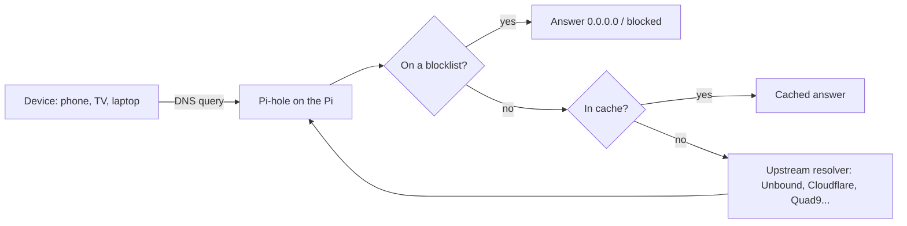

Pi-hole is a **network-wide DNS filter**: every device that asks it for a name gets an answer, unless the name is on a blocklist (ads, trackers, malware). Because it works at DNS level, it covers phones, TVs and consoles that cannot run ad blockers. It runs happily on a small Raspberry Pi ([[1. Raspberry Pi and Single-Board Computers|Raspberry Pi and Single-Board Computers]]). DNS itself is explained in [[07. DNS]].

## How it works



| Part | Role |
| ---- | ---- |
| **FTL** (`pihole-FTL`) | The DNS engine (a tuned dnsmasq) with caching, logging and the API |
| **Gravity** | The compiled database of blocklists, rebuilt on a schedule |
| **Web interface** | Dashboard, query log, allow and block lists, settings |
| **Upstream resolver** | Where non-blocked queries are sent |

---

# Install

Requirements: a Pi (any model is plenty), a **static IP or a DHCP reservation** for it, Raspberry Pi OS or another supported Linux, wired Ethernet preferred.

```
$ curl -sSL https://install.pi-hole.net | bash      # the official installer (read it first if you prefer)
$ sudo pihole setpassword                           # set the web admin password (version 6)
```

Browse to `http://<pi-ip>/admin`.

Useful commands:

```
$ pihole status
$ sudo pihole -g                  # update gravity (blocklists)
$ sudo pihole -up                 # update Pi-hole
$ pihole -q example.com           # which list blocks a domain?
$ sudo pihole-FTL --config        # view settings (version 6 keeps them in pihole.toml)
```

Version 6 integrated the web server into FTL and moved configuration to `/etc/pihole/pihole.toml`; older guides that mention `lighttpd` or `setupVars.conf` describe version 5.

---

# Make the Network Use It

Pi-hole only helps if devices ask it. Two ways:

| Method | How | Notes |
| ------ | --- | ----- |
| **Router DHCP DNS setting** | Set the router's DHCP "DNS server" to the Pi's IP | Simplest; if the router cannot, use the next option |
| **Pi-hole as the DHCP server** | Disable DHCP on the router, enable it in Pi-hole | Per-device names in the dashboard; the Pi is now critical |

Check from a device:

```
$ nslookup doubleclick.net            # should return a blocked address
$ dig example.com @<pi-ip>            # query the Pi directly
```

Reserve the Pi's address so it never changes, and consider a **second Pi-hole** for redundancy: if the only DNS server is off, the whole network seems "down".

---

# Upstream Resolvers and Privacy

| Choice | What you get |
| ------ | ------------ |
| **Public resolver** (Cloudflare 1.1.1.1, Quad9, Google) | Easy and fast; that provider sees your queries |
| **Unbound (recursive)** | The Pi resolves from the root servers itself, so no single upstream sees everything |
| **DNS over HTTPS / TLS to upstream** | Encrypts queries leaving your network |

Minimal local Unbound as the upstream:

```
$ sudo apt install unbound
# /etc/unbound/unbound.conf.d/pi-hole.conf
server:
    interface: 127.0.0.1
    port: 5335
    do-ip6: no
    hide-identity: yes
    hide-version: yes
    prefetch: yes
```

Then set Pi-hole's upstream DNS to `127.0.0.1#5335`. Enable DNSSEC validation where available.

---

# Lists and Tuning

- Start with the default list, add a few reputable ones, and **do not over-block**: too many lists break websites
- **Allow-list** a domain when something breaks (the query log shows what was blocked at that moment)
- **Groups** give different rules to different devices (for example a console with fewer blocks)
- **Local DNS records**: give home devices friendly names (`nas.home`, `pi.home`)
- Schedule gravity updates; check the dashboard for odd spikes (a device asking for thousands of blocked domains may be infected or chatty)

---

# Limits to Know

- Devices that use **DNS over HTTPS** inside the browser or app, or **hard-coded DNS servers**, bypass Pi-hole; block outbound DNS (port 53 and known DoH servers) at the router firewall if you want to enforce it
- It cannot block ads served from the **same domain** as the content (some video and in-app ads)
- It is **not a security product** on its own, only one layer
- The Pi is a **single point of failure** for name lookups

---

# Pi-hole Everywhere with Tailscale

Add the Pi to your tailnet and set it as the tailnet's DNS server: your phone and laptop use Pi-hole **even away from home**, and home devices stay filtered. Steps are in [[3. Tailscale, VPNs and Always-On Pi Services|Tailscale, VPNs and Always-On Pi Services]].

Related network concepts: [[13. Network Security]], [[09. Network Services]].
