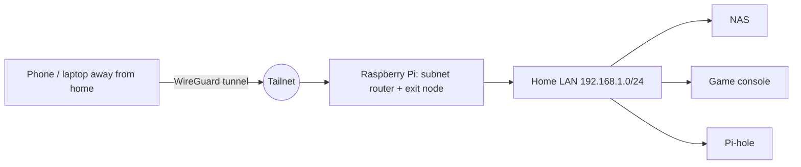

A small always-on computer at home becomes a **gateway**: it carries your VPN, your DNS filter and anything else that must be reachable from outside. This note covers VPN basics, using **Tailscale** from a Pi, the remote console-gaming use case, and running agent bots on the same kind of host. The wider remote-access design (Wake-on-LAN, RDP) is in [[Remote Workstation Anywhere]].

## VPN options at a glance

| Option | Protocol | Notes |
| ------ | -------- | ----- |
| **Tailscale** | WireGuard under the hood | Mesh network ("tailnet"); no port forwarding; identity-based; easiest start |
| **WireGuard** (self-managed) | WireGuard | Fast and simple; you manage keys and config; one open UDP port |
| **OpenVPN** | TLS-based | Mature, flexible, heavier |
| **IPsec / IKEv2** | IPsec | Built into phones and routers; more complex |
| **Cloudflare Tunnel / ZeroTier** | Varied | Alternatives for exposing services or meshes |

A **VPN** creates an encrypted tunnel so a remote device behaves as if it were on your network. Two shapes:
- **Remote access**: your laptop or phone joins the home network
- **Site gateway**: one device (the Pi) shares a whole subnet with the VPN

Terms for the network side are in [[13. Network Security]].

---

# Tailscale in Practice



| Term | Meaning |
| ---- | ------- |
| **Tailnet** | Your private network of devices |
| **MagicDNS** | Names such as `pi` that resolve inside the tailnet |
| **Subnet router** | A device that advertises a LAN range so other devices can reach hosts that **cannot run Tailscale** (printers, consoles, a NAS) |
| **Exit node** | A device that carries **all** internet traffic of a remote client (like a classic VPN) |
| **ACLs / grants** | Rules for who may reach what |
| **Tailscale SSH** | SSH authenticated by tailnet identity |
| **Serve / Funnel** | Share a local service inside the tailnet / publicly |

## Turn the Pi into a gateway

```
$ curl -fsSL https://tailscale.com/install.sh | sh

# allow routing
$ echo 'net.ipv4.ip_forward = 1' | sudo tee /etc/sysctl.d/99-tailscale.conf
$ echo 'net.ipv6.conf.all.forwarding = 1' | sudo tee -a /etc/sysctl.d/99-tailscale.conf
$ sudo sysctl -p /etc/sysctl.d/99-tailscale.conf

# join, advertise the home LAN and offer to be an exit node
$ sudo tailscale up --advertise-routes=192.168.1.0/24 --advertise-exit-node
```

Then, in the Tailscale admin console:
1. **Approve** the advertised subnet route and the exit node
2. **Disable key expiry** for the Pi so the gateway does not drop off after months
3. Optionally restrict who can use them with ACLs

From a remote device, pick the Pi as the exit node, or just reach LAN addresses (`192.168.1.20`) directly because the subnet router forwards them.

Tips:
- Give the Pi a **fixed LAN address**
- Run `tailscale status` and `tailscale netcheck` to see direct vs relayed connections and latency
- Linux subnet routers and exit nodes can gain throughput from UDP forwarding offloads (see Tailscale's performance notes for `ethtool` settings)
- Keep Tailscale updated; enable automatic updates

## Pi-hole for the whole tailnet

In the admin console under **DNS**, add the Pi's tailnet IP as a **custom nameserver** and turn on **Override DNS servers**. In Pi-hole, allow queries from the tailnet interface (listen on all interfaces, with firewall rules keeping port 53 off the open internet). Now every device gets ad and tracker blocking wherever it is: [[2. Pi-hole DNS on a Raspberry Pi|Pi-hole DNS on a Raspberry Pi]].

---

# Self-Managed WireGuard (for comparison)

```ini
# /etc/wireguard/wg0.conf on the server (the Pi)
[Interface]
Address = 10.8.0.1/24
ListenPort = 51820
PrivateKey = <server-private-key>

[Peer]
PublicKey = <phone-public-key>
AllowedIPs = 10.8.0.2/32
```

```
$ wg genkey | tee privatekey | wg pubkey > publickey
$ sudo wg-quick up wg0
```

You must open **UDP 51820** on the router (or the Pi must be reachable), maintain keys yourself and handle dynamic IPs with DDNS. Tailscale removes all of that, which is why it is the default choice for a home gateway.

---

# Remote Console Gaming (PlayStation Remote Play)

Goal: play a console at home from anywhere, with the Pi and Tailscale providing the network path.


What the setup depends on:
- The console stays **powered or in rest mode** with network features enabled so it can be woken and reached
- The Pi advertises the **home subnet**, so the remote device can reach the console's LAN address as if it were home
- **Latency and bandwidth** decide the experience: a wired console, a good home upload speed and a nearby exit path matter more than anything else
- Remote Play can also connect through the console maker's own online service; the Tailscale path is useful when that fails (strict NAT, double NAT, carrier-grade NAT) or when you want everything on your own network

Note the exact steps you used (console settings, app version, any DNS or port tweaks) beside this section when you next set it up, because the details change between console and app updates.

---

# Always-On Agent Bots

A small host that is always on is also a natural home for **self-hosted AI agent bots**: long-running assistants (the "claw" family: Clawdbot, later Moltbot, now OpenClaw) that connect to a chat app, call a model API and run tools or skills on your behalf. Concepts: [[1. AI Agents and Workflows]], [[2. Claude Code Tooling and MCP]].

Because such a bot holds API keys and can run commands, treat it as a **privileged service**:

| Practice | Why |
| -------- | --- |
| Run it as a **dedicated user** or in a **container** | Limits what a bad skill or prompt can touch |
| **Do not expose** its control interface to the internet; reach it over **Tailscale** | Removes the biggest attack surface |
| **Least-privilege tokens** and a **spending limit** on model API keys | Contains a leak or a runaway loop |
| Review any **skill / plugin** before installing; pin versions | Skills run code |
| Keep secrets out of the workspace and chat logs | Prevents accidental disclosure |
| Log tool calls and keep a human in the loop for destructive actions | Auditability |
| Back up its configuration | Easy rebuild |

General hardening: [[Server Hardening with SSH, UFW and Fail2ban]], [[6. Cloud Security|Cloud Security]] (same least-privilege ideas).

---

# Operating the Gateway

- **Backups**: image the SD card or snapshot the SSD after the system works; keep Tailscale and Pi-hole configs in a repo or backup
- **Power**: surge protection, and a UPS HAT or small UPS if it is critical
- **Monitoring**: simple uptime checks and alerts ([[24. Network Device Monitoring with NetPulse|Network Device Monitoring with NetPulse]])
- **Updates**: schedule `apt` upgrades, Tailscale and Pi-hole updates; reboot to a known-good state
- **Redundancy**: a second Pi or an always-on spare for DNS
- **Security**: key-only SSH, firewall, only the services you need; see [[13. Network Security]]
