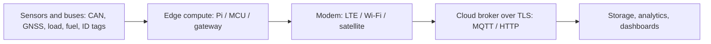

# 04. Sensors, Buses and Edge Hardware Reference

Reading notes from researching hardware for a vehicle-telemetry style project. The product is private, so this keeps to the **parts, interfaces and trade-offs**, which apply to any IoT or edge build. Most of it is research, not hands-on; the hands-on hardware is the Pi ([[1. Raspberry Pi and Single-Board Computers|Raspberry Pi and Single-Board Computers]]). How to choose and stage a build: [[5. Prototyping Hardware - Bench to Field|Prototyping Hardware - Bench to Field]].

## The signal chain



---

# Edge Compute

| Option | Strength | Limitation | Best use |
| ------ | -------- | ---------- | -------- |
| **Raspberry Pi 5** | Real Linux, containers, Python, huge community | Not automotive-qualified | Main **bench** computer |
| **Raspberry Pi Compute Module 5** + I/O board | Closer to an embedded product | Needs a properly engineered carrier, power, certification | Second bench iteration, enclosure mock-up |
| **Arduino Portenta H7** | Real-time MCU work, industrial I/O | Less convenient than Linux for a full app | Deterministic input node |
| **ESP32-S3 dev board** | Cheap, Wi-Fi and BLE | Dev board only | Many fake BLE sensors and tags |
| **Industrial fanless PC** | Robust Linux, SSD, expansion | Cost and power | Load testing, site gateway |

---

# CAN Bus and J1939

**CAN** is the robust two-wire bus used inside vehicles and industrial machines. **J1939** is the higher-level protocol used on heavy vehicles and engines (standard rate 250 kbit/s on a 29-bit-ID CAN), defining **parameter group numbers (PGNs)** and **suspect parameter numbers (SPNs)** for readings like engine speed or coolant temperature.

| Adapter | Type | Notes |
| ------- | ---- | ----- |
| **Kvaser Leaf Light HS v2 (J1939 connector version)** | Professional USB-CAN | Good for heavy-vehicle connectors |
| **PEAK PCAN-USB FD** | Professional USB CAN / CAN FD | Mature tools and API; CAN FD ready |
| **CSS Electronics CANedge2** | CAN data logger with Wi-Fi | Logging, DBC decoding workflows |
| **CSS Electronics CANmod.input** | Analogue / digital / pulse to CAN | Represent bench sensors on CAN without a custom board |
| **CANable-style hobby adapters** | Low-cost USB-CAN | Fine for early software tests; do not make it the reference |
| **SPI CAN HAT on a Pi** (MCP2515) | Cheap native CAN | Good for learning with SocketCAN |

Working rules:
- **Listen-only** mode when connected to anything real, so you cannot disturb the bus
- Generate test frames on an **isolated bench bus**, never onto a working vehicle
- Decode with a **DBC** file and tools such as `can-utils`, `python-can`, `cantools`

```
$ sudo ip link set can0 up type can bitrate 250000
$ candump can0
$ cansend can0 18FEF100#FFFFFFFFFFFFFFFF
```

---

# Positioning (GNSS)

| Family | Capability | Use |
| ------ | ---------- | --- |
| **u-blox ZED-F9R** | Dual-band, with dead reckoning | Best accuracy reference |
| **u-blox NEO-M9N** | Multi-constellation standard precision | Low-cost live-location bench option |
| **u-blox M10 modules** | Modern, low power | Simple position source |
| **Basic USB GNSS puck** | NMEA text stream | Cheapest, when accuracy is not under test |

Software should keep **fix type, satellite count, accuracy estimates and timestamp quality**, not just latitude and longitude. A production device normally uses the GNSS **built into its gateway**; separate modules are an independent reference to judge it.

---

# Connectivity

| Option | Use | Caution |
| ------ | --- | ------- |
| **Industrial LTE router** (Teltonika RUT-class) | Easy Internet for a bench computer | Not the in-vehicle gateway |
| **LTE HATs for Pi** (Sixfab kits) | Direct modem experiments | Check the **bands** for your country, approvals and drivers |
| **Cellular modules** (Quectel EG25-G LTE Cat 4, SIMCom A7672 Cat 1) | Module-level learning | Integration and certification are separate work |
| **Smartphone hotspot** | Quickest test | Not repeatable |
| **Satellite** (Iridium short-burst data modems, integrated cellular + satellite trackers) | Where there is no coverage | Needs its own antenna and costs more per message |
| **LoRa / LoRaWAN** | Long range, tiny payloads | Different network and data rates |

Cellular categories in brief: **LTE Cat 1 / Cat 1bis** (moderate data, widely supported), **Cat M1 / NB-IoT** (very low power, small payloads, coverage varies), **Cat 4** (higher speed). Check coverage and mobility on the **actual routes**, not just maps.

---

# Sensing

| Measurement | Bench parts | Field parts and notes |
| ----------- | ----------- | --------------------- |
| **Weight / payload** | Small bar **load cell** with **HX711** amplifier; four-corner platform | **Onboard air-suspension scales** and industrial **Modbus / RS-485 transmitters**; readings are estimates needing empty and loaded calibration and comparison with a weighbridge |
| **Fuel / liquid level** | Water container with ultrasonic or low-voltage level sensor; simulated values | **Capacitive** tank sensors (digital RS-232 / RS-485, CAN or BLE variants); installation by qualified fitters; the ECU's own fuel value is a baseline but often too coarse |
| **Driver / asset ID** | **PN532 NFC** board, USB RFID reader, **iButton** reader, BLE tags | iButton and RFID are common in commercial trackers; consider cloning risk and enrolment |
| **Environment** | **BME280** (temperature, humidity, pressure), **DS18B20** probe | Probes sealed for field use |
| **Motion / orientation** | IMU: **BNO085**, **ICM-20948** | Harsh-braking and impact detection; do not duplicate if the gateway already provides it |
| **Tamper / buttons** | Reed switch, push button | Enclosure-open and panic inputs |
| **Analogue signal simulation** | Rotary potentiometer | Fake an analogue fuel or load signal |

Interfaces you will meet: **I2C** and **SPI** (short-range chip buses), **UART / RS-232 / RS-485** (serial; RS-485 is differential and runs long cables), **Modbus** (simple industrial protocol over RS-485 or TCP), **1-Wire**, **analogue 0-5 V / 4-20 mA**, **BLE**, **CAN**.

Sensor data is **noisy**: filter it (median or moving average), calibrate it, store raw and processed values, and keep units and timestamps explicit.

---

# Gateways (Buy Instead of Build)

A **telematics gateway** collapses several bench devices (GNSS, LTE, CAN, serial I/O, backup battery, certificates) into one certified box.

| Family | Notes |
| ------ | ----- |
| **Teltonika FMC650 / FMM650** | Professional trackers with CAN and external antennas; LTE Cat 1 and LTE-M variants |
| **Digital Matter G150 Global** | Cat 1bis, IP68, rich I/O, RS-232, BLE, wide voltage input, optional satellite |
| **Ruptela Trace5, Queclink GV350 series** | Established vehicle tracker families |
| **Linux vehicle computers** (Advantech, AAEON, OnLogic class) | Containers and local analytics; higher power and cost |

Do not rely on a marketing page: ask for the datasheet, test on the bench, then test on the intended vehicle class. A weighted scoring method is in [[5. Prototyping Hardware - Bench to Field|Prototyping Hardware - Bench to Field]].

---

# Antennas, Enclosures and Connectors

- **Antennas**: combined LTE + GNSS (+ Wi-Fi) automotive antennas from vendors such as Taoglas, Panorama, PCTEL and 2J. Match **connector type, cable loss, bands, mounting surface and ingress rating** to the modem; choose antennas **after** the modem. Satellite needs its own approved antenna
- **Enclosures**: Hammond, Polycase, Fibox and ROLEC IP-rated boxes; certified cable glands and strain relief
- **Automotive connectors**: Deutsch DT / DTM, TE AMPSEAL, Amphenol sealed connectors; harness design follows the gateway and installer requirements
- **IP ratings**: the first digit is dust, the second water (IP67 survives temporary immersion; IP68 continuous immersion to a stated depth)

---

# Prototyping Fabrication

| Option | Use |
| ------ | --- |
| Off-the-shelf ABS or polycarbonate **project box** | First bench build |
| **PETG / ASA** FDM print | Fast fit and mounting iterations; ASA tolerates UV and heat better |
| **PA12 nylon** (SLS / MJF) | Stronger presentation part with fine detail |
| **Transparent acrylic** | Demo where components should stay visible |

**3D printing proves fit and appearance, not fire resistance, EMC, water ingress, vibration or automotive suitability.**
