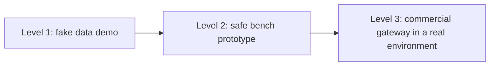

# 05. Prototyping Hardware - Bench to Field

How to go from an idea to a working hardware prototype without wasting money or hurting anyone. The parts themselves are in [[4. Sensors, Buses and Edge Hardware Reference|Sensors, Buses and Edge Hardware Reference]]; the platform we have used is [[1. Raspberry Pi and Single-Board Computers|Raspberry Pi and Single-Board Computers]].

## Three levels of prototype

| Level | What you build | Hardware | Purpose |
| ----- | -------------- | -------- | ------- |
| **1. Fake data** | Software only, simulated sensors and devices | A laptop or a Pi | Prove the data flow, dashboards and rules |
| **2. Bench** | Real sensors and buses on a table | Pi, adapters, dev boards, small sensors | Prove interfaces, calibration, noise handling |
| **3. Field** | A certified off-the-shelf gateway in the real setting | Commercial device, proper antennas, enclosure, harness | Prove it survives power, vibration, weather and coverage |

Most projects should live in **Level 1 and 2 for a long time**: software risk is far cheaper to retire than hardware risk.

---

# Build or Buy, Per Category

Decide for each part separately:

| Question | Lean to **buy** if... | Lean to **build** if... |
| -------- | --------------------- | ----------------------- |
| Is certification needed (radio, EMC, vehicle)? | Yes | No |
| Does an adequate product already exist? | Yes | No |
| Is the part a differentiator of your product? | No | Yes |
| Volume | Low | High enough to repay engineering |
| Time to market | Short | Long |

Typical split: **buy** modems, GNSS, gateways, antennas, enclosures and connectors; **build** the software, data model, rules and user experience. Build custom hardware only when there is sustained demand, stable interfaces and enough volume to recover engineering and certification cost.

---

# Choosing Among Candidates: a Scoring Matrix

Score each candidate 0 to 5 per criterion and weight what matters. Example criteria and weights:

| Criterion | Weight |
| --------- | -----: |
| Frequency bands, regulator approvals and multi-network support for **your country** | 12% |
| Bus signal access (for example listen-only CAN / J1939) | 12% |
| Serial, BLE and sensor compatibility | 10% |
| **Offline storage and backfill** behaviour | 12% |
| Open protocol or API so data can go to **your** cloud | 12% |
| Device certificates, secure boot, signed over-the-air updates | 10% |
| Power input range, transient protection, backup battery | 10% |
| Environmental, vibration, ingress and EMC evidence | 8% |
| Local distributor, warranty and support | 8% |
| Unit cost, airtime flexibility, lifecycle commitment | 6% |

**Reject** any device that forces all data through the manufacturer's paid platform without a commercially acceptable raw-data or API route. No device enters a project from a marketing page alone: datasheet, vendor questions, bench test, then field test.

## Supplier questions worth asking

- Which bands and approvals apply in our country, and where is the evidence?
- How is data stored when offline, and what is the maximum backlog?
- Which protocols and APIs are supported (MQTT, HTTP, TCP, custom)?
- How are devices authenticated and updated (certificates, signed firmware)?
- What is the expected product lifecycle and end-of-life policy?
- What are the real-world power consumption and sleep modes?

---

# Safety and Good Habits

| Rule | Why |
| ---- | --- |
| **Never transmit test frames onto a working vehicle or machine** | You can trigger faults or unsafe behaviour; use an isolated bench bus |
| Connect to live buses in **listen-only** mode | Cannot disturb the system |
| Installations touching **fuel tanks, high voltage, brakes** go to qualified installers | Fire and safety risk |
| Mains and high-current work only if qualified | Shock and fire |
| Use correct fuses and wire gauges; check polarity twice | Most dead boards die from wiring mistakes |
| **ESD** care: touch ground first, use mats for sensitive parts | Static kills chips silently |
| Respect 3.3 V vs 5 V logic levels | Direct connection can destroy GPIO |
| Do not leave lithium cells unattended while charging | Fire |
| Keep a bench log: wiring photos, firmware versions, test results | Reproducibility |

Security applies to hardware too: change default passwords, lock down services, use TLS to the cloud, authenticate devices with certificates, and plan secure updates ([[Server Hardening with SSH, UFW and Fail2ban]], [[6. Cloud Security|Cloud Security]]).

---

# Reality Checks Before Manufacturing

A working prototype is **not** a product. A field device additionally needs:

- Electrical and **PCB engineering**; automotive power and transient design
- **EMC and radio** testing and market approvals
- **Thermal, ingress, UV and chemical** resistance testing
- **Vibration and shock** testing
- Secure manufacturing and **device key** injection
- Tooling, quality control, traceability and **warranty stock**
- Installer harnesses and model-specific approvals

Budget for these before deciding to build rather than buy.

---

# A Sensible Shopping Order

1. **Nothing**: build Level 1 with fake data
2. A **Pi** with decent storage and power ([[1. Raspberry Pi and Single-Board Computers|Raspberry Pi and Single-Board Computers]])
3. One **USB CAN adapter** and the cheap sensors needed to learn the interfaces
4. A **GNSS puck** as a position reference
5. Connectivity from the development network (skip cellular until the data model is proven)
6. A **project box** or a 3D-printed enclosure for demos
7. Only then evaluate **commercial gateways**, antennas, satellite and field sensors, after the supplier questions are answered

Do not buy antennas, connectors or field sensors before the gateway is selected, since they depend on it.
