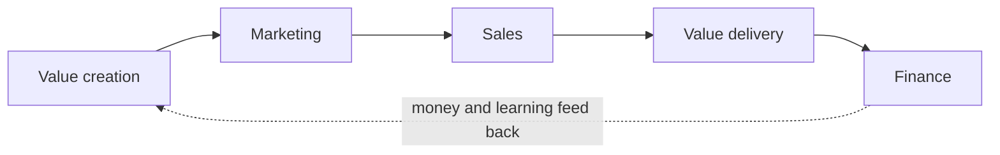
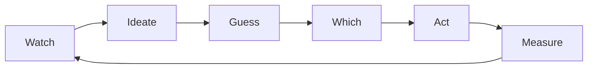
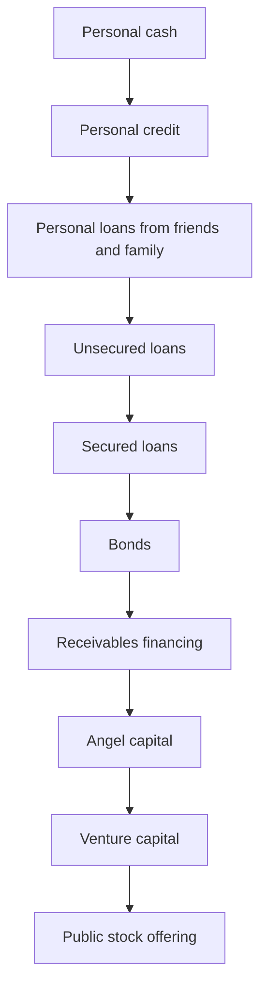

# 01. How Business Works

The core model of a business as five linked processes, and the concepts that explain each one: finding and testing value, getting attention, selling, delivering, and keeping the money. The human and systems side is in [[3. Mental Models for Business|Mental Models for Business]].

> **Based on:** *The Personal MBA: A World-Class Business Education in a Single Volume* by Josh Kaufman (2010). [Bookshop](https://bookshop.org/book/9781591843528)

## At a glance

| Framework | In one line | Use it when |
|---|---|---|
| Five Parts of Every Business | Value creation, marketing, sales, value delivery, finance, each feeding the next | Checking an idea or a failing business: which part is missing? |
| Iron Law of the Market | Demand sets the ceiling; no team or product rescues a market that is not there | Before building anything |
| Core Human Drives | Acquire, bond, learn, defend, feel: every market is an unmet drive | Finding or framing what people want |
| Ten Ways to Evaluate a Market | Score ten factors 0-10, add up: below 50 skip, 75+ go | Choosing between ideas |
| Twelve Standard Forms of Value | Product, service, shared resource, subscription, resale, lease, agency, audience aggregation, loan, option, insurance, capital | Deciding what exactly you sell and how it pays |
| Prototype, Iteration Cycle, MEVO, Shadow Testing | Make it tangible, loop quickly, sell before it exists | Validating an offer cheaply |
| Economic Values and Relative Importance Testing | Nine things buyers weigh; force trade-offs to learn the real ranking | Deciding what to include and leave out |
| Critically Important Assumptions | The facts that must be true or the plan fails | Before signing a lease, hiring, or spending savings |
| Marketing concepts | Attention, receptivity, remarkability, probable purchaser, end result, qualification, hook, call to action | Designing any message or campaign |
| Sales concepts | Trust, common ground, pricing uncertainty, four pricing methods, value-based selling, risk reversal, reactivation | Pricing and closing |
| Value delivery concepts | Value stream, throughput, expectation effect, predictability, duplication, scale, amplification | Making delivery reliable and scalable |
| Finance concepts | Margin, value capture, sufficiency, four revenue levers, lifetime value and acquisition cost, break-even, amortization, cash flow, opportunity cost, time value, compounding, leverage, funding ladder | Reading the money side of any offer |

## The Five Parts of Every Business

A business is a repeatable process that creates something of value, that people want, at a price they accept, delivered to their satisfaction, with enough profit left to keep the owners going. Remove any part and you have something else.

| Missing part | What you have instead |
|---|---|
| Value creation | A hobby |
| Marketing | A flop nobody hears about |
| Sales | A non-profit (value given away) |
| Value delivery | A scam |
| Finance | A business that closes |

- Test of understanding: if you cannot describe or diagram all five for your idea, you do not understand it yet.
- **Economically valuable skills**: only skills that feed one of the five parts get paid. A talent with no link to them is a pastime (fine, but do not budget on it).
- Common mistake: working only on the part you enjoy (usually creation) and starving the other four.

## Is there a market? (value creation, part one)

**Iron Law of the Market**
- Market size and quality limit everything. A technically excellent product with too few buyers still fails.
- Example: a sophisticated, expensive gadget aimed at a mass market that did not care sold a small fraction of its target.

**Core Human Drives** (the four from the HBS researchers Lawrence and Nohria, plus a fifth the author adds)

| Drive | Wants | Typical businesses |
|---|---|---|
| Acquire | Objects, status, power | Retail, brokers |
| Bond | To be valued, belong | Restaurants, events, dating |
| Learn | Curiosity satisfied | Courses, publishing |
| Defend | Safety of self and property | Alarms, insurance, legal |
| Feel (added) | Sensation, excitement | Games, film, sport |

- The more drives an offer touches, the more attractive it is. Every sale is some mix of money, status, power, love, knowledge, protection, pleasure, excitement.

**Ten Ways to Evaluate a Market** (score each 0-10, be conservative)
1. Urgency
2. Market size
3. Pricing potential
4. Cost of customer acquisition
5. Cost of value delivery
6. Uniqueness of offer
7. Speed to market
8. Up-front investment
9. Upsell potential
10. Evergreen potential (work once, sell repeatedly)

- 50 or below: move on. 50-75: pays the bills, no home run. 75+: strong.
- Note the direction: for acquisition cost, delivery cost and up-front investment a high score means cheap and easy.

**Hidden benefits of competition**
- Competitors prove that buyers exist, which removes your biggest risk. Buy from them: you learn pricing, selling, onboarding, complaints and gaps from the inside.

**Mercenary and Crusader rules**
- Mercenary: money alone will not carry you through the long grind; choose a market that keeps you interested ("boring" necessary markets can be gold).
- Crusader: a fascinating idea is not a business. Evaluate coldly; keep passion projects as side projects until the bills are covered.

## Twelve Standard Forms of Value

Value must take a form people will pay for. Most good businesses stack several.

| Form | You earn by | Watch for |
|---|---|---|
| Product | Selling a tangible or digital item above its cost | Inventory, duplication is cheap |
| Service | Fees for help | Your time is finite; price to cover it |
| Shared resource | Access fee to a durable asset many use | Too few users (cost) or too many (crowding) |
| Subscription | Recurring fee for ongoing benefit | Churn: retention is the whole game |
| Resale | Buying wholesale, selling retail | Sourcing and inventory |
| Lease | Charging for temporary use of an asset | Wear, loss, repair; recover cost before it dies |
| Agency | Commission for matching seller and buyer | Only paid on a close, so spend time on closable deals |
| Audience aggregation | Selling access to an audience's attention | Do not alienate the audience |
| Loan | Interest on lent money | Underwriting and default risk |
| Option | Fee for the right (not duty) to act by a deadline | Enforce the deadline; flexibility is a valuable thing to sell |
| Insurance | Premiums for taking on a defined risk | Estimate risk well; pay legitimate claims |
| Capital | Share of profits for an ownership stake | Valuation and failure probability |

- **Perceived value**: the less effort a buyer must put in to reach the same end result, the more they will pay (a weekly pool cleaning service beats a cleaning kit).
- **Modularity**: build offers as separable pieces so each can be improved alone and recombined.
- **Bundling** raises perceived value (phone plus plan); **unbundling** opens sales that a big package blocks (one song instead of an album).

## Testing before committing

| Concept | What it means |
|---|---|
| Prototype | A rough tangible version, in the same form as the final thing, shown early; secrecy loses learning |
| Iteration Cycle (WIGWAM) | Watch, Ideate, Guess, Which, Act, Measure; then repeat |
| Iteration velocity | The faster and smaller the loops, the faster you learn and the cheaper mistakes are |
| Feedback | Ask real prospects (not friends), ask open questions, stay calm, treat apathy as the worst answer, offer a preorder |
| Alternatives and trade-offs | Buyers always pick one option over others; you cannot please everyone, so aim at the pattern of your best customers |
| Critically Important Assumptions (CIAs) | Facts that must hold for the plan to work; list them, then test each |
| Shadow Testing | Sell the offer before it exists (honestly, as in development) to learn if people will really pay |
| Minimum Economically Viable Offer (MEVO) | Fewest benefits needed to produce a real sale |
| Incremental augmentation | After launch, add benefits in small tested steps instead of lurching |
| Field testing | The maker uses the product in real conditions for years before selling |

**Nine Economic Values** buyers weigh: efficacy, speed, reliability, ease of use, flexibility, status, aesthetic appeal, emotion, cost. Convenience (speed, reliability, ease, flexibility) trades against fidelity (quality, status, beauty, emotion); few offers win at both.

**Relative Importance Testing**: if you ask people to rate every value they say all matter. Instead show small sets of 4-5 benefits and ask which is most and least important. Repeating this forces the trade-offs buyers make in real life and gives a ranking.

**Worked example (CIAs plus MEVO)**: someone plans a studio that needs about 100 members at a monthly fee to cover rent and wages. CIAs: enough local people want it; they will pay that fee; they commit for 12 months. MEVO: a simple page with location, schedule, fees and a preorder form. If paid preorders reach the break-even count, sign the lease; if not, the assumption failed cheaply.

Common mistakes: building in stealth for years; asking friends; treating compliments as demand; skipping the preorder.

## Marketing: getting the right attention

Marketing finds prospects; selling closes them. They are different jobs.

| Concept | Idea | Practical use |
|---|---|---|
| Attention | Limited and filtered; must be earned by being more interesting or useful | Beat the filters or stay invisible |
| Receptivity | Openness to a message, depends on what and when | Fit message, medium and timing; look personal, not mass |
| Remarkability | Worth remarking on; people spread what surprises them | Build something distinctive so customers do the advertising |
| Probable purchaser | The person perfectly suited to the offer | Aim at them; most of the world will never care |
| Point of market entry | The moment someone becomes interested (new baby, new house) | Reach people right when they enter |
| Addressability | How easy it is to reach the audience | Prefer markets with obvious gathering places |
| End result | Buyers want the outcome or feeling, not the features | Lead with benefits tied to a human drive |
| Qualification | Screen prospects before they buy | Turn away poor-fit customers early |
| Desire | You cannot invent want; connect to the one that exists | Show how the offer delivers what they already crave |
| Visualization | Let people experience it (test drive, hold it) | Move them from comparing to wanting |
| Framing | What you emphasise and omit shapes the choice | Present honestly but lead with what matters |
| Free | Genuine free value earns attention and trust | Give samples that really help; attention is not payment |
| Permission | Marketing to people who asked to hear from you beats interrupting | Build an opt-in list |
| Hook | One phrase naming the main benefit | Write one before any campaign |
| Call to action | One clear, simple next step | State exactly what to do and what happens next |
| Narrative | Stories, especially the hero journey where the customer is the hero | Show people who walked the path before |
| Controversy | A real position draws attention | Keep it civil and genuinely held |
| Reputation | What people say about you; can only be improved, not managed | Make people glad they chose you |

- Mistake: assuming everyone is a prospect; a hook that is clever but names no benefit; several calls to action in one message.
- See [[1. Positioning|Positioning]] for choosing the market category and [[3. Marketing Fundamentals|Marketing Fundamentals]] for segmentation and the funnel.

## Sales: closing the transaction

A transaction is an exchange of value; sales is the only point where resources flow in.

| Concept | Idea |
|---|---|
| Trust | Without it nothing trades; earn it with a record of fair dealing and signals of reliability |
| Common ground | The overlap between what you can offer and what they want; sales is aligning interests, not forcing |
| Pricing uncertainty principle | Any price can be set at any time; but you must give a believable reason why it is worth it |
| Four pricing methods | Replacement cost (cost-plus), market comparison, discounted cash flow, value comparison |
| Value-based selling | Ask questions to learn what the result is worth to this buyer, then price against that |
| Education-based selling | Teach the buyer why quality costs what it does |
| Next best alternative | What each side does if there is no deal; know theirs, build yours |
| Three universal currencies | Resources, time, flexibility; each can be traded for the others |
| Three dimensions of negotiation | Setup, structure, discussion; most of the work happens before the table |
| Buffer | A third party (agent, lawyer) who negotiates for you and slows decisions |
| Reciprocation | Favours create a felt debt; give first, honestly |
| Damaging admission | Stating a real flaw up front raises trust in everything else |
| Barriers to purchase | The five standard objections: costs too much, won't work, won't work for me, I can wait, too difficult |
| Risk reversal | Take the buyer's risk through a guarantee so they can say yes |
| Reactivation | Re-approach past customers with a fresh offer; cheapest sale there is |

**Four pricing methods in practice**
- Replacement cost: what it would cost to rebuild, plus margin. Floor, not target.
- Market comparison: what similar things sold for recently.
- Discounted cash flow: value of the income it will produce, discounted for time (how businesses are priced).
- Value comparison: who values it most and why. Usually supports the highest price. Use the other three as baselines.

**Worked example**: a buyer says "too expensive". Treat it as a barrier, not an end. Ask what the problem costs them each month, what happens if they wait, and what a fix is worth. If your fee is a small fraction of that value, restate it that way and offer a guarantee to remove the "won't work" fear.

Common mistakes: selling features; discounting before finding the barrier; hiding flaws, which raises suspicion.
Related depth: [[1. Consultative Selling|Consultative Selling]], [[2. Tactical Negotiation|Tactical Negotiation]], [[1. Value-Based Pricing|Value-Based Pricing]].

## Value delivery: keeping the promise

Everything needed so each paying customer is satisfied: orders, stock, fulfilment, support.

| Concept | Idea |
|---|---|
| Value stream | The whole chain of steps from raw inputs to the customer's hands; map it to find waste |
| Distribution channel | Direct to user (full control, limited by your time) or via intermediaries (reach, less control) |
| Expectation effect | Perceived quality is performance minus expectations; set modest, beat them |
| Predictability | Uniformity, consistency and reliability; people prize knowing what they will get |
| Throughput | Rate at which the system reaches its goal: dollar, unit or satisfaction throughput |
| Duplication | Reproducing value reliably at low cost |
| Multiplication | Duplicating the whole system (new store, franchise) |
| Scale | Duplicate or multiply as volume grows; limited mostly by human involvement |
| Accumulation | Small repeated changes compound into big results |
| Amplification | A small improvement to a large system has a large effect |
| Barrier to competition | Each improvement to your value stream makes you harder to copy |
| Force multiplier | Tools that multiply effort; worth their cost when used a lot |
| Systemization | Make the process explicit and repeatable so it can be improved |

- Worked example: a one-person service has fixed capacity. To grow, write the steps down (systemize), take out the steps only you can do (automate or delegate), then duplicate it.
- Mistake: promising more than you can reliably do; over-engineering a process before it works once by hand.
- Depth: [[2. Running on Systems|Running on Systems]], [[1. Managerial Output|Managerial Output]].

## Finance: keeping enough of the money

Finance is watching money in and out and checking that the result justifies the effort. Profit is a means (pay costs, pay the people running it, build a cushion), not the only purpose.

| Concept | Idea | Formula or rule |
|---|---|---|
| Profit margin | What you keep after cost, as a percentage of cost | (revenue - cost) / cost: spend $100, sell for $150, margin 50%; sell for $300, margin 200%. Note this is markup in everyday terms |
| Value capture | Share of the value you create that you keep | Maximisation (take all you can) erodes why buyers buy; minimisation (take enough to stay sufficient) builds loyalty and word of mouth |
| Sufficiency | Enough profit that the people running it will keep going | Target monthly revenue = what you must pay out each month; above it you are sufficient. Subjective; "ramen profitable" is the floor |
| Four methods to increase revenue | More customers, bigger transactions (upsell), more frequent transactions, higher prices | The only four levers; put effort into your ideal customers (buy early, often, big, spread the word) |
| Pricing power | Ability to raise prices over time; lower value captured means more headroom | Test; if doubling prices loses under half your customers, it pays. Price-insensitive markets (luxury) can take much more. Also covers cost inflation |
| Lifetime value (LTV) | Total a customer is worth over the relationship | Revenue per period times periods retained; subscriptions raise it |
| Allowable acquisition cost (AAC) | Most you can spend to win a customer | LTV - delivery cost - (overhead / customers), times (1 - target margin). A high LTV even allows a loss on the first sale (a loss leader) |
| Overhead | Minimum ongoing resources to stay open, sales or not | Lower overhead reaches sufficiency sooner; with fixed seed capital, "burn rate" sets how long you have |
| Fixed vs variable costs | Fixed do not move with output; variable do | Cutting fixed cost accumulates ($50 a month saved is $600 a year); cutting variable cost is amplified by volume ($0.50 off a unit is $500 per 1,000) |
| Incremental degradation | Cutting quality bit by bit until the product is hollow | Cost cuts hit a floor and diminishing returns; adding value has no ceiling. Cheap-ingredient "chocolate" lost its name |
| Break-even | Point where total revenue exceeds total spend including the launch | $50,000 monthly profit after a $600,000 launch takes twelve months to pay back; keep a running tally |
| Amortization | Spread an up-front cost over its useful life | A $100 million plant making 10 million units adds $10 a unit. It rests on a forecast: a fad (a fashion shoe) strands the capacity |
| Purchasing power | All liquid assets: cash, credit, available funding | "Cash is king"; track it so you never run out |
| Cash flow cycle | Money moves like a bath: inflow minus outflow | Receivables are promises, not cash; debt defers outflow but adds interest and debt service. Collect fast, pay later (within limits), do not act as a bank, hold credit lines as backup |
| Opportunity cost | Value of the next best use you gave up | Quitting a $50,000 job to start up costs that salary too. Do not over-analyse; weigh the few best alternatives |
| Time value of money | Money now beats money later | Present value = future amount / (1 + rate): $1 million in a year at 5% is worth at most about $952,000 today; ten years of $200,000 profit at 5% is about $1.54 million (the discounted cash flow pricing method) |
| Compounding | Gains on gains (a positive feedback loop) | $1 at 5% doubles in about 14 years; saving $10 a day at 8% for 40 years passes $1 million from about $146,000 contributed. Patience is the cost |
| Leverage | Borrowing to magnify gain and loss | $20,000 as one 20% deposit vs four $5,000 deposits: if values double, 5x vs 20x; if they halve, a $50,000 loss vs $200,000. Banks at 30-40x leverage fell in 2008. Keep modest |
| Return on investment | Value created from an investment | Collected / spent - 1 (spend $2 million, collect $4 million, ROI 100%). Applies to time too (return on invested time); every estimate is a guess until realised |
| Sunk cost | Past spend you cannot recover | Ignore it; weigh only what more it takes against the reward. A builder tripled his budget to finish a building worth less than it cost |

**Worked example of AAC**: lifetime value $2,000, delivery cost $500 leaves $1,500; with $500,000 overhead over 500 customers, $1,000 each leaves $500; a 60% target margin allows 40% of that, so $200, to win a customer. Any channel that costs less than that per customer is worth testing.

**Hierarchy of funding** (ladder from least to most control given up)

- Cash and credit are quick but risk your credit rating; loans from family can wreck relationships. Secured loans (collateral) run much larger than unsecured; bonds go through investment banks; receivables financing hands the lender control of your receivables and gets paid before salaries.
- Angels are individuals putting in roughly $10,000 to $1 million for about 1-10%, usually without decision power. VCs invest tens or hundreds of millions in rounds, dilute holders and take board seats. A public offering opens the door to hostile takeover; angels and VCs push for an exit.
- More money, more control ceded, and more communication overhead; boards can remove founders (Apple removed Jobs in the 1990s). Funding speeds up a sound business and breaks a broken one.
- **Bootstrapping** (own cash, credit and revenue) keeps 100% control but is slower; use outside money only for things you could not do otherwise, then climb only as far as needed.
- Common mistakes: counting receivables as cash; ignoring opportunity cost; chasing a sunk cost; piling on leverage; using a forecast for a large amortization.
- Depth: [[1. Reading the Numbers|Reading the Numbers]], [[2. Cash Allocation|Cash Allocation]], [[4. Corporate Finance and Valuation|Corporate Finance and Valuation]].

## Recall

**Q: What are the five parts of every business and what do you have if one is missing?**

??? note "Answer"
    Value creation, marketing, sales, value delivery, finance. Missing them gives a hobby, a flop, a non-profit, a scam, or a business that closes.

**Q: How do you test an idea before spending real money?**

??? note "Answer"
    List the critically important assumptions, make a minimum economically viable offer, and shadow test it by taking honest preorders from real prospects. Iterate in small fast loops (watch, ideate, guess, which, act, measure).

**Q: What are the four ways to raise revenue?**

??? note "Answer"
    More customers, larger average transaction, more frequent transactions, higher prices.

**Q: How is the most you can spend to acquire a customer worked out?**

??? note "Answer"
    Start with lifetime value, subtract delivery cost and a per-customer share of overhead, then multiply by one minus your target margin.

**Q: Why does a guarantee help a sale?**

??? note "Answer"
    It reverses risk: the buyer's fear of waste or a bad decision is a main barrier to purchase, and the guarantee moves that risk to the seller.

## Links

- [[3. Mental Models for Business|Mental Models for Business]] (psychology, productivity, systems, analysis, improvement from the same book)
- [[2. What an MBA Teaches|What an MBA Teaches]]
- [[1. Positioning|Positioning]], [[3. Marketing Fundamentals|Marketing Fundamentals]]
- [[1. Consultative Selling|Consultative Selling]], [[2. Tactical Negotiation|Tactical Negotiation]]
- [[1. Value-Based Pricing|Value-Based Pricing]]
- [[2. Running on Systems|Running on Systems]], [[4. Building a Business That Sells|Building a Business That Sells]]
- [[1. Reading the Numbers|Reading the Numbers]], [[2. Cash Allocation|Cash Allocation]]
- [[1. Good Strategy|Good Strategy]], [[2. Seven Powers|Seven Powers]]
