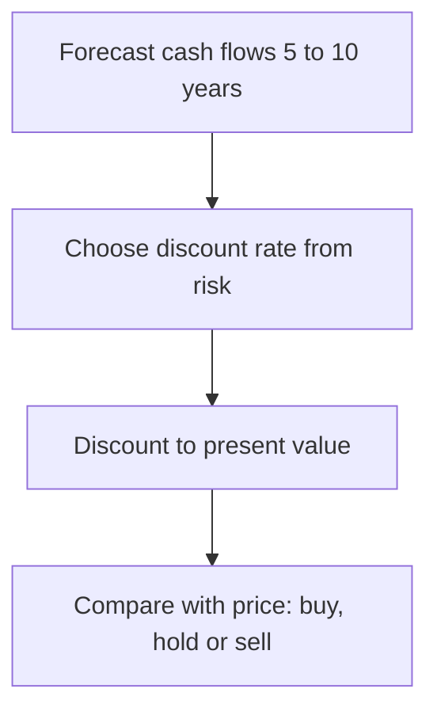

# 02. What an MBA Teaches

What a two-year management programme actually covers, how it frames leadership, finance, strategy and ethics, what it leaves out, and what that means for studying business independently.

> **Based on:** *What They Teach You at Harvard Business School* by Philip Delves Broughton (Penguin, 2009 reissue with a new postscript; first published 2008, US title *Ahead of the Curve*). [Bookshop](https://bookshop.org/book/9780141046488)

The book is a first-person diary of two years (2004 to 2006) at one elite programme, written by a former newspaper correspondent with no business background. About 895 students were admitted from roughly 7,100 applications; about a third were women and about a third international, with an average age of 27 (the author was 32). Treat the lessons below as what that programme taught and how one critical insider saw it, not as a universal syllabus. The author altered the names and some details of classmates; professors and visiting speakers appear as themselves.

## At a glance

| Idea or lesson | In one line | Use it when |
|---|---|---|
| Case method | Learn by deciding what you would do from real, incomplete facts | Practising judgement on your own |
| Core courses | Finance, accounting, marketing, operations, organisational behaviour, then strategy, negotiation, ethics, macro, entrepreneurship | Building a self-study map |
| Economic truth over rules | Accounts are a picture of the business, not the business | Reading any statements |
| Cash conversion cycle | Growth can drain cash if you pay suppliers before customers pay you | Reviewing a growing business |
| Valuation | Value is future cash flow discounted for time and risk | Pricing an asset or investment |
| Beta, alpha, risk-adjusted return | Judge returns relative to the risk taken | Comparing investments or jobs |
| Five forces and competitive advantage | Industry structure decides profit more than operations do | Picking where to compete |
| Fit and flywheel | Advantage comes from mutually reinforcing activities | Judging whether an edge lasts |
| Ethics frameworks | Economic, legal and ethical responsibilities; bluffing vs lying | Hard calls under pressure |
| BATNA and ZOPA | Know your walk-away and the range of possible deals | Any negotiation |
| Leverage | Debt boosts equity returns and imposes discipline, and brings risk | Understanding financing and buyouts |
| Entrepreneurship framing | Pursue opportunity beyond the resources you control; manage risk, do not seek it | Starting something |
| Recruiting culture and critique | Prestige routes, pressure and herd career choices | Deciding whether a programme is worth it |

## The case method

- Every class is a real business situation (a few pages to thirty plus exhibits). The question is always "what would you do?"
- There is no single right answer, and some protagonists' actions ended badly. The point is how you reason with thin information and uncertainty, so the pattern of thinking outlasts the formulas.
- A **cold call** (the professor picks a student to open, lasting from a couple of minutes to a quarter of an hour) forces you to commit. Professors often chose the person whose background matched the case. Then any student adds a comment that must advance the learning.
- Preparation: read alone (the school expected at least two hours per case), then meet a study group of four or five for about an hour before class.
- Sections: for the whole first year the same 90 students shared every class. The school pushed this as network-building; the author found the forced bonding exercises, skits and "skydeck" roasts from the back row wearing, and for some students cruel.
- Grading was on a forced curve (most students in the middle band), with half based on class participation and half on exams. Mid-semester participation feedback was given. Almost nobody failed out; the pressure was relative rank, not survival. Ruback's own "anxiety curve" had stress peaking at exams and again during recruiting.
- Workload: the faculty's official figure was 55 hours a week of academic work, which the author found a big underestimate in the first weeks. A pre-term maths and accounting camp helped those without a business background.
- Value cited by graduates: seeing hundreds of situations teaches that other leaders hit the same problems and that business is less mysterious. Specific models fade; the range of perspectives and the habit of asking what others think stick.
- Smaller lesson: a professor's pre-term baron-and-peasants case showed that even a simple farm comparison can produce different answers depending on accounting choices, and the aim was learning to judge, not to be right.

Limits: you decide as an outsider with a neat exhibit pack, and real decisions involve people you must live with afterwards. A non-native English speaker in the book found participation grading hard.

## The core curriculum

| Area | What it taught |
|---|---|
| Accounting and control (FRC) | Economic truth over rules; internal accounts are the instrument panel |
| Finance (two courses) | Valuation, cost of capital, risk and return, leverage |
| Marketing | The customer is the centre; a good product is not enough; the channel can matter more than the end consumer |
| Operations and technology (TOM) | Decision trees, regression, process and supply chain, the Toyota production system |
| Organisational behaviour (LEAD) | Behaviour in organisations, psychological contracts, managing yourself |
| Strategy | Choosing the industry and building a durable advantage |
| Negotiation | Analytic tools and ethics of bargaining (a short course) |
| Leadership and corporate accountability | Ethics, responsibilities of leaders |
| Macro and the world economy | How business sits inside the economy |
| The Entrepreneurial Manager | Starting and financing a venture |

First year is required courses; second year is elective. You rank up to thirty choices and an algorithm allocates them. Three approaches are common: deepen one area (for a planned career such as private equity), fix your weaknesses, or take the easiest schedule to return to a family firm or old job.

## Accounting: seek economic truth

- Two sayings drilled in by the professor: Assets = Liabilities + Equity, and Accounting = Economic truth + Measurement error + Bias.
- Accounts are a summary and a choice of presentation. Rigorous accounts can mislead and rule-breaking ones can still show the truth. "I only follow the rules" is not an answer; the rules are a messy by-product of lobbying and politics.
- An asset is a resource that produces measurable, reliable cash benefit. The more uncertain the benefit, the more it behaves like an expense. Example from class: direct-response adverts with a unique phone number per ad can be treated as an asset because their revenue is traceable; generic advertising is an expense.
- Book accounting (to manage the firm) and tax accounting (to minimise tax) should be kept distinct; blurring them created mistrust in a sports-club case.
- People appear on income statements only as costs, never as assets, which distorts service firms and makes lenders wary of them.
- The "earnings game": managers smooth reported profits quarter to quarter by deferring losses and booking income early. A perfectly smooth curve should raise suspicion, not comfort.
- Cash held can reflect character and history, not just policy. A software founder said he kept a year of payroll in the bank because he had persuaded friends to join and could not bear to fail them.
- Control side: internal reports guide operations like a ship's instrument panel. Monitoring costs more than it saves past a point; find where. A **balanced scorecard** combines financial measures with customer, behaviour and learning measures. Done well it tells the story of the business; done badly it produces useless numbers.
- Students voted on whether accounting is useful or useless; the "useful" side won narrowly.

## Finance: valuation, cash and risk

- Finance reduces to **valuation**: what is an asset worth, what should I pay, how do I pay, and what risks threaten the value?
- **Cash conversion cycle**: time between paying for goods and being paid for them. A small lumber merchant looked healthy but kept running short because it bought stock, held it, and gave customers 30 days to pay; growth widened the funding gap and it was missing supplier discounts. A computer maker that built to order and collected first held almost no inventory and even earned interest on the float. Inventory is a cost; cash is what counts.
- **Forecasting**: project revenue (extend recent growth for a while, then fade to economy-wide growth), then costs and investments, over a sensible 5 to 10 years.
- **Time value**: a dollar now beats a dollar later; discount future cash flows. A risk-free government bill gives the baseline rate; riskier firms need higher expected returns (a diversified conglomerate needs less than a one-product start-up). The **discount rate** is also called the cost of capital, hurdle rate, or opportunity cost of capital, depending on who is speaking; it is one number.
- **Risk**: opportunity cost includes the good thing that did not happen. Higher risk demands higher expected return; illiquid, long commitments need extra reward.
- **Beta** measures how far a stock swings relative to the market (1 moves with it, above 1 exaggerates, below 1 dampens). **Alpha** is return above what the risk justifies; **risk-adjusted return** is the honest comparison. Value investors argue that price against future cash flow matters more than past volatility and look for a **margin of safety** (cash cushion, modest debt, a product people love). A stock that falls on a scandal looks riskier by beta but may be cheaper by value.
- Valuation is "art not science": forecasts are guesses, and classmates from banks admitted that polished models are sometimes negotiating tools adjusted to the price the client already wants, often built on a default 10% cost of capital. Judgement and understanding the business beat model complexity.
- **Decision trees**: weight outcomes by probability (a 70% chance of a $20m find against a $10m drilling cost gives an expected $4m). Use them to handle uncertainty, not remove it.
- **Risk-weighting life**: an arbitrage course used expected-cost thinking (a 0.1% chance of losing $100,000 costs the same as a 20% chance of losing $500) and the author applied it to job and family trade-offs. A classmate's counterpoint: perceived risk differs from real risk, and the worst outcomes feel far worse than imagined.
- **Law of one price and arbitrage**: identical cash flows should cost the same; a gap is a riskless profit for whoever spots it first. That elective was graded on simulated trading profit, not participation.
- **Leverage ("juicing the returns")**: a firm with $1,000 of assets making $200 operating profit, funded $800 debt at 10% interest and $200 equity with a 50% tax rate, pays $80 interest and $60 tax and leaves $60 for equity, a 30% return. All-equity, the same firm pays $100 tax and leaves $100, a 10% return. Interest is tax-deductible, but the debt is a fixed obligation.
- **Private equity** loads debt on an acquired firm, cuts costs to service it, then sells or floats it. A first-year pay of about $400,000 at a top buyout firm (roughly double a banker's) made it the class's top goal. The author's critique: extreme leverage rewards investors while staff and communities carry the strain, and owners no longer face their workers.

See [[1. Reading the Numbers|Reading the Numbers]], [[4. Corporate Finance and Valuation|Corporate Finance and Valuation]], [[3. Accounting Basics|Accounting Basics]].

## Operations: the Toyota system

- **Just-in-time**: make what is needed, when needed, and nothing more; excess stock and overproduction count as waste.
- **Jidoka**: make problems visible at once and stop the line to fix them. A cord (andon) lets any worker halt production without blame.
- **Five whys**: ask why five times to reach the root cause, not the symptom.
- **Kaizen**: continuous small improvements by everyone. Process determines outcome; the same lesson came back from a later guest founder who said most ideas are good and execution is thousands of little things.
- Warning: a few operations classes give a false sense of being able to redesign any business after seeing one restaurant case.

## Strategy: pick the game, then build a lasting edge

- **Strategy is not operational efficiency.** A beautifully run laundry in a crowded easy-entry market earns little; picking the right industry is where good strategy starts. The most profitable sectors over twenty years were pharmaceuticals, high technology, finance, discount retail and oil; airlines were the worst.
- **Five forces** (barriers to entry, supplier power, customer power, substitutes, rivalry), with later additions: complements and, in regulated sectors, government.
- **Competitive advantage** is the gap between your cost and what buyers will pay. Two sources: lower cost, or differentiation (vertical = better, horizontal = different). Being neither is "stuck in the middle". Winners get copied and tend to drift back to average returns, so sustaining the edge is the real work.
- **Sustainability** needs mutually reinforcing activities, so the advantage is hard to copy piece by piece. Examples used: a discount retailer whose low costs, culture, logistics and supplier power support each other; a consumer-goods firm riding the learning curve (more output, better and cheaper output, more sales); a music-device maker whose ecosystem raises willingness to pay (a flywheel).
- **Game theory**: model what a rival will do in response and what each option costs, as a decision aid rather than an answer.
- **Scope**: apply a *value test* (is someone else a better owner? one conglomerate sells units it cannot rank first or second) and an *ownership test* (do you need to own the asset, or can contracts and relationships do it? a franchisor chose franchising over owning real estate). A supply-chain manager owned none of its 7,500 suppliers in 26 countries yet ran their production.
- Second-year strategy added: start with opinions, then test them (a management writer's view that decisions need alternatives); build several integrated options and write down what proof each needs; treat the functions as a system rather than optimising one; and "follow your gut" first, then dig.
- **Competitiveness and clusters**: another elective assessed regions by four buckets (rivalry, demand, factor conditions such as skills and capital, supporting industries) and argued that the cluster, not the single firm, drives competitiveness. A lesson for the author: his first answer to a case (sell the business) was right for the firm and wrong for the people and place it served.
- **Beyond the market**: patents are not always the best protection (a secret recipe stays secret), regulators can be allies, and campaign groups tend to target the most embarrassable firm, not the worst.
- A guest founder's advice outside the models: culture and paying attention matter as much as analysis, numbers follow rather than lead, and returning calls and emails promptly puts you far ahead of most rivals.
- Entrepreneur's version of strategy: cross the gap between enthusiasts who buy on promise and pragmatists who need it to work, by finding the people or channels that influence them (the author's example: for showers, the plumber, not the end user, is the buyer to convince).

Depth: [[1. Good Strategy|Good Strategy]], [[2. Seven Powers|Seven Powers]].

## Leadership and organisational behaviour

- Often rated the softest class by students, praised by business leaders as the most important: attracting people, paying them right, building culture and values.
- **Psychological contracts** are unwritten expectations that sit beside formal contracts and cause real trouble when ignored (a plating firm traded tolerance of bad behaviour for productivity; a bank's free-dinner perk could never be made fair to everyone).
- A case of a young manager overwhelmed in a first general management job (unclear reporting lines, an impatient owner, an idle subcontractor) raised the questions: should he have clarified his powers before accepting, should he have briefed upwards early, and where were the decision points?
- Self-assessment tools: a personality inventory (sixteen types, widely used and widely criticised as flattery that fits everyone) and a career-interest profile. The "reflected best-self" exercise asks ten to twenty friends and colleagues for examples of you at your best, then you reconcile it with your own portrait. The author distrusted reducing people to letters but later gave the exercises some credit.
- Open question the book keeps raising: can leadership be taught, and is business the right medium? The author concludes you can learn to manage and motivate others even if the quality of a great leader cannot be taught.
- A teacher noted that the school never celebrated graduates who simply built a balanced life; its speakers were mostly chief executives, who often admitted they had not found the balance they preached.

See [[2. Leadership and Organisational Behaviour|Leadership and Organisational Behaviour]] and [[3. Mental Models for Business|Mental Models for Business]].

## Ethics and responsibility

- Introduced as a required course in 2003 after the fraud-driven collapse of a firm run by a celebrated graduate; the framework asks leaders to meet three tests: **economic, legal, ethical**.
- Courts take the duty to investors (fiduciary duty) seriously. A teaching equation: a court decision is the legal model times the facts.
- **Is bluffing ethical?** An old Harvard Business Review article compared business to poker: keep information private, bluff within the rules, never defraud. In class, a poker player defended secrecy-by-bluffing; an "ethical idealist" said honesty must hold whatever the local norm or cost; a third view was that if you bluff here you probably bluff elsewhere. The author notes business jargon ("off balance sheet") sounds like fraud to outsiders.
- Social responsibility: Friedman (a business's only duty is to raise profit within the rules) versus Handy (a company is the people in it and has moral duties). The professor's answer: somewhere in between.
- A European academic friend's view: ethically bad businesspeople often break no law because they helped write it; executive pay and lobbying are legal ethical failures.
- Practical tests from cases: pulling a product after a safety scare, and a car maker deciding what to do on finding a launch safety failure. A graduate later shut down a weak amusement ride in this spirit.
- The course had low prestige beforehand; many saw it as a weak, easy subject. The applicant-snooping case (some applicants viewed their own admission status on a flawed site and were rejected) showed a gap between the dean's "intuitive" right and wrong and a class vote of roughly three quarters against the punishment.
- A visiting manufacturing chief executive said that anyone who had done business in China for thirty years and claimed never to have done anything ethically dubious was lying; to her, ethics were adaptive rather than a fixed rulebook.

## Negotiation

| Term | Meaning |
|---|---|
| BATNA | Best alternative to a negotiated agreement; your walk-away and your leverage |
| ZOPA | Zone of possible agreement; the range both sides might accept |
| Three schools | Poker player, idealist, pragmatist ("what goes around comes around") |
| Three-dimensional view | Work at the table and away from it: personalities, interests, venue, timing, numbers |
| Go to the balcony | Step back and see the whole situation when talks stall |
| Build a golden bridge | Make it easy for the other side to move toward your goal |

- Map the other side's interests, BATNA and ZOPA before you start; most people only prepare their own position.
- Bluffing is acceptable; knowingly misrepresenting facts to harm the other is not. In the US there is no general duty of good faith in bargaining, but fraud is costly, and exploiting an unsophisticated party can backfire in court. The real cost of unethical negotiating is reputation.
- Use power to educate the other party, not to escalate.
- Classmates quickly turned the phrases into jokes, which is a sign they stuck.

Depth: [[2. Tactical Negotiation|Tactical Negotiation]].

## Entrepreneurship, venture and the money careers

- Definition taught: entrepreneurship is the relentless pursuit of opportunity beyond the resources you currently control. It is about managing risk, not taking it.
- **People, opportunity, context, deal** was the framework for assessing a venture.
- Cash rules from the venture-finance teacher: more cash is preferred to less, sooner to later, certain to risky, and never run out.
- Marketing flavour: relentlessly pursue the customers and partners you need to choose your opportunity, sell and gather resources. Write an elevator pitch answering what problem it solves and why buy from you. Never judge a pitch only by the idea; the investors' real question is whether this team can make it happen.
- **Money for ideas**: the teacher claimed that the supply of capital has never beaten the supply of good opportunities; a student took this as the biggest lesson.
- Join a "world-class tribe": reputation and networks matter, and you rarely know what you are doing until you have done it a couple of times. Spin-off companies from one firm in the teacher's example numbered eleven.
- The author's own side-project (a paid audio service) failed because a strategy professor asked how much value it could capture: entry was easy, people resisted paying, and there was no technology edge. Lesson: ask about value capture before building.
- Pitching to investors: lead with the customer's pain and story, then the team; cash-flow forecasts show you thought about the model but matter little; investors tend to favour a hot comparison and to repeat advice (pick a vertical).
- Private equity and hedge funds drew the most ambition and the biggest pay; first-year offers were far above ordinary jobs. The author questions what conscience guides those who hold such power.
- Venture capital looked easy to the visiting investor who opened the trek; a partner at a top firm said it was lonelier than operating work, slow to show results, and, in the author's view, not a job for people straight out of school. The author found venture investors a uniform group.
- Depth: [[2. Innovation and Entrepreneurship|Innovation and Entrepreneurship]].

## Networking, recruiting and the culture around it

- Stated pitch to students: you are part of a brand and an elite; simply getting in made you a "winner". The author found this arrogant and a source of anxiety.
- **Route funnelling**: peer pressure pushed people to a few routes: banking or consulting for two years "to be taken seriously", then private equity or hedge funds. The job board listed almost no other pattern, and even non-profits wanted ex-consultants. Career switchers (such as journalists) found the school failed to deliver the fresh start it promised.
- **Warnings from insiders**: lunches with ex-consultants and ex-bankers produced the message "do not go into either": they pay well and leave no life. Reports included 127-hour weeks, a banker's children seen only as outlines under blankets, and consultants single if they joined single and divorced if they joined married.
- **Recruiting machine**: firms camped on campus, phoned students' homes, bought drinks and dinners, and used former employees as informants. Summer internships were often decisive, and some firms hired only through them; one bank was said to make interns work from a folding stool in rotating departments.
- **Hell week**: classes were suspended in February for interviews. Students ran colour-coded spreadsheets and alumni calls; one student applied to sixteen firms and could not schedule the interviews. A classmate told the author you must do this, you cannot be cynical.
- **Interview prep**: consulting "caselets" (the interviewer describes a client problem; you ask for a moment, restate the problem, ask structured questions, do quick calculations), selling yourself even if modest, and quirky valuation questions (such as bidding to buy the school itself).
- **Students described themselves as "insecure overachievers"**: high achievers still unsure of identity. Counselling was used by eighty or ninety in each class; the school ran pep talks, and a first-person piece in the student paper on a classmate's depression showed the pressure was real.
- **Cost framed as nothing**: expensive treks were called a rounding error against future earnings; the author and another family-supporting student called that logic obnoxious.
- **Gaming the system**: some students converted savings into a car or shifted money to parents before applying for financial aid. The classmate who explained it said it was not lying; the author was disgusted.
- **Grade disclosure**: since 1998 the school had barred recruiters from asking for grades. Administration moved to optional disclosure from the class of 2008, citing weakening academic motivation. Students voted 44 to 6 against; the school went ahead anyway, which the author saw as confirmation that recruiters and donors count more than students.
- **Where the class went** (the author's tally): 42% financial services, 21% consulting, 6% technology and telecom, under 5% each for most other industries, under 3% for non-profit and government. Median first-year pay was about $138,000, and four fifths took jobs in the US. A hierarchy formed: private equity and hedge funds at the top ("studs"), then banking and consulting, with McKinsey alone taking about 5%.
- **An indicator**: an analyst's observation was that when 10% or fewer of graduates chose finance it signalled a good time to buy stocks, and 30% or more a time to sell. The class of 2006 was above that bar, and the 2008 crash followed.
- After graduation: friends reported lasting confidence ("a right to be in the room"), a habit of asking others' views, and an ease with executives, not memory of formulas. Several found consulting a safe place to wait ("for people who are afraid to make choices"). A graduate in the Middle East found the degree rarer and more valuable there than in the US.
- A year later, the unhappy stories were mostly in finance: long hours, small bonuses, mortgages worth more than the homes. Classmates on unconventional paths (old-line firms, small start-ups, non-profits) were happiest, and many left their first job within a year.

## What the author says it misses (critique)

| Critique | Detail |
|---|---|
| Over-quantifying people | Treating human behaviour as a process to manage; several equations felt like overcomplicated common sense |
| Mission overreach | "Educate leaders who make a difference" implies business should run everything; he would rewrite it to teaching the processes and management of business |
| Business over government | A celebrated former chief executive called business the most important institution; the author wants that argued out in class with cases and debate |
| Grades and herding | Forced curve and prestige routes push conformity; he would drop grades altogether |
| Entrepreneurship taught by non-practitioners | Bar professors without business experience from teaching it; other subjects can be taught by academics |
| Finance depth uneven | Novices struggle; technical students want more; recruiters say graduates think they are smarter than they are. He would add optional technical courses and give novices classical training |
| "International" claim | Many international students had lived in the US for years; the school was seen as East Coast and conservative, and ethics frameworks carried an American spin |
| Unhappy choices | The system generates anxiety; people take jobs they expect to hate for status and money ("a factory for unhappy people", said a classmate) |
| Family and values | Panels of senior alumni confessed damaged families, yet the class chased the same path |
| Soft spots in ethics | Doing good is discussed more than done; few attended the social enterprise conference |
| The "two-part life" | Accumulate, then give back; the author argues this venerates the biggest accumulators and justifies concentration of capital |
| Statistics-only thinking | His closing case would be a defence secretary who trusted data over eyewitness reports, a warning about confusing measurement with truth |

The 2009 postscript goes further: after the 2008 credit crash he says he had been too timid. The faculty failed to foresee two disasters involving its alumni (a fraud-driven collapse, then the financial crisis); few classes dealt with what happens to workers once fired; guests who later led firms into trouble were welcomed as heroes; and the dean's "we all failed" and refusal to assign blame was inadequate. He also describes the leveraged-return era as having given financial firms an illusion of size that ended when credit froze, and notes his happiest classmates two years on were the ones on unconventional paths.

Fair counterweights he gives: capable and kind classmates, strong teaching, the case method's balance of academic and practical, a useful business language and network, and real confidence gained. He says he was glad he went, and the degree gave him control over his time.

## Practical takeaways for studying business independently

- Cover the same map: accounting and cash, finance and valuation, marketing, operations, people, strategy, negotiation, ethics, entrepreneurship.
- Copy the case method: for any company you read about, write what you would do, then compare with what happened and ask what information was missing. List at least two alternative options before deciding.
- Keep cash central: calculate a cash conversion cycle and a rough discounted cash flow for any business you study, and check the assumptions harder than the spreadsheet.
- Treat accounts as evidence, not truth: look for smooth earnings, odd asset treatment, and what the cash balance says about the owner.
- Judge strategy by industry structure first, operations second, then ask what reinforcing activities make the edge hard to copy.
- Use probability-weighted thinking for big choices (outcomes times chances), including personal ones, but remember that real feelings about loss are larger than the spreadsheet.
- Practise negotiation preparation (BATNA, ZOPA, the other side's interests) before real conversations.
- Build the networks and confidence the programme provides by talking to practitioners; graduates say that was the lasting value. Choose a place and field and stay long enough to build a reputation.
- Prefer teachers who have run businesses, especially for entrepreneurship; test ideas by asking how much value you can capture, and do not run out of cash.
- Decide what you want from work before copying the prestige route; the book's repeated warning is that comparing yourself with a peer group and chasing the herd led to unhappy choices.
- Be wary of jargon and false precision; if a technique cannot be explained plainly, you do not yet understand it.
- Compare with a self-study view in [[1. How Business Works|How Business Works]], which argues the essentials can be learned without the cost.

## Recall

**Q: What is the case method and what is it meant to build?**

??? note "Answer"
    Learning from real business situations by deciding what you would do with incomplete information. It builds a way of thinking and deciding, and exposure to many perspectives, not a stock of right answers.

**Q: Why can a growing, profitable-looking company run out of cash?**

??? note "Answer"
    A long cash conversion cycle: it pays suppliers and holds stock while customers pay slowly, so growth widens the funding gap.

**Q: What do the five forces and competitive advantage tell you?**

??? note "Answer"
    Industry structure (entry, suppliers, buyers, substitutes, rivalry) largely sets profit potential. Advantage is the gap between cost and willingness to pay, from lower cost or differentiation, sustained by reinforcing activities.

**Q: What are BATNA and ZOPA?**

??? note "Answer"
    BATNA is your best alternative if no deal is reached; ZOPA is the range of outcomes both sides could accept. Know both sides' before you negotiate.

**Q: How does leverage raise equity returns, and what is the catch?**

??? note "Answer"
    Interest is deductible and borrowed money earns the same operating profit, so a smaller equity base earns a bigger percentage (30% against 10% in the book's example). The catch is a fixed obligation, which strains the firm and its people if cash falls short.

**Q: Name two things the author thinks the programme gets wrong.**

??? note "Answer"
    Any two of: grades and conformity, overreaching mission, glorifying business over government, treating people as processes, entrepreneurship taught by non-practitioners, herd career choices into finance and consulting.

## Links

- [[1. How Business Works|How Business Works]] (self-study counterpart)
- [[3. Mental Models for Business|Mental Models for Business]]
- [[1. Good Strategy|Good Strategy]], [[2. Seven Powers|Seven Powers]], [[3. Deciding Under Uncertainty|Deciding Under Uncertainty]]
- [[1. Reading the Numbers|Reading the Numbers]], [[4. Corporate Finance and Valuation|Corporate Finance and Valuation]]
- [[2. Tactical Negotiation|Tactical Negotiation]]
- [[2. Leadership and Organisational Behaviour|Leadership and Organisational Behaviour]]
- [[2. Innovation and Entrepreneurship|Innovation and Entrepreneurship]]
