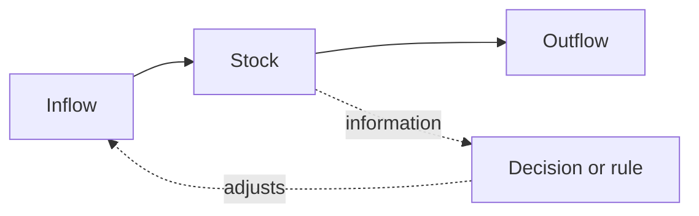

# 03. Mental Models for Business

The thinking tools from the same book that sit under the five parts: how minds decide, how to work with yourself and others, and how to understand, measure and improve any system.

> **Based on:** *The Personal MBA: A World-Class Business Education in a Single Volume* by Josh Kaufman (2010). [Bookshop](https://bookshop.org/book/9781591843528)

## At a glance

| Framework | In one line | Use it when |
|---|---|---|
| Perceptual control, reference level | People act to pull a perception back to a target; no gap, no action | Designing incentives or asking why people do or skip things |
| Reorganization, conflict | Random trying when you do not know the fix; two targets on one perception stall you | Feeling lost, or procrastinating |
| Guiding structure | Change the environment, not the behaviour | Building habits or team routines |
| Threat lockdown, doomsday scenario | Fear fixates the mind; stage the worst case to loosen it | Fear is blocking a decision |
| Biases (loss aversion, absence blindness, confirmation, hindsight, etc.) | Predictable errors in how minds weigh and notice | Reviewing a decision, a plan or a sales message |
| Monoidealism, switching penalty | One thing at a time, in blocks | Planning a working day |
| Four methods of completion, MITs | Complete, delete, delegate or defer; pick two or three that matter | Facing a long task list |
| Goals (PICS), states of being, habits | Goals are achievements; states of being are decision criteria; habits are repeated supports | Setting direction without setting yourself up to fail |
| Five-Fold Why and How, next action | Dig to the real aim, then to a doable step | A goal feels fuzzy or borrowed |
| Counterfactual simulation, Parkinson's law | Assume the end state is real and ask what must be true | A "someday" goal, or work that drags |
| Testing, personal R&D | Run your habits as experiments, and budget for them | Improving how you work |
| Working with others | Power, comparative advantage, communication overhead, importance, safety, commander's intent | Leading or being part of a team |
| Social forces | Social proof, authority, commitment, referrals, clanning, convergence | Spotting influence on yourself or using it honestly |
| Understanding systems | Flows, stocks, slack, constraints (five focusing steps), feedback loops, coupling | Anything with moving parts, including a business |
| Uncertainty, change, normal accidents | Unknowable events and inevitable failures; plan for them rather than predict | Planning and risk |
| Analysing systems | Deconstruct, measure a few KPIs, add context, ratios, segments | Diagnosing a problem |
| Improving systems | Optimise one variable, refactor, critical few, cut friction, automate with care, build resilience | Making a process better |

## How minds work

**Caveman Syndrome**: body and brain are tuned for a small-tribe, always-moving, food-scarce life, not desk work and 16-hour days. Modern worries trigger ancient alarms, and modern ills (sedentary life, constant food, low energy) follow. Not a personal flaw.

**Onion brain**: hindbrain keeps you alive (reflexes, heart, urges); midbrain senses, feels, remembers, matches patterns and predicts; forebrain (self-awareness, logic, inhibition, decision) is a new layer for ambiguity and mostly idle until something unexpected appears. The inner voice is a commentator on the midbrain, not "you". Horse and rider: the rider sets direction and reassures the horse. Meditation (watch the chatter without joining it) builds the separation.

**Gas tank**: food, exercise, sleep (7-8 hours), some daylight and raw materials for mood chemistry are inputs. Poor inputs cut the quantity and quality of output, so self-care comes first, not last.

**Perceptual control and reference level**
- Behaviour is a control system like a thermostat: a gap between perceived state and target triggers action, and action stops once the perception is back in range. Reward and punishment are not the root cause.
- The same stimulus gives different results. Paid overtime makes an income-seeker work more, and someone with enough income work less or the same.
- Three kinds of reference level: a **set point** (a minimum or maximum), a **range** (between two limits), an **error** (a set point of zero, such as complaints).
- Business use: financial controls are set points (revenue above a floor, spend below a ceiling) and only trigger action when breached.
- To change behaviour, change the reference level or the environment. Learning that something is possible resets reference levels (the four-minute mile fell again and again once someone did it).
- **Conservation of energy**: with no violation, people do the minimum. Laziness is a feature that keeps reserves, and "good enough" jobs persist for decades.
- **Reorganization**: when a reference level is violated and you do not know the fix, the brain tries random changes (the midlife crisis). It is the basis of learning, so resisting it only slows learning; it ends when the perception is back under control.
- **Conflict**: two control systems on one perception (work vs rest) leaves you doing neither well. Between people it is the same, with different targets needing the same resource. You cannot control another person, so resolve it by changing the situation that sets each side's reference level (firm slots for work and rest; equal resources; a shared measure of success).

**Pattern matching, mental simulation, interpretation**
- Minds store patterns learned by trying things, recall them by context, and simulate outcomes from them. Experts are expert because they hold more accurate patterns. Simulation needs a "point B" to aim at.
- With little data the mind fills gaps from stored patterns (a spam filter's "priors"), so the first reading feels certain. **Reinterpretation** edits the stored belief: name it, find where it came from, list other readings, accept it is an interpretation, and consciously swap it. A "failed career" can become "found out what does not fit".

**Motivation and inhibition**
- Motivation is a feeling that links sensing to acting: toward desirable things, away from threats, and away wins. Logic cannot order it on; remove the inner "away" signals. Shouting at people only teaches them to move away from you.
- **Inhibition** is overriding the autopilot (do not run from a bear), "free won't".
- **Willpower depletion**: willpower runs on blood glucose, and the marshmallow-test children who deferred did better later. Spend it once to change the environment (remove the ice cream, block the internet) instead of fighting temptation daily.

**Guiding structure**: environment is the biggest driver of behaviour. A couple adopted a strict diet with little effort by changing what was in the house and where they ate; Odysseus had himself tied to the mast. Aviation's sterile cockpit rule (no chatter below 10,000 feet) does the same for attention.

**Biases to know**

| Bias | What happens | Counter |
|---|---|---|
| Loss aversion | Loss weighs about twice an equal gain; threats beat opportunities, so uncertainty looks risky and people stay in jobs | Reinterpret the loss as "no big deal"; offer risk reversal and guarantees to buyers (casinos abstract loss with chips) |
| Threat lockdown | A perceived threat ends in fight, flee or freeze; freezing locks you on the threat. Chronic modern threats misfire | Do not repress the signal; tell your mind either the threat was never real or has passed; use exercise or sleep to burn off stress hormones. Layoffs: do them once, cleanly |
| Cognitive scope limitation | Beyond roughly 150 relationships (Dunbar; another estimate is 231) people become abstractions, which is how executives harm people they never picture | Personalise: the newspaper rule (front page, read by family) and the grandchild rule |
| Association | Feelings attach to unrelated cues (a celebrity's watch, a brand tied to happiness) | Notice what a pitch is associating you with; choose your own associations |
| Absence blindness | We struggle to notice what is not there: the prevented problem, a good low-drama manager, doing nothing as the right call | Use checklists; reward quiet competence; state benefits as positive, immediate, concrete |
| Contrast | A price feels small beside a bigger one (accessories after a suit, a warranty after a computer) | Compare with the full option set; use framing honestly |
| Scarcity | Limited stock or time speeds decisions | Limited quantities, price rises, price drops ending, deadlines; fake limits on digital goods backfire |
| Novelty | Attention fades on the unchanging (sustained vigilance tops out near half an hour) | Vary messages; teach in short modules |
| Excessive self-regard | The less skilled overrate themselves and miss skill in others (Dunning-Kruger); optimism also gets novices to start | Keep advisers who will disagree; avoid yes-men |
| Confirmation bias | We notice what supports our view, harder when it is strongly held | Actively seek disconfirming evidence |
| Hindsight bias | "I should have known" | You decided with less information; the past is outside your control |
| Incentive-caused bias | Advisers steer toward what pays them (do not ask the barber if you need a haircut) | Ask how they are paid. Commission or stock options reward the wrong horizon; paying for something once loved can dull the inner drive |
| Modal bias | Assuming my way is best; the highest-paid person's opinion wins without data | Suspend judgment on purpose; bring data |
| Attribution error | Others' failures are character, mine are circumstances | Find the circumstances before judging |
| Planning fallacy | Plans run late: we picture everything going well, and slack is cut because it looks unacceptable | Build real slack; the value of a plan is the thinking in making it |
| Bystander apathy | The more who could act, the less each does | One named owner and a deadline per task |

## Working with yourself

| Concept | Idea |
|---|---|
| Monoidealism | One thing on the mind, no conflict (flow). Takes 10-30 min to settle. Remove interruptions, resolve inner conflict, then do a timed dash (Pomodoro: 25 min work, 5 min rest, "a pomodoro is indivisible") |
| Cognitive switching penalty | Multitasking is rapid switching and each switch reloads context; batch similar work. Maker's schedule (long blocks) vs manager's schedule (many short meetings): do not mix |
| Four methods of completion | Complete (only you can do it well), delete (unimportant), delegate (someone can do it 80% as well), defer (park on a someday/maybe list) |
| Most Important Tasks | Two or three each day on a separate list, do first, ideally against an early deadline; they give you permission to refuse interruptions |
| Goals (PICS) | A goal is a specific achievement your mind can simulate: Positive (toward, not away), Immediate (now, else someday list), Concrete (you will know it is done), Specific (what, when, where); set it on effort within your control, not a result like weight |
| States of being | "Happy", "successful" are qualities of experience, not achievements; split them into parts and use them as decision criteria ("is this working?") |
| Habits | Regular supporting actions: install one at a time, pin to an existing trigger (vitamins after brushing teeth), pack the bag the night before |
| Priming | Deciding what interests you changes what you notice; set a reading purpose before opening a book |
| Decision | To decide is to cut off options; a system only informs it. Roughly 40-70% of the information is enough; not deciding is itself a decision. Tiebreak: which experience do I want? |
| Five-Fold Why | Keep asking why until "because I want it". "A million dollars" becomes "feel free", which has other routes |
| Five-Fold How | Then ask how, repeatedly, down to actions you can do now, each of which already gives some of the feeling |
| Next action | A project is anything needing more than one action; define "done", then the next physical step; track projects and actions apart |
| Externalization | Write it or say it (even to a rubber duck): outside stimuli work on the mind better than inner talk |
| Self-elicitation | Ask yourself good questions in a journal. ABC method: antecedent (when, who, where, thoughts, feelings), behaviour, consequence |
| Counterfactual simulation | Assume an end state is already true and work out what would have to be true to get there; it can turn "a year or two away" into "now" |
| Parkinson's law | Work expands to fill the time, so ask how you would do it on an aggressive deadline; Ingvar's rule: assume ten minutes for small tasks and meetings |
| Doomsday scenario | Write the worst case in full; you usually survive it, and then you can plan to improve on it |
| Performance load | Past a limit, more tasks lower performance on all; limits need accepted consequences; keep unscheduled capacity |
| Energy cycles | 24-hour circadian and roughly 90-minute ultradian rhythms. Track yours, put deep work on peaks, rest on troughs (walk, nap, meditate), sleep enough |
| Stress and recovery | Find your breaking point safely, then run near 90% and rest without guilt |
| Testing | Treat routines as experiments: observations, knowns, hypotheses, tests, results; write them down |
| Mystique | Liking the idea of a role is not liking the job; ask someone who does it for the highs, lows and whether it was worth it |
| Locus of control | Separate what you control or influence from what you do not; aim goals at effort, drop worry about the rest |
| Attachment | Gripping a plan blocks better options; accept a plan is dead (sunk cost, applied to yourself) |
| Personal R&D | Budget money and time for learning and trying; the book suggests at least 5% of monthly income |
| Growth mindset | Skills are muscles, not fixed (Dweck); a fixed mindset turns every challenge into a verdict |

Worked example: a founder has thirty open tasks and a vague goal of "be successful". Delete half, delegate or defer most of the rest, pick two Most Important Tasks, run Five-Fold Why on the goal (it turns out to be control of time), then take the next action toward that.

## Working with others

| Concept | Idea |
|---|---|
| Power | Influence (they want to) or compulsion (they must); you cannot control people, only influence them. Influence lasts, compulsion breeds retaliation. Power grows with reputation |
| Comparative advantage | Even if you can do everything, each should do what they do relatively best and trade (Ricardo's cloth and wine). Diverse teams beat uniform ones. Learn enough of a skill to judge it |
| Communication overhead | Coordination time grows geometrically with headcount. Past about five to eight people most of a person's job is communicating. Keep teams small and autonomous (3-8). Symptoms of breakdown: invisible decisions, unfinished business, coordination paralysis, nothing new, pseudo-problems, an embattled centre, negative deadlines, input domination |
| Importance | People need to feel valued; undivided attention, listening and curiosity do it |
| Safety | Put-downs make people stonewall. STATE: share facts, tell your story, ask for their path, talk tentatively, encourage testing |
| Golden trifecta | Appreciation, courtesy, respect, for everyone, including waiting staff |
| Reason why | Adding any "because" lifted compliance from about 60% to 95% in the copier-queue study |
| Commander's intent | State the goal and why; people adapt when things change; micromanagement does not scale |
| Referrals | Being known and liked transfers through a trusted introducer; even tiny commonalities warm a cold contact |
| Clanning | Groups form fast, build "us" and "them", and fight (Robbers Cave); shared goals that need both sides dissolve it |
| Convergence and divergence | Members grow alike and police deviation (culture); groups also drift away from copycats; you become the average of those you spend time with, so choose your circle |
| Social signals | Costly or visible items show identity or status; buyers pay for the signal, so build one into an offer |
| Social proof | In doubt, copy others. Best testimonial: interested but sceptical, bought anyway, pleased |
| Authority | People comply with perceived authority even against their judgment (Milgram: 65% went to the maximum shock). Those in authority get filtered information |
| Commitment and consistency | A small stated promise creates pull to follow through; a "foot in the door" |
| Pygmalion effect | People rise or fall to the expectations placed on them; high expectations also raise the risk of disappointment, so measure objectively |
| Option orientation | When something breaks, bring options with costs and a recommendation, not just the problem |

**Management in six principles** (the author's summary)
1. Recruit the smallest group that can do the job well and fast.
2. State the desired end result, who owns what, and current status.
3. Treat people with respect (the golden trifecta).
4. Build an environment where people can be productive, then leave them alone; shield them from distraction and needless meetings.
5. Expect uncertainty: make an ambitious plan but expect to revise it.
6. Measure a few indicators; if it is not working, try another approach.

Mistakes: assigning a task to "the team"; giving steps instead of intent; judging a late supplier's character instead of asking what happened.
Depth: [[2. Leadership and Organisational Behaviour|Leadership and Organisational Behaviour]], [[1. Hiring|Hiring]], [[1. Managerial Output|Managerial Output]].

## Understanding systems

| Concept | Idea |
|---|---|
| Gall's law | A working complex system grew from a working simple one; designed from scratch it never works. Prototype, MEVO and iteration are this law applied |
| Flow and stock | Flows move resources in and out; stocks are the pools (cash, inventory, queues). To grow a stock raise inflow or cut outflow |
| Slack | The amount held in a stock; too little starves the next step, too much ties up cash and space |
| Constraint | Output is capped by one critical input (Goldratt). Five focusing steps: identify it, exploit it (stop wasting it), subordinate everything else to it, elevate it (add capacity, last because it costs), then re-evaluate because the constraint moves |
| Feedback loops | Balancing loops stabilise (thermostat); reinforcing loops amplify (price war, compounding) |
| Autocatalysis | Output feeds the next cycle (ad spend returning more than it costs, viral sign-ups); grows until something changes, and TV advertising's old multiple has faded |
| Environment and selection tests | Surroundings set pass-or-die conditions: value to customers, revenue over expenses, enough profit. Tests shift, which lets small players beat incumbents |
| Uncertainty | Risk is a known unknown; uncertainty is the unknown unknown (black swans). Forecast models are only as good as their guesses |
| Change | Systems always change; plans ignoring change have little value; we mistake randomness for skill or bad luck |
| Interdependence | Tightly coupled systems are time-dependent with little slack and cascade; the critical path delays everything. Remove dependencies (staff may settle small cases below a set amount without asking) |
| Counterparty risk | Others may not deliver; the 2008 banks all insured each other |
| Second-order effects | Fixes cause consequences elsewhere (land reclamation dried an island's springs; rent control shrank housing) |
| Normal accidents | In complex tightly-coupled systems failures will happen; overreacting adds controls and more coupling. Study near misses instead |

## Analysing systems

1. **Deconstruct**: split into subsystems you can hold in mind (past about seven or eight variables confusion sets in); note inflows, outflows, triggers, endpoints and if-then conditions, ideally in a diagram.
2. **Measure**: collect data while the system runs. Pick three to five **key performance indicators** tied to the five parts or throughput; easy to measure is not important (revenue alone is not a KPI, profit is).
3. **Check quality**: garbage in, garbage out; keep **analytical honesty**, ideally with a dispassionate outsider auditing your numbers, since status pressure tempts people to keep flattering data.
4. **Add context**: never read an aggregate or a single magic number alone; compare to last period and to **norms** (history, including seasonality). Norms break if you change how you measure.
5. **Sample** when you cannot measure everything: random, unbiased, as large as you can; a larger sample gives higher **confidence**.
6. **Ratios**: compare one measure to another (closing ratio, return on promotion, return on assets, profit per employee, returns per sale).
7. **Averages**: the mean gets skewed by outliers (a few billionaires among readers); compare it with the median; mode finds clusters; midrange is a rough two-point estimate.
8. **Correlation is not causation**: it is a hint; many things change at once, so isolate and adjust (for seasonality, a promotion at the same time).
9. **Proxies**: measure something closely correlated when you cannot measure directly (cursor position for attention); a bad proxy misleads (lines of code).
10. **Segment** by past performance, demographics or psychographics to find hidden pockets.
11. **Humanise**: tell the numbers as one person's experience (a persona); a shorter hold time still leaves an angry caller.

## Improving systems

| Concept | Idea |
|---|---|
| Optimisation | Maximise throughput or minimise one input; trying several at once is trade-offs, so pick one target |
| Refactoring | Make the process more efficient without changing output: deconstruct, spot patterns, regroup (put the part within reach) |
| Critical few | 80/20: a minority of inputs gives most of the output (five of 120 customers gave 95% of one firm's revenue); focus there and drop the troublesome rest |
| Diminishing returns | Beyond a point more input yields less (a worn-out ad); stop at the "85% solution", perfection is a trap |
| Friction | Anything draining energy over time; remove it before pushing harder. A little deliberate friction can curb frivolous returns |
| Automation | Best for defined, repeated tasks; applied to a bad process it magnifies the badness |
| Paradox of automation | The more efficient the automated system, the more it matters that humans catch errors, because it multiplies every error at speed |
| Irony of automation | Reliable systems bore operators, who then stop watching; counter with ongoing sampling and testing |
| SOP and checklist | Predefined steps cut friction and willpower use; review SOPs every two to three months so they do not become red tape. A five-step line-insertion checklist took one hospital's infection rate from 11% to 0 |
| Cessation | Sometimes the fix is to stop (fire a customer, drop a product, leave a market); doing something feels better than doing nothing |
| Resilience | Prefer many modest defences to one strength (the turtle over the tiger). Marks: low debt and fixed cost, cash reserves, several independent lines, flexible people, no single point of failure, fail-safes. It never maximises throughput |
| Fail-safe | A backup built before it is needed, kept separate from the primary so one failure cannot take both; no single critical point of failure |
| Stress testing | Switch to "demon mode" and try to break your own system on purpose (simulate a traffic spike) |
| Scenario planning | Write "what would I do if" for the major futures; the basis of hedging, in place of predicting |
| Middle path | The balance point between too little and too much shifts constantly |
| Experimental mindset | Learning comes from trying, and failure is information |

Worked example: orders arrive faster than packing. Constraint is packing (a stock of unpacked orders builds). Rather than hiring everywhere, measure time per step, apply 80/20 to find the slowest step, write a checklist for it, then automate the repetitive part and keep a person sampling for errors.

## Recall

**Q: What does "behaviour is like a thermostat" imply for incentives?**

??? note "Answer"
    People act to bring a perception back to a target level. Rewards and punishments are only one input; if the target is not breached, nothing happens, so structure and targets matter more than the carrot and stick.

**Q: Name the four methods of completion.**

??? note "Answer"
    Complete, delete, delegate, defer.

**Q: What is the first thing to do with a slow system?**

??? note "Answer"
    Find the constraint: the single limit. Deconstruct, measure the few key numbers in context, then identify, exploit, subordinate to, elevate and re-evaluate that point.

**Q: Why does adding people to a team not always speed it up?**

??? note "Answer"
    Communication overhead grows much faster than headcount; past a core of about three to eight, each addition adds coordination cost.

**Q: What is the Five-Fold Why for?**

??? note "Answer"
    To uncover the underlying aim behind a stated goal, then use Five-Fold How to turn it into a concrete next action.

**Q: Why is a highly automated process not a reason to cut the people watching it?**

??? note "Answer"
    Automation multiplies errors as fast as output, so a human who notices is worth more. But reliable systems bore operators, so keep them engaged with sampling and tests.

## Links

- [[1. How Business Works|How Business Works]] (the five parts and the commercial concepts)
- [[2. What an MBA Teaches|What an MBA Teaches]]
- [[3. Deciding Under Uncertainty|Deciding Under Uncertainty]]
- [[2. Running on Systems|Running on Systems]], [[3. Operating Rhythm|Operating Rhythm]]
- [[1. Managerial Output|Managerial Output]]
- [[2. Leadership and Organisational Behaviour|Leadership and Organisational Behaviour]]
