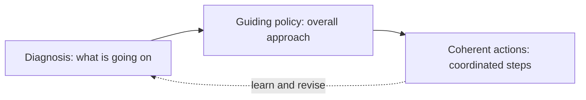

# 01. Good Strategy

What a real strategy is (a diagnosis, a guiding policy and coherent action), how to spot a fake one, and the sources of power good strategies draw on.

> **Based on:** *Good Strategy/Bad Strategy: The Difference and Why It Matters* by Richard Rumelt (2011). [Bookshop](https://bookshop.org/book/9780307886231)

## At a glance

| Framework | In one line | Use it when |
|---|---|---|
| The kernel | Diagnosis, guiding policy, coherent actions | Writing or judging any strategy |
| Four signs of bad strategy | Fluff, no challenge named, goals as strategy, bad objectives | Reviewing a plan or "strategic plan" |
| Why bad strategy happens | Avoiding choice, templates, positive-thinking | You wonder why the plan is so vague |
| Leverage | Find the pivot point, anticipate, concentrate | Resources are thin and effort must count |
| Proximate objectives | Pick a target close enough to hit | A goal is too far away to act on |
| Chain-link systems | Performance is capped by the weakest link | Improving one part changes nothing |
| Design | Strategy as fitted-together parts, not a pick from a menu | The problem has many interacting policies |
| Focus | Coordinated policies aimed at one segment | Deciding who not to serve |
| Healthy growth | Growth is an outcome, not a goal | Someone proposes growth or a deal for its own sake |
| Advantage | Surplus, isolating mechanisms, four ways to grow value | Judging how defensible a position is |
| Dynamics | Ride waves of change; guideposts; attractor states | An industry is shifting |
| Inertia and entropy | Organisations resist change and drift to disorder | The problem is internal, or a rival is slow |
| Strategy as hypothesis | Treat the plan as a testable bet; use anomalies | You have a plan and need to learn from it |
| Mind tools | Kernel, problem-solution, create-destroy, panel of experts, written judgments | Your first idea feels too comfortable |

## The kernel

Every good strategy has a core of three parts. Remove one and what is left is not a strategy.

| Part | What it does | Example |
|---|---|---|
| Diagnosis | Names the challenge, treats some facts as critical and ignores the rest | "The local supermarket is open 24/7 and cheaper, so we cannot win on price or hours" |
| Guiding policy | The overall approach to the obstacle. Channels action like guardrails, without spelling out every move | "Serve the busy professional who has little time to cook" |
| Coherent actions | Policies, resource commitments and moves that reinforce each other | Second checkout, ready meals, longer evening hours |

- The question behind diagnosis is simply "what's going on here?". It reduces overwhelming reality to a few critical features.
- A good diagnosis is usually a metaphor, an analogy, or an accepted framework. It also has to point to something you can act on (a school's organisation can be changed with policy; its social class cannot).
- A guiding policy is not a goal or a vision. It is a method of grappling with the obstacle, and it rules out a huge number of actions.
- The policy needs the diagnosis, otherwise you cannot compare alternatives. It needs at least the first round of actions, otherwise you cannot tell if it is doable.
- Coherence is the cheapest form of advantage: actions that work together instead of cancelling out. Incoherent example: buying several premium brands while believing "brand is the key" and also running a cost-cutting platform strategy.
- Strategy is mostly the choice of what is truly important. Focusing on one thing slights another, and that pain is the point.
- Worked example (corner shop): thousands of possible tweaks to "maximise profit" are useless advice. Framing the choice as two customer groups (students vs time-poor professionals) collapses the complexity. The guiding policy then organises which actions fit.
- Common mistakes:
  - Calling the guiding policy "the strategy" with no diagnosis behind it.
  - Wanting every conflicting value satisfied (strong local autonomy, central initiatives, nobody upset). Action forces the choice.
  - Starting with action and never writing down the problem it solves.

## Four signs of bad strategy

Bad strategy is not just missing good strategy. It is an active way of avoiding the hard work.

| Sign | What it looks like | Check |
|---|---|---|
| Fluff | Inflated, abstract words that restate the obvious ("customer-centric intermediation") | Rewrite it in plain language. Is anything left? |
| Failure to face the challenge | No statement of what makes the situation hard | Can you point to the obstacle the plan addresses? |
| Mistaking goals for strategy | Revenue, margin or "be number one" targets, with no route | Does it say how, or only how much? |
| Bad strategic objectives | A "dog's dinner" list of everything, or blue-sky aims as hard as the original problem | Are there few, pivotal, reachable objectives? |

- Dog's dinner: long lists of priorities collected from every stakeholder, often relabelled "long-term" so none must start now. A city with dozens of strategies and well over a hundred action items is the typical case.
- Blue sky: the objective just restates the desired end state and skips over the fact nobody knows how to get there.
- Goals vs objectives: goals are broad values (grow, be a good employer). They act as constraints, like the rules of a sport. Objectives are specific operational targets. Strategy is the bridge from one to the other, and the leader's main job is to keep adjusting it.
- A 20% growth and 20% margin target on a business that has always made 12% is a wish, not a plan.

### Why so much bad strategy

- Avoiding choice: any real strategy hurts someone, so leaders spread resources evenly and nobody is offended.
- Template-style strategy: fill in vision, mission, values, initiatives. Easy to produce, hard to disagree with, and useless because it makes no decision. Mission statements that say "we are a university" tell no one what to do.
- Positive-thinking / "you only need to believe": treats analysis of obstacles as negativity. Believing in the goal replaces working out the route.

## Sources of power

These are reusable ways a strategy gets extra force. They overlap, and strong strategies combine several.

### Leverage

- Find a pivot point where focused effort produces a cascade of effects, then concentrate force there.
- Built from three things: anticipation, insight into what is pivotal, and concentration of effort.
- Anticipation: predict the "downstream" results of things that have already happened (like flooding after a storm upstream). The most important anticipations are about rivals' reactions, and about how they anticipate you.
- Pivot point example: a keystone, or a contract term that keeps the right to resell what you build.
- Concentration: one organisation turned a small budget into a global presence by backing one area decisively instead of spreading out.

### Proximate objectives

- A proximate objective is close enough to be feasible, while still moving you toward the larger aim.
- A lunar-landing style goal looks audacious but was chosen because the key technologies existed and a rival had a gap in exactly that area. It came with the steps along the way.
- Hierarchy: high-level objectives create sub-goals for lower units, and cascade in time as each is reached and new ones are set.
- Proximate depends on skill level. Skills are rungs on a ladder: a pilot concentrates on landing on a ship only because basic flying is automatic. A start-up that has not coordinated its basics should not target a new continent yet.
- Test: could this organisation, with today's resources and competence, plausibly hit it?

### Chain-link systems

- A system with chain-link logic is limited by its weakest link. Strengthening other links gains nothing.
- Quality matters where quantity cannot substitute (a good chef, a safety seal).
- Getting stuck: each link manager rationally refuses to invest if the others will not, so everything stays mediocre. Improving a single link can even lower profit.
- Getting unstuck: a leader identifies the bottlenecks, takes personal responsibility for the end result, turns off the normal local rewards, and fixes them one after another (cost cutting last). Central direction wins out over autonomy for a time.
- Flip side: an excellent set of unusual, interlocked policies is hard to copy. Copying one piece gives a rival cost but no competition, because the advantage is in the whole system.
- Three conditions for lasting excellence: each core activity is done superbly, they are chain-linked, and the grouping is unusual enough that skill in one does not transfer to the others.

### Design

- Strategy is often designed (constructed) rather than chosen from a menu. Competitors usually do not hand you four options on a slide.
- Three aspects shown in a famous ancient battle: premeditation, anticipation of the other side's behaviour, and design of coordinated action in time and space.
- Design thinking handles trade-offs: improving one part pushes costs onto others (the lightweight spacecraft example, where cutting one component forces redesign of five others).
- The more demanding the performance you want, the tighter the fit must be. With plentiful resources, loose design still works, which is why success breeds laxity.
- Order imposed on chaos shows in the way different policies reinforce one another.

### Focus

- Focus has two meanings: coordinating policies so they add up to extra power, and aiming that power at the right target.
- Worked example (a can maker): it served customers who need short production runs and rush orders. Big competitors sold large volumes to a few powerful buyers who could play them against each other. Concentrating on the segment gave the focused firm bargaining power and a larger share of the value it created. It was not the biggest, but it made the most money.
- Focus is not simply a narrow product line. It is concentration plus coordination that creates an advantage.
- Many large organisations pursue several goals at once and fund none enough to break through. Often there is no strategy to find.
- Good strategies tend to be "corner solutions": emphasise one thing over compromise.

### Growth

- Growth is a result, not a strategy. Healthy growth comes from superior products and skills and shows as rising share together with better returns.
- In a commodity business, growth is driven by industry demand and profit is plowed back into capacity. Most of the profit is an illusion.
- Acquisitions usually cost a premium of about a quarter plus fees. They create value only if you buy below worth or can add more value than anyone else.
- Reasons leaders chase size anyway: assumed lower overhead, pay rising with size, parking executives, the fun of deals, and advisers who earn fees on deals.
- "Economies of mass" (combining cash flows) is arithmetic, not a rationale. A contract can often achieve what a merger claims to.
- Watch return on capital, not revenue.

### Advantage

- Competitive advantage: lower cost, or more perceived value, or both. It applies only to certain products and buyers.
- Think in terms of surplus (the gap between buyer value and cost).
- Sustaining it needs an isolating mechanism that stops rivals duplicating the underlying resources: patents, reputation, relationships, network effects, scale, tacit know-how.
- Owning an advantage does not make you richer. A machine that earns a fixed amount forever is worth no more tomorrow. Value grows when advantage changes.
- Four ways to create value from advantage:

| Move | Meaning |
|---|---|
| Deepen | Widen the gap between value and cost (study the work; one famous bricklayer study doubled output by raising the pallets and changing the workflow) |
| Broaden | Extend it into new products or markets, with guardrails so you do not damage the brand |
| Raise demand | More buyers or larger orders for the scarce resource |
| Strengthen isolating mechanisms | Block copying, including changing the rules (ownership law for shared oil fields) |

- Deepening stalls when management thinks improvement is natural or can be driven by pressure alone, and when it ignores that methods need study.
- Broadening risk: a failure in the new field can hurt the original brand.

### Dynamics

- Waves of change (technology, cost, regulation, buyer perception) create new high ground and level the old. Skill at strategy shows most in transitions.
- You do not need to forecast perfectly, only see about 10% more clearly than rivals.
- Five guideposts for reading a transition:

| Guidepost | Idea |
|---|---|
| Rising fixed costs | Sharply higher fixed costs reshape who can compete |
| Deregulation | Rule changes release constraints; early moves often follow old rules of thumb |
| Predictable biases | Forecasters rarely predict a peak. For durable goods, early boom then replacement-only sales |
| Incumbent response | Incumbents resist what threatens their skills and positions |
| Attractor state | How the industry "should" work, judged on overall efficiency, not one firm's wish |

- Attractor-state analysis is helped by accelerants (demonstration effects, such as a file-sharing service showing songs are data) and impediments (regulation, entrenched interests).
- A vision is a company's desire to win. An attractor state is where the industry's efficiency points.

### Inertia and entropy

- Inertia: an organisation's unwillingness or inability to adapt. Three kinds: routine, cultural, and inertia by proxy (relying on an outside party that itself resists).
- Entropy: left alone, organisations drift toward disorder and blurred purpose, so leaders must constantly work at it even when nothing external changes.
- Implications:
  - Many wins owe to a rival's inertia (one streaming firm beat a store-based rental chain that could not abandon its stores). Study rivals' inertia as closely as your own strengths.
  - Sometimes the biggest challenge is internal. Then the kernel applies to renewal: diagnose, set a guiding policy, change people, power and procedures.
- Hump chart: rank every outlet, product or segment by contribution and plot the cumulative total. If some units subsidise others the line rises, peaks, then sags. Closing the worst and fixing the weak middle can double earnings. A garden-centre chain got most of its gain this way: about half from closing weak sites, half from copying best practice. That was just management, undoing accumulated clutter.
- Planting a garden is more fun than weeding it, but without weeding the pattern is lost.

## Strategy as a hypothesis (the science of strategy)

- Generally known functional knowledge is necessary but never decisive. The decisive kind is proprietary, learnt by exploring your own arena.
- A new strategy is a hypothesis and its implementation is an experiment. Deduction alone is enough only if you already know everything relevant.
- Anomalies (facts that do not fit received wisdom) are opportunities. Example: an executive saw that Italian espresso bars were social places with good coffee while his home market treated coffee as cheap fuel. That mismatch became a testable bet, then hundreds of iterations.
- Loop: hypothesis, data, anomaly, new hypothesis.

## Mind tools

Being strategic mostly means being less myopic than your usual self. Insight arrives in any one of the kernel's three parts, not as a whole strategy.

| Tool | How it works |
|---|---|
| The kernel | Check you have all three parts and an argument that links facts, diagnosis, policy and action |
| Problem-solution | Work backwards from what is being done to the problem it solves, then see rival solutions and structural causes |
| Create-destroy | After an idea, generate truly different alternatives and try to destroy your own favourites. Avoid straw-man options and generic "more study" |
| Panel of experts | Imagine respected people critiquing the idea, because we model whole personalities better than abstract theory |
| Pre-commit in writing | Write your diagnosis and predictions before the discussion. Otherwise "I thought of that" hides what you missed |

- Quick closure: a hard, ill-structured problem makes the first idea feel like relief, then you spend your effort defending it. Treat the relief as a warning sign.
- The key personal skill is thinking about your own thinking.

### Keeping your head

- Independent judgment without eccentricity, doubt without cynicism.
- Look at fundamentals, not the crowd. A cable-laying firm priced capacity far below cost while selling at much more than it was worth. Stock-market enthusiasm did not make the economics work.
- Social herding: when unsure we copy others, so everyone calibrates to everyone and acts uninformed.
- Inside view vs outside view: believing "this case is different". Use the base rate of similar cases (credit booms after real-estate booms usually end badly).
- Risk-seeking incentives: if you keep the upside and others bear the loss, risk rises.

## Putting it together: a quick audit

1. Write the challenge in two sentences. If you cannot, stop.
2. Write the guiding policy as an approach, not a target.
3. List the actions. Do they reinforce each other, and does each follow from the policy?
4. Which source of power is at work (leverage, chain-link, focus, dynamics)?
5. What is the proximate objective for the next quarter?
6. Who loses, or what gets deprioritised? If nothing does, you have no strategy.
7. Which assumption would you most like to test first?

## Recall

**Q: What are the three parts of the kernel, and why can you not drop the diagnosis?**

??? note "Answer"
    Diagnosis, guiding policy, coherent actions. Without a diagnosis you cannot compare alternative guiding policies or judge whether any of them tackles the real obstacle.

**Q: Name the four signs of bad strategy.**

??? note "Answer"
    Fluff, failure to face the challenge, mistaking goals for strategy, and bad strategic objectives (a dog's dinner list or blue-sky aims).

**Q: Why can improving one part of a chain-link system make things worse?**

??? note "Answer"
    Performance is limited by the weakest link, so extra quality in one link adds cost but no output. Each manager rationally waits for the others, so the system gets stuck. The fix needs a leader to push all the bottlenecks, one at a time.

**Q: Is owning a competitive advantage enough to get richer?**

??? note "Answer"
    No. Value grows only when you deepen the advantage, broaden it, raise demand for the underlying resource, or strengthen the isolating mechanisms that stop copying.

**Q: What does a hump chart show?**

??? note "Answer"
    Ranking units by contribution and plotting the running total reveals subsidies: the total peaks and then falls. Dropping the worst units and fixing the weak ones is often a bigger gain than any new idea.

## Links

- [[2. Seven Powers|Seven Powers]]: a sharper test for which advantages are durable
- [[3. Deciding Under Uncertainty|Deciding Under Uncertainty]]: pre-mortems, outside view and honest bets on a strategy
- [[1. Positioning|Positioning]]: choosing the segment and the story (focus in practice)
- [[3. Operating Rhythm|Operating Rhythm]]: turning policy into recurring action
- [[1. How Business Works|How Business Works]]: the system strategy sits on
