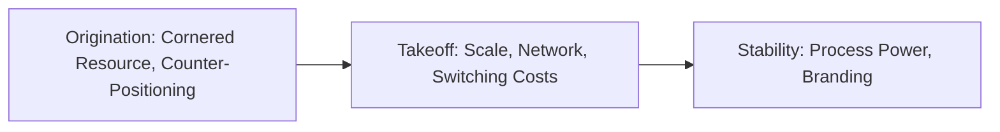

# 02. Seven Powers

The seven conditions that let a business keep above-normal returns despite competition, when each can be built, and how to test whether you really have one.

> **Based on:** *7 Powers: The Foundations of Business Strategy* by Hamilton Helmer (2016). [Bookshop](https://bookshop.org/book/9780998116303)

## At a glance

| Framework | In one line | Use it when |
|---|---|---|
| Power = Benefit + Barrier | A benefit alone gets copied; the barrier is what makes it last | Judging any claimed advantage |
| The Mantra | Strategy is a route to continuing Power in significant markets | Writing or testing a strategy |
| Fundamental Equation | Value = market size x Power | Linking strategy to value |
| The 7 Powers | Scale, Network, Counter-Positioning, Switching Costs, Branding, Cornered Resource, Process | Asking "which ones do we have or can we get?" |
| Power intensity | Industry economics x competitive position | Sizing how strong a Power is |
| The 3 S's | Superior, Significant, Sustainable | Quick screen of an attribute |
| Invention and compelling value | Power starts with something new that customers must have | Deciding what to build |
| Power Progression | Origination, Takeoff, Stability decide which Powers are open | Deciding what to pursue now |

## Power = Benefit + Barrier

- **Power**: conditions that create the potential for lasting differential returns (persistent profit above what is needed to cover the cost of capital).
- **Benefit**: something that materially improves cash flow, through higher price, lower cost, or less investment needed.
- **Barrier**: something that stops competitors arbitraging the benefit away, either because they cannot or because chasing it looks unattractive to them.
- Benefits are common (any cost-cutting project qualifies). Barriers are rare. Rule: look to the barrier first.
- Power is relative: assess it against each competitor, including potential entrants and functional substitutes. One arbitrageur is enough to erode margins.
- Power belongs to a strategically separate business, not the whole firm. A firm can have Power in one product and none in another.
- Operational excellence is needed to realise the potential, but copyable excellence is not Power.
- Leadership still matters: it creates the Power in the first place (see Dynamics below). Once Power exists, a weak business with a brilliant manager stays weak.

### The Mantra and the Fundamental Equation

- Strategy: a route to continuing Power in significant markets.
- Value is the discounted stream of free cash flow. Rewritten as: current market size x discounted growth x long-term share x long-term differential margin.
- So: potential value = market scale x Power. Share and margin are long-term equilibrium values, not this year's numbers.
- Persistence matters because most value sits in the later years. At 10% growth, the first three years are only about 15% of value.
- Value axiom: strategy has one objective, maximising potential fundamental business value.

### The 3 S's

| Test | Meaning |
|---|---|
| Superior | Improves free cash flow |
| Significant | The improvement is material (many "network effects" are real but tiny) |
| Sustainable | Largely immune to competitive arbitrage |

Superior plus Significant is the Benefit. Sustainable is the Barrier.

## The seven Powers

| Power | Benefit | Barrier |
|---|---|---|
| Scale Economies | Lower unit cost | Prohibitive cost of share gains for a follower |
| Network Economies | Higher price (value rises with users) | Prohibitive cost of share gains (value deficit too big to offset) |
| Counter-Positioning | Superior business model: lower cost and/or higher price | Collateral damage the incumbent expects if it copies |
| Switching Costs | Higher price on follow-on sales to existing customers | Rival must compensate customers for the switch |
| Branding | Higher price for an identical offering | Hysteresis (takes years to build) and uncertainty |
| Cornered Resource | Better product, lower cost or other gain from coveted asset | Fiat: law, contract, or personal choice |
| Process Power | Lower cost and/or better product | Hysteresis: complexity and opacity make copying slow |

Barrier types group into four: cost of gaining share (Scale, Network, Switching Costs), collateral damage (Counter-Positioning), fiat (Cornered Resource), hysteresis (Branding, Process Power). "Hysteresis" means a time constant: no amount of money speeds it up.

### 1. Scale Economies

- Definition: unit cost falls as volume rises.
- Sources: fixed cost spread over volume, volume-to-area relationships (tanks, warehouses), distribution density, learning, purchasing.
- Barrier logic: a follower can only gain share by offering better value (lower price), the leader retaliates from its lower cost base, and after a few rounds the follower models that retaliation and stays put.
- Example: a streaming service that moved content to exclusive and original titles turned its largest cost into a fixed cost. The same spend spread over tens of millions of subscribers is a few dollars each, but over one million it is a hundred dollars each.
- Intensity: industry economics (how big the fixed cost is relative to sales) times competitive position (how much bigger you are than the follower). Both must be positive. Strong scale economies with no scale lead means no Power.
- Surplus Leader Margin = fixed-cost share of sales x (leader sales / follower sales minus 1).

### 2. Network Economies

- Definition: customer value rises with installed base.
- Benefit: the leader can charge more. Barrier: a follower would need to pay users to switch.
- Typical traits: winner takes all (tipping point), bounded by the network's real scope (a personal-life network does not extend to a professional one), and the early product decides who scales first.
- Example of failure: a start-up that borrowed a larger network's users but built a professional product. The users came for novelty, engagement stayed low, and the larger platform's rules change killed it.
- Indirect network effects: complements (apps, developers, accessories) that follow the leader, making the whole offer better.
- Caveat: positive network effects do not equal Power. The effect must be large relative to cost and the possible user base. Early on it is very hard to size how big the network and its effect will be.
- Strategic imperative if you think you have it: scale much faster than anyone else.

### 3. Counter-Positioning

- Definition: a newcomer adopts a better business model that the incumbent does not copy because it expects damage to its existing business.
- The incumbent is usually acting rationally, not stupidly. Ask the same question the incumbent asks: "Am I better off adopting or staying the course?"
- Not counter-positioning: when the new approach is simply a poor bet for the incumbent on its own (it lacks any route to Power in it). A film maker facing digital cameras is a disruption but not CP.
- Three kinds of collateral damage:

| Type | Why the incumbent holds back |
|---|---|
| Milk | Combined value is negative: the new model cannibalises a very profitable base (active funds vs low-fee index funds). The decision relaxes as the base shrinks and uncertainty falls |
| History's slave | Cognitive bias. The novel model is unproven, and the old success shapes how leaders see the world, so they belittle it |
| Job security | Agency problem. The decision-maker's pay and position are hurt more than firm value by upending the business |

- Incumbent's usual script: denial, ridicule, fear, anger, capitulation (often late). Common outcome: dabbling without commitment.
- Challenger tips: the right bet is one the incumbent loses even if it plays well. Stay respectful in tone so the incumbent delays acting.
- Limits: CP is relative to the incumbent only. It does not protect against other firms using the new model. It is not exclusive: several challengers can be counter-positioned.
- Not the same as disruptive technology: they overlap but neither implies the other (a burger chain with a different model has CP, no new technology).

### 4. Switching Costs

- Definition: value loss a customer expects from moving to another supplier for additional purchases.
- Benefit applies only to follow-on sales to existing customers. No follow-on product, no benefit. No benefit with new customers.
- Barrier: a rival must compensate customers for the switch, so a challenge is unattractive.
- Three types:

| Type | Source |
|---|---|
| Financial | Money to replace system and complements |
| Procedural | Retraining, risk of errors, lost familiarity |
| Relational | Emotional ties to the supplier, team or user community |

- Example: enterprise software where customers dislike the product yet keep paying maintenance because migration risk is huge.
- Multipliers: add-on products and acquisitions widen what switching affects, and deeper integration raises procedural and relational costs.
- Not exclusive. When the market matures, all players see the value of a locked-in customer and compete harder for new customers, arbitraging that benefit away. Most value comes from getting customers early.
- Weakness: a technology shift can wash it away.
- Can open paths to other Powers (network effects, branding).

### 5. Branding

- Definition: durable higher value attributed to an objectively identical offering, due to historical information about the seller.
- Two reasons for the premium: affective valence (good feelings tied to the name) and uncertainty reduction (peace of mind it will be as expected, as with medicine or safety goods).
- Barrier: it takes a long time of consistent reinforcement, with no guarantee of success (hysteresis plus uncertainty). Copycats also risk trademark action.
- Hazards: dilution (going down-market resets the clock), counterfeiting, changing tastes, geographic limits (strong in one country, absent in another).
- Narrow definition: high awareness alone is not Branding Power. A big firm's ability to fund large ads may be Scale Economies.
- Not exclusive: several luxury brands each hold Power.
- Good fit: consumer identity goods and goods tied to bad tail events. B2B buyers care about objective deliverables, so premiums are rare.

### 6. Cornered Resource

- Definition: preferential access, at attractive terms, to a coveted asset that can independently improve value.
- Examples: a patent, a mineral source, a patented process, a talented core team.
- Barrier is fiat: law (patents, property rights) or personal choice (a creative lead who stays out of loyalty).
- Five tests:

| Test | Question |
|---|---|
| Idiosyncratic | If they keep acquiring coveted assets cheaply, why can they? The real Power may be the discovery process behind it |
| Non-arbitraged | Is the rent already paid away (a star actor's fee)? |
| Transferable | Does it create value at other firms too? If not, an unseen complement is involved |
| Ongoing | Would returns drop if the factor were removed? Early contributors may be embedded already |
| Sufficient | Is it enough alone given good operations? Individual leaders usually are not |

- Renewing the resource is the continuing strategic challenge (for a creative team, renewing its director pool).

### 7. Process Power

- Definition: embedded organisation and activity sets that give lower cost or a better product and can only be matched through extended commitment.
- Rare. Benefit (step-by-step process improvement) is common operational excellence. The rare part is the barrier: complexity and opacity mean even with money and a willing partner, copying takes years. Rule: Process Power = operational excellence plus hysteresis.
- Example: a famous car maker's production system took decades to evolve bottom-up, was largely tacit, and a partner plant from a rival could not reproduce its results quickly.
- Experience curve: cost falls 15-30% per doubling of volume is common across firms. It shows gains over time, not differences between firms at a point in time, so it is not evidence of Power.
- Process Power usually only appears in the stability stage, when a firm has operated long enough.

## Intensity: industry economics x competitive position

- For each Power, split strength into two parts and assess each separately. Both can be targets of strategy.

| Power | Industry economics | Competitive position |
|---|---|---|
| Scale | Size of fixed cost relative to financials | Relative scale vs the main rival |
| Network | How much each extra user adds (delta) | Installed-base lead |
| Counter-Positioning | Model is superior and imposes expected damage | Binary: you adopted it |
| Switching Costs | Strength of lock-in in this market | Binary: you hold the customer or not |
| Branding | How a brand builds value over time | Time since brand investment began |
| Cornered Resource | How much the resource improves value | Whether you have it |
| Process | How steeply process gains build and how slowly | Time invested vs the rival |

- Surplus Leader Margin: the margin the leader could earn if it priced so that the Power-less rival made zero profit. It is a marker of leverage, not a forecast.
- Exclusive Powers: Scale, Network (typically one winner). Non-exclusive: Counter-Positioning, Switching Costs, Branding (several firms can hold them).

## Testing your own strategy

1. Name the business (strategically separate), the market and the main competitors (current, potential, functional).
2. For each of the seven, ask: what is the benefit, what is the barrier? If you cannot state the barrier, you do not have it.
3. Apply the 3 S's: superior, significant, sustainable. Is it big enough to matter?
4. Check relative to each competitor: any one without the barrier ends the margin.
5. Separate industry economics from your position and ask which you can change.
6. Check the stage (Progression below): are you looking for a Power whose window is open?
7. If you have none, you lack a viable strategy and are exposed. Look for Powers to layer on over time.

## Dynamics: how Power is created

Statics is "being there" (what makes a position durable). Dynamics is "getting there". Confusing the two is a classic error: high share goes with good returns, but buying share with low prices usually destroys value.

### Invention first ("me too" won't do)

- Every Power starts with an invention: a product, process, business model or brand.

| Power | What you must do |
|---|---|
| Scale / Network | Offer a business model with scale or network economics and a product attractive enough to win relative share or installed base |
| Cornered Resource | Secure rights to a valuable resource on good terms, often by developing it and gaining a patent |
| Branding | Make consistent creative choices over a long time |
| Counter-Positioning | Pioneer a superior model that would hurt incumbents to copy |
| Switching Costs | First win a customer base, as for Scale and Network |
| Process Power | Evolve a complex process that cannot be imitated quickly |

- Flow: resources + external conditions (technology, law, competition) open a chance, then invention is crafted (not designed, adaptive experimentation, a rudder only works while the ship moves), and then a route to Power must be found. Arrows are dotted because most inventions do not lead to Power.
- Invention gives a one-two punch: it opens the door to Power and it grows market size.
- Planning rarely creates Power. It can boost it once present.

### Compelling value

- Market size comes from "gotta have" products. A rough rule from a semiconductor leader was about 10x better, but it depends on the field (50% more efficiency can be enough elsewhere).
- Three routes, each with different risk:

| Route | Starting point | Main uncertainty | Tactics |
|---|---|---|---|
| Capabilities-led | A capability looking for a need | Is there a customer need? (A document format tool took years and a technology shift to take off) | Stay in the game, avoid high-testosterone commitments, require an early barrier |
| Customer-led | Everyone sees the need, nobody knows how to meet it | Can we invent it? (Ultra-clear glass for optical fibre) | Take a different route than rivals' incremental one |
| Competitor-led | A rival has a product, you must be far better | Will it be enough, and will rivals be slow to respond? (A console launch built on 3D graphics) | Big-bang commitments up front, line up complement makers beforehand |

- Customers' stated wants can mislead: people often do not know what they want until shown.

### The Power Progression

Stages are defined by the business's own unit growth, not industry life-cycle stages.

| Stage | Meaning | Powers whose barrier can first be set |
|---|---|---|
| Origination | Before compelling value; sales may be zero | Cornered Resource, Counter-Positioning |
| Takeoff | Explosive growth (above roughly 30-40% a year in units) | Scale, Network, Switching Costs |
| Stability | Growth slows; markets are known and buyers shop on price | Process Power, Branding |

- Why each barrier belongs where it does:
  - Hysteresis (Branding, Process): needs time, so only in stability.
  - Collateral damage (Counter-Positioning): the model must exist before takeoff.
  - Fiat (Cornered Resource): resource value is still underpriced early; once visible it is priced in.
  - Cost of gaining share (Scale, Network, Switching): share is only cheap while the market is in flux. Later, everyone prices a customer at full value and arbitrage erases the benefit.
- Practical meaning: takeoff is a one-off window. Miss it and the Powers that depend on it may be gone for good. Also, in a big boom, good financials are a false positive; if you have not built Power, arbitrage arrives when growth slows. A rival entering does not "validate the market": it starts a race for relative scale with only one winner.
- Use: at any stage, only a few Powers are available to explore (at most three), which narrows the search.
- Worked example: a chip maker secured the rights to its invention (Cornered Resource, origination), won a key customer's design during takeoff, and then held scale, switching and network benefits into stability. One summary line: a single design win, then years of high switching costs, then scale economies.
- Leadership matters most in building Power, in timing and aggression (a company-wide sales push to win design deals).

## Using it in practice

- Use as a compass in fast-moving moments, not a planning exercise. The question is: "What Powers do we have, and which do we need to worry about establishing now?"
- Look for pre-takeoff Powers early: secure the key rights, pioneer the model.
- During takeoff: win relative scale, installed base and first customers before pricing becomes rational.
- In stability: work on brand consistency, process depth, and layer more Powers.
- Corporate (multi-business) strategy is outside the book's scope.
- The author also ran an equity fund using this lens; alpha only exists where the future is opaque. Treat the track record as one data point, not proof.

## Recall

**Q: What two things must both be present for Power, and which one is rarer?**

??? note "Answer"
    A Benefit (material improvement in cash flow) and a Barrier (something that stops competitors arbitraging it away). The Barrier is rarer, so look at it first.

**Q: Why does an incumbent often fail to copy a Counter-Positioned challenger?**

??? note "Answer"
    Because copying would damage its existing business more than it gains (milking a profitable base), because bias makes it belittle the new model, or because of agency problems that make managers protect their own position. It is usually rational, not stupid.

**Q: Which Powers are established at origination, takeoff and stability?**

??? note "Answer"
    Origination: Cornered Resource and Counter-Positioning. Takeoff: Scale Economies, Network Economies, Switching Costs. Stability: Process Power and Branding.

**Q: Why is a well-known brand not necessarily Branding Power?**

??? note "Answer"
    Branding Power means a durable premium on an identical offering earned through history. High awareness might be caused by scale (a rival cannot afford the same ads), or the product may be a B2B good with no affective premium.

**Q: How do you size the strength of a Power?**

??? note "Answer"
    Separate industry economics from competitive position (for example fixed-cost share times relative scale for Scale Economies). Both must be positive, and both can be targets of strategy.

## Links

- [[1. Good Strategy|Good Strategy]]: building the diagnosis and coherent action around a Power
- [[3. Deciding Under Uncertainty|Deciding Under Uncertainty]]: betting well when the route to Power is unknowable
- [[1. Positioning|Positioning]]: Branding and counter-positioning in practice
- [[1. Value-Based Pricing|Value-Based Pricing]]: capturing the price benefit that Power creates
- [[1. How Business Works|How Business Works]]: where value and margins come from
