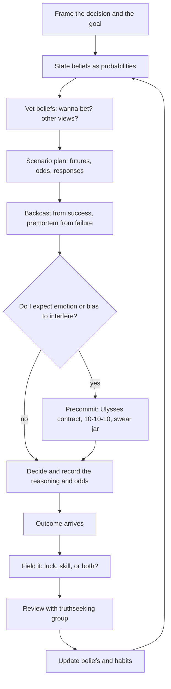

# 03. Deciding Under Uncertainty

How to make and review decisions when luck and hidden information are involved: treat choices as bets, judge the process rather than the result, and build habits and groups that keep you honest.

> **Based on:** *Thinking in Bets: Making Smarter Decisions When You Don't Have All the Facts* by Annie Duke (2018). [Bookshop](https://bookshop.org/book/9780735216358)

## At a glance

| Framework | In one line | Use it when |
|---|---|---|
| Resulting | Judging a decision by its outcome | Reviewing any past decision |
| Decisions as bets | Every choice is a bet on an uncertain future | You catch yourself wanting certainty |
| Belief calibration | Hold beliefs as probabilities (0-10 or percent), not true/false | Stating an opinion or forecast |
| "Wanna bet?" | Imagine real money on the belief to vet it | A belief feels too certain |
| Fielding outcomes | Sort results into luck or skill, honestly | Learning from a result |
| Reshaping habit | Keep the cue and reward, change the routine | Self-serving bias keeps winning |
| Truthseeking group | Charter: accuracy, accountability, diversity | Reviewing decisions with others |
| CUDOS | Share data, judge ideas not people, disclose conflicts, organised skepticism | Setting group rules of engagement |
| Talking to non-members | Express uncertainty, lead with "yes, and", agree to a mode, focus forward | Disagreeing without a fight |
| Mental time travel | 10-10-10, past-you and future-you, regret before the choice | Deciding in the moment |
| Tilt and decision swear jar | Spot emotional state and verbal red flags | You are upset or sure of yourself |
| Ulysses contract | Precommit to block your future self | You know when you will be irrational |
| Scenario planning | Map futures, assign probabilities, plan responses | Big or uncertain choices |
| Backcasting and premortem | Look back from a won future and a failed one | Starting a plan |
| Hindsight bias (the chainsaw) | Remember the branches that never happened | After the outcome is known |

## Resulting and why the brain does it

- **Resulting**: treating the quality of a decision as if it equals the quality of the outcome. A great decision can fail and a terrible one can work.
- **Hindsight bias**: after an outcome, seeing it as inevitable ("I should have known").
- Test: name your best and worst decisions of last year. Most people list best and worst results. Few list a bad decision that got lucky, or a well-reasoned one that failed.
- Example: a founder fires an underperforming executive after coaching, role changes and a sound market read. The replacement search goes badly. The decision was reasonable given what was known, the result was bad, and he wrongly concludes he "should have known".
- Drunk-driving test: nobody concludes they drive better drunk because they got home safely. The same logic applies to good outcomes from poor process.
- Why we do it: the brain evolved to build certainty and order out of noise, and the quick reflexive system acts before the deliberative one. Goal: get reflexive habits to carry out deliberative intentions.
- Real life is poker, not chess:

| Chess | Poker and real life |
|---|---|
| All information visible | Hidden information |
| Little or no luck | Luck matters |
| The better player nearly always wins; a loss shows an identifiable error | A good decision can lose, so one outcome says little |

- Sample size trap: you only see a few outcomes of your own decisions (four coin flips cannot say if the coin is fair). A house flip that made money might just reflect a rising market.
- "I'm not sure" is a useful, honest answer. Admitting uncertainty is the first step to measuring and narrowing it.
- Redefining wrong: if you say something is 76% likely and the 24% happens, you were not wrong. Judge the forecast by the odds you stated in advance.

## All decisions are bets

- A bet is a choice made by thinking about what will probably happen, with something at risk. Choosing, probability, risk, decision, belief.
- Not choosing is a bet too. Every yes closes other options (opportunity cost).
- Most bets are bets against our other possible selves, not against another person.
- Our bets are only as good as our beliefs, and beliefs are formed sloppily.

### How beliefs form

1. We hear something.
2. We believe it.
3. Only sometimes, later, we vet it.

- Repetition makes myths feel true (the "dog years" multiplier, a baldness rule).
- Motivated reasoning: we fit new information to what we already believe, so we guard beliefs instead of testing them.
- Being smart makes it worse: a clever mind builds a better story for the position it already holds (blind-spot bias).

### "Wanna bet?"

- Imagining a real wager triggers step three. Ask:
  - Where did I get this? How good is the source and how current?
  - What other evidence exists, and what similar beliefs of mine turned out wrong?
  - What are the plausible alternatives, and what might the other person know that I do not?
- The person who wins bets over time has the more accurate beliefs.

### Redefining confidence (calibration)

- Replace "I'm confident / not confident" with how confident: rate a belief 0-10, or give a percent.
- Express range too: "somewhere between X and Y". More knowledge or less luck means a tighter range.
- The number can reflect incomplete knowledge of the past, inherent uncertainty about the future, or both.
- Benefits:
  - Nudging 58% to 46% hurts less than "I was wrong", so you update more readily.
  - You judge yourself on how well you incorporated new information, not on right vs wrong.
  - You stop treating disagreeing information as a threat, which makes you better at truthseeking.
- Expected value: a $50,000 grant at 70% is worth $35,000 to plan around. A $200,000 grant at 5% is worth far less. Without probabilities you chase the biggest number.

## Learning from outcomes

- Experience becomes expertise only when you sort outcomes correctly. Outcomes are feedback, and each one is a bet on whether it belongs in the luck bucket or the skill bucket.
- Skill: the result would repeat if you made the same decision, and change if you changed it. Luck: things outside your control (others, weather, genes, timing).

### Self-serving bias

- We take credit for good results (skill) and push bad ones onto luck. A gambler who blamed losses on luck and wins on cleverness kept betting a losing hand.
- Ambiguity, hidden information and small samples give you the room to misfile outcomes. Fielding errors (like the low-fat snack boom) hide whether your belief was wrong.
- The same bias applies to other people's results: their bad outcome is their fault and their good outcome is luck. Watching others is thus a poor teacher unless you change the fielding.
- Note the bias is strongest in zero-sum contexts but exists everywhere because we compete for reputation.

### Reshaping the habit

- A habit loop: cue, routine, reward. Rule: keep the old cue, keep the old reward, change the routine.
  - Old: good outcome (cue), credit my skill (routine), feel good (reward).
  - New: any outcome (cue), look for what was luck, what I could improve, who deserves credit (routine), feel good about being a rare credit-giver and mistake-finder (reward).
- Compete on the dimension that helps: be better than peers at admitting mistakes and giving credit.
- Make outcome fielding a bet: "Would I bet that this was 100% luck?" Absolute words ("always", "never") invite a bet against you.
- Top performers often discuss their own errors after a win. They look for what they could have done better.

## Truthseeking groups (decision pods)

- On our own we have one viewpoint. A group can fill in blind spots, test alternatives and de-bias, but only with the right charter. Without one it drifts to confirmation and becomes an echo chamber.
- Two modes of group thought: confirmatory (justify a position, amplifies bias, groupthink) and exploratory (even-handed consideration of alternatives).
- Conditions that trigger exploratory thought: you know before forming views that you will answer to an audience that is (a) of unknown views, (b) interested in accuracy, (c) well informed, (d) has a legitimate reason to ask why.

### The truthseeking charter

1. Focus on accuracy over confirmation (reward honesty, open-mindedness).
2. Accountability, with advance notice.
3. Openness to a diversity of ideas.

- A good charter is stated plainly. One experienced player's rule for a peer: no hard-luck stories, ask about strategy as much as you like.
- Even the "bet" is a form of accountability: you must stand by your belief.
- Evidence of diversity helping: appellate panels with one judge from the other political side showed a "disciplining effect", and diversity of reasonable views reduced extremity.
- Drift happens: ideologically uniform groups slide to more extreme versions of their view.
- Idea: prediction markets and betting on whether study results will replicate beat expert opinion, because confirming a preference is worth nothing there.

### CUDOS (norms borrowed from science)

| Norm | Meaning | In practice |
|---|---|---|
| Communism (shared data) | Data belongs to the group | "More is more": share everything, especially details you want to skip |
| Universalism | Judge claims by impersonal criteria, not messenger | Don't shoot the message. Equally, do not accept an idea just because you like who said it |
| Disinterestedness | Guard against conflicts of interest | Disclose stakes. Blind the group to the outcome when reviewing a decision. Anyone can be biased without knowing it |
| Organised Skepticism | Ask why a belief might not be true | Disagree civilly. Treat dissent as a contribution, not an attack |

- Telling a listener the outcome, or your own conclusion, before asking for input infects them with your conflict of interest. Ask for input first.
- Skeptical does not mean cynical: it means starting from "I'm not sure" and inviting the other person in.

### Talking with people outside your group

1. **Express uncertainty.** It invites others to share what they know.
2. **Lead with assent.** State what you agree with, then use "and", not "but". "And" adds; "but" denies.
3. **Ask for a temporary agreement.** "Do you want to vent, or do you want advice?" Opting in to truthseeking.
4. **Focus on the future.** People get defensive about the past but are rational about what to do next. Asking what they would do differently next time leads back to examining the past anyway.

## Mental time travel

### Moving regret before the decision

- Regret after the fact cannot change anything. Regret before a choice can.
- Late-night self vs morning self: we trade the future person's welfare for the present one's. Seeing an aged version of yourself raised retirement saving.
- **10-10-10** (a question tool): what are the consequences in ten minutes, ten months, ten years? You can also run it in reverse: how would I feel today if I had made this choice ten minutes, months or years ago?
- Benefits: better decisions, kinder self-treatment afterwards, a prepared response to a bad outcome, and a reminder that intense feelings fade.
- Use a zoom lens: a flat tire looks like the worst moment of your life until you recall it a year later. Take the long view of the most recent upswing or downswing.

### Tilt

- Tilt: letting a recent bad (or good) outcome distort later decisions emotionally. The emotional centre shuts down the planning centre, like a shaken pinball machine.
- Signs are emotional and physical. Name the state so you can interrupt it. The remedy is to step back and get the long view.
- Example rule: set a loss limit and a time limit in advance, so that you must face the explanation to your group before breaking them.

### Ulysses contracts

- A precommitment: past-you binds future-you before temptation or emotion arrives. The original was binding oneself to a mast and wax in the crew's ears.
- Raise barriers (take a ride-share to a bar, skip the mall where you snack, a loss limit and session time limit) or lower barriers to rational action (carry healthy snacks so the better choice is the easy one).
- Use when you can predict the situation where you will be irrational.
- Binding comes in levels, from physically blocking the option to a simple commitment. Even the weakest form creates a decision interrupt: the moment you consider breaking it, you stop and think.

### Decision swear jar

- Pick red-flag words and thoughts. When you hear yourself say them, stop and re-think (a "decision interrupt").

| Red flag | Examples |
|---|---|
| Illusion of certainty | "I know", "I'm sure", "0%", "100%", "always", "never", "best", "worst" |
| Irrational outcome fielding | "I got so unlucky", "I planned it perfectly", "they had it coming" |
| Moaning only to offload | Complaint with no point (unless the group agreed to a venting break) |
| Dismissing people with labels | Pejorative generalisations ("idiot", "typical ___") instead of weighing the idea |
| Universalism violations | Judging an idea by who or where it came from |
| Motivated reasoning and echo chambers | "Conventional wisdom", "everyone agrees with me", "can you prove it's not true?" |
| Zoomed-in moments | "Worst day ever" |
| The word "wrong" | It is a conclusion, not a reason, and little is 0% or 100% |
| Lack of self-compassion | "I should have known", "how could I be so stupid?" |
| Overly generous story editing | Shading a story so the listener agrees, or sharing your conclusion or the outcome before asking for input |

- Handy question: what are the odds that everyone around me is an idiot?

## Planning with futures

### Reconnaissance and scenario planning

- Every decision already contains a prediction. Make it explicit.
- Steps:
  1. List the possible futures (with branches deeper than the first step).
  2. Assign rough probabilities, even a range such as 20-80%.
  3. Rate how good or bad each is.
  4. Decide how you will respond in each branch.
  5. Record the plan and the odds so you cannot rewrite history later.
- If two people differ widely on a probability, have them swap sides and argue the other case. The answer is often in the middle, or one of them has a factor the other missed.
- Benefits: realism about uncertainty, readiness to respond, less unproductive regret or euphoria, less resulting and hindsight bias.
- Worked example: a charity ranked pending grant applications by amount requested. Re-ranked by probability times amount, the order flipped, budgeting became more realistic, and they began checking their probability estimates after wins as well as losses. The same method suits a sales pipeline.
- Worked example (decision tree): a late-game choice between running and passing. Counting scenarios showed a pass gave more chances to score before time ran out because an incomplete pass stops the clock. The risk of the feared outcome was small (a couple of percent). Few analysts saw the extra play even afterwards.

### Backcasting

- Imagine the goal is achieved ("We doubled market share"). Work backward: what happened, which decisions, what had to go right?
- Looking back from a future is better than forward from now. Prospective hindsight raised the ability to identify reasons for outcomes by about 30% in one study.
- Reveals required low-probability events and signals when the goal should be adjusted. Add precommitments and checkpoints for re-evaluation.

### Premortem

- Imagine the plan failed ("Growth stalls again"). Everyone lists reasons why.
- Backcasting is the cheerleader, premortem is the heckler. You need both to see positive and negative space.
- Research on mental contrasting shows people who only visualise success act less. Imagining obstacles raises follow-through.
- It makes dissent safe, since the failure is already assumed. It is an act of organised skepticism, and dissenters are represented in the plan.
- Then protect against the risks, prepare responses and set early warning signs.

### Hindsight and the tree

- Time as a tree: one trunk (the past), many branches (futures) with thickness as probability. The present is a chainsaw that cuts all branches except the one that happened.
- A 2-3% twig becomes "100%" once it happened. This is hindsight bias.
- Example: a court noted that a verdict showed hindsight bias, because once an explosion occurred it seemed foreseeable, though at the time it was just one possible future.
- Antidote: record the branches and their weights before the outcome, so you can see what you knew.

## A decision process

## Quick checklist

1. What do I believe, and how sure am I (a number)?
2. Where did the belief come from, and what would change it?
3. What are the possible futures and their odds?
4. What would success look like in hindsight, and what would failure look like?
5. Am I tilted, tired or invested in a result? Is there a precommitment I can set?
6. Write down the decision, reasoning and odds before the result is known.
7. After the result: how much was luck, how much was skill, who gets credit, what do I change?

## Common mistakes

- Using the outcome as the grade for the decision.
- Collecting hard-luck stories instead of questions.
- Picking a group that agrees with you.
- Forecasting only success.
- Calling one number "wrong" when the forecast was a probability.
- Waiting until the outcome to think about what could happen.
- Treating hindsight as proof you "should have known".

## Recall

**Q: What is resulting, and why is it a problem?**

??? note "Answer"
    Judging a decision by how it turned out. Luck and hidden information make outcomes an imperfect signal, so good decisions get punished and bad ones repeated.

**Q: How should you express a belief to keep it calibrated?**

??? note "Answer"
    As a degree of confidence (a 0-10 score, a percentage, or a range of plausible values) rather than as certain. Then adjusting from 58% to 46% feels like normal updating, not admitting you were wrong.

**Q: What are the three parts of a truthseeking charter, and what is CUDOS?**

??? note "Answer"
    Accuracy over confirmation, accountability with advance notice, and openness to diverse ideas. CUDOS is shared data (communism), universalism, disinterestedness, and organised skepticism.

**Q: What is the difference between a backcast and a premortem?**

??? note "Answer"
    A backcast imagines a successful result and asks how you got there. A premortem imagines failure and asks why. The premortem reveals obstacles and makes dissent safe, and the two together cover the positive and negative space.

**Q: What is a Ulysses contract?**

??? note "Answer"
    A precommitment made while calm that restricts your future self when you predict emotion or temptation will take over, for example a stop-loss rule, a time limit, or a ride home arranged before the evening.

## Links

- [[1. Good Strategy|Good Strategy]]: pressure-test strategy with a premortem and the outside view
- [[2. Seven Powers|Seven Powers]]: Power is a long-run bet under uncertainty
- [[1. Reading the Numbers|Reading the Numbers]]: expected value and probability-weighted numbers
- [[2. Cash Allocation|Cash Allocation]]: capital choices as bets
- [[2. Tactical Negotiation|Tactical Negotiation]]: leading with assent and expressing uncertainty with counterparties
