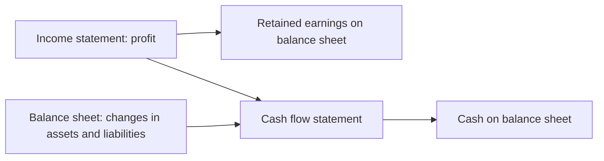
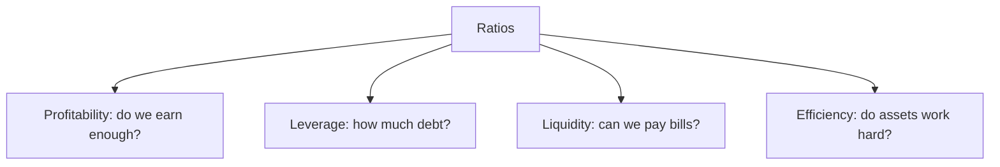
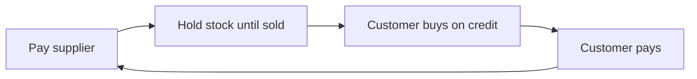

# 01. Reading the Numbers

How a non-accountant reads the three financial statements, spots the judgement calls inside them, and uses ratios, cash flow, working capital and return-on-investment maths to decide things.

> **Based on:** *Financial Intelligence, Revised Edition: A Manager's Guide to Knowing What the Numbers Really Mean* by Karen Berman and Joe Knight, with John Case (2013). [Bookshop](https://bookshop.org/book/9781422144114)

## At a glance

| Framework | In one line | Use it when |
| --------- | ----------- | ----------- |
| Art of finance | Every statement holds assumptions, estimates and bias | Before trusting any number |
| Income statement | Revenue minus costs, matched to the period, gives profit (an estimate) | Judging profitability |
| Balance sheet | Assets = liabilities + equity, a snapshot on one day | Judging strength, debt, what ties up cash |
| Cash flow statement | Operating, investing, financing cash in and out | Asking "can we pay the bills?" |
| Profit is not cash | Timing gaps make profitable firms run dry | Growing fast, long customer terms |
| Ratio families | Profitability, leverage, liquidity, efficiency | Comparing over time, to plan, to peers |
| Return maths | Payback, NPV, IRR, hurdle rate, WACC, EVA | Approving a spend or a project |
| Working capital | Receivables + inventory - payables; the cash conversion cycle | Freeing cash without new revenue |

## The art of finance

- Finance describes a business using limited data. It is a reflection of reality, not reality itself.
- Three sources of fuzz in nearly every line:
  - **Assumptions**: how long an asset lasts, when a sale counts, which costs belong to a product.
  - **Estimates**: the number produced from the assumption.
  - **Bias**: the direction the choice pushes the result (profit higher or lower, cost in one bucket or another).
- Four questions to ask of any figure: what is assumed? what is estimated? which way does it lean? what decisions follow from that lean?
- Common judgement areas:

| Area | Where the judgement sits | Effect of bending it |
| ---- | ------------------------ | -------------------- |
| Accruals | Which month a cost or sale belongs to | Moves profit between periods |
| Allocations | Share of shared cost given to each product or unit | Makes a product look cheap or dear |
| Depreciation | Useful life of an asset | Longer life = lower yearly cost = higher profit |
| Revenue timing | When a sale is "earned" | Pulls profit forward |
| Valuation | Method for what a business is worth (earnings multiple, discounted cash flow, asset value) | Each method leans differently |

- The authors' point is not "numbers lie". It is that a manager who knows where the estimates sit can challenge them, and can also build proposals with defensible assumptions.
- Fraud usually lives in these same soft spots (stretched depreciation lives, revenue booked early, operating costs capitalised). Cash is the number least touched by them.

## Income statement

- Also called P&L, statement of earnings, operating statement. Always covers a span of time.
- Reading checklist: the label, the entity (company, division, region), the period, actual vs projection (pro forma) vs non-GAAP, units ("in thousands"), the comparison columns (budget, last year), and the footnotes.
- Layout: sales at the top ("top line"), costs in the middle, profit at the bottom.

```text
Revenue
- Cost of goods sold (or cost of services)
= Gross profit
- Operating expenses (SG&A, R&D, depreciation, amortisation)
= Operating profit (EBIT)
- Interest, taxes, one-off charges
= Net profit (the bottom line)
```

### Matching principle

- Costs go in the period of the sales they helped earn, not the period the cash left.
- A truck bought for the year ahead is spread over its life. A bulk stock purchase hits cost only as units sell. Taxes are accrued monthly even if paid quarterly.
- This is why profit and cash differ.

### Revenue

- Recognised when earned (product delivered, service done), not when paid.
- Grey cases: long projects with milestones, bill-and-hold (billed now, shipped later), bundled deals.
- **Backlog / bookings**: orders not yet recognised. **Deferred revenue**: cash received before the work is done; sits on the balance sheet as a liability (you owe the work).

### Costs

- **COGS / cost of services**: costs directly tied to making or delivering. Plant manager? Supervisor? Commissions? No hard rule, only "reasonable and consistent".
- "Above the line" (COGS) draws more management attention than "below the line" (operating expenses). Moving a cost across the line changes gross margin with no change in reality.
- **Operating expenses (overhead)**: rent, admin salaries, marketing, R&D. Good overhead strengthens the business, bad overhead is bureaucracy.
- COGS is not the same as variable cost: supervisor pay in COGS is fixed in the short run; commissions are variable but sit in operating expenses.

### Forms of profit

| Profit | Formula | What it tells you |
| ------ | ------- | ----------------- |
| Gross | revenue - COGS | Basic profit of the product or service; must also fund everything below |
| Operating (EBIT) | gross - operating expenses | How well the business is run, before financing and tax |
| EBITDA | EBIT + depreciation + amortisation | Operating profit ignoring non-cash charges |
| Net | operating - interest - tax - one-offs | What is left for owners |
| Contribution margin | revenue - variable costs | What each sale adds toward fixed costs; keep a line if positive even when "full-cost" profit is negative |

- Fixing low profit has only three honest levers: more profitable sales (slow), lower production cost (slow), lower overhead (fast, often headcount, can backfire on morale and the long term).
- Exchange rates can swing profit on foreign sales with nothing changing operationally.

### Depreciation sensitivity (worked)

A van costing 36,000 earns revenue 10,000/month, direct cost 5,000, overhead 3,000.

| Assumed life | Depreciation per month | Net profit per month |
| ------------ | ---------------------- | -------------------- |
| 1 year | 3,000 | -1,000 (loss) |
| 3 years | 1,000 | 1,000 |
| 6 years | 500 | 1,500 |

Same van, same trading, three different bottom lines. Ask what life is assumed before comparing profits.

## Balance sheet

- A snapshot on one date. The equation: **assets = liabilities + owners' equity**. What the company owns equals what it owes plus what the owners hold.
- Lenders and veteran investors read it first; managers read the income statement first and miss what ties up cash.

| Section | Typical items | Notes |
| ------- | ------------- | ----- |
| Current assets | cash, accounts receivable, inventory | Cash within a year. Receivables carry an allowance for bad debts. Inventory valuation (FIFO vs LIFO) is a choice |
| Long-term assets | property, plant and equipment (PPE), intangibles, goodwill | PPE is shown after accumulated depreciation. Goodwill = price paid above net assets of an acquired firm |
| Current liabilities | accounts payable, short-term debt, accrued costs, deferred revenue | Due within a year |
| Long-term liabilities | loans, bonds | |
| Equity | paid-in capital, retained earnings | Retained earnings = profit kept over time |

- **Why it balances**: every transaction changes two things. Profit raises equity (as retained earnings); dividends lower it. Borrowing raises cash and a liability; buying equipment swaps cash for an asset.
- **Book value** (equity) rarely equals **market value**. Market cap = share price x shares.
- A company can be profitable and still hold negative or thin equity if losses accumulate faster than it earns.
- **Capital expenditure vs expense**: spending that benefits several years is capitalised and depreciated; moving ordinary costs into capex flatters profit (a classic abuse).
- **Mark-to-market**: some assets are carried at current market value, not cost.

### How the statements link



## Cash flow statement

- Cash has little room for estimates: it is in the bank or it is not.
- Three sections:

| Section | Contains | Healthy sign |
| ------- | -------- | ------------ |
| Operating | cash from customers less cash to staff, suppliers, landlord | Positive and larger than profit; the single best health number |
| Investing | buying and selling assets, acquisitions | Negative in a growing firm; near zero may mean milking the business |
| Financing | loans taken and repaid, shares issued or bought back, dividends | Shows reliance on outside money |

- Shareholder money goes under financing, not investing (a frequent mix-up).

### Building it from two balance sheets (indirect method)

Start from net profit and walk through each balance sheet change:

| Change | Cash effect |
| ------ | ----------- |
| Depreciation (non-cash expense) | add back |
| Asset up (receivables, inventory) | subtract |
| Asset down | add |
| Liability up (payables) | add |
| Liability down (debt repaid) | subtract |
| Dividends paid | subtract (financing) |

### Profit is not cash

Three reasons they diverge:

- Revenue is booked at the sale, cash arrives later.
- Expenses are matched to revenue, paid earlier or later.
- Capital spending hits cash now and profit slowly.

Worked example, profitable but out of cash. Opening cash 5,000. Customers pay after 60 days, suppliers want payment after 30. COGS 60 percent of sales, overhead 4,000/month.

| | Jan | Feb | Mar |
| --- | --- | --- | --- |
| Sales | 10,000 | 15,000 | 22,000 |
| Net profit | 0 | 2,000 | 4,800 |
| Cash collected | 0 | 0 | 10,000 (Jan sales) |
| Cash paid | 4,000 | 10,000 (Jan COGS + overhead) | 13,000 (Feb COGS + overhead) |
| Closing cash | 1,000 | -9,000 | -12,000 |

Growth makes it worse: each month needs more cash up front. Reverse case: a cash-on-sale retailer paying suppliers late can show a rising bank balance while losing money, but losses eventually drain it.

- Profitable but short of cash needs **financial** skill (financing, terms). Cash-rich but loss-making needs **operational** skill (cost, pricing).
- **Free cash flow** = operating cash flow - net capital expenditure. Options it buys: expand, repay debt, buy back shares, pay dividends.
- **Owner earnings** (Buffett's term): what an owner could take out and still keep the business healthy. Same spirit as free cash flow.
- Even large firms can run short when a short-term funding market freezes. Always know where next month's cash comes from.

## Ratios

- A number alone answers nothing ("is 10 million profit good?" "compared to what?"). Ratios give the comparison.
- Compare three ways: to the same ratio last period (trend), to plan, to peers in the industry.
- Four families:



### Profitability

| Ratio | Formula | Read it as |
| ----- | ------- | ---------- |
| Gross margin | gross profit / revenue | Cents kept per sales dollar after direct cost. Falling = discounting or rising cost |
| Operating margin | operating profit / revenue | Management quality. Falling = costs outpacing sales |
| Net margin (return on sales) | net profit / revenue | What the owners keep. Varies hugely by industry |
| Return on assets (ROA) | net profit / total assets | Profit per dollar of everything owned. Too high can mean under-investment or assets hidden off the books |
| Return on equity (ROE) | net profit / shareholders' equity | Return to owners; boosted by debt, so read with leverage |
| Return on capital (ROTC, ROIC, ROCE, RONA) | NOPAT / (equity + interest-bearing debt) | Return on all money provided; NOPAT = operating profit x (1 - tax rate) |

- **Percent of sales**: express every income statement line as a share of revenue and track it. Creeping lines show where pressure is.
- **Ratio relationship**: ROA = net margin x asset turnover. Two ways to raise ROA: earn more per sale, or sweat the assets (cut inventory, collect faster, buy less plant).
- Different firms compute the same ratio differently (ending vs average balances). Fine if consistent; compare like with like.
- Averaging balance sheet figures is more logical when dividing a year of profit by a point-in-time asset figure.

### Leverage

| Ratio | Formula | Read it as |
| ----- | ------- | ---------- |
| Debt-to-equity | total liabilities / equity | Debt per unit of owner money. Lenders judge loans by it |
| Interest coverage | operating profit / annual interest | How easily interest is paid. Near 1 is dangerous |

- Two senses of leverage: **financial** (debt-funded assets) and **operating** (fixed vs variable cost mix, e.g. big plant). Both lift upside and risk. High fixed cost plus high debt is the riskiest mix.
- Leases kept off the balance sheet can hide debt. Ask if any exist.

### Liquidity

| Ratio | Formula | Read it as |
| ----- | ------- | ---------- |
| Current ratio | current assets / current liabilities | Near 1 is too low; far above can mean idle cash |
| Quick ratio (acid test) | (current assets - inventory) / current liabilities | Can we pay without selling stock? Usually want above 1 |

### Efficiency

Use 360 days a year, as the authors do.

| Ratio | Formula | Meaning |
| ----- | ------- | ------- |
| Days in inventory (DII) | average inventory / (COGS / 360) | Days stock sits. Lower frees cash |
| Inventory turns | 360 / DII | Times stock cycles per year |
| Days sales outstanding (DSO) | ending receivables / (revenue / 360) | Average days customers take to pay |
| Days payable outstanding (DPO) | ending payables / (COGS / 360) | Average days we take to pay; higher saves cash but strains suppliers |
| PPE turnover | revenue / PPE | Sales per unit of fixed assets; leasing flatters it |
| Total asset turnover | revenue / total assets | Sales per unit of all assets |

- DSO is an average: two large overdue invoices can hide behind good-looking invoices. Check **receivables aging** (under 30, 30 to 60, 60 to 90, over 90 days). One million under ten days plus one million over ninety days still averages about fifty.

### Investor view: the "Big Five"

- Revenue growth, earnings per share, EBITDA, free cash flow, and return on capital (return on equity for banks and insurers).
- Price-to-earnings = share price / earnings per share. Higher usually signals expected growth.
- Shareholder value depends on current results, growth, expected cash flows, predictability (risk), and management quality, plus market mood.

### Cautions

- One ratio chased alone distorts decisions (a margin target that stops you discounting dead stock keeps cash frozen).
- Ratios say nothing about scale: 3 percent of a giant can beat 30 percent of a small firm in absolute money.
- Numerators are profit estimates and denominators are estimates too; the trend matters more than the single value.
- Pick the 2 or 3 ratios that matter in your business and watch them routinely.

## Worked example, all in one

Small trading company, 360-day year. Figures in thousands.

| Income statement | | Balance sheet | |
| ---------------- | --- | ------------- | --- |
| Revenue | 1,000 | Cash | 80 |
| COGS | 600 | Receivables | 150 |
| Gross profit | 400 | Inventory | 120 |
| Operating expenses | 250 | Current assets | 350 |
| Operating profit | 150 | PPE | 400 |
| Interest | 30 | Total assets | 750 |
| Tax (25% of 120) | 30 | Payables | 100 |
| Net profit | 90 | Short-term debt | 50 |
| | | Long-term debt | 250 |
| | | Equity | 350 |

| Ratio | Calculation | Result |
| ----- | ----------- | ------ |
| Gross margin | 400 / 1,000 | 40% |
| Operating margin | 150 / 1,000 | 15% |
| Net margin | 90 / 1,000 | 9% |
| ROA | 90 / 750 | 12% |
| ROE | 90 / 350 | 25.7% |
| Debt-to-equity | 400 / 350 | 1.14 |
| Interest coverage | 150 / 30 | 5.0 |
| Current ratio | 350 / 150 | 2.33 |
| Quick ratio | 230 / 150 | 1.53 |
| DSO | 150 / (1,000 / 360) | 54 days |
| DII | 120 / (600 / 360) | 72 days |
| DPO | 100 / (600 / 360) | 60 days |
| ROA check | 9% x (1,000 / 750 = 1.33) | 12% |

Reading: healthy margin and cover, but about 54 plus 72 days to turn stock and sales into cash. Trimming 5 days off DSO would release roughly 14 (5 x 1,000/360).

## Working capital

- Money needed to fund daily operations: receivables + inventory (+ cash) - payables. The common textbook shorthand is current assets - current liabilities (here 350 - 150 = 200).
- Cash cycles round: cash buys materials, becomes inventory, becomes finished goods, becomes receivables, becomes cash again.
- Increase receivables or inventory = more working capital tied up. Increase payables = less needed.



### Cash conversion cycle

```text
cash conversion cycle (days) = DSO + DII - DPO
cash needed to fund it       = revenue per day x cycle days
```

Example above: 54 + 72 - 60 = 66 days; 66 x 2.78 = about 183 of cash tied up.

### Levers

| Lever | How it frees cash | Who touches it |
| ----- | ----------------- | -------------- |
| Receivables (DSO) | Fix quality and delivery problems (unhappy customers pay late), set terms up front, credit checks, accurate invoices, early-pay discounts such as "2/10 net 30" (costs margin) | Sales, ops, customer service, credit, billing |
| Inventory (DII) | Fewer product variants, lean and just-in-time methods, do not build stock into slow demand just to keep unit cost low | Sales, engineering, production |
| Payables (DPO) | Pay later; but slow pay raises prices, hurts supplier quality and credit rating | Finance; a policy call |

- One day of DSO or DII is worth about a day of revenue or cost of sales in cash. Large firms free millions by trimming a day.
- Mind the soft costs of stretching suppliers: relationships, reliability, and credit reputation.

## Return on investment

### Time value of money

- **Future value**: what money today grows to at an interest rate. **Present value**: what a future sum is worth now (discounting). A dollar today beats a dollar later.
- Rates and projections are assumptions: longer horizon, bigger guesswork, more risk.
- **Hurdle rate** (required rate of return): the minimum return to accept a project. Set above cost of capital, higher for riskier work. **Opportunity cost**: the best alternative given up.

### Evaluating a capital expenditure

1. Work out the initial cash outlay (price, installation, training, downtime). Cash, not accounting cost.
2. Project future **cash flow**, not profit: start from profit, add back depreciation, subtract working-capital build and capex. Be conservative.
3. Judge with payback, NPV and IRR. Stress-test at 80 to 90 percent of projected cash flows (sensitivity analysis).

| Method | Formula idea | Strength | Weakness |
| ------ | ------------ | -------- | -------- |
| Payback | outlay / yearly cash flow | Simple screen | Ignores cash after break-even and time value |
| Net present value (NPV) | sum of cash flow / (1+i)^t, minus outlay | Dollar value added in today's money | Hard to explain; needs a rate |
| Internal rate of return (IRR) | the rate that makes NPV = 0 | Easy to compare with hurdle rate | Ignores scale and duration |
| Profitability index | present value / outlay | Ranks projects of different size | Needs NPV first |

```text
PV = CF1/(1+i) + CF2/(1+i)^2 + ... + CFn/(1+i)^n
NPV = PV - initial outlay        accept when NPV > 0
```

Worked example. Outlay 10,000; cash 4,000 a year for 3 years; hurdle 10%.

- Payback = 10,000 / 4,000 = 2.5 years (looks fine, inside the 3-year life).
- PV = 4,000 x 2.487 = 9,947, NPV = -53, IRR about 9.7%. Reject: it just misses the hurdle.

When the methods disagree, NPV wins. The book's three-option test (9 percent hurdle): payback favours the one-year pay-off, IRR 20 percent also favours it, but NPV favours the three-year option (15.3 percent for three years beats 20 percent for one).

- Some choices need no maths (a 4,000 computer whose failure idles a profitable engineer). Do not pad an analysis to justify a decision already made.
- Write proposals short: the project, costs and benefits, risks, strategic fit, recommendation, plus the NPV, payback and IRR behind it.

### Cost of capital and economic profit

```text
cost of debt   = interest rate x (1 - tax rate)
cost of equity = risk-free rate + beta x (market return - risk-free rate)
WACC           = debt share x cost of debt + equity share x cost of equity
```

- Book example: 30% debt at 6% with 25% tax (4.5%) and 70% equity at 13% gives WACC of 10.45%. Firms often add two to three points for the hurdle rate.
- More debt is not always cheaper: it raises risk, so equity and lenders ask for more.
- **EVA = ROTC - WACC**; **economic profit = EVA x total capital**. Positive means value created for capital providers; negative means they would do better elsewhere.
- Example from the model company: ROTC 17.3% (NOPAT 112.5 on capital 650) against a 10% WACC gives EVA of 7.3%, economic profit of about 47.

## Using it as a manager

- Learn the 2 or 3 numbers you can move (your costs, your receivables, your inventory) and state their cash effect.
- Ask finance which ratios and hurdle rate the company uses, and which assumptions sit behind a report.
- Share the numbers with the team: a weekly "numbers" meeting on 2 or 3 key figures, a visible scoreboard, short repeated training. Transparency builds trust and makes books harder to cook.
- Check the cash picture before big spends; time purchases for the cash-rich part of the year.

## Common mistakes

- Treating profit as cash.
- Comparing profit across firms or years without checking depreciation, revenue recognition and cost classification.
- Fixating on one ratio or a margin target.
- Judging a project on payback alone, or on projected profit instead of cash flow.
- Reading DSO without the aging report.
- Cutting overhead to flatter profit while ignoring the long term.
- Forgetting off-balance-sheet leases when judging debt.

## Recall

**Q: Why can a company be profitable and still run out of cash?**

??? note "Answer"
    Profit counts sales when earned and costs when matched to them. Cash moves when customers and suppliers actually pay. If customers pay in 60 days, suppliers want 30 and sales are growing, cash goes out before it comes in. Capital spending also hits cash at once but profit slowly.

**Q: What are the four ratio families and one example of each?**

??? note "Answer"
    Profitability (gross margin or ROE), leverage (debt-to-equity or interest coverage), liquidity (current or quick ratio), efficiency (DSO, inventory days, asset turnover).

**Q: How do you compute the cash conversion cycle, and what do you do with it?**

??? note "Answer"
    DSO + days in inventory - DPO. Multiply by revenue per day to see the cash tied up. Shorten it by collecting faster, holding less stock, or (carefully) paying later.

**Q: A project returns 4,000 a year for 3 years on a 10,000 outlay with a 10 percent hurdle. Accept?**

??? note "Answer"
    No. Payback is 2.5 years, but the present value of the cash flows is about 9,947, so NPV is about -53 and IRR about 9.7 percent, just under the hurdle.

**Q: Why does ROA = net margin x asset turnover matter?**

??? note "Answer"
    It shows two ways to raise return: earn more per sale (price, cost) or use assets harder (less stock, faster collection, less plant). When margin is stuck, balance sheet management is the other route.

## Links

- [[2. Cash Allocation|Cash Allocation]] for turning the cash lesson into a bank-account routine.
- [[3. Accounting Basics|Accounting Basics]] for the bookkeeping behind these statements.
- [[4. Corporate Finance and Valuation|Corporate Finance and Valuation]] for NPV, WACC and valuation in depth.
- [[5. South African Tax and Compliance|South African Tax and Compliance]] for tax effects on profit and cash.
- [[1. Value-Based Pricing|Value-Based Pricing]] and [[1. How Business Works|How Business Works]] for how margins connect to pricing and the business model.
