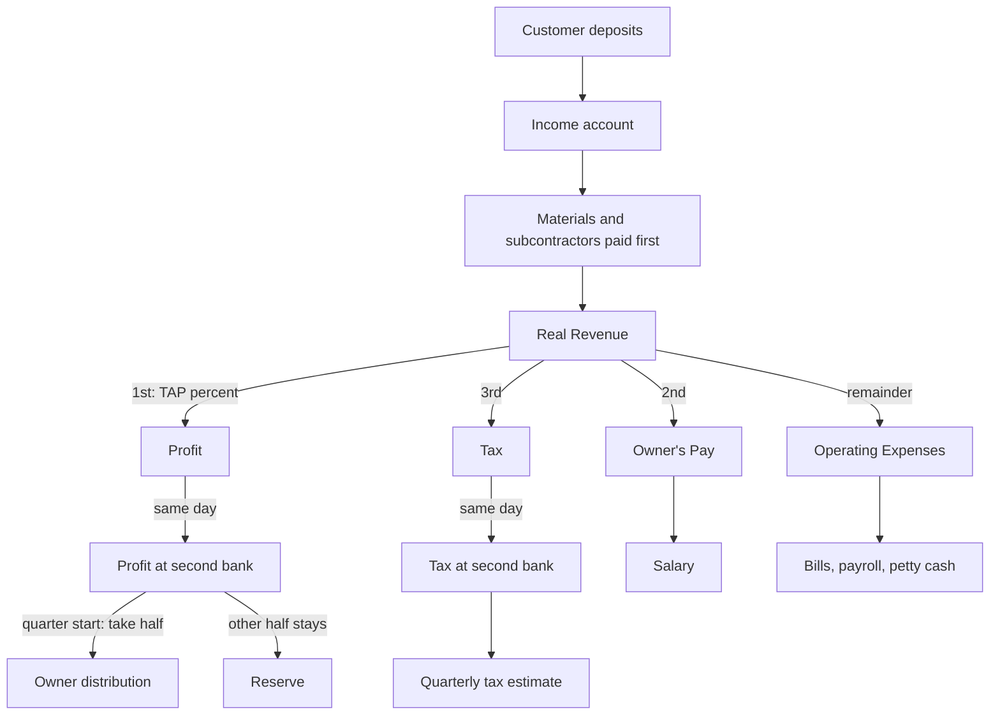

# 02. Cash Allocation

A bank-account system for small businesses that takes profit, owner pay and tax out of every deposit before anything is spent, so profit is a habit and not a leftover.

> **Based on:** *Profit First: Transform Your Business from a Cash-Eating Monster to a Money-Making Machine* by Mike Michalowicz (2014). [Bookshop](https://bookshop.org/book/9780981808291)

## At a glance

| Framework | In one line | Use it when |
| --------- | ----------- | ----------- |
| Profit First formula | Sales - Profit = Expenses, not Sales - Expenses = Profit | You never seem to have profit left over |
| Survival Trap | Crisis-driven selling and spending that loops | Cash is tight and you "just sell" |
| Small plates (four principles) | Small plates, serve sequentially, remove temptation, keep a rhythm | Designing any money habit |
| Instant Assessment | Compare last year's actuals to target percentages on real revenue | Starting, or checking health |
| Target Allocation Percentages (TAPs) | Share of each deposit per account by revenue tier | Setting the targets |
| Core accounts | Income/Operating, Profit, Owner's Pay, Tax (plus two hidden ones) | Setting up the bank |
| 10/25 rhythm | Allocate and pay bills on the 10th and 25th | Running it week to week |
| Quarterly distribution | Take half the profit balance, keep half | First day of each quarter |
| Advanced accounts | Vault, Drip, Pass-Through, Stocking and others | After two quarters of the basics |
| Debt Freeze and Snowball | Stop new debt, then kill the smallest first | Business or personal debt |
| Efficiency and client pruning | Double results for half the effort; drop weak clients | Making room for the percentages |

## The idea: flip the formula

- Normal accounting: **Sales - Expenses = Profit**. Profit is what is left, which is usually nothing, because spending expands to fill whatever arrives.
- Profit First: **Sales - Profit = Expenses**. Take profit off the top, then run the business on what remains. If the rest is not enough, the business is telling you it cannot afford its costs; the answer is to cut or sell better, never to raid the profit.
- This is about managing cash behaviour, not replacing the books. You still need the income statement, balance sheet and cash flow (see [[1. Reading the Numbers|Reading the Numbers]], [[3. Accounting Basics|Accounting Basics]]).

### Why normal accounting backfires

- **Bank-balance accounting**: one pool of money, so everything looks spendable; tax, your pay and profit become afterthoughts.
- **Top-line thinking**: revenue is the headline number, so the reflex is "sell more".
- Human nature: whatever income arrives, we find "necessary" ways to spend all of it. More revenue then brings more expenses, and more variety, and more mess.
- **Survival Trap**: crisis makes you take any client and any money, which leads to bad clients, scattered offerings, then another crisis. A cautionary story in the book: a café owner using collected sales tax to pay other bills, then facing the tax authority.
- Revenue is not equal revenue: some costs far more to earn than other revenue.

### The diet analogy: four principles

| Principle | In the diet | In the business |
| --------- | ----------- | --------------- |
| Small plates | Smaller plate, smaller portion, same habit | Spendable account holds only a slice of each deposit |
| Serve sequentially | Vegetables first | Always move money to Profit, then Owner's Pay, then Tax, remainder to expenses |
| Remove temptation | Junk food out of the house | Profit and tax money in a second bank, hidden, no cards, no online view |
| Enforce a rhythm | Eat often so you never binge | Allocate and pay on fixed dates twice a month |

## Real Revenue

- Percentages are applied to **Real Revenue**, not top-line revenue.
- Real Revenue = revenue - materials - subcontractors (the costs you pass on and barely control). Your own employees are not subtracted; they are paid whether the day is good or bad.
- If nearly all delivery is by your own staff, Real Revenue is simply revenue.
- Resellers and manufacturers: base it on gross profit.
- Why it matters: a firm taking 5,000,000 in fees and passing 4,000,000 to commissioned agents is a 1,000,000 business to manage.
- Different from gross profit: gross profit would also subtract the staff time on the work.

## Instant Assessment

Do it with the last twelve months.

1. Top line revenue.
2. Materials and subs (if any).
3. Real Revenue = 1 - 2.
4. Actuals: profit (cash really kept or paid out as a bonus), owner's pay (regular payroll), tax paid or reserved, operating expenses (the rest).
5. Check: profit + pay + tax + expenses = Real Revenue.
6. Pick the column below, multiply Real Revenue by each percentage to get target dollars.
7. **Bleed** = actual - target. Negative on profit, pay or tax means you are under-funding them. Positive on expenses means overspending. Write "increase" or "decrease" against each.

Law-firm style example from the book: 1,233,000 Real Revenue; profit actual 5,000 against a 123,000 target; owners paid 190,000 against 123,000; tax short by about 90,000; expenses 141,000 too high. Fix: cut pay and costs.

## Target Allocation Percentages (TAPs)

Share of **Real Revenue** per bucket, by annual Real Revenue range. These are destinations, not where to begin.

| Real Revenue range | A: 0 - 250K | B: 250K - 500K | C: 500K - 1M | D: 1M - 5M | E: 5M - 10M | F: 10M - 50M |
| ------------------ | ----------- | -------------- | ------------ | ---------- | ----------- | ------------ |
| Profit | 5% | 10% | 15% | 10% | 15% | 20% |
| Owner's Pay | 50% | 35% | 20% | 10% | 5% | 0% |
| Tax | 15% | 15% | 15% | 15% | 15% | 15% |
| Operating Expenses | 30% | 40% | 50% | 65% | 65% | 65% |

- Pattern: owner pay shrinks as you move from doing the work to running systems and managers; operating expenses rise through the 1M to 5M zone because systems become mandatory, and profit climbs again later. Founder income shifts from salary to profit distributions.
- Percentages beat dollar sizes: they show health relative to size.
- The percentages come from the author's experience, not a law. Tune them to your industry.

### Tuning your own

- **Profit**: average net margin of five public firms in your sector over 3 to 5 years, or your best year as a percentage, or just the table. Rule of thumb for runway if sales stopped dead: 5% allocation is about 3 weeks of operating cash, 12% about 2 months, 24% about 5 months (higher profit also means leaner costs, so reserves stretch further). Very fat margins attract competitors and price cuts, so keep improving efficiency.
- **Owner's Pay**: the market salary for the work you actually do most of the time (not "CEO" if you spend most of the time selling or delivering), times 1.25 for headroom. Do not cut your own pay to make the numbers work.
- **Tax**: use past returns as a percentage of Real Revenue, your accountant's year-to-date estimate, or tax tables for your country. The author's rough rule uses about 35% of the non-expense share: with 55% to expenses, 45% x 35% is roughly 16%. Check with an accountant; for South Africa see [[5. South African Tax and Compliance|South African Tax and Compliance]].
- A brand-new business with no history: start at 1% profit, 50% owner pay, 15% tax and step up quarterly.

## Account setup

Core accounts, named with their percentage in the nickname (for example "PROFIT [15%]"):

```text
Bank 1 (daily)                       Bank 2 (a different bank, hidden)
  Income / Operating Expenses  ----->  Profit  (no cards, no online view)
  Owner's Pay                  ----->  Tax     ("the government's money")
  Profit      (holding tray)
  Tax         (holding tray)
```

- Keep the existing checking account as Operating Expenses. Add Owner's Pay (checking), and Profit and Tax (savings or checking, they are only holding bins).
- Two more savings accounts at a second bank are the "no temptation" versions of Profit and Tax. Switch off online view, cheques and debit cards. Use auto-transfer from the first bank.
- Disable any grand-total balance view, which puts everything back on one plate.
- Negotiate fees and minimum balances; change banks if the bank will not.
- Tell your accountant first. If they dismiss it, a bookkeeper who knows the method helps. The objection "one account plus ledger categories is enough" misses the behaviour point: the separate accounts are the guardrail.

## Day one to year one

### Start small

- Start from your current share and add 1 percentage point to each (history of no profit becomes 1%). The goal is a routine you hardly feel.
- Allocate what is available today: balance minus unpaid cheques, split by your percentages.
- You just diverted roughly 3 points; cut costs by 10% to cover it. Cancel what you do not need, negotiate the rest (except payroll).
- Each quarter, move toward the TAPs by about 3 points in total across the buckets. Never step backward: that destroys the habit.

### The 10/25 rhythm

Do money admin only on the 10th and the 25th (or the business day before). Bills then arrive on time by mid-month and month end.

Worked example (percentages 10% profit, 25% owner, 15% tax, 50% opex; fixed amounts 3,000 payroll, 100 petty cash). Deposits since the last run: 20,000.

| Step | Move | Amount |
| ---- | ---- | ------ |
| 1 | Profit 10% | 2,000 |
| 2 | Owner's Pay 25% | 5,000 |
| 3 | Tax 15% | 3,000 |
| 4 | Operating Expenses 50% (stays) | 10,000 |
| 5 | Transfer fixed sums out of opex: employee pay and petty cash | 3,000 and 100 |
| 6 | Move whole Profit and Tax balances to the hidden second bank | 2,000 and 3,000 |
| 7 | Pay yourself your set salary, staff from payroll, bills from what remains (6,900) | |



- If you cannot cover payroll and bills after the allocations, costs exceed what the business supports: cut, renegotiate, or raise revenue. Do not dip into the other accounts.
- Seeing the same two cut-off dates, you spot patterns: when bills cluster, which small recurring costs add up, where cash really goes. It also makes you pay vendors consistently.
- Revenue is uneven, so percentages smooth it: surplus in Owner's Pay accumulates and covers lean months. Set a sustainable salary from the average of your worst three months times the owner percentage, and raise it by quarter if the account keeps growing. Do not treat the best month as normal.
- **Required Income For Allocation (RIFA)**: owner pay wanted per period / owner pay percentage. For example 5,000 a half-month at 31% needs a bit over 16,000 deposited each period. Use this instead of a "monthly nut" of expenses, which keeps you focused on covering costs.

### Quarterly

- On the first day of the quarter, take **half** of the Profit account as a distribution to owners (split by ownership), leave half as a reserve. Do not count that day's new allocations.
- Spend it on yourself: the distribution is the reward. "Plowing back" or "reinvesting" it is just lending it to the business again.
- Pay quarterly tax estimates, review percentages, and move one step closer to the TAPs.

### Yearly

- Finalise tax. If the tax account is short, this is the one time Profit may be used to cover it (and raise the tax percentage by the same amount you lower profit). If there is extra, move it to Profit.
- Growing profit means growing tax. Estimates based on last year will undershoot.
- Once the reserve exceeds a three-month operating cushion, consider capital investments that raise efficiency, or fund the Vault.

## Advanced accounts

Add only after at least two quarters of clean basics. Each gives a clear picture of a specific pool of money.

| Account | Purpose |
| ------- | ------- |
| Income | Collect all deposits; separates money in from money out; allocate from here on the 10th and 25th |
| Vault | Very low-risk, hard-to-reach emergency fund; build to a three-month reserve; write the rules for using it in advance |
| Stocking | Saves for periodic bulk purchases (for example a 5,000 order every 10 months: put 250 aside at each of the 20 allocations) |
| Pass-Through | Reimbursed costs and at-cost income, which are not profit or pay |
| Materials | Cash earmarked for materials when most revenue is pass-through |
| Subcontractor or Commission | Same, for contractors and commissioned staff |
| Employee Payroll | Fixed sum each run covering gross pay and payroll taxes |
| Major Equipment | Monthly sum / 2 per run toward future big kit |
| Drip | Up-front or retainer payments: park them, release only what has been earned each period (120,000 for a year of work drips 10,000 a month) |
| Petty Cash | Small fixed sum on a debit card for incidentals |

### Other tactics

- **Pareto overlap**: roughly 20% of clients bring 80% of revenue and 20% of offerings bring 80% of profit. Look at both together: drop weak clients who buy unprofitable work, retune weak clients who buy profitable work, bring profitable offerings to top clients, and clone the overlap.
- **Employee formula**: a full-time person should be supported by about 150,000 to 250,000 of Real Revenue as a minimum. Another rule credited to Greg Crabtree: Real Revenue should be at least 2.5 times total labour cost for skilled-labour firms and 4 times for low-cost labour firms.
- **Make tax money unattractive to raid**: rename the Tax account "the government's money", hide accounts, send outside income (payment platforms, foreign accounts) to the Income account every day, use bank-processed payments so money leaves the moment you pay, set balance alerts for the 10th, 15th, 24th and 30th.
- **Priority tags for tasks**: mark tasks that will earn money within about 60 days, serve a top client, or build a repeatable system; do those that earn all three first.
- **Accountability**: a pair or a group of three to ten that meets on about the 11th and 26th, sharing Profit and Tax balances, challenges and wins, no business dealings between members, one person who validates the numbers.
- **Personal finance**: the same pattern works at home (Income, Vault, Recurring Payments, Day-to-Day, Debt Destroyer accounts).

## Debt and efficiency

### Debt Freeze

- Stop new debt. Mark up the last 12 months of expenses: labour, costs needed to earn revenue now, costs needed to keep the doors open, recurring items.
- Total the yearly spend (excluding tax and owner pay), divide by 12. Compare with the opex target from the assessment and cut, aiming for 10% **below** target, in one go rather than slowly.
- Keep the muscle (what delivers) and cut the fat.

### Debt Snowball

- Pay minimums on everything, put all spare cash on the **smallest** debt, then roll its payment onto the next. Momentum beats interest-rate optimisation for most people. No new debt while paying down.
- Tax tip: repayments of debt are not an expense, so as debts fall tax may rise (the book's "paying for your sins").

### Make the percentages possible

- Efficiency first, then sales. Aim for twice the result with half the effort in one area at a time. Think big step, not 5 minutes faster.
- Fewer offerings to the same kind of customer is the route to efficiency.
- Prune clients. A study quoted in the book split clients by revenue into quarters: the top quarter brought 89% of revenue and about 150% of profit, the bottom quarter 1% of revenue and a 50% loss, with similar effort per client. Fire the weakest politely and clone the best.
- Profit margins get competed away over time, so keep finding efficiency.

## Common mistakes

| Mistake | Why it hurts | Fix |
| ------- | ------------ | --- |
| Starting with 20 to 30% profit | Cannot be afforded, money gets pulled back, habit dies | Start at current + 1 point, step up each quarter |
| Cutting costs that create efficiency | Old tools can cost more in quality and speed | Keep or buy what lowers cost per result |
| "Plowing back" profit | Borrowing from yourself under a nicer name | If opex is short, cut costs |
| Credit card as operating line | It is debt, a sign costs are too high | Freeze, keep for real emergencies |
| Raiding the tax account | Tax grows as profit grows; estimates lag | Treat it as the government's money; ask the accountant quarterly |
| Going back to one account | The habit needs the separation | Keep the structure |
| Believing "it takes money to make money" | Keeps you in the trap | Efficiency first |
| Skipping the accountability partner | Willpower fades | Join or start a group |
| Treating best month as normal | Over-hiring and over-spending | Plan from the worst three months |

## Caveats

- Percentages, tax rates and tax advice in the book are US-centred. Cross-check the tax share with a local accountant. Sales tax or VAT you collect is not yours: hold it aside, never use it as working cash.
- It is a behavioural system for owner-managed small firms, not a substitute for statements, budgeting or corporate-finance thinking ([[4. Corporate Finance and Valuation|Corporate Finance and Valuation]]).
- The thresholds are rules of thumb from one author's practice. Treat them as starting points.

## Recall

**Q: What is the Profit First formula and why flip it?**

??? note "Answer"
    Sales - Profit = Expenses. With the usual Sales - Expenses = Profit, spending grows to use all the money and profit is the scrap at the end. Taking profit first forces the business to live on what remains and become efficient.

**Q: In what order is each deposit allocated, and what is the percentage base?**

??? note "Answer"
    Profit, then Owner's Pay, then Tax, then the remainder to Operating Expenses. Percentages apply to Real Revenue: revenue minus materials and subcontractors. Do it on the 10th and 25th.

**Q: How do you start without crushing cash flow?**

??? note "Answer"
    Take your current share for each bucket and add 1 percentage point, cut expenses 10 percent to fund it, then move about 3 points a quarter toward your targets. Never step back.

**Q: What happens on the first day of each quarter?**

??? note "Answer"
    Take half of the Profit balance as an owner distribution to spend on yourself, leave half as reserve, pay tax estimates, and bump the percentages toward the targets.

**Q: Why keep Profit and Tax at a second bank with no cards or online view?**

??? note "Answer"
    The system works with human behaviour: out of sight, out of reach. If the money is easy to see and move, it gets "borrowed" for bills and the habit collapses.

## Links

- [[1. Reading the Numbers|Reading the Numbers]] for why profit is not cash and how working capital behaves.
- [[3. Accounting Basics|Accounting Basics]] for the statements underneath.
- [[5. South African Tax and Compliance|South African Tax and Compliance]] for tax and VAT obligations.
- [[2. Running on Systems|Running on Systems]] and [[3. Operating Rhythm|Operating Rhythm]] for the systems and rhythm ideas.
- [[1. Value-Based Pricing|Value-Based Pricing]] for raising margin on the revenue side.
