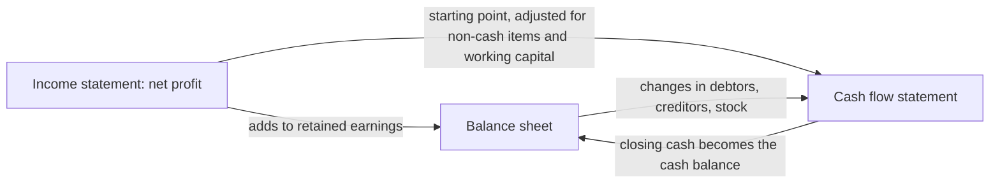

# 03. Accounting Basics

How the books work: recording transactions, producing the three statements, and keeping the habits that make the numbers trustworthy.

> **Not from the library.** General reference material written to fill a gap in the books in this section.

Pairs with [[1. Reading the Numbers|Reading the Numbers]] (interpreting the statements) and [[2. Cash Allocation|Cash Allocation]] (what to do with the cash). This note is about producing the numbers in the first place.

## At a glance

| Framework | In one line | Use it when |
|---|---|---|
| Double-entry | Every transaction hits two accounts, debits equal credits | Recording anything |
| Accounting equation | Assets = Liabilities + Equity | Sanity-checking that the books balance |
| Chart of accounts | The numbered list of buckets money can go in | Setting up books, or tidying messy ones |
| Journals and ledgers | Journal = chronological record, ledger = per-account totals | Tracing a number back to its source |
| Accrual vs cash basis | Record when earned/incurred vs when cash moves | Choosing a method, reading profit vs cash |
| Three statements | Income statement, balance sheet, cash flow, linked | Reporting and diagnosing |
| Depreciation | Spread an asset's cost over its useful life | Buying equipment, vehicles, laptops |
| Inventory and revenue recognition | When cost and sales hit the books | Selling goods or long projects/subscriptions |
| Management accounts | Monthly internal pack, faster than annual statements | Running the business monthly |
| Bookkeeping habits | Small recurring routines | Always |

## Double-entry
- Every transaction has at least two sides; total debits = total credits.
- Debit and credit are just left and right; what they do depends on the account type.

| Account type | Increases with | Decreases with |
|---|---|---|
| Asset (cash, debtors, equipment) | Debit | Credit |
| Expense | Debit | Credit |
| Liability (creditors, loans) | Credit | Debit |
| Equity (capital, retained earnings) | Credit | Debit |
| Income | Credit | Debit |

- Worked example: you invoice a client R10 000 for work done.
    - Debit Debtors (asset up) R10 000
    - Credit Sales (income up) R10 000
    - Client pays: Debit Bank R10 000, Credit Debtors R10 000.
- Why it matters: errors show up as an unbalanced trial balance instead of hiding.
- Mistake: forcing a balance with a "suspense" entry and never clearing it.

## The accounting equation
```
Assets = Liabilities + Equity
Equity = Capital introduced + Retained profit - Drawings/dividends
```
- Every transaction keeps this true; it is the check behind the balance sheet.
- Example: owner puts in R50 000 cash (assets +50 000, equity +50 000). Then buys a R20 000 laptop on credit (assets +20 000, liabilities +20 000). Result: assets R70 000 = liabilities R20 000 + equity R50 000.

## Chart of accounts
- Numbered list of every account; fixes how transactions are categorised.
- Common numbering convention (not a rule): 1xxx assets, 2xxx liabilities, 3xxx equity, 4xxx income, 5xxx cost of sales, 6xxx expenses.
- Keep it small and meaningful: one account per thing you will want to see in a report.
- Design for the decisions you make (e.g. separate software subscriptions from travel if you track them).
- Mistake: a giant "general expenses" bucket, or 200 accounts for a five-person business.

## Journals and ledgers
- Journal: every entry in date order with description, accounts, amounts.
- General ledger: the same entries grouped per account, with a running balance.
- Trial balance: list of all ledger balances; debits should equal credits. Statements are built from it.
- Subledgers (debtors, creditors) hold per-customer/supplier detail; their totals must agree with the control account in the ledger.
- Adjusting journals at period end: accruals, prepayments, depreciation, stock count.

## Accrual vs cash basis

| | Cash basis | Accrual basis |
|---|---|---|
| Income recorded | When money arrives | When earned (invoiced/delivered) |
| Expense recorded | When money leaves | When incurred |
| Pro | Simple, matches bank | Shows true performance and obligations |
| Con | Distorts timing, hides debts | More bookkeeping |

- Accruals: expenses incurred not yet paid (e.g. December electricity billed in January). Prepayments: paid in advance for a future period (annual insurance).
- Example: R12 000 annual software paid in January. Cash basis: R12 000 expense in January. Accrual: R1 000 per month.
- Matching principle: put costs in the same period as the revenue they helped earn.
- Mistake: judging a business on cash-basis profit while customers owe it large unpaid invoices.
- Profit is not cash; see [[1. Reading the Numbers|Reading the Numbers]].

## The three statements and how they connect

| Statement | Question | Period |
|---|---|---|
| Income statement | Did we make a profit? | Over a period |
| Balance sheet | What do we own and owe? | At a date |
| Cash flow statement | Where did cash come from and go? | Over a period |



- Net profit flows into retained earnings (equity) on the balance sheet.
- Cash flow starts from profit, adds back non-cash items (depreciation), then adjusts for working-capital changes (more debtors = less cash).
- Closing cash on the cash flow statement must equal cash on the balance sheet.
- Cash flow sections: operating, investing (buying assets), financing (loans, equity, dividends).
- Mistake: reading only the income statement and missing a cash squeeze from growing debtors.

## Depreciation
- Allocates the cost of a long-life asset over its useful life, instead of expensing it all at purchase.
- Straight-line:
```
Annual depreciation = (Cost - Residual value) / Useful life
```
- Example: R30 000 equipment, R0 residual, 5 years: R6 000 per year expense; book value is R30 000 at purchase, R24 000 after year 1, R18 000 after year 2, and so on to R0.
- Depreciation is non-cash: it reduces profit but not bank balance.
- Accounting depreciation and tax allowances (wear and tear) are separate calculations and often differ.
- Mistake: expensing everything bought, or never depreciating and overstating assets.

## Inventory and revenue recognition basics
**Inventory**
- Hold at the lower of cost and net realisable value (what you can sell it for less selling costs).
- Cost-flow methods: FIFO (first in, first out) and weighted average are the common ones; keep one consistently.
- Cost of sales = Opening stock + Purchases - Closing stock.
- Example: opening R20 000 + purchases R80 000 - closing R30 000 = cost of sales R70 000.
- Mistake: skipping stock counts, so gross margin is a guess.

**Revenue recognition**
- Core idea: recognise revenue when you transfer the goods or services to the customer, in the amount you expect to be entitled to, not when you invoice or get paid.
- Goods: usually on delivery. Services: over time as delivered. Subscriptions: spread across the term. Deposits received in advance are a liability (deferred revenue) until earned.
- Example: R12 000 annual subscription paid upfront = R1 000 revenue per month; the unearned balance sits as a liability.
- Mistake: booking a whole multi-month contract as revenue on signing.

## Frameworks: IFRS for SMEs
- Full IFRS is written for listed and large entities; **IFRS for SMEs** is a simplified standard for entities without public accountability.
- In South Africa the Companies Act regulations tie the financial reporting standard a company uses to its public interest score and whether it is audited or independently reviewed; small private companies commonly use IFRS for SMEs. The Financial Reporting Standards Council (FRSC) issued the standard locally.
- The IASB published a third edition on 27 February 2025, effective for periods starting on or after 1 January 2027 (early adoption allowed), per the IFRS Foundation (as of November 2026).
- Who uses what (Companies Regulations 2011, reg 27, as of November 2026): public interest score of 350 or more must use IFRS, or IFRS for SMEs if the scoping criteria are met; 100 to under 350 may use IFRS, IFRS for SMEs or SA GAAP; under 100 may use those if independently compiled, otherwise a framework of its choice. A company may always use a fuller standard than required.
- Not confirmed: I found no official source stating how the third edition is recognised in South African regulation (the regulations refer to the standard as issued by the IASB; the public interest score is under dtic review). Confirm with CIPC, the FRSC or your accountant.
- Very small entities may use other permitted frameworks; the choice affects audit/review requirements, see [[5. South African Tax and Compliance|South African Tax and Compliance]].

## Management accounts
- Internal monthly pack: income statement vs budget and prior period, balance sheet, cash flow, debtors and creditors ageing, a few KPIs.
- Annual financial statements are late and compliance-driven; management accounts are for steering.
- Target: ready within about 10 working days of month end (a practical norm, not a rule).
- Review checklist: margin trend, overheads vs budget, debtor days, cash runway, one-off items.
- Mistake: producing it and never discussing variances.

## Bookkeeping habits
- Separate business and personal bank accounts; never mix.
- Capture every receipt and invoice the day it arrives (photo or scan).
- Reconcile the bank monthly; unreconciled items older than a month are red flags.
- Issue invoices promptly; chase overdue debtors on a fixed schedule.
- Record owner's drawings and loans explicitly, not as expenses.
- Back up records and keep them for the legally required period (see tax note).
- Close each month: lock the period so old entries cannot change quietly.
- Use accounting software, but understand the entries it makes for you.

## Recall

**Q: State the accounting equation and what a double-entry rule guarantees.**

??? note "Answer"
    Assets = Liabilities + Equity. Every transaction has equal debits and credits, so the equation always balances and errors surface in the trial balance.

**Q: Why can a profitable business run out of cash?**

??? note "Answer"
    Accrual profit counts sales when earned, but cash arrives later. Growing debtors, stock purchases, loan repayments and asset purchases consume cash without reducing profit.

**Q: How do the three statements connect?**

??? note "Answer"
    Net profit moves into retained earnings on the balance sheet and is the starting point of the cash flow statement; closing cash on the cash flow must equal the cash on the balance sheet.

**Q: A R30 000 asset with 5-year life and no residual value: annual straight-line depreciation?**

??? note "Answer"
    R6 000 per year, a non-cash expense.

## Links
- [[1. Reading the Numbers|Reading the Numbers]]
- [[2. Cash Allocation|Cash Allocation]]
- [[4. Corporate Finance and Valuation|Corporate Finance and Valuation]]
- [[5. South African Tax and Compliance|South African Tax and Compliance]]
